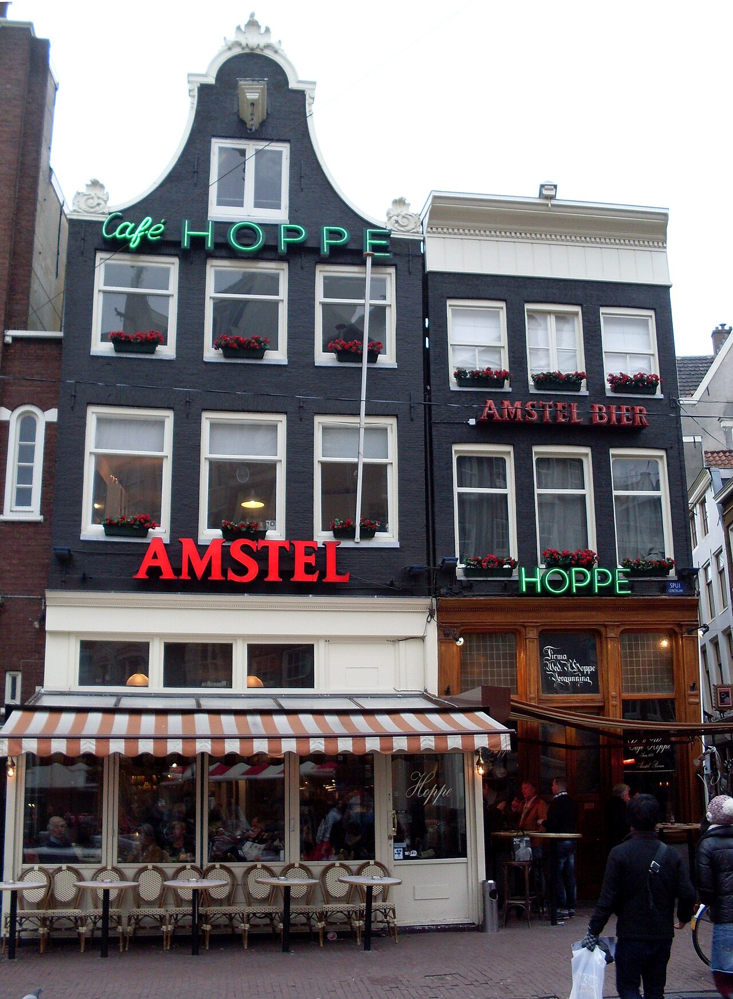

# Café Hoppe

Spui 广场的东南角，两栋窄窄的荷兰式立面连在一起：左边是 18 号，绿色霓虹“Café HOPPE”挂在深色砖墙上；右边是 20 号，红色“AMSTEL”与绿色“HOPPE”并排。门口没有大招牌，只有一张小吧桌和几个端着啤酒杯站着的人。推门进去，先是 standing bar 的拥挤与啤酒龙头，再往里走，才是坐着喝的 salon。阿姆斯特丹人把这种店叫 bruin café（棕色咖啡馆），Hoppe 是其中最老、也最完整的一间。

图：Spui 18–20 号的 Café Hoppe 双立面，绿色霓虹与 Amstel 招牌。图片：Marcelmulder68，CC BY-SA 3.0 nl，via Wikimedia Commons（[原图页面](https://commons.wikimedia.org/wiki/File:Spui_nr._18_en_20.jpg)）。

## 1670 年：Café Hoppe的关键起点
Café Hoppe 官方说它自 1670 年起就在 Spui 这个位置卖酒。18 号是国家保护的 rijksmonument，室内外基本没有大改；20 号原本是一间酒店/餐厅，20 世纪初并入 Hoppe 的经营。1930 年代，Harry Mustert 给店取了今天的名字“Hoppe”，并把 18 号与 20 号打通，形成两个不同的空间：18 号是站着喝的“standing Hoppe”，20 号是坐着喝的“sitting Hoppe”。这个布局一直保留到今天，也是 Hoppe 最容易被误解的地方——它不是一间店，而是两间连体店。

Hoppe 的历史里有很多荷兰政治与文化的脚注。Hans van Mierlo 与 D66 的早期讨论在这里发生，年轻的 Beatrix 公主来过，Freddy Heineken 是常客；这些故事被官方 About 页当作“Hoppe 是阿姆斯特丹客厅”的证据。2013 年，Misset Horeca 把它评为荷兰最佳咖啡馆；今天由 Jan-Wieger van der Linden 与 Pepijn Zonneveld 经营。它没有因为游客多而改成“荷兰主题酒吧”，仍然卖 jenever、Amstel 与简单的酒馆食物。

## 建筑与空间

18 号是典型的阿姆斯特丹老建筑：深色砖墙、白色窗框、绿色霓虹、窄门与高窗。室内是深色木饰、镜面、黄铜啤酒龙头、旧海报与 standing bar 的长台面；没有舞台，没有背景音乐，客人靠得很近，谈话声就是全部的声场。20 号的 salon 更宽，桌子更多，靠窗的位置能看到 Spui 的行人与书市；墙上挂着 Hoppe 的旧照片与 Amstel 的广告。

两栋楼之间的动线是 Hoppe 的核心体验：站在 18 号喝一杯，再走到 20 号坐下来吃一点；或者反过来，先坐再站。高峰时 18 号几乎无法转身，杯子要举高；20 号相对安静，适合两三个人。想拍照的话，门口的双立面与绿色霓虹最好看；室内光线暗，不要用闪光灯对着客人。

## 酒单与味觉

Hoppe 的核心是 jenever 与啤酒。jenever 是荷兰的杜松子酒，通常比英国 gin 更甜、更麦芽，常以小杯（borrel）配啤酒一起喝；Hoppe 有自己的“Firma H.J. Hoppe” jenever 标签，也有年轻与陈年版本。啤酒以 Amstel 为主，另有季节啤酒与 radler；酒单不长，但足够覆盖“站着喝一杯”的场景。食物是荷兰酒馆风格：bitterballen、奶酪块、炸肉丸、三明治与简单的冷盘。

点单时可以直接说“een jenever”或“een biertje”；如果不确定 jenever 的类型，让服务员推荐年轻（jong）或陈年（oud）。年轻 jenever 更干净、更烈，陈年更圆、更甜；配一杯 Amstel 或苦味酒（bitter）是阿姆斯特丹的标准组合。不要期待花式鸡尾酒或精致 wine list；Hoppe 的价值在“老木头、冷啤酒、低声谈话”，不是调酒表演。

## 怎么喝

最佳时间是下午四点到傍晚，或晚上九点后。下午 Spui 的书市与行人还在，站在门口喝一杯最舒服；晚上 18 号会挤满本地人与游客，20 号则更适合坐下来。周末与国王节（King’s Day）非常拥挤，想安静就避开。Hoppe 不放音乐，所以谈话不需要喊；这也意味着不要带蓝牙音箱或大声外放。

点单时先看你在 18 号还是 20 号：18 号通常吧台点、站着喝；20 号可以找桌子，由服务员点。喝完的空杯放回吧台或桌上，不要带到街上。想抽根烟，到门外指定的位置，不要站在门口堵路。结账时服务费通常已包含，仍可按服务留零钱。

## Café Hoppe的地址与营业安排
- 地址：Spui 18-20, 1012 XA Amsterdam。
- 营业：周日至周四 09:00–01:00；周五至周六 09:00–02:00（官方 Contact）。
- 交通：电车 2、11、12 到 Spui；地铁 52 到 Rokin，步行 3 分钟。
- 预订：不接受预订，现场找位；团队建议分开到店。
- 价格：啤酒与 jenever 属阿姆斯特丹中等价位；食物与小食更便宜。
- 支付：银行卡与现金都常见；小额消费建议备零钱。
- 无障碍：门口有台阶，18 号通道窄；轮椅建议从 20 号入口或提前联系。

## 礼仪与常见误区

第一，不要把 Hoppe 当成一间“安静咖啡馆”；它是 bruin café，谈话声、啤酒杯与 standing bar 是核心。第二，不要以为 18 号与 20 号是两家店；它们是同一间 Hoppe 的两个空间，账单与规则可能不同。第三，不要点“花式鸡尾酒”或“拿铁艺术”；这里主打 jenever、啤酒与简单酒馆食物。第四，不要用闪光灯拍室内；老木头、镜面与陌生人都不适合被闪光。第五，不要在门口大声外放音乐；Hoppe 的传统就是不放背景音乐。第六，不要把“1670 年”当成 18 号建筑的全部年份；18 号是历史建筑，20 号是后来并入的酒店/餐厅。

## 从Café Hoppe延伸到Café De Dokter
从 Hoppe 出门就是 Spui 广场与书市，往北是 Kalverstraat 与 Begijnhof，往东是 Amsterdam Museum 与 Rokin，往南是 Singel 与花市。可以把这一站排成“Spui 书市 → Hoppe 站着喝一杯 → Begijnhof → Amsterdam Museum → 晚上 De Dokter”。若想把阿姆斯特丹的“小酒吧”做成一条路线，先到 Hoppe 感受 standing/sitting 的双空间，再步行五分钟到 [Café De Dokter](ref:dokter) 看 18 平方米的极限尺度；[Heineken Experience](ref:heineken) 是啤酒品牌博物馆，[De Halve Maan](ref:halve-maan) 与 [Cantillon](ref:cantillon) 则是比利时啤酒厂/酒馆的对照。若把“历史咖啡馆”放进更大脉络，里斯本的 [A Brasileira](ref:brasileira) 是另一座城市的文学咖啡馆样本。

**关键事实。**

| 项目 | 内容 |
| --- | --- |
| 一句话定位 | 阿姆斯特丹 Spui 18–20 号的 Café Hoppe，自 1670 年起就在这个街角卖酒；18 号是国家级保护建筑，20 号原为酒店/餐厅，1930 年代 Harry Mustert 把两栋打通并定名 Hoppe，形成“站着喝的 Hoppe”与“坐着喝的 Hoppe” |
| 地址 | Spui 18-20, 1012 XA Amsterdam, Netherlands |
| 城市/国家 | 阿姆斯特丹 / 荷兰 |
| 营业状态 | 已核验营业 |
| 官网 | cafehoppe.com |

**来源与边界。** 本页关于「Café Hoppe」的关键事实，主要由以下来源交叉核对：Café Hoppe（Spui 18–20 地址、周日至周四 09:00–01:00、周五至周六 09:00–02:00 的营业时间与交通说明）、Amsterdam Now（交叉核对“350 年历史”、bruin café 定位、Spui 街角与站/坐两种空间）、I amsterdam（“不放音乐”的咖啡馆传统与 Hoppe 的安静交谈氛围）。产品、地址或营业状态变化较快时，以 cafehoppe.com 的最新页面为准；价格、批次与状态会变，涉及这些字段时以页面所列来源的最新版本为准。正文为项目自写，来源只作核验，不复制原文。

**并读。** 把「Café Hoppe」与「Café De Dokter」、「喜力体验馆：老啤酒厂的第二次生命」、「半月酒厂」放在一起读时，先确认它们是同一层级还是上下游关系：先确认地址与营业状态，再比较历史、空间与点单体验。本页负责给出场所的基本坐标，对照条目补上具体案例与差异；读完再回到本页，才能分清哪些差别属于场所本身，哪些只是产地、批次或品牌选择。

## 参考资料
- Café Hoppe 官方 About 页：<https://cafehoppe.com/en/about/>，用于核对 1670 年、18/20 号、Harry Mustert、standing/sitting Hoppe 与 2013 年荷兰最佳咖啡馆。
- Café Hoppe 官方 Contact 页：<https://cafehoppe.com/en/contact/>，用于核对地址与营业时间。
- Amsterdam Now 的 Hoppe 文章：<https://www.amsterdamnow.com/uitgaan/cafe-hoppe-op-het-spui-bruine-kroeg-met-350-jaar-geschiedenis/>，用于交叉核对 bruin café 定位与 350 年历史。
- I amsterdam 的“不放音乐咖啡馆”页面：<https://iamsterdam.nl/zien-en-doen/cafes-zonder-muziek>，用于核对 Hoppe 的安静传统。
- 同城的 `place:cafe-de-dokter` 是 18 平方米的微型酒吧，`place:heineken-experience` 是啤酒品牌博物馆，`place:de-halve-maan` 与 `place:cantillon-brewery` 是比利时啤酒文化样本。
- 相关条目：[Café De Dokter](ref:dokter)、[Heineken Experience](ref:heineken)、[De Halve Maan](ref:halve-maan)、[Cantillon](ref:cantillon)、[A Brasileira](ref:brasileira)
