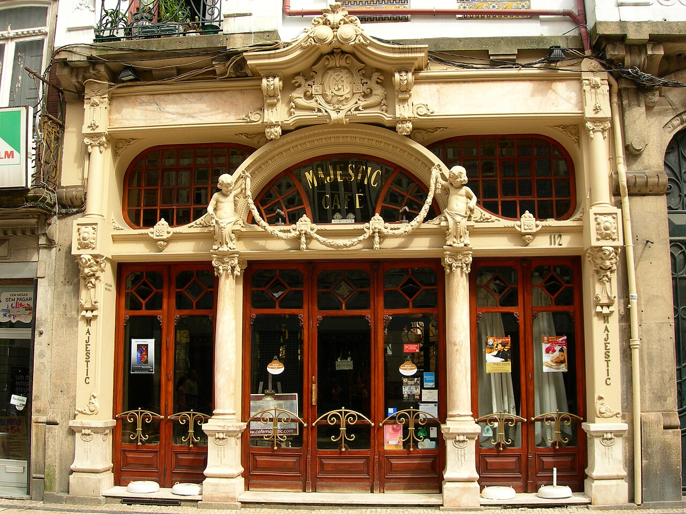

# 马杰斯蒂克咖啡馆

波尔图的 Rua de Santa Catarina 是条繁忙的步行街，商店、咖啡馆与剧院挤在一起。走到 112 号，会看到一面白色大理石立面，门楣上写着“MAJESTIC”，门口有 brass 门把手与老式旋转门。推门进去，先是深色木饰、镜面、雕花天顶与皮革座椅，然后是一间玻璃温室，把 Santa Catarina 与后面的 Passos Manuel 两条街连起来。它不像巴黎咖啡馆那样“向外看”，而是把客人包进一个 1920 年代的新艺术盒子里。

图：Café Majestic 的新艺术正立面与“MAJESTIC”招牌，Rua de Santa Catarina 112。图片：Maragato1976，CC BY-SA 3.0，via Wikimedia Commons（[原图页面](https://commons.wikimedia.org/wiki/File:Caf%C3%A9_Majestic_(Porto).jpg)）。

## 1922 年：马杰斯蒂克咖啡馆的关键起点
1921 年 12 月 17 日，Café Elite 公司成立，并签下 Rua de Santa Catarina 110–116 号底层的租约。1922 年 12 月 2 日，咖啡馆以“Majestic Café”之名开业，室内设计由 José Pinto de Oliveira 负责。1924 年，公司更名为“Café Majestic”；1925 年，João Queiroz 设计了 Passos Manuel 一侧的酒吧与温室。

咖啡馆的黄金年代在 1920–1930 年代。它是波尔图资产阶级、作家、艺术家、记者与飞行家的会面点：José Régio、Teixeira de Pascoaes、Leonardo Coimbra、Gago Coutinho、Beatriz Costa、Júlio Resende 都曾是常客。店内保留的“Honours Book”记录着这些名字，也记录着当时的社会网络。

1983 年 8 月 31 日，Café Majestic 被列为“公共利益建筑”（Imóvel de Interesse Público）。1992 年，店方决定修复；修复历时两年，1994 年 7 月 15 日重新开放。今天看到的大理石立面、新艺术木饰、佛兰德斯镜、灰泥天顶、皮革座椅与温室，是那次修复后的整体效果；它不是“原封不动的 1922 年”，而是“按历史样式重建的 1920 年代”。

把 Majestic 放回 1920 年代的波尔图，会看到它与巴黎咖啡馆不同的气质：这里的商业资产阶级更含蓄，咖啡馆既是生意场，也是阅读、听音乐与会友的地方；新艺术风格不是王室的炫耀，而是城市中产对“现代生活”的想象。它没有巴黎咖啡馆的露天座位，却把街道的流动感收进玻璃温室里。

## 空间与酒单

Café Majestic 的空间是“前厅 + 温室 + 后厅”。前厅有大理石台面、深色木柜、镜面与 brass 灯具；温室有玻璃顶、藤椅与绿植，光线最好；后厅更安静，适合正餐。墙面有雕花木饰与 framed 海报，天顶有灰泥装饰，地面是旧式地砖。它的尺度不大，但细节密度很高，坐下来会先看天花板再看菜单。

对看建筑的人，Majestic 的看点在天顶、镜面与木饰的接缝：灰泥花纹、镜框线脚与柜台曲线彼此呼应，温室则用玻璃与铁架把室内外连起来。它不大，却像一套被精心保存的室内布景。

菜单是葡萄牙传统与“咖啡馆简餐”的混合：pastéis de nata、torrada、三明治、海鲜、烤肉、鳕鱼、caldo verde 与甜点；酒单有波特酒、Douro 葡萄酒、啤酒与咖啡。它不是只卖咖啡的咖啡馆，正餐时段以吃饭为主；下午可以点一杯咖啡、波特酒或甜点。

## 怎么喝

上午适合点一杯咖啡与 pastel de nata，坐在温室看 Santa Catarina 的人流；下午可以点波特酒或 Douro 白葡萄酒，配三明治、torrada 或甜点。晚上正餐可以点鳕鱼、烤肉或海鲜，配一杯 Douro 红酒；饭后一杯波特酒是波尔图式的收尾。

不要期待“Gago Coutinho 同款座位”或固定讲解；店里没有把每张桌子都标成文物。若只喝一杯，吧台比温室更容易找位，温室多留给用餐与拍照的客人；周末下午常满座，最好避开 15:00–18:00。想了解历史，读墙上的 Honours Book 与官网，或把这里作为“波尔图新艺术/文学”步行路线的一站。

## 马杰斯蒂克咖啡馆的地址与营业安排
- 地址：Rua de Santa Catarina 112, 4000-446 Porto。
- 营业：周一至周六 09:30–23:30；周日关闭。
- 交通：地铁 24 号线（Bolhão）步行约 3 分钟；公交 202、207、502 等附近停靠。
- 预订：正餐建议预订；下午咖啡与甜点通常可以直接到店。
- 价格：正餐人均中等偏高；咖啡与甜点相对轻。
- 提示：店内空间不大，婴儿车与行李箱会挡通道；高峰时门口排队，最好提前十分钟到。

## 礼仪与常见误区

第一，不要把它当成“可以安静工作一下午”的咖啡馆；Café Majestic 是热门景点，下午与周末人很多，长时间占桌不合适。第二，不要用“1922 年原物”描述所有装饰；1983 年认定的是建筑与装饰价值，1992–1994 年修复按历史样式重做，原件与复原件并存。第三，不要把“公共利益建筑”理解成“不能营业的博物馆”；它仍然是营业中的咖啡馆，只是在改造时需遵守保护要求。第四，不要在温室里用闪光灯拍天花板；玻璃顶与镜面会反光，也会影响邻桌。第五，不要把“波特酒”只当成甜酒；它有白、红、陈年与茶色等类型，点单前可以问服务生。

新艺术建筑与历史咖啡馆的身份，不意味着可以随意拍摄或长时间占座；高峰时段把座位留给用餐客人，是更合适的用法，也能避免服务摩擦。

## 从马杰斯蒂克咖啡馆延伸到拉布拉之家
从 Café Majestic 出来，往西是 Bolhão 市场，往东是 São Bento 火车站与 Avenida dos Aliados，往南是 São Bento 教堂与 Clérigos 塔。可以排成：Bolhão 市场 → Café Majestic 咖啡/午餐 → São Bento 火车站 → Clérigos 塔 → Livraria Lello → 杜罗河。若想看波尔图历史咖啡馆，可以把 Majestic 与 Café Guarany、Café A Brasileira 排在同一天。

相关条目：[拉布拉之家](ref:labra)。

**关键事实。**

| 项目 | 内容 |
| --- | --- |
| 一句话定位 | 波尔图 Rua de Santa Catarina 112 号的 Café Majestic，1922 年 12 月 2 日开业，设计出自 José Pinto de Oliveira；大理石立面、新艺术木饰、佛兰德斯镜与温室使它成为波尔图最完整的新艺术咖啡馆，1983 年列为公共利益建筑，1994 年修复重开 |
| 地址 | Rua de Santa Catarina 112, 4000-446 Porto, Portugal |
| 城市/国家 | 波尔图 / 葡萄牙 |
| 营业状态 | 已核验营业 |
| 官网 | cafemajestic.com |

**来源与边界。** 本页关于「马杰斯蒂克咖啡馆」的关键事实，主要由以下来源交叉核对：Café Majestic、Comércio com História（1983 年 8 月 31 日“公共利益建筑”认定、1994 年 7 月 15 日重开与建筑/装饰描述）、Travel Portugal Now（交叉核对地址、营业时间、空间与客群描述）。产品、地址或营业状态变化较快时，以 cafemajestic.com 的最新页面为准；价格、批次与状态会变，涉及这些字段时以页面所列来源的最新版本为准。正文为项目自写，来源只作核验，不复制原文。

**并读。** 把「马杰斯蒂克咖啡馆」与「四猫咖啡馆」、「拉布拉之家」、「丽兹海明威酒吧」放在一起读时，先确认它们是同一层级还是上下游关系：先确认地址与营业状态，再比较历史、空间与点单体验。本页负责给出场所的基本坐标，对照条目补上具体案例与差异；读完再回到本页，才能分清哪些差别属于场所本身，哪些只是产地、批次或品牌选择。

## 参考资料
- 店方历史页：<https://www.cafemajestic.com/en/Majestic-Cafe/History.aspx>，用于核对 1921/1922/1924/1925 年与 1983/1992/1994 年修复。
- 店方 Honours Book：<https://www.cafemajestic.com/en/Majestic-Cafe/Honors-Book.aspx>，用于核对客群名单。
- Comércio com História 条目：<https://www.comerciocomhistoria.gov.pt/en/listings/majestic-cafe-3206/>，用于核对 1983 年认定、1994 年重开与建筑描述。
- Travel Portugal Now 条目：<https://travelportugalnow.com/majestic-cafe-porto/>，用于交叉核对地址、营业时间与空间描述。
- 同批的 `place:els-quatre-gats`、`place:casa-labra` 可以对照南欧历史咖啡馆/酒馆的不同类型。
- 相关条目：[四猫咖啡馆](ref:gats)、[拉布拉之家](ref:labra)、[巴黎丽兹 Hemingway 酒吧](ref:hemingway)、[花神咖啡馆（威尼斯）](ref:florian)、[和平咖啡馆](ref:paix)

对照阅读：[四猫咖啡馆](ref:gats)、[丽兹海明威酒吧](ref:hemingway)。
