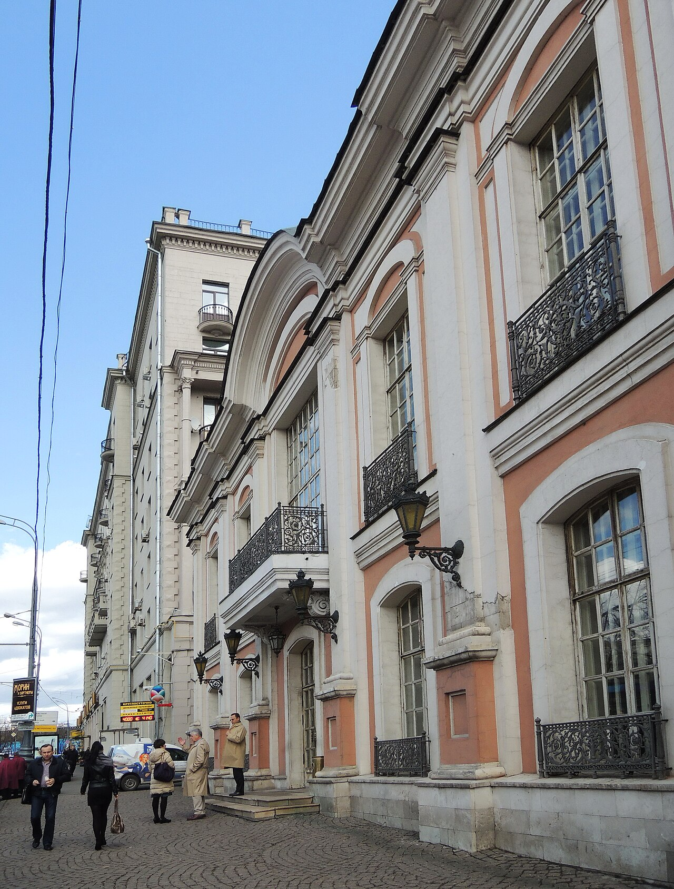

# Café Pushkin

在莫斯科特维尔林荫道的起点附近，一栋浅色巴洛克式宅邸的窗前常停着车。推门进去，先看到的是深色木柜、成排旧书、黄铜仪器与穿着制服的侍者；再往里，才是餐桌与烛台。这里看起来像一座十九世纪贵族宅第，但它并不是从普希金时代营业至今的老店——它生于 1999 年，是一个把文学想象做成空间的现代餐厅。

图：特维尔林荫道 26A 的巴洛克式宅邸立面，Café Pushkin 自 1999 年起设于其中。图片：Shakko，CC BY-SA 4.0，via Wikimedia Commons（[原图页面](https://commons.wikimedia.org/wiki/File:Moscow,_Tverskoy_blrd_26a_-_Cafee_Pushkin_(2014)_by_shakko_01.jpg)）。

## 1999 年：Café Pushkin的关键起点
官方历史页把一个关键事实讲得很清楚：法国歌手 Gilbert Bécaud 在 1964 年的歌曲《Nathalie》里，让主人公在莫斯科走进一家叫“Café Pouchkine”的咖啡馆，喝热巧克力、看窗外下雪。那只是歌词里的虚构地点，却让不少法国游客到了莫斯科就去找它。Andrei Dellos 被这个“不存在的咖啡馆”激发，决定在特维尔林荫道的一栋巴洛克式宅邸里把它造出来。1999 年 6 月 4 日，Café Pushkin 开业，Bécaud 本人在开业式上唱了《Nathalie》。

所以它必须被归入“历史风格餐厅”，而不是“百年老店”。它的历史只有二十多年，但它所调用的符号很老：普希金、特维尔林荫道、十九世纪贵族沙龙、法俄双语菜单、旧书与药房。官方历史页还特意讲了特维尔林荫道与普希金的关系：这条 1796 年开放的林荫道是莫斯科上流社会散步的地方，普希金常在这里出现；附近的老宅曾举办儿童舞会，他在那里遇见未来的妻子娜塔莉娅·冈察洛娃；林荫道尽头的教堂是他们结婚的地方。餐厅把这些地点记忆收进自己的叙事，但它本身不是那些事件的现场。

## 建筑与空间

官方称它位于“一座巴洛克式宅邸”。今天的室内被分成几个性格不同的厅：最有名的是“药房”（Apothecary），高窗、植物纹样、黄铜与玻璃器皿让它像一间十九世纪末的法国温室；另一个是“图书馆”（Library），深色木书架、雕花天花、旧版俄语经典与扶手椅，把光线压得很低；还有“夹层”（Entresol）与靠窗的座位。每个厅都有自己的菜单与酒单，这种“分厅”设计让餐厅更像一座宅第，而不是一个大开间。

室内是刻意过量的：书脊、镜框、瓷器、烛台、放大镜与植物标本挤在一起，侍者从狭窄的走道穿过。它不追求极简，也不追求“真实复原”；它追求的是一种被文学化了的俄罗斯贵族空间。白天，高窗把特维尔林荫道的树影投进来；晚上，烛光与台灯把木色与金色照得很暖。想拍照，最好在午餐前或下午茶时段，晚餐高峰的走道很窄，闪光灯也会打扰别人。

## 酒单与味觉

菜单的核心是“十九世纪俄罗斯贵族菜”与经典法餐的结合。官方与 Maison Dellos 都用了这个说法：俄罗斯贵族在十九世纪大量使用法籍厨师，法餐的技法与俄式的食材、酸奶油、腌菜、黑面包、鱼子与野味混在一起，形成了后来被称为“贵族菜”的传统。今天的 Café Pushkin 把这种混合做成可点的菜单：pelmeni、罗宋汤、波扎尔斯基肉饼、鲟鱼、野味、小牛肉、酸奶油与荞麦，以及拿破仑、蜂蜜蛋糕等甜点。

酒单以俄罗斯传统与法餐搭配为主：伏特加、自制浸泡酒（nalivka）、香槟、波尔多与勃艮第。官方首页提到“香槟早餐”：工作日到 12:00、周末到 14:00，适合想从早上开始慢慢吃的人。第一次来，可以点一份罗宋汤配黑面包、一份 pelmeni 或波扎尔斯基肉饼，再加一杯 nalivka；想试法餐线，可以看小牛肉或鲟鱼。甜点里的蜂蜜蛋糕与拿破仑更适合配红茶或咖啡，而不是配烈酒。

## 怎么吃

Café Pushkin 的节奏更像“坐下来吃一顿”，而不是“喝一杯就走”。午餐与晚餐都建议预订，尤其是周末与演出季；官方电话是最稳的确认方式。早餐时段相对宽松，香槟早餐是它的一个特色；下午三点到五点适合只喝下午茶或吃甜点。晚餐建议留出两小时，不要按“快餐”的时间安排。

着装没有硬性要求，但这里是莫斯科的高价位餐厅，商务休闲最稳。带小孩可以，但晚餐高峰的图书馆厅更适合安静交谈；如果想拍照，药房厅的高窗在白天最好看。菜单有俄语与英语，侍者通常能用英语解释菜品；点菜时可以直接问“今天的野味/鱼是什么”，因为菜单会随季节变化。价格以现场菜单为准，官网的 PDF 只作参考。

## Café Pushkin的地址与营业安排
- 地址：Tverskoy Boulevard 26A, Moscow（俄语：Тверской бульвар, 26А）。
- 坐标：55.7637, 37.6050（以官方地址 26A 为准；部分二手资料写 27A，属于混淆）。
- 电话：+7 (495) 739-00-33。
- 营业：官方联系页写周一至周三 9:00–24:00、周四 9:00–00:00、周五至周六 24 小时、周日 24 小时；节假日常有调整，出发前电话确认。
- 交通：地铁到 Pushkinskaya、Tverskaya 或 Chekhovskaya，步行约 5–10 分钟；门口有代客泊车，但市中心堵车严重，建议地铁。
- 预订：强烈建议，尤其是晚餐与周末；说明想坐药房厅、图书馆厅还是夹层。
- 支付：银行卡为主，现金也可；小费通常按账单 10%–15% 放桌上或刷卡。
- 无障碍：入口有台阶，室内为老建筑改造，轮椅通行需提前电话确认。
- 周边：特维尔林荫道、普希金雕像、莫斯科艺术剧院旧址都在步行范围内。

## 礼仪与常见误区

第一，不要把这里当成“普希金时代的百年老店”。它 1999 年开业，是一个文学主题的现代餐厅；它的“历史感”来自设计、菜单与叙事，不是连续经营。第二，不要把“Café Pouchkine”与巴黎的同名店混为一谈。莫斯科店是源头，巴黎店是 2010 年后由同一集团开设的分支。第三，不要期待“苏联食堂”或廉价俄餐；这里是高价位、全服务的餐厅，菜单与酒单都偏正式。第四，不要穿得太随意；虽然没有硬性着装要求，但背心、拖鞋与运动短裤不适合晚餐。第五，不要在没有预订的情况下带一大群人去；厅与厅之间的座位有限，临时拼桌会很尴尬。第六，不要在图书馆厅大声讲电话；那里是整间餐厅最安静的空间。

## 从Café Pushkin延伸到Café de la Paix
从餐厅出门，左手是特维尔林荫道的树与长椅，右手是普希金广场与雕像。可以把这一站放进“文学与咖啡馆”的城市线：先在特维尔林荫道散步，看普希金雕像与老宅，再进 Café Pushkin 吃一顿俄式贵族菜；如果只想喝一杯，可以去附近的咖啡馆或酒吧，把正餐留给晚上。跨城对照可以看巴黎的 [Café de la Paix](ref:paix)、[La Coupole](ref:coupole) 与 [Brasserie Lipp](ref:lipp)：它们同样把“文学/历史”做成空间，但各自的历史长度与经营方式不同。维也纳的 [Café Central](ref:central) 与布达佩斯的 [New York Café](ref:newyork) 则是另一种“作家咖啡馆”的样本。

莫斯科市中心不适合自驾；地铁是最稳的方式。若想安排一日线，可以把特维尔林荫道、普希金广场、莫斯科艺术剧院与餐厅串成一个下午到晚上的步行圈。冬天路面结冰，穿防滑鞋；夏天林荫道有树荫，适合饭前散步。

**关键事实。**

| 项目 | 内容 |
| --- | --- |
| 一句话定位 | 莫斯科特维尔林荫道 26A 号的俄式餐厅，1999 年 6 月 4 日由 Andrei Dellos 的 Maison Dellos 开设；它的名字来自法国歌手 Gilbert Bécaud 1964 年歌曲《Nathalie》里虚构的“Café Pouchkine”，并非百年老店 |
| 地址 | Tverskoy Boulevard 26A, Moscow, Russia |
| 城市/国家 | 莫斯科 / 俄罗斯 |
| 营业状态 | 已核验营业 |
| 官网 | cafe-pushkin.ru |

## 参考资料
- 官方历史页：<https://cafe-pushkin.ru/o-restorane/istoriya/>，用于核对《Nathalie》的虚构咖啡馆、Dellos 的灵感、1999 年 6 月 4 日开业与特维尔林荫道的普希金记忆。
- 官方联系页：<https://cafe-pushkin.ru/o-restorane/kontakty/>，用于核对 26A 地址、电话与营业时间。
- Maison Dellos 页面：<https://maison-dellos.com/en/>，用于核对 1999 年开业、Andrei Dellos 项目、宅邸空间与“十九世纪俄罗斯贵族菜 + 法餐”的定位。
- 官方首页：<https://cafe-pushkin.ru/>，用于核对“1999 年开业”、香槟早餐与日夜营业口径。
- 跨城对照：[Café de la Paix](ref:paix)、[La Coupole](ref:coupole)、[Brasserie Lipp](ref:lipp)、[Café Central](ref:central)、[New York Café](ref:newyork)。

对照阅读：[和平咖啡馆](ref:paix)、[利普啤酒馆](ref:lipp)。
