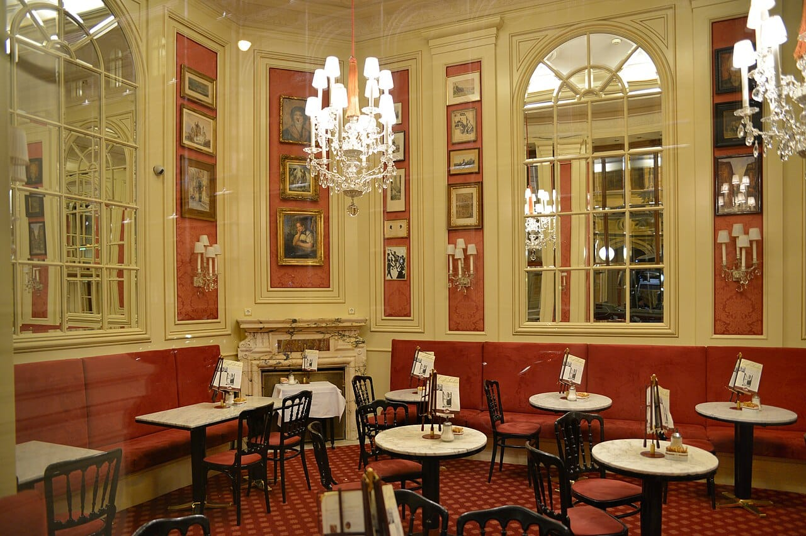
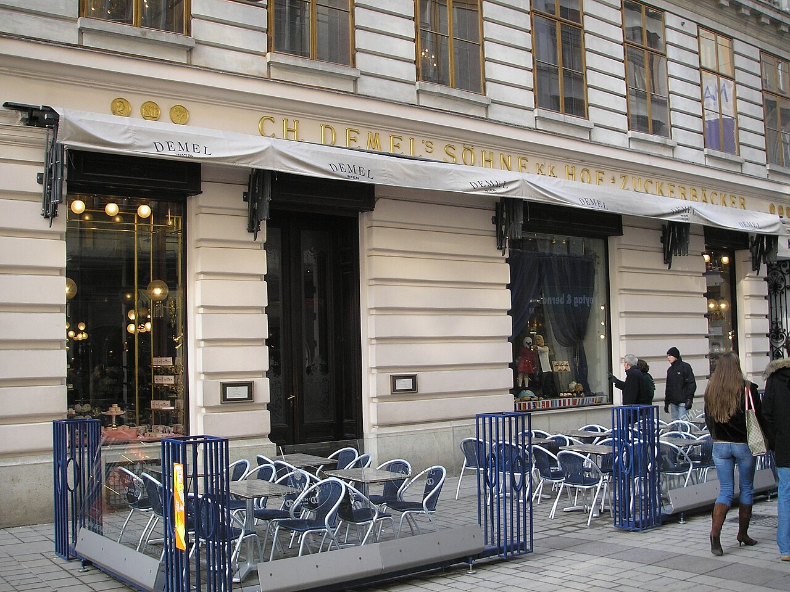

# Café Sacher

从维也纳国家歌剧院出来，沿 Philharmoniker Straße 走几十米，就能看到 Hotel Sacher 的深色雨棚与金色字母。Café Sacher 不在临街的独立门面里，而是藏在酒店一层：推门进去，先是深色木饰、红色丝绒、镜面与黄铜吊灯，然后才是蛋糕柜和领位台。它看起来像一间为“下午四点”准备的房间——外面是歌剧、马车与 Ringstrasse 的车流，里面是蛋糕叉碰到瓷盘的声音。

图：Café Sacher 内部，Hotel Sacher 的红色天鹅绒座位与吊灯。图片：Feel free to use my photos, but please mention me as the author and if you want send me a message . or ( rufre@lenz-nenning.at )，CC BY-SA 3.0 at，via Wikimedia Commons（[原图页面](https://commons.wikimedia.org/wiki/File:Cafe_Sacher,_Hotel_Sacher,_Wien.JPG)）。

## 1876 年：Café Sacher的关键起点
Café Sacher 的历史要分两层讲。第一层是蛋糕：1832 年，16 岁的 Franz Sacher 在 Metternich 宫廷里做出第一只 Sachertorte。关于这只蛋糕的起源，官方叙述强调“年轻学徒在宫廷宴会上的即兴之作”，但具体细节在流传中不断被浪漫化。能确认的是，Sachertorte 从此与 Sacher 家族绑定，成为维也纳最著名的巧克力蛋糕。第二层是酒店：1876 年，Eduard Sacher 在歌剧院旁开出 Hotel Sacher；1880 年他与 Anna 结婚，1892 年 Eduard 去世后，Anna Sacher 接手经营，把酒店与咖啡馆做成了维也纳上流社会的会客厅。

今天的 Café Sacher 仍然属于 Hotel Sacher，而不是一家独立咖啡馆。它的“Original Sacher-Torte”有明确的品牌边界：两层杏子酱、巧克力淋面、旁边一团不加糖的鲜奶油，官方说每一只都按原始配方、经过 34 道手工步骤完成。也正因为“Original”是注册商标，维也纳其他咖啡馆可以卖“Sachertorte”，但不能把自己的蛋糕称为“Original Sacher-Torte”。这不是口味之争，而是地理标志式的品牌叙事。

## 建筑与空间

咖啡馆的室内是典型的维也纳“酒店沙龙”风格：深色木墙板、红色丝绒长椅、小圆桌、镜面、黄铜灯具与大面积窗帘。空间不算大，桌距偏近，白天靠窗的位置能看到街道与酒店门廊，晚上则更像一间灯光温暖的剧院包厢。蛋糕柜通常在前场，陈列着整只 Sacher-Torte、其他巧克力蛋糕、奶油蛋糕与季节甜点；领位台会把客人带到窗边、角落或靠墙的丝绒座位。

它不适合大声谈话，也不适合把笔记本电脑摊开工作。这里的节奏是“入座—点蛋糕与咖啡—慢慢吃—结账”，服务生会在你坐下后问要不要先来点饮品。想拍照的话，最好在非高峰时段，且不要对着其他客人；红色丝绒与镜面很容易把陌生人一起框进画面。酒店与咖啡馆之间的动线是共享的，穿堂而过时请让行李与婴儿车先走。

## 酒单与味觉

核心当然是 Original Sacher-Torte。正确吃法是切一小块，配一团不加糖的鲜奶油：蛋糕体偏干、巧克力淋面厚，杏子酱提供酸度，鲜奶油负责把甜与苦拉开。不要先吃奶油再吃蛋糕，也不要把整团奶油抹在蛋糕表面；一口蛋糕、一点奶油，才是维也纳的标准节奏。咖啡方面，可以点 Wiener Melange、Einspänner 或黑咖啡；甜度高的蛋糕适合用无糖咖啡平衡。

除了蛋糕，咖啡馆也提供简餐、早餐、下午茶与酒单。Sacher 的鸡尾酒里有一款以巧克力与杏子为灵感的 Sacher Cocktail，酒精度约 15% vol；如果不喝酒，可以点热巧克力、Melange 或茶。下午茶可以点“Sachertorte + 咖啡”的经典组合；晚上则可以把蛋糕当甜点，配一杯甜型葡萄酒或香槟。价格属于维也纳高端咖啡馆区间，蛋糕与饮品的单价都不低。

## 怎么喝

最合适的时间是上午九点到十一点，或下午三点到五点。上午人少，蛋糕柜刚补货，靠窗的位置更容易坐到；下午是传统下午茶时段，但旅行团与歌剧散场客会让门口排队。若想看歌剧院夜景，可以订晚上八点后的位置，点一块蛋糕与一杯香槟，但要注意咖啡馆 23:00 关门，不要太晚入场。官方建议预订，尤其是周末、圣诞节与歌剧季。

点单时先说要几块 Sacher-Torte，再选咖啡。蛋糕可以两人分一块，也可以一人一块；如果只想尝味道，一块加两杯咖啡就够。不要要求“少糖”或“去奶油”，那会改变店方定义的完整吃法；如果确实不吃奶油，可以单独说明。结账时服务费通常已包含在账单里，但仍可以按服务留下小额零钱。

## Café Sacher的地址与营业安排
- 地址：Philharmoniker Straße 4, 1010 Wien。
- 营业：每日 07:00–23:00（官方页面；特殊日期可能调整）。
- 交通：地铁 U1/U2/U4 Karlsplatz 或 U3 Stephansplatz，步行 5–10 分钟；电车 1、2、71 等在 Oper/Karlsplatz 下车。
- 预订：建议通过 Hotel Sacher 官方渠道预订，尤其是下午茶与周末；临时到店可以排队，但不保证有窗边位。
- 价格：蛋糕、咖啡与鸡尾酒属高端区间；酒店下午茶与正餐更高。
- 着装： smart casual 即可，不需要正装；歌剧散场后会有礼服客，但咖啡馆不设硬性 dress code。
- 无障碍：酒店入口有台阶与旋转门，轮椅建议从侧门或提前联系酒店确认动线。

## 礼仪与常见误区

第一，不要把任何巧克力蛋糕都叫“Sacher-Torte”；在维也纳，Sachertorte 是一种蛋糕类型，只有 Hotel Sacher 的版本可以叫“Original Sacher-Torte”。第二，不要以为“Original”只是营销词；它涉及配方、商标与酒店历史，点单时看清菜单上的名称。第三，不要把旁边的鲜奶油拌进咖啡；它是蛋糕的配菜，不是奶精。第四，不要在歌剧散场后把咖啡馆当成快速拍照点；这里是酒店的一部分，客人要吃饭、谈话、过纪念日。第五，不要穿歌剧礼服却带着外卖盒进入；咖啡馆不提供“站着吃完就走”的快餐动线。第六，不要把 1832 年当成酒店开业年；1832 年是蛋糕的起源，1876 年才是 Hotel Sacher 的开业年。

## 从Café Sacher延伸到Café Central
从 Café Sacher 出门，左手是维也纳国家歌剧院，右手是 Albertina 与 Hofburg 的方向；沿 Ringstrasse 走十分钟可到 Burggarten、Mozartstatue 与 Kunsthistorisches Museum 一带。可以把这一站排成“歌剧院导览 → Café Sacher 下午茶 → Albertina → Hofburg → Ringstrasse 夜景”。若想把维也纳咖啡馆做成一条路线，可以先去 [Café Central](ref:central) 看文学咖啡馆的穹顶与人群，再去 [Café Hawelka](ref:hawelka) 感受战后作家与艺术家的小桌，最后到 [Café Sperl](ref:sperl) 看 Otto Wagner 式的室内；Café Sacher 则是“酒店沙龙 + 甜点品牌”的另一种类型。若想比较 Sachertorte 的另一条叙事，步行几分钟到 Kohlmarkt 的 [Demel](ref:demel)，那里有另一套“皇家糖果师”的历史与蛋糕版本。完整的维也纳咖啡馆夜晚可以参照 [维也纳咖啡馆之夜路线](ref:vienna-route)。

## 参考资料
- 咖啡馆官方页：<https://www.sacher.com/en/restaurants/cafe-sacher-wien/>，用于核对地址、营业时间与预订信息。
- Original Sacher-Torte 官方页：<https://www.sacher.com/en/original-sacher-torte/>，用于核对 1832 年、34 道步骤与配方叙述。
- Sacher Confiserie 官方页：<https://www.sacher.com/en/sacher-confiserie-vienna/>，用于核对“Original”品牌边界与销售场景。
- Hotel Sacher 官方页：<https://www.sacher.com/en/vienna/>，用于核对 1876 年开业与酒店位置。
- 同城的 `place:demel` 是 Sachertorte 叙事的另一极，`place:cafe-central`、`place:cafe-hawelka`、`place:cafe-sperl` 则代表不同类型的维也纳咖啡馆。
- 相关条目：[Demel](ref:demel)、[Café Central](ref:central)、[Café Hawelka](ref:hawelka)、[Café Sperl](ref:sperl)、[维也纳咖啡馆之夜路线](ref:vienna-route)

## 相关图像

图：Kohlmarkt 14 号的 Demel 店面与橱窗。图片：No machine-readable author provided. Gryffindor assumed (based on copyright claims).，Public domain，via Wikimedia Commons（[原图页面](https://commons.wikimedia.org/wiki/File:Caf%C3%A9_Demel,_Vienna.jpg)）。关联图像：Café Sacher。
