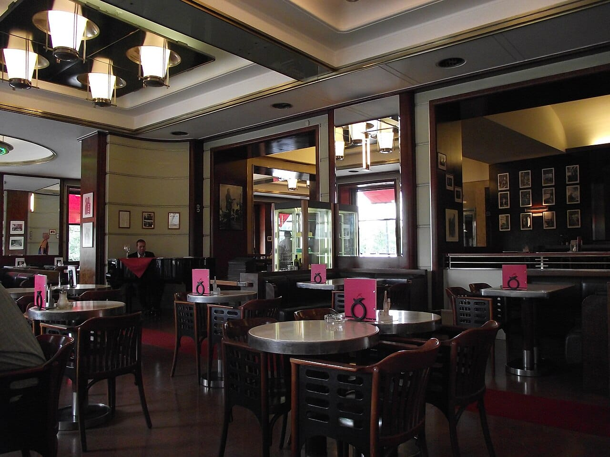
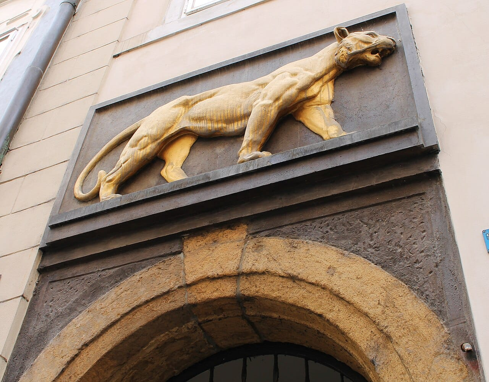

# 斯拉维亚咖啡馆

布拉格民族大街（Národní）走到国家剧院对面，会看到一栋浅色转角建筑，二楼是斯拉维亚咖啡馆（Café Slavia）。它的位置几乎定义了它的身份：正对伏尔塔瓦河与国家剧院，楼下是布拉格最繁忙的交通与游客流，楼上是高窗、深色木饰面与老式吊灯。1884 年开业，1930 年代改造成装饰艺术风格，至今仍是布拉格最常被提到的“文学咖啡馆”。

图：斯拉维亚咖啡馆的装饰艺术风格内景。图片：Fred Romero from Paris, France，CC BY 2.0，via Wikimedia Commons（[原图页面](https://commons.wikimedia.org/wiki/File:Praha_-_Kav%C3%A1rna_Slavia.jpg)）。

> **先给结论**
> **一句话：** 这页判断斯拉维亚咖啡馆值不值得专程去，以及到访前要核对什么。
>
> - **适合谁：** 正在计划去斯拉维亚咖啡馆、想知道值不值得专程安排半天到一天的人。
> - **不适合谁：** 只想要“必去榜单”、不准备核对预约、交通和开放时间的人。
> - **先看这两点：**
>   - 进门后自己找座位，靠窗的位置通常最先满；坐下后等侍者，不要去吧台点单。
>   - 第一，不要把斯拉维亚当成“只喝咖啡的咖啡馆”；它同时是餐厅，午餐与晚餐时段以正餐为主。

## 1884 年：斯拉维亚咖啡馆的关键起点
斯拉维亚的历史可以分三层。第一层是 1882 年的“新斯拉维亚”（Nová Slavia），当时是民族剧院周边新兴的市民社交场所；第二层是 1884 年，咖啡馆以“Kavárna Slavia”之名正式开业，位置就在今天这栋拉扎尼宫（Palác Lažanský）的转角；第三层是 1931–1932 年的改造，室内转向装饰艺术风格，形成了今天看到的高窗、镜面、深色木饰与对称布局。把“1882”与“1884”混用，是这座咖啡馆最常见的时间错误。

19 世纪末到 20 世纪初，斯拉维亚靠近民族剧院、布拉格音乐学院与查理大学，顾客里有作家、作曲家、演员与评论家。里尔克、卡夫卡、斯美塔那、扬·聂鲁达等名字常被提起；他们是否每天都来并不重要，重要的是这里提供了一种“演出前、下课后、截稿前”的社交空间。店内最著名的视觉作品是维克托·奥尔瓦（Viktor Oliva）的《喝苦艾酒的人》（Piják absintu），画中一位男子坐在桌旁，面前是一杯绿色苦艾酒，旁边站着一个裸体女性幻影。它既是咖啡馆的招牌，也是布拉格“苦艾酒时代”的视觉记忆。

1948 年之后，斯拉维亚被国有化，但仍作为文化场所运营。1968 年“布拉格之春”及其后的正常化时期，这里成了异议人士、作家与学生的碰头点；瓦茨拉夫·哈维尔、伊日·科拉尔等人与这里的联系，使它从“文学咖啡馆”变成了“政治咖啡馆”。1992 年，因产权纠纷，咖啡馆停业；1997 年重新开放。这段中断很重要：今天看到的斯拉维亚，是 1990 年代恢复后的版本，而不是 1930 年代原封不动的延续。

## 空间与酒单

斯拉维亚的空间是“高窗 + 镜面 + 深色木 + 大理石台面”。靠窗的位置能看到国家剧院、伏尔塔瓦河与民族大街的车流；靠里的卡座更安静，适合谈话。它不像维也纳咖啡馆那样用报纸架和弯木椅组织空间，而更像一家“有咖啡馆功能的餐厅”：白天有咖啡与甜点，中午和晚上有正餐，菜单从早餐、三明治、捷克菜到国际菜都有。

咖啡方面，斯拉维亚供应浓缩、卡布奇诺、拿铁、摩卡与维也纳式咖啡；捷克本地的咖啡文化更接近“咖啡馆 + 餐厅”的混合，而不是意大利式的站饮。想喝得本地一点，可以点一杯浓缩配水，或点“vídeňská káva”（维也纳咖啡）；想喝清爽的，点一杯冰咖啡或气泡水。甜点有蛋糕、甜卷与冰淇淋，具体以柜台为准。

酒单是斯拉维亚的另一面。作为咖啡馆，它供应咖啡与茶；作为餐厅，它有捷克啤酒、摩拉维亚葡萄酒、苦艾酒与烈酒。苦艾酒与奥尔瓦的画形成呼应，但不要因此以为“这里以苦艾酒为主”——它只是菜单上的一项，不是主打。若想试苦艾酒，先问侍者供应方式与酒精度，不要直接点“最烈的那款”。

正餐以捷克菜为主：烤猪肘、炖牛肉配面包、烤鸭、鲤鱼、土豆泥与酸菜；也有沙拉、意面与三明治。价格在布拉格内城属于中等偏上，靠窗位置与旅游区位置带来溢价。午餐时段本地人不少，晚上游客比例更高。

## 第一次去怎么点

进门后自己找座位，靠窗的位置通常最先满；坐下后等侍者，不要去吧台点单。想只喝咖啡，点一杯浓缩或卡布奇诺即可；想坐久一点，点咖啡加一份甜点；想吃正餐，午餐点捷克菜，晚餐点烤猪肘或烤鸭，注意分量很大，两个人分一份更合适。苦艾酒可以饭后点一小杯，配水慢慢喝，不要一口闷。

时段上，上午九点到十一点最安静，靠窗光线好；中午十二点到两点是午餐高峰；下午三点到五点适合咖啡与蛋糕；晚上七点后是晚餐与演出前人群。国家剧院有演出时，开场前半小时店内会很忙，想安静就避开这个时段。想拍国家剧院与咖啡馆同框，下午光线更稳；想拍室内，先征得邻桌同意，不要用闪光灯。

费用结构：咖啡馆与餐厅共用菜单，座位不额外收费，账单含饮品与食物，小费通常按账单的 5%–10% 留在桌上或直接告诉侍者。旅游区可能收取面包或餐具费，以菜单为准。不要用“只点一杯咖啡”来测试餐厅的底线；午餐高峰只点咖啡可以，但不要占大桌。

## 斯拉维亚咖啡馆的地址与营业安排
**地址**：Národní 1012/1, 110 00 Praha 1, Czechia。位于民族大街与国家剧院对面的转角，楼下是电车站与地铁站出口；看到“Café Slavia”与奥尔瓦画作的复制海报就到了。

**交通**：地铁 B 线 Národní třída 站，出站步行约 2 分钟；电车 6、9、18、22 路到 Národní divadlo 站，过马路即到。民族大街车流大，过马路要走人行横道；从老城广场步行过来约 10 分钟。

**营业时间**：周一至周日 09:00–23:00，周日 09:00–22:00；节假日可能调整，以官网或门口告示为准。`operating_status` 记为 `verified`，表示官网与公开信息在 2026-11-20 仍显示营业；这不等于每天一定开门。

**预订**：斯拉维亚接受晚餐与团体预订，午餐通常 walk-in；靠窗位置不能指定，先到先得。没有严格 dress code，但国家剧院演出前后顾客会穿得正式一些。带小孩可以，餐厅有高脚椅的可能性要现场问。

**价格**：咖啡与甜点属于布拉格内城中等偏上；正餐人均约 300–600 捷克克朗，烤猪肘与烤鸭分量大，适合分享。苦艾酒按杯计价，先问价格与酒精度。刷卡普遍可用，小费另计。

页面核验日期 2026-11-20；营业时间、价格与演出安排以官方渠道为准。

## 礼仪与常见误区

第一，不要把斯拉维亚当成“只喝咖啡的咖啡馆”；它同时是餐厅，午餐与晚餐时段以正餐为主。第二，不要把它当成“哈维尔每天坐在这里”的纪念馆；哈维尔与异议人士的联系真实，但具体座位与日常细节多为后来的叙述。第三，不要错过奥尔瓦的画，但也不要把它当成“苦艾酒广告”；它是 20 世纪初的象征主义作品，不是店内饮品宣传。

常见误区还有三个。其一，把“1882 年新斯拉维亚”与“1884 年咖啡馆开业”混为一谈；前者是前身，后者才是今天的店名与位置。其二，以为 1990 年代停业后“原样恢复”；实际是产权纠纷后的重新经营，室内与菜单都经过调整。其三，以为靠窗位置可以预订；通常不能指定，先到先得，演出前尤其紧张。

不适合来这里的情况：只想站着喝一杯快速咖啡的人；需要绝对安静办公的人；对正餐价格敏感的人。它适合“看一场国家剧院演出前后，坐下来吃一顿”的场景，也适合想感受布拉格文学与政治记忆的人。

## 布拉格的周边街区
斯拉维亚正对国家剧院，往北是查理大桥与老城广场，往南是跳舞的房子与伏尔塔瓦河岸。把咖啡馆放在“国家剧院—民族大街—查理大桥”这条线上：先在斯拉维亚喝咖啡或吃午餐，再看国家剧院外观，沿河走到查理大桥，最后进老城。走路约 30 分钟，不需要交通工具。

若想看“另一种布拉格咖啡馆”，可以转去老城广场附近的咖啡馆，或去胡索瓦街的金虎酒馆喝啤酒；前者更 touristy，后者更本地、更吵。斯拉维亚适合作为“正餐 + 咖啡”的一站，金虎适合作为“只喝啤酒”的一站，两者不要安排在同一时间段。

国家剧院有演出时，民族大街与咖啡馆门口人流密集，拍照要避让；伏尔塔瓦河岸的风大，冬天从咖啡馆出来要加衣。若遇到门口有剧组或活动围挡，不要跨越，改从侧门或第二天再来。

## 同城酒吧与延伸阅读
- [酒吧与城市](ref:pub-and-city)：咖啡馆如何用座位、报纸与营业时间组织公共生活。
- [中央咖啡馆](ref:cafe-central)：维也纳的文学咖啡馆，可与斯拉维亚的“国家剧院对面”位置对照。
- [哈维尔卡咖啡馆](ref:hawelka)：维也纳的家族咖啡馆，另一种“作家与艺术家”传统。
- [金虎酒馆](ref:tygra)：布拉格老城的啤酒馆，赫拉巴尔与哈维尔的另一处酒桌记忆。
- [罗马希腊咖啡馆](ref:greco)：已停业的意大利历史咖啡馆，说明“有名”与“仍在营业”是两件事。

相关条目：[认识一座城，从一间酒馆开始](ref:pub-and-city)、[中央咖啡馆](ref:cafe-central)、[哈维尔卡咖啡馆](ref:hawelka)。

## 相关图像

图：布拉格金虎酒馆门上的金虎市宅标志。图片：Sarah Stierch，CC BY 4.0，via Wikimedia Commons（[原图页面](https://commons.wikimedia.org/wiki/File:M%C4%9Bstsk%C3%BD_d%C5%AFm_U_zlat%C3%A9ho_tygra_-_Stierch.jpg)）。关联图像：斯拉维亚咖啡馆。
