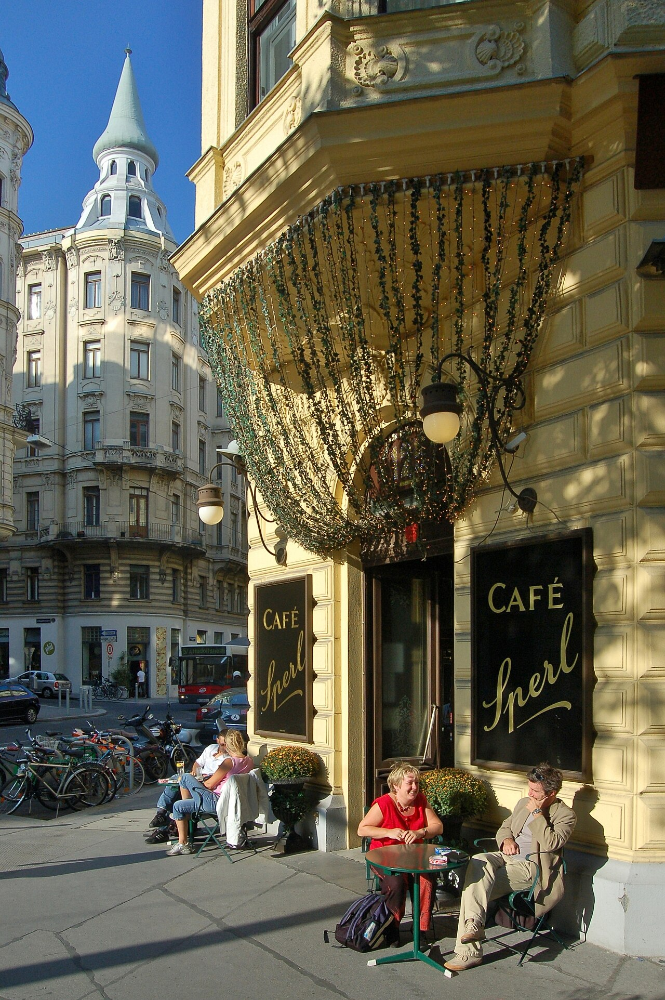

# 斯佩尔咖啡馆

图：斯佩尔咖啡馆。图片：Bahnfrend，CC BY-SA 3.0，via Wikimedia Commons（[原图页面](https://commons.wikimedia.org/wiki/File:Caf%C3%A9_Sperl,_front,_2006.JPG)）。

## 1880 年：斯佩尔咖啡馆的关键起点
斯佩尔咖啡馆（Café Sperl）在维也纳第六区玛利亚希尔夫（Mariahilf）的 Gumpendorfer Straße 11，离纳旭市场（Naschmarkt）只有几步路。它不属于那种被围起来供人拍照的“故居式咖啡馆”，而是一家以日常使用为本的老店：早上有人来吃早餐、看报，下午有人打球、聊天，晚上有钢琴声。

1880 年，这座建筑按照环路时期建筑师 Gross 与 Jelinek 的设计建成，最初叫“Ronacher”；同年十二月，Sperl 家族接手，咖啡馆从此有了沿用至今的名字。1884 年 Adolf Kratochwilla 接手，他的家族一直经营到 1968 年。1895 年前后，Siebenerclub（七人俱乐部）与 Hagengesellschaft 把这里当作聚会地点；1897 年，维也纳分离派正是从这一艺术圈子里走出来。1968 年六月 Manfred Staub 接手，1983 年的修复保留了原有空间气氛，并让原始镶木地板重新露出来。1988 年它被 Roy Ackerman 评为“年度咖啡馆”，1999 年在 Tafelspitz 评比中获得咖啡馆类最高评价，2012 年拿到“金咖啡壶”奖。这些奖项说明它是被同行与本地人认可的日常场所，而不是只靠“最老”标签维持的景点。

## 空间与咖啡单

推门进去，先看到的是中央大厅：大理石桌面、Thonet 弯木椅、靠墙的报纸架，以及几张台球桌。空间没有刻意做旧，磨损与修补都在使用中自然留下；1983 年修复时保留的正是这种“继续用下去”的状态。靠窗的位置光线好，适合白天读报；台球桌一带更热闹；想安静谈话，可以选靠里的桌子。

咖啡单是典型的维也纳体系。Wiener Melange 是浓缩咖啡加热奶与奶泡，口感比小杯拿铁更轻；Einspänner 是高杯浓缩上覆一层厚奶油，适合想要更浓郁口感的人；Verlängerter 是“加长”的浓缩，接近淡美式；Kleiner Brauner 与 Großer Brauner 则是小杯或大杯加少量奶。第一次来点 Melange 最稳；想喝浓一点，点 Einspänner；想喝淡一点，点 Verlängerter。

食物与甜点是另一半。店里的招牌是 Sperltorte（斯佩尔蛋糕），维也纳旅游局的介绍也把它列为到店必试；此外还有早餐、维也纳家常菜与自制面点，菜单随季节和当日采购调整。不要把这里的蛋糕只当成“拍照道具”：本地人下午点一块蛋糕配咖啡，是正常的一餐式休息。具体菜单与价格以官方渠道为准，页面核验日期 2026-11-07。

## 第一次去怎么点

进门自己找空位，坐下等侍者过来，不要站在门口等带位，也不要直接去吧台点单。一个人只点一杯咖啡坐很久，在维也纳咖啡馆是成立的；两个人分享一块蛋糕，点两把叉子也很平常。最稳的组合是 Melange 加一块 Sperltorte；如果想吃咸的，可以点一份维也纳家常菜或早餐，再把咖啡放在后面。

时段上，开门后的早晨最安静，适合看报、写字；下午两三点是蛋糕与游客的高峰；周日下午有钢琴演奏，气氛更满，谈话音量也会被抬高。想安静，选靠里或靠窗的位置；想感受老咖啡馆的“公共客厅”气氛，就接受人多与声音大。

费用结构要说清：传统维也纳咖啡馆一般不在账单上单列座位费或音乐费，消费就是饮品、食物加小费；但旅游区个别店会有自己的规定，遇到菜单上标注的座位费或最低消费，以菜单为准。结账时常见做法是凑整或加 5%–10% 小费，报出含小费的总额，不要把现金留在桌上就走。

## 斯佩尔咖啡馆的地址与营业安排
**地址**：Gumpendorfer Straße 11, 1060 Wien, Austria，位于玛利亚希尔夫街区内部，门面不算夸张，按门牌找比跟着游客找更可靠。

**交通**：乘地铁 U4 至 Kettenbrückengasse，步行约 5–7 分钟；或乘 U3 至 Neubaugasse，步行约 8 分钟；也可乘 57A 路公交至 Laimgrubengasse。具体线路、无障碍出口与末班车以 Wiener Linien 当日信息为准。

**开放时间**：官网联系页写明周一至周六 07:00–22:00，周日 10:00–20:00；七八月的周日休息。维也纳旅游局另提到周日下午 15:30–17:30 有钢琴演奏。节假日、夏季与临时活动会调整，以官网当日公告为准。

**门票与预约**：不收门票，按点单消费。散客通常现场找位；团体建议提前电话（+43 1 586 41 58）或邮件（melange@cafesperl.at）询问。价格在维也纳属于中等偏上：一杯咖啡加一块蛋糕的预算明显低于一顿正餐，但早餐、正餐与甜点的计价方式不同，菜单与价格以店内当日菜单为准。

着装休闲整洁即可，不需要正装。建议备少量现金，结账更方便。

「斯佩尔咖啡馆」的开放时间、价格与预约，以[官网](https://www.cafesperl.at/)的公开页面为准；核验日期为 2026-11-08，临时调整以官网当日公告为准。

## 礼仪与常见误区

第一，坐下不等于点单，要等侍者过来；招手时用眼神和轻声示意，不要大声喊。第二，一杯咖啡坐两三个小时是正常的，但高峰时段长时间占大桌会影响等位，自己判断。第三，报纸看完放回原处，不要带走；台球桌是营业设施，不是拍照布景。第四，小费不强制，但结账时报出含小费的总额是当地习惯。

常见误区有四个：把这里当成“电影布景”而不是正在营业的咖啡馆；以为它是维也纳“最老”的咖啡馆（“最老”有不同的统计口径，斯佩尔的可核查起点是 1880 年）；把 Sperltorte 与 Sachertorte 当成同一种蛋糕；以为点一杯咖啡就必须配餐。另一个实际误区是只看排队长度：斯佩尔的名气确实带来游客，但它的日常性还在，错峰来比排队更能看到真实状态。

不适合来这里的情况：赶时间只想站着喝一杯的人、想安静开电话会议的人、把咖啡馆当成快速拍照点的人。它适合愿意坐下来、把半小时到一下午交给一张桌子的人。

## 维也纳的周边街区
出门往南是纳旭市场，往东步行可到分离派会馆（Secession）与卡尔广场，往北是玛利亚希尔夫大街的商店与餐馆。把斯佩尔放在上午：先喝咖啡看报，再去纳旭市场逛一圈，中午在市场附近吃饭；下午去分离派会馆或博物馆区。这样一条线不用来回穿城，也避开了下午咖啡馆的客流高峰。

若想把“维也纳咖啡馆”作为主题，一天安排两三家就够，太多会审美疲劳。斯佩尔适合作为第一站，因为它空间完整、菜单全、对第一次来的人友好；想更安静，可以把后面的时间留给小巷里的店。冬季维也纳天黑得早，下午四点后街上人流转向圣诞市集与剧院，路线要相应调整。

## 同城酒馆与延伸阅读
- [中央咖啡馆](ref:cafe-central)：同在维也纳内城的历史咖啡馆，可对照“拱廊大厅”与“街区咖啡馆”的空间差别。
- [花神咖啡馆（巴黎）](ref:cafe-de-flore)：巴黎左岸的文学咖啡馆，可与维也纳的“公共客厅”传统比较。
- [花神咖啡馆（威尼斯）](ref:caffe-florian)：圣马可广场上的历史咖啡馆，费用结构与斯佩尔不同。

补充阅读：[维也纳咖啡馆傍晚路线：中央咖啡馆到斯佩尔](ref:c-extra-1)、[A Ginjinha](ref:c-extra-2)。

对照阅读：[中央咖啡馆](ref:cafe-central)、[花神咖啡馆（威尼斯）](ref:caffe-florian)。

相关条目：[花神咖啡馆](ref:cafe-de-flore)。
