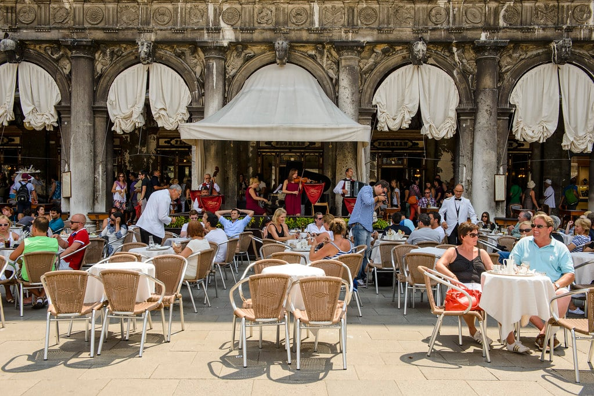
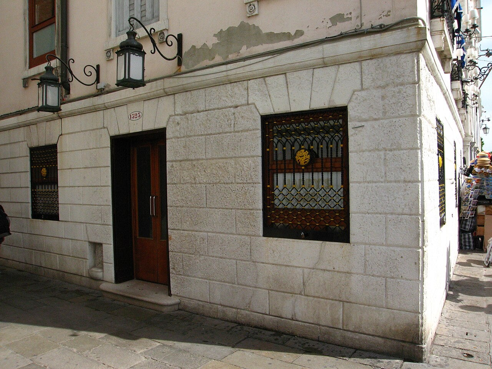

# 花神咖啡馆（威尼斯）

图：圣马可广场拱廊下的花神咖啡馆露天座，乐队在白色遮阳篷前演奏。图片：Son of Groucho，CC BY 2.0，via [原图页面](https://www.flickr.com/photo.gne?id=9755522045)。

## 1720 年：花神咖啡馆（威尼斯）的关键起点
花神咖啡馆在圣马可广场的拱廊下，属 Procuratie Nuove 一侧，门牌是 Piazza San Marco 57。它于 1720 年 12 月 29 日开业，创办人 Floriano Francesconi 给店取名 "Alla Venezia Trionfante"（向胜利的威尼斯致意）；顾客后来习惯用创办人的名字称呼它，Florian 就这样固定下来。今天它仍在同一组厅堂里营业，官方把 1720 年视为起点，并在 2020 年办了 290 周年纪念。

18 世纪的威尼斯咖啡馆是少数允许女性入座的公共空间，花神咖啡馆的官方叙述也强调这一点。戈尔多尼、卡萨诺瓦、歌德、拜伦等名字常与这里联系在一起；这些是历史记载中的到访，而不是"某人固定坐哪张桌子"的保证。19 世纪以后，广场上的咖啡馆几经易主与改建，花神逐渐从本地人的会客厅变成游客必到的一站，这个转变本身就说明了威尼斯旅游经济的分量。

需要区分的是称号。花神常被写成"世界最古老的咖啡馆"，但巴黎的 Procope 在 1686 年已开业，因此更稳妥的说法是"意大利持续经营时间最长的咖啡馆之一"，以及"仍在原址营业的历史咖啡馆"。这两种说法都能被官方材料支持，也不会把不同城市的账算混。

## 空间与酒单

咖啡馆由多间装饰不同的厅组成。Sala degli Uomini Illustri（名人厅）以 Giulio Carlini 所绘的威尼斯名人肖像著称；Sala delle Stagioni（四季厅）由 Cesare Rota 把四季画成女性形象；Sala Liberty 是 20 世纪初增建的厅，以拱顶和轻快的装饰线条区别于 18 世纪的华丽；此外还有以参议院、东方为主题的厅。厅与厅之间不是博物馆展柜，而是仍在使用的座位区，遇到活动或维护时可能临时关闭。

餐单以咖啡、热巧克力、茶和甜点为主，也供应简餐。咖啡走意大利路线：浓缩、玛奇朵、加奶的 caffè 都是常见选项；热巧克力浓稠，适合冬天。甜点柜里的蛋糕与威尼斯传统点心是更稳的选择。菜单会随季节调整，具体品类与价格以官方渠道为准。

露台与拱廊座位才是这家店真正的"产品"：你付的钱里有相当一部分买的是广场本身。天气好时乐队在户外演奏，音乐附加费按人收取，金额不在网上逐项公布，落座前问清楚最省事。

## 第一次去怎么点

先站在拱廊外看一遍价目牌，再决定坐室内还是室外。室内的差别是能看装饰、听不清广场人声；室外是看人流、听乐队，但要多付音乐费。第一次去建议点一杯浓缩或热巧克力，加一块蛋糕，预算可控，也符合这家店的节奏。

如果同行者各点各的，注意音乐费通常按人头计算，不按杯数。不要为了拍全景点最便宜的饮品然后长时间离座；侍者会收拾桌面，其他客人也在等位。想认真看厅堂，可以点单后安静坐着，把每间厅走一遍再回座，比端着杯子穿行更合适。

时段上，开门后的头一小时和傍晚乐队开始前相对从容；正午与周末下午是广场人流最密的时候。冬季若遇涨潮（acqua alta），拱廊地面可能积水，木栈道会铺出来，进出要留神。

## 花神咖啡馆（威尼斯）的地址与营业安排
**地址**：Piazza San Marco 57, 30124 Venezia, Italy，位于圣马可广场拱廊下、Procuratie Nuove 一侧。

**交通**：威尼斯没有汽车，广场周边以步行为主；水上巴士（Actv）1 号线与 2 号线在 San Marco 站停靠，下船步行数分钟即到，San Zaccaria 站也在步行范围内。从马可波罗机场可乘 Alilaguna 水上巴士，或先走陆路到罗马广场（Piazzale Roma）再换船。

**营业时间**：官网联系页写明每日 9:00–23:00，页面核验日期 2026-11-08。节庆与特殊活动可能调整，以官方渠道当日信息为准；这家店游客密集，建议出发前再确认一次。

**门票与预约**：咖啡馆不收门票，按点单付费；**不接受预订**，散客现场入座，旺季需要等位。10 人以上团体需通过邮件联系官方安排。露台乐队演奏时按人收取音乐附加费，金额不在网上逐项公布，落座前问清楚。

**价格与着装**：价格属于威尼斯核心区最高一档，同一杯咖啡可能比背街咖啡馆贵数倍，音乐费另计。着装没有硬性要求，但进室内脱帽、收好湿伞是基本礼貌。

「花神咖啡馆（威尼斯）」的开放时间、价格与预约，以[官网](https://www.caffeflorian.com/)的公开页面为准；核验日期为 2026-11-08，临时调整以官网当日公告为准。

## 礼仪与常见误区

第一，音乐费不是小费。它是座位与演出的附加费，按人收取；小费是另外的事，意大利不强制，留 5%–10% 或凑整即可。第二，坐下不等于已经点单，要向侍者明确说出要什么，否则可能等很久。第三，不要移动桌椅去拼桌，也不要为了拍照站到通道中央。

常见误区有三：把这里当成"世界最古老咖啡馆"；把名人到访当成"一定能遇到某种氛围"；把露台当成免费观景台。更准确的读法是：它是一家仍在营业的 18 世纪咖啡馆，卖的是咖啡、厅堂和广场上的位置，历史是背景而不是承诺。

带小孩、推婴儿车或行动不便的客人要注意：拱廊有台阶与门槛，涨潮时更麻烦。这家店不适合"快速喝完就走"的行程，也不适合把这里当餐厅吃正餐。

## 从花神咖啡馆（威尼斯）延伸到哈里酒吧（威尼斯）
出门就是圣马可大教堂、钟楼与总督宫，广场三面都是拱廊，适合慢慢走一圈。往西穿过广场与小巷，步行几分钟可到 Calle Vallaresso 的[哈里酒吧（威尼斯）](ref:harrys)，从咖啡馆的慢节奏换到鸡尾酒吧的正式感。这条两站路线已整理为[威尼斯圣马可广场两站酒吧路线](ref:venice-route)，适合安排在傍晚。

若只安排半天，建议顺序是：上午看教堂与总督宫，中午避开人群，下午晚些时候回广场喝一杯，傍晚再走去哈里酒吧。圣马可一带在涨潮与游轮到达时段会非常拥挤，出发前看当天水位与船期，比临时挤在拱廊里更有效。

## 同城酒馆与延伸阅读
- [酒吧与城市](ref:pub-and-city)：咖啡馆、pub、bar 与 beer hall 如何用座位与营业时间组织公共生活。
- [哈里酒吧（威尼斯）](ref:harrys)：同一街区的另一种"喝一杯"，以贝里尼和生牛肉薄片闻名。
- [威尼斯圣马可广场两站酒吧路线](ref:venice-route)：把两站串成一条傍晚步行路线。

相关条目：[认识一座城，从一间酒馆开始](ref:pub-and-city)、[哈里酒吧（威尼斯）](ref:harrys)、[威尼斯圣马可广场两站酒吧路线](ref:venice-route)。

## 相关图像

图：哈里酒吧在 Calle Vallaresso 的入口，门楣上方标着门牌 1323。。图片：Felix Haslimeier，CC BY-SA 2.0，via Wikimedia Commons（[原图页面](https://commons.wikimedia.org/wiki/File:Italy_-_Venice,_Harry%27s_Bar,_San_Marco.jpg)）。关联图像：花神咖啡馆（威尼斯）。
