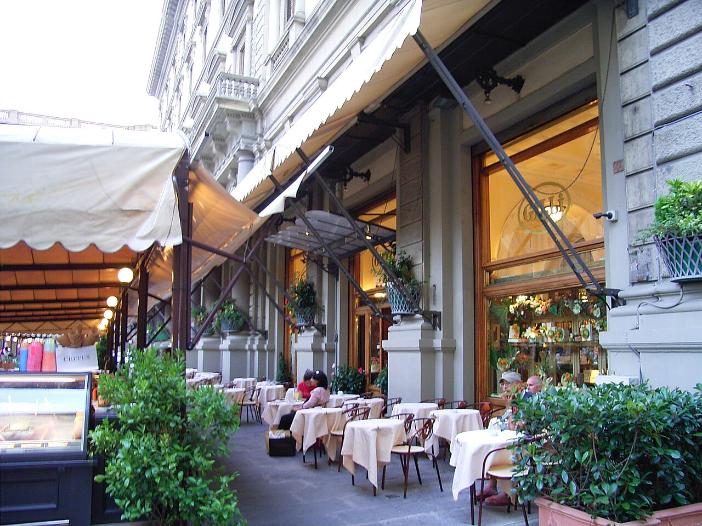

# 吉利咖啡馆

在佛罗伦萨 Piazza della Repubblica 靠 Via Roma 的转角，吉利咖啡馆的橙色遮阳篷和深色木门很容易被游客错过。它不像领主广场旁那些把历史写在招牌上的餐厅，也不靠网红橱窗招客；推门进去，先看到的是胡桃木柜台、老式挂钟、镜面与一排排甜点盒。这里是佛罗伦萨仍然在营业的最老咖啡馆之一，但它首先是一门从 1733 年做到今天的甜点与咖啡生意，而不是一座只供参观的老房子。

图：Caffè Gilli 的店面与露台，位于 Piazza della Repubblica 与 Via Roma 转角。图片：jeienne，CC BY 3.0，via Wikimedia Commons（[原图页面](https://commons.wikimedia.org/wiki/File:Caffe%27_Gigli_-_panoramio.jpg)）。

## 1733 年：吉利咖啡馆的关键起点
吉利的故事从 1733 年开始。那一年，来自瑞士的 Gilli 家族在Via dei Calzaiuoli 开了一间“bottega di pani dolci”——直译是“甜面包铺”，卖的是糖渍水果、甜点和当时佛罗伦萨人理解的“精致食品”。当时佛罗伦萨还在美第奇家族治下，铺子离主教座堂不远，做的是街坊与路过客人的生意。

十九世纪中叶，铺子搬到 Via degli Speziali 一带；1893 年，随着旧市场被拆除、Piazza Vittorio Emanuele（今天的 Piazza della Repubblica）成为新城市中心，Gilli 迁到广场附近，并在同年取得售酒许可。1893 年 12 月 22 日，《La Nazione》报上的广告称它为“Maison Gilli”，卖甜点、糖果与利口酒。1917 年，它搬到 Palazzo Levi 底层——也就是今天的位置；这座建筑由 Boccini 设计，是 Fondiaria 保险公司的总部，属于新广场周边最早的一批大型办公楼。

1990 年，Valenza 集团接手 Gilli，目标是把它从旅游化、老旧的经营状态拉回“佛罗伦萨人的咖啡馆”。1991 年，在已经是“历史店铺”与意大利历史咖啡馆协会成员之后，它又被认定为文化遗产。2025 年 3 月 25 日，经过一轮整修后重新开门；这次工程更新了楼梯、照明与服务空间，但没有把木饰、老钟和大理石柜台拆掉。

## 空间与酒单

Gilli 的空间是“旧咖啡馆 + 现代餐饮”的叠层。底层的主厅保留深色木饰、镜面、黄铜灯具与胡桃木/大理石柜台；墙上有一面仍由佛罗伦萨钟表匠维护的老钟，天花板上是 Ezio Giovannozzi 在二十世纪最初十年绘制的四幅女性肖像圆章。靠窗的位置能看到 Piazza della Repubblica 的拱廊与来往人流，里面则更像一间安静的甜点店。

白天的主力是咖啡与甜点：espresso、cappuccino、caffè latte，配 cantuccini、羊角包、巧克力、糖渍水果与季节蛋糕。午餐与晚餐由 bistrot 菜单接管，做的是托斯卡纳与意大利经典菜，酒单以意大利葡萄酒为主，也有鸡尾酒吧的 negroni、americano 与 spritz。它不像专门酒吧那样把调酒当主角，但在下午与晚饭前，点一杯 negroni 或 spritz 配小食，是本地人也会用的方式。

## 怎么喝

早上最适合点一杯 cappuccino 或 espresso，配一只羊角包或 cantuccino，站在柜台边快速吃完。上午十点以后，游客开始多起来，甜点柜前会排队；如果想慢慢坐，午后的 bistrot 时段更合适。下午可以点一杯 caffè latte 或热巧克力，配一份巧克力或糖渍水果；佛罗伦萨的甜点偏干，适合蘸咖啡。

傍晚的鸡尾酒时段，建议从 negroni 或 americano 开始：前者苦、烈、带橙皮香，后者更轻、更适合配小食。若想喝葡萄酒，可以让服务生按托斯卡纳产区推荐，不必只盯着最贵的酒单。这里不是精酿酒吧，不建议用“酒单有多长”来判断它；它的强项是咖啡、甜点与空间，酒是让谈话继续下去的背景。

## 吉利咖啡馆的地址与营业安排
- 地址：Via Roma 1R, 50123 Firenze，Piazza della Repubblica 转角。
- 营业：每日 08:00–24:00；节假日与特殊活动会调整，出发前看官网。
- 交通：从 Duomo 步行约 5 分钟；从 Santa Maria Novella 车站步行约 10–12 分钟；附近有公交与出租车停靠点。
- 点单：先找座位或到柜台点单；甜点柜可以直接指选，咖啡与餐点分开下单。
- 预约：bistrot 与晚餐建议提前预订；早餐与下午茶通常不需要。
- 价格：坐下比站着贵，旅游区尤其明显；甜点按件计价，先看柜牌。

## 礼仪与常见误区

第一，不要把 Gilli 当成“拍照背景”。它是正在营业的咖啡馆，柜台前有人排队点单，不要为了拍甜点柜挡住动线。第二，不要只点一杯咖啡却占着 bistrot 的餐桌；早餐与下午茶用咖啡座，正餐时段才用餐厅桌。第三，不要用“1733 年”推断所有空间都是 1733 年的原物；现在的店面是 1917 年迁入 Palazzo Levi 后的格局，木饰与装饰是不同年代叠起来的。第四，不要把“历史咖啡馆”理解成博物馆门票；这里没有讲解牌与固定参观路线，点单就是进入方式。第五，不要在柜台前慢慢挑十分钟；后面的人通常只想拿一只羊角包就走。

咖啡馆的历史感不等于所有座位都安静；广场转角与室内区域的气氛不同，想久坐应避开正午与周末的翻台高峰，室内与露台是两种体验。

1733 年是甜面包铺的起点，1893 年才迁到新广场；把三个年份压缩成“1733 年开业”会读错它的空间史。

## 从吉利咖啡馆延伸到圣卡洛咖啡馆
从 Gilli 出门，向北两分钟是 Duomo 与 Baptistery，向南穿过 Piazza della Repubblica 就是 Via degli Speziali 与 Palazzo Vecchio 方向；往西十分钟到 Uffizi，往北十分钟到 Santa Maria Novella。可以把路线排成：Duomo → Piazza della Repubblica → Gilli 喝一杯 → Palazzo Vecchio → Uffizi → Ponte Vecchio。若只想在附近吃饭，Piazza della Repubblica 四周的选择很多，但 Gilli 的位置最适合作为“等人”与“歇脚”的中点。

相关条目：[圣卡洛咖啡馆](ref:san-carlo)。

**关键事实。**

| 项目 | 内容 |
| --- | --- |
| 一句话定位 | 佛罗伦萨 Piazza della Repubblica 转角的 Caffè Gilli，1733 年由瑞士 Gilli 家族以“甜面包铺”起家，1893 年迁到新广场、1917 年定于 Palazzo Levi；木饰、老钟与大理石柜台保留着佛罗伦萨历史咖啡馆的日常 |
| 地址 | Via Roma 1R, 50123 Firenze, Italy |
| 城市/国家 | 佛罗伦萨 / 意大利 |
| 营业状态 | 已核验营业 |
| 官网 | caffegilli.com |

**来源与边界。** 本页关于「吉利咖啡馆」的关键事实，主要由以下来源交叉核对：Caffè Gilli（1733 年起源、瑞士 Gilli 家族、Via dei Calzaiuoli 与今日 Piazza della Repubblica 的位置；1893 年 Maison Gilli、Palazzo Levi、1991 年文化遗产认定与室内木饰、老钟、胡桃木/大理石柜台）、Firenze Patrimonio Mondiale。产品、地址或营业状态变化较快时，以 caffegilli.com 的最新页面为准；价格、批次与状态会变，涉及这些字段时以页面所列来源的最新版本为准。正文为项目自写，来源只作核验，不复制原文。

## 参考资料
- 店方历史页：<https://www.caffegilli.com/en/story>，用于核对 1893 年 Maison Gilli、1991 年文化遗产与室内细节。
- Firenze Patrimonio Mondiale 的《Arte e botteghe》PDF：<https://www.firenzepatrimoniomondiale.it/wp-content/uploads/2015/12/AB-PiazzaSignoria.pdf>，用于核对 1733 年起源与 Donatello 奖。
- 同城的 `place:antico-caffe-greco` 与 `place:caffe-san-carlo-torino` 可以对照意大利历史咖啡馆的“甜点铺 + 沙龙”类型。
- 若想看都灵的 bicerin 与巧克力传统，读 `place:al-bicerin-torino`。
- 本页不把“佛罗伦萨最老咖啡馆”写成无争议纪录；不同资料对 1733 年之后的迁址细节有差异，正文只写有来源支撑的节点。
- 相关条目：[罗马希腊咖啡馆](ref:greco)、[圣卡洛咖啡馆](ref:san-carlo)、[都灵 Al Bicerin](ref:bicerin)、[Camparino in Galleria](ref:camparino)、[维也纳咖啡馆之夜](ref:vienna)

对照阅读：[罗马希腊咖啡馆](ref:greco)、[阿尔比切林咖啡馆](ref:bicerin)。
