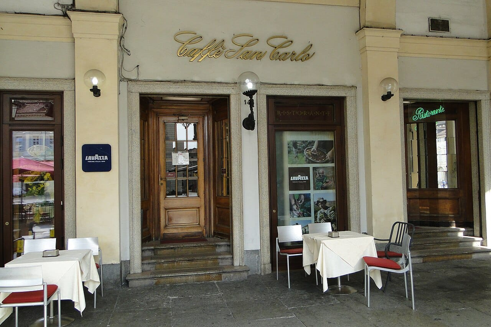
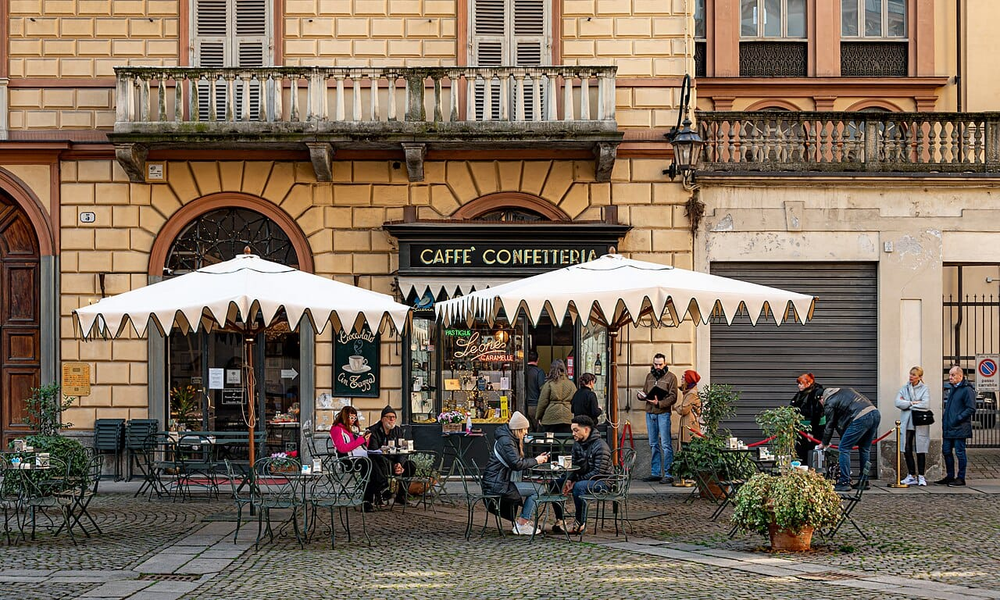

# 圣卡洛咖啡馆

都灵市中心 Piazza San Carlo 的拱廊下，一排石柱把街道与广场隔开，Caffè San Carlo 的木门与金色招牌就嵌在柱廊里。它不像街角咖啡馆那样随意，也不像博物馆餐厅那样疏离：门口是广场的喷泉与雕像，里面是镜面、灰泥、红色天鹅绒座椅与大理石小桌。对都灵人来说，这里是“历史咖啡馆”；对游客来说，它更像一扇进入十九世纪都灵上流社会的门。

图：都灵 Piazza San Carlo 的 Caffè San Carlo；咖啡馆 1822 年以 Caffè di Piazza d'Armi 开业，1837 年后经 Giuseppe Leoni 改造并形成今日的新古典装饰，照片为现址外观，不是 1822 年原貌。图片：K.Weise，CC BY-SA 4.0，via Wikimedia Commons（[原图页面](https://commons.wikimedia.org/wiki/File:Caff%C3%A9SanCarloTo1.jpg)）。

## 1822 年：圣卡洛咖啡馆的关键起点
圣卡洛的历史通常从 1822 年算起。它最初叫 Caffè di Piazza d'Armi，借用广场的旧名称“阅兵广场”；MuseoTorino 指出，关于这家店最早的营业记录可追到 1828 年，当时经营者 Michele Ducco 申请延长关门时间。它从一开始就不是普通咖啡馆，而是广场拱廊下的社交场所：有外部装饰、有煤气照明实验，后来成为都灵改革派与知识分子的“沙龙”。

1837 年，咖啡馆因“颠覆活动”被关闭；几个月后以新老板的名字重开为 Caffè Vassallo。为了重新吸引客人，Vittorio Vassallo 请来建筑师 Giuseppe Leoni。Leoni 在 1839 年设计了新古典立面：希腊神庙式的门廊、成对的多立克柱、带花环的檐部；1840 年开始做内部装饰，中央大厅有金色壁柱、科林斯柱头与巨大的镜面。墙顶与墙面由 Morgari 与 Giuseppe Borra 绘制；1851 年，小房间“Gabinetto Cinese”（中国厅）由 Pietro Spinzi 与 Giacomo Beltrami 装饰。

复辟时期的圣卡洛是意大利复兴运动的温床。Cavour、D'Azeglio、Alexandre Dumas 父子、Giolitti、Einaudi 等人都曾出现在客人名单里；都灵“六人组”（Sei di Torino）画家也常在此聚会，据说南极探险船“Stella Polare”的计划也在这里讨论过。1883–1893 年，咖啡馆曾长期关闭；1894 年重开后加了音乐厅、摩尔厅与冬季玻璃阳台。1942 年轰炸严重损坏建筑，1953–1963 年修复，原十九世纪立面被拆掉，换成现代门窗，只留下部分内部装饰。

2022 年，在开业 200 周年之际，圣卡洛在 Gallerie d'Italia 博物馆空间内重启，由 Costardi Bros 经营，定位是“咖啡馆 + bistrot”：白天卖咖啡与甜点，午晚市做皮埃蒙特菜与创意料理。它因此有两层身份：一层是历史建筑与复兴运动记忆，一层是当代博物馆餐饮。写它的时候，不能只写“1822 年的老咖啡馆”，也不能只写“博物馆里的新餐厅”。

## 空间与酒单

今天从 Piazza San Carlo 进入，先经过拱廊与门厅，里面保留两间面向广场的厅。主厅有彩色大理石地面、圆形大理石桌、红色天鹅绒座椅、金色灰泥与镜面，中央挂着约 1960 年安装的 18 臂穆拉诺吊灯；天花板在轰炸后改为简化的蛋彩装饰。旁边的小厅是 1851 年的“中国厅”，椭圆穹顶、浅色漆柱、壁龛中的古典女性雕像，气氛更私密。

餐饮由 Costardi Bros 设计：咖啡豆拼配、手冲与意式浓缩，甜点与皮埃蒙特传统菜，午市与晚市有 bistrot 菜单，下午有 aperitivo。酒单以意大利葡萄酒、起泡酒与经典鸡尾酒为主，也有以咖啡为灵感的特调。它不是“只喝咖啡”的站吧，也不是高端正餐；最舒服的用法是上午喝一杯咖啡，中午吃一顿轻午餐，傍晚再回来喝一杯 aperitivo。

## 怎么喝

上午来，点一杯意式浓缩或玛奇朵，站在吧台喝，是意大利咖啡馆的标准动作；想坐久一点，再点一杯卡布奇诺与甜点。中午与晚上，可以按 bistrot 菜单点菜，配一杯皮埃蒙特红酒或起泡酒。下午的 aperitivo 适合点 Americano、Negroni 或一杯起泡酒，配小食。

圣卡洛的空间适合“慢”，但不适合“占座一下午”：午餐与晚餐时段，桌面会被翻台；如果想长时间聊天，选非餐期的靠里位置，先确认是否需要最低消费。博物馆开放日与展览开幕前后，人会明显增多；想拍空景，最好开门不久就到。

## 圣卡洛咖啡馆的地址与营业安排
地址是 Piazza San Carlo 156, 10121 Torino。它位于都灵市中心，步行可达埃及博物馆、Mole Antonelliana、Castello 广场与 Porta Nuova 车站。当前营业时间通常为每日 08:30–20:30；博物馆展览与私人活动会调整，出发前查 Costardi Bros 或 Gallerie d'Italia 页面。

咖啡馆接受预订，午晚餐与团体建议提前订；只喝咖啡通常可直接入座。没有严格着装要求，但它是历史建筑内的餐厅，商务休闲更合适。意大利咖啡馆的座位费（servizio）可能计入账单；小费不是强制，但可留 5%–10% 或整数。博物馆参观需另购门票，咖啡馆是否可单独进入以现场为准。

## 礼仪与常见误区

第一个误区是把“1822”当成“这栋建筑建于 1822”。咖啡馆 1822 年开业，建筑与装饰在 1830–1850 年代形成，1942 年轰炸后又重建，今天看到的是修复后的版本。第二个误区是把圣卡洛当成“复兴运动博物馆”；它是营业中的咖啡馆，政治历史是背景，不是展品。第三，意大利人喝卡布奇诺通常在上午，午饭后点卡布奇诺不算错，但会被视为游客习惯；想本地一点，点浓缩或玛奇朵。第四，不要只拍照不消费；历史厅的座位优先给客人。第五，不要大声讲电话或移动桌椅；这里是拱廊下的公共空间，声音会传到邻桌。

## 从圣卡洛咖啡馆延伸到Al Bicerin
从圣卡洛出来，Piazza San Carlo 本身就是都灵最漂亮的巴洛克广场之一，往北是 Egyptian Museum，往东是 Mole Antonelliana 与 Via Po，往南是 Porta Nuova。把圣卡洛与[Al Bicerin](ref:bicerin)排在同一天很合适：上午在圣卡洛喝咖啡，下午去 Consolata 喝 bicerin；想比较欧洲历史咖啡馆，可以读[Antico Caffè Greco](ref:greco)、[Caffè Florian](ref:florian)、[维也纳咖啡馆之夜](ref:vienna-route)与[Café Central](ref:central)。

**关键事实。**

| 项目 | 内容 |
| --- | --- |
| 一句话定位 | 都灵 Piazza San Carlo 拱廊下的 Caffè San Carlo，1822 年以 Caffè di Piazza d'Armi 开业，1837 年后经 Giuseppe Leoni 改造，是意大利复兴运动与都灵知识界的沙龙；2022 年在 Gallerie d'Italia 内以咖啡馆与 bistrot 形式重启 |
| 地址 | Piazza San Carlo 156, 10121 Torino, Italy |
| 城市/国家 | 都灵 / 意大利 |
| 营业状态 | 已核验营业 |
| 官网 | costardibros.it |

**来源与边界。** 本页关于「圣卡洛咖啡馆」的关键事实，主要由以下来源交叉核对：Costardi Bros（2022 年 200 周年重启、咖啡馆与 bistrot 双重定位、Gallerie d'Italia 空间与 Gambero Rosso 2025 评价）、Museo Torino / Città di Torino、Locali Storici d'Italia（历史场所认定与都灵传统咖啡馆谱系；不用于当前菜单）等 4 条来源。产品、地址或营业状态变化较快时，以 costardibros.it 的最新页面为准；价格、批次与状态会变，涉及这些字段时以页面所列来源的最新版本为准。正文为项目自写，来源只作核验，不复制原文。

## 参考资料
- [Antico Caffè Greco](ref:greco)
- [Caffè Florian](ref:florian)
- [Al Bicerin](ref:bicerin)
- [维也纳咖啡馆之夜](ref:vienna-route)
- [Café Central](ref:central)

本页于 2026-11-21 核对 Costardi Bros 与 Gallerie d’Italia 的公开页面。咖啡馆通常每日 08:30–20:30，博物馆展览与私人活动会调整；午晚餐与团体建议订位，座位费与小费规则以账单为准。1822 年是开业年，建筑与装饰在 1830–1850 年代形成、1942 年轰炸后重建；圣卡洛不是复兴运动博物馆，卡布奇诺的饮用习惯也已在正文限定。本页图片是都灵圣卡洛广场上的咖啡馆外观，不是店内实拍；图注已标摄影者与许可，文字许可见文末 rights 字段。

## 相关图像

图：都灵 Piazza della Consolata 的 Al Bicerin 店面；咖啡馆 1763 年由 Giuseppe Dentis 开办，1856 年迁入建筑师 Carlo Promis 设计的新楼，照片为现址外观。图片：Jorge Franganillo，CC BY 2.0，via Wikimedia Commons（[原图页面](https://commons.wikimedia.org/wiki/File:Torino_Caff%C3%A8_Al_Bicerin_(52738271224).jpg)）。关联图像：圣卡洛咖啡馆。
