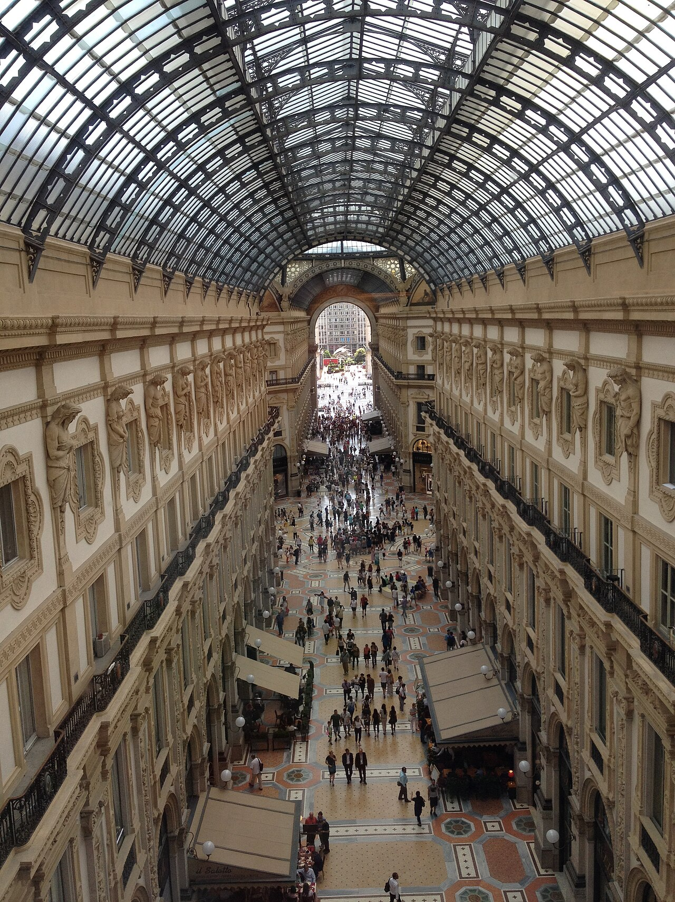

# 坎帕里诺长廊酒吧

米兰大教堂广场旁，Galleria Vittorio Emanuele II 的北拱廊下，有一间总是站着人的酒吧：大理石吧台、黄铜扶手、红白相间的 Campari 标志，吧台后面的马赛克在灯光下泛着光。这里是 Camparino in Galleria。它不像传统咖啡馆那样让你坐下慢慢喝，而是把“站着喝一杯 Campari Seltz、吃两口小食、再继续走”的米兰习惯保留下来。对很多米兰人来说，Camparino 不是旅游景点，而是下班后、看歌剧前、购物途中顺路停一下的地方。

图：米兰 Galleria Vittorio Emanuele II 的内部拱廊；Camparino 位于长廊北侧拱廊、Piazza Duomo 一侧，照片展示的是长廊建筑与马赛克地面，不是 Camparino 酒吧内部。图片：Dispe，CC0，via Wikimedia Commons（[原图页面](https://commons.wikimedia.org/wiki/File:Galleria_Vittorio_Emanuele_II_di_Milano_-_Interno_-_Vista_da_un_piano_alto.JPG)）。

## 1915 年：坎帕里诺长廊酒吧的关键起点
Camparino 的故事要从 1867 年说起。那一年，Gaspare Campari 在刚刚落成的 Galleria Vittorio Emanuele II 里开出 Caffè Campari，位置正对 Piazza Duomo；长廊也在 1867 年开放，酒吧的店面与这座建筑同龄。同年，他的儿子 Davide Campari 出生，后来被称为“第一个在长廊里出生的米兰公民”。1915 年，Davide 在父亲咖啡馆的旁边开了一间“小 Campari”——Camparino，作为 Caffè Campari 的“弟弟”。

Camparino 从一开始就不是普通酒吧。它装了一套从地窖直通吧台的苏打水系统，能稳定供应冰镇苏打水，让 Campari Seltz 在整杯喝完后仍保持气泡与低温；吧台与杯子预先冰镇，也是当时的创新。室内请来 Eugenio Quarti 做木作、Alessandro Mazzucotelli 做铁艺、Angelo d'Andrea 设计 Bar di Passo 的马赛克，形成典型的意大利自由风格（Liberty）装饰。1915 年的这些细节，今天仍是 Camparino 的空间核心。

1943 年 8 月，米兰遭到轰炸，Galleria 与 Camparino 严重受损。战后重建，Miani 家族经营了很长一段时间；2018 年，Campari 集团重新收回这间酒吧，进行修复，2019 年以更完整的历史空间重新开放。它现在既是 Campari 的品牌旗舰，也是米兰 aperitivo 的公共地标。这个双重身份需要小心处理：它确实有商业品牌的意图，但也确实保留了 1915 年的空间与站立式饮酒习惯，不能简单归类为“广告店”。

## 空间与酒单

Camparino 分三个区域。Bar di Passo 是最靠近拱廊的站立式吧台，客人站着喝，速度快、气氛热闹；Sala Spiritello 是可以坐下的厅，适合朋友聊天与吃饭；Sala Gaspare Campari 需要预订，更安静，适合正式用餐或私人聚会。Bar di Passo 的马赛克、黄铜吧台与高脚凳是标志性画面；Sala Spiritello 则有更完整的自由风格装饰与座位。

酒单以 Campari 为核心：Campari Seltz（Campari、冰镇苏打水、冰块，通常不加柠檬）、Negroni、Americano、Milano-Torino、Garibaldi 等。Campari Seltz 是这里的“原点饮品”，1915 年就有；Negroni 与 Americano 则是米兰 aperitivo 的经典。食物以意式小食、三明治、沙拉与简单主菜为主，Sala Spiritello 的菜单更完整。它不是高端正餐餐厅，也不是只卖酒的站吧；最合适的用法是“喝一杯 + 吃一点”。

## 怎么喝

第一次来，先在 Bar di Passo 点一杯 Campari Seltz，站着喝，观察吧台节奏。Campari Seltz 的酒精度不高，气泡强，适合白天与餐前；若觉得苦，可以先从 Americano 或 Milano-Torino 入门，再过渡到 Negroni。点 Negroni 时，可以说清楚要“classic”还是“less sweet”；吧台会按标准比例做。

想坐下来吃饭，去 Sala Spiritello；想安静约会或商务晚餐，提前订 Sala Gaspare Campari。aperitivo 时段（傍晚）最热闹，Bar di Passo 会挤满人；想拍照，开门后不久或下午非餐期更合适。不要站在通道中央挡住拱廊人流；这里首先是一个公共通道，其次才是酒吧。

## 坎帕里诺长廊酒吧的地址与营业安排
地址是 Piazza Duomo 21, 20121 Milano，位于 Galleria Vittorio Emanuele II 北侧、面向大教堂广场。地铁 Duomo 站直达；周边是米兰大教堂、La Scala、Royal Palace 与 Museo del Novecento。

营业时间按官网：Bar di Passo 周一至周六 09:30–23:00，周日 09:30–22:00；Sala Spiritello 周一至周四 12:00–15:00、16:00–23:00，周五至周六 12:00–00:00，周日 12:00–22:00；Sala Gaspare Campari 需预订。每年大约营业 362 天，具体节假日以官网为准。

Bar di Passo 不接受预订，先到先得；Sala Spiritello 与 Sala Gaspare 建议订位。没有严格着装要求，但晚上与周末，商务休闲更合适。小费不是强制，账单可能含 servizio；可留 5%–10% 或整数。站着喝通常比坐下便宜，这是意大利咖啡馆的常见规则。

## 礼仪与常见误区

第一个误区是把 Camparino 当成“Campari 广告店”；它确实是品牌旗舰，但也有 1915 年以来的独立空间与酒吧功能。第二个误区是坐下就不走；Bar di Passo 是站立式吧台，翻台快，长时间占座不合适。第三，Campari Seltz 不是“越冰越好”；杯子和酒都冰镇，但加太多冰会稀释，按吧台做法即可。第四，不要挡住 Galleria 的通道；这里是公共建筑，拍照要让行人。第五，不要默认可以随时订到 Sala Gaspare；热门时段要提前。

Camparino 的站立式 Bar di Passo 与堂食区价格、服务不同；把这里当成可以久坐的餐厅，会错过它作为 aperitivo 快节奏地标的用法，也可能在高峰时段占错座位。

## 从坎帕里诺长廊酒吧延伸到意大利 Campari
从 Camparino 出来，抬头就是 Galleria 的玻璃穹顶与马赛克地面，往北是 La Scala，往南是米兰大教堂与 Royal Palace，往西是 Museo del Novecento。把 Camparino 放进“米兰 aperitivo”路线，可以先去大教堂，再到这里喝 Campari Seltz，最后去 La Scala 或 Navigli。想理解 Campari 与意大利饮酒文化，读[意大利 Campari](ref:campari)、[Negroni](ref:negroni)与[Americano](ref:americano)；想比较欧洲酒吧空间，读[American Bar at the Savoy](ref:savoy)与[Antico Caffè Greco](ref:greco)。

**关键事实。**

| 项目 | 内容 |
| --- | --- |
| 一句话定位 | 米兰 Galleria Vittorio Emanuele II 北拱廊的 Camparino in Galleria，1915 年由 Davide Campari 开办；以 Campari Seltz、站立式 Bar di Passo 与自由风格马赛克闻名，是米兰 aperitivo 的地标 |
| 地址 | Piazza Duomo 21, 20121 Milano, Italy |
| 城市/国家 | 米兰 / 意大利 |
| 营业状态 | 已核验营业 |
| 官网 | camparino.com |

**来源与边界。** 本页关于「坎帕里诺长廊酒吧」的关键事实，主要由以下来源交叉核对：Camparino in Galleria（地址、Bar di Passo / Sala Spiritello / Sala Gaspare Campari 的营业时间与预订方式）、Campari Group（交叉核对 Gaspare Campari 在 Galleria 开店、Davide Campari 出生与 1915 年 Camparino 的品牌脉络；1915 年 Campari Seltz 的供应方式、冰镇杯与从地窖送苏打水的系统）。产品、地址或营业状态变化较快时，以 camparino.com 的最新页面为准；价格、批次与状态会变，涉及这些字段时以页面所列来源的最新版本为准。正文为项目自写，来源只作核验，不复制原文。

**并读。** 把「坎帕里诺长廊酒吧」与「金巴利」、「内格罗尼」、「美国佬」放在一起读时，先确认它们是同一层级还是上下游关系：先确认地址与营业状态，再比较历史、空间与点单体验。本页负责给出场所的基本坐标，对照条目补上具体案例与差异；读完再回到本页，才能分清哪些差别属于场所本身，哪些只是产地、批次或品牌选择。

**适用边界。** 对「坎帕里诺长廊酒吧」而言，营业时间、预约方式与菜单会变；到访前以官网、电话或现场公告为准。

**更新提示。** 「坎帕里诺长廊酒吧」最近核对于 2026-11-21；地址、营业时间、门票与预约会变，出行前以官网当日公告为准。

## 参考资料
- [意大利 Campari](ref:campari)
- [Negroni](ref:negroni)
- [Americano](ref:americano)
- [American Bar at the Savoy](ref:savoy)
- [Antico Caffè Greco](ref:greco)

最后核对：Piazza Duomo 21 的埃马努埃莱二世长廊入口、站立区与座位区规则按官网查于 2026-11-21；“第一”与“地标”只作历史叙述，不作无争议排名。本页是“喝酒去”的米兰长廊酒吧条目，中文与英文版同步；文字许可见上方 rights 字段，图片署名与许可见各图注。

对照阅读：[金巴利](ref:campari)、[美国佬](ref:americano)。
