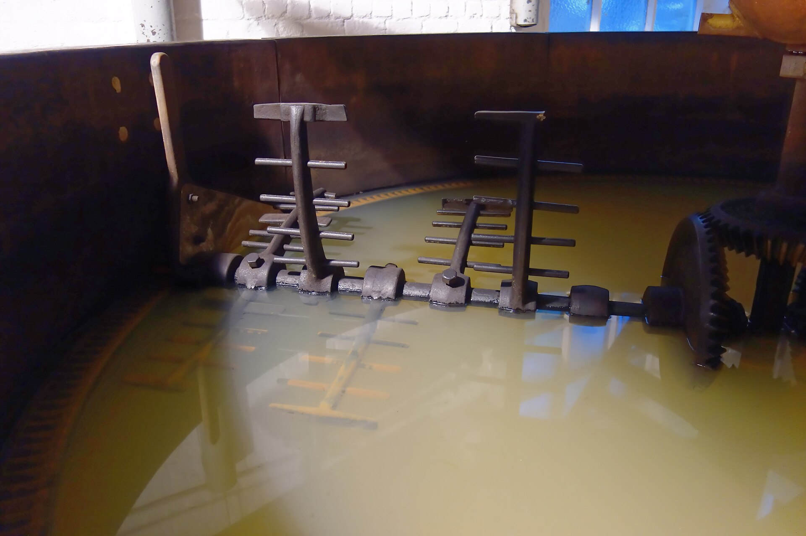
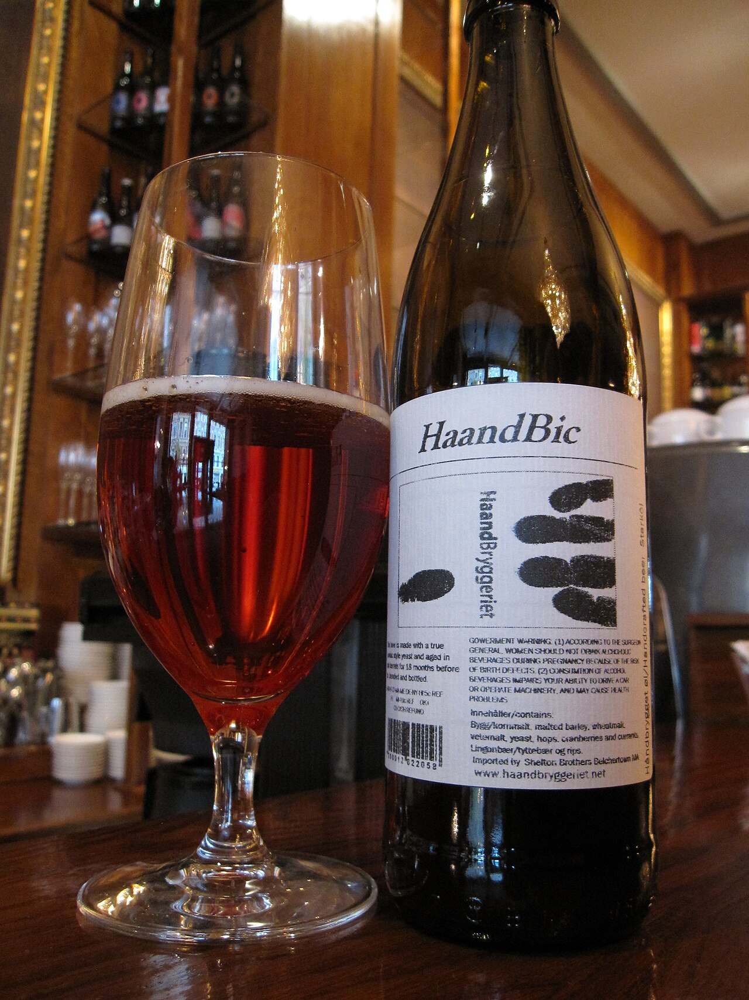

# 康帝隆酒厂

图：康帝隆酒厂相关实景照片。图片：Abujoy，CC BY 4.0，via Wikimedia Commons（[原图页面](https://commons.wikimedia.org/wiki/File:Brasserie_Cantillon_02.jpg)）。

## 安德莱赫特的兰比克门口

康帝隆在布鲁塞尔市西南的安德莱赫特，门牌是 Rue Gheude 56，邮编 1070。它不在老城景点密集的那一圈，最近的交通节点是地铁 Clemenceau 与布鲁塞尔南站（Gare du Midi），从南站步行约十分钟。周边是普通的城市街区：修车行、仓库、住宅与几栋新楼，酒厂藏在一排不起眼的门面后面。第一次来的人常会怀疑走错，直到看见门口的酒桶与“Musée Bruxellois de la Gueuze”的字样。

这个位置本身就是信息。兰比克的传统产区不是某一片葡萄园式的乡村，而是布鲁塞尔城区与西南的 Pajottenland 一带，靠 Senne 河谷的气候与空气中的野生微生物。康帝隆是今天少数仍在布鲁塞尔市内酿酒、且对外开放的兰比克酒厂，官网把自己称作“布鲁塞尔最后一家兰比克酒厂”。这句话指的是市内产能与家族经营，不是说比利时只剩这一家。

## 1900 年，与一座“活着的博物馆”

酒厂在 1900 年建立，厂名沿用家族姓氏，后来由 Van Roy 家族接手经营。1978 年，Jean-Pierre Van Roy 与友人成立“布鲁塞尔贵兹博物馆”协会（Musée Bruxellois de la Gueuze），当时的背景并不浪漫：自发发酵啤酒被视为过时的产品，酒厂面临消失的风险。协会用导览、展览与公开酿造日把酒厂变成一座“活博物馆”，设备继续使用，酒继续酿，参观者看到的是生产现场，而不是被封存的展柜。

所以这里的参观没有“先看展板再进车间”的分界。铜制糖化锅、冷却盘、橡木桶与堆到天花板的酒瓶同时构成展览与生产线。运气好的话能看到正在糖化、装瓶、洗桶，或在夏天看到水果啤酒的浸渍准备；也可能什么都看不到，因为当天的工序不对外开放。这种不确定性是活博物馆的代价，也是它比标准化展馆更值得来的原因。

## 自发发酵：酒厂本身就是展品

兰比克不接种商业酵母。麦汁糖化后泵入浅而宽的冷却盘（coolship），在夜间自然降温，空气中的野生酵母与细菌落入麦汁，随后进入橡木桶进行长达一年以上的[发酵](ref:fermentation)与熟成。桶壁的微生物群落、酒窖的温度与湿度、甚至当年的气候，都会进入风味。酸、霉香、皮革、柑橘、干草这些词，描述的就是这套不可控系统。

橡木桶在这里不是“增添木味的工具”，而是微生物的家。康帝隆的桶有些已经使用超过一百年，只做必要的维护，不追求新桶的香草与烘烤味；[橡木陈年](ref:oak-ageing)的作用是让酒在缓慢氧化与微生物作用下变得干、复杂、耐放。年轻的兰比克尖锐，陈年的兰比克沉稳，贵兹就是把不同年份混在一起，再在瓶中二次发酵。这也是[兰比克](ref:lambic)与普通酸啤的分界：前者靠环境与时间，后者可以用接种菌种在几天内做出酸度。

## 酒单与品鉴顺序

基础款是 Lambic Bio，未经调配的年轻兰比克，酸度高、气泡少；Gueuze 由不同年份的兰比克调配后在瓶中二次发酵，气泡细、酸度立体；Kriek 与 Framboise 分别用樱桃与覆盆子浸渍，果香真实，不是糖浆味；Iris 用干投酒花，是酒厂里较少见的“酒花型”兰比克；Saint-Gilloise、Lou Pepe 与 Nath 等系列各有年份与配方差异；标签写“100% Lambic Bio”的，强调全部使用有机兰比克。

品鉴顺序建议从最干、最轻的开始：先 Lambic，再 Gueuze，最后水果款与特殊款。温度不要过低，过冰会把霉香与果香一起压掉；杯子用小郁金香杯，倒少量，让酒在杯里回温。若只在商店买酒带走，注意瓶装贵兹适合继续陈放，但运输与储存要避光、避高温。把这些酒放回[比利时](ref:belgium)的啤酒版图里看，它们是唯一以“自然发酵”而不是“选育酵母”为核心的一支。

## 两种参观：平日自由行与周六导览

平日（周一、周二、周四、周五）10:00–16:00 是自由参观，不需要预约，到门口买票即可，成人票 9 欧元、优惠票 8 欧元，16 岁以下免费；参观约一小时，结束时给三小杯品鉴：兰比克、贵兹与一款水果啤酒。商店开到 17:00。周三、周日与公共假日闭馆，2026 年的年度闭馆安排在 7 月 27 日至 8 月 1 日，年底与年初也有缩短或闭馆日，出发前必须查官网。

周六只提供导览，必须在线预约，票价 13 欧元，时长约一个半小时，同样含品鉴。十人以上的团体不能走自由参观，需要提前至少两周邮件预约私人导览；15 人以上按每人 13 欧元计，15 人及以下按 195 欧元的包场价。酒厂不允许带狗。它不参加布鲁塞尔博物馆通票（Museum Pass），不要拿着通票直接来。

## 兰比克的地理与规则

兰比克不是一个可以随便搬到任何地方复制的配方。传统上它限定在布鲁塞尔与 Pajottenland，靠当地空气、酒窖微生物与长期陈酿形成风味；欧盟对“Oude Geuze”“Oude Kriek”等传统名称有传统特色保证（TSG）保护，对原料、调配与陈年有定义，具体适用范围以法规文本为准。酒厂自己的“100% Lambic Bio”标签，则是对有机原料与全兰比克配方的自我约束。

对消费者来说，法规的实际意义是：看到“Oude”字样，通常意味着更长的陈年与更酸的风格；没有这个词的“Gueuze”可以是较年轻的调配，甜度也可能更高。把[酸啤](ref:sour-beer)当成一个笼统口味类别会掩盖这些差异。兰比克的酸不是加乳酸调出来的，而是发酵与陈年共同产生的，这也是它难以被“快速复制”的原因。

## 实用信息

**地址**：Rue Gheude 56, 1070 Bruxelles, Belgium（安德莱赫特）。**交通**：地铁 2 号线或 6 号线至 Clemenceau，步行约五分钟；从布鲁塞尔南站步行约十分钟；电车 81 路与 82 路在附近有站。**开放时间**：周一、周二、周四、周五、周六 10:00–16:00，商店至 17:00；周三、周日与假日闭馆。**票价**：平日自由参观 9 欧元、优惠 8 欧元；周六导览 13 欧元；16 岁以下免费。

**提示**：酒窖温度低，夏天也要带件外套；地面湿滑，穿防滑鞋；不要触摸桶与设备；品鉴后要骑车或开车的人可以只买瓶装带走。周边餐饮不多，建议回南站或市中心吃饭。本页不列坐标，坐标以官方渠道为准。

对照阅读：[兰比克](ref:lambic)、[比利时](ref:belgium)。

相关条目：[酸啤酒](ref:sour-beer)。

**关键事实。**

| 项目 | 内容 |
| --- | --- |
| 一句话定位 | 布鲁塞尔安德莱赫特的自发发酵兰比克酒厂，1900 年建厂，兼作布鲁塞尔贵兹博物馆；平日自由参观、周六只做预约导览，是理解兰比克与贵兹的核心现场 |
| 地址 | Rue Gheude 56, 1070 Bruxelles, Belgium |
| 城市/国家 | 布鲁塞尔 / 比利时 |
| 营业状态 | 已核验营业 |
| 官网 | cantillon.be |

## 相关图像

图：酸啤酒。图片：Bernt Rostad，CC BY 2.0，via Wikimedia Commons（[原图页面](https://commons.wikimedia.org/wiki/File:Norwegian_sour_beer.jpg)）。关联图像：康帝隆酒厂。
