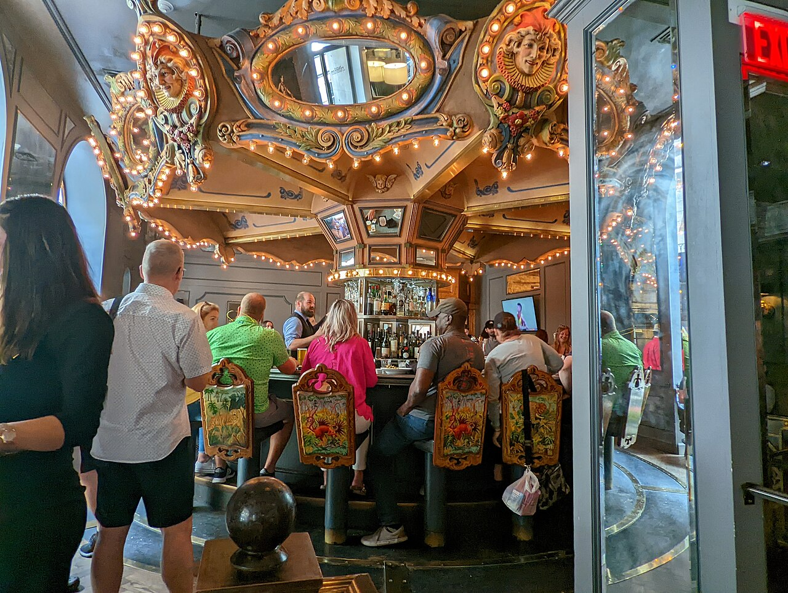

# 旋转木马酒吧

皇家街（Royal Street）上的 Hotel Monteleone 大堂里，有一座真的会转的酒吧：圆形吧台被做成旋转木马的样子，彩绘马、镜面、灯泡与镀金雕饰围成一圈，吧台本身以很慢的速度绕着房间转。第一次坐下时，你会觉得是旁边的客人在移动；过几分钟才意识到，转的是自己。它不是主题餐厅式的“布景”，而是一台 1949 年安装、至今仍在运转的饮酒机器。

图：Hotel Monteleone 内旋转木马酒吧的彩绘吧台与顶棚；吧台 1949 年安装，现有木马顶棚为 1992 年加建。图片：Carnaval.com Studios，CC BY 2.0，via Wikimedia Commons（[原图页面](https://commons.wikimedia.org/wiki/File:Carousel_Bar_at_Hotel_Monteleone,_New_Orleans,_April_2022.jpg)）。

## 1949 年：旋转木马酒吧的关键起点
Hotel Monteleone 由西西里移民 Antonio Monteleone 于 1886 年买下，后来成为法国区少有的家族经营老酒店。Carousel Bar 于 1949 年安装在原来的 Swan Room 夜总会空间里；当时并没有现在这座华丽的旋转木马顶棚，1992 年翻新时才加上顶棚与光纤“星空”，还有一颗定时划过的流星。吧台有 25 个座位，底下由 2,000 个钢滚轮支撑，用 1/4 马力电机拉动，约 15 分钟转一圈。1999 年，酒店被 Friends of the Library Association 指定为文学地标；福克纳、田纳西·威廉斯、杜鲁门·卡波特等人都曾是客人。卡波特常开玩笑说自己出生在这家酒店，实际他母亲临产时住在酒店，但最后还是去了医院。

把它的历史放回酒店与城市里看，会更完整。Hotel Monteleone 1886 年由 Antonio Monteleone 买下 64 间房的 Commercial Hotel 起家，后来扩成法国区少有的高层酒店；1949 年，家族在原来的 Swan Room 夜总会里装上旋转吧台，最初并没有现在的木马顶棚。1992 年翻新加了顶棚与光纤星空，才变成今天的样子。1999 年，Friends of the Library Association 把酒店指定为文学地标，全美只有少数酒店获此称号；福克纳、田纳西·威廉斯、Eudora Welty、卡波特都住过或喝过。Vieux Carré 是 1938 年 Walter Bergeron 在酒店里创作的，比旋转吧台还早 11 年；它用干邑、黑麦、甜味美思、Bénédictine 与两种苦精，把法国区多族裔的味觉写成一杯酒。

## 空间与酒单

酒吧最醒目的是头顶的旋转木马顶棚：彩绘面板、镜面、灯泡与金色卷草纹，围出一圈很上镜的空间；吧台外的休息区有桌子和沙发，现场钢琴与爵士乐几乎每晚都有。酒单以新奥尔良经典为主：Vieux Carré 是酒店 1938 年由主调酒师 Walter Bergeron 创作的招牌，配方用黑麦威士忌、干邑、甜味美思、Bénédictine、Angostura 与 Peychaud's，对应法国、美国、意大利与加勒比移民的味觉拼图；Sazerac 是本地官方鸡尾酒；此外有 Pimm's Cup、Fleur de Lis、Monteleone 等。它不是精酿啤酒吧，也不是严肃的调酒实验室，强项是“在旋转的房间里喝一杯有地方历史的酒”。

吧台转一圈约 15 分钟，正好对应一杯鸡尾酒从入口到喝完的节奏；座位有限，高峰期通常需要等位。

## 怎么喝

想坐旋转吧台，最好一开门就到，25 个座位很快满；坐不上就选旁边的桌子，仍能看到转动的吧台与现场音乐。第一次来点 Vieux Carré，想清爽一点就点 Pimm's Cup 或 Fleur de Lis；Sazerac 适合想喝烈一点的人。坐旋转座位时，把杯子放在吧台上，不要用手一直扶着杯脚，也不要频繁起身，否则容易晕。容易晕车的人建议坐外圈桌子，照样能看吧台转动。晚上 9 点后气氛更热闹，下午则更适合安静聊天。

## 旋转木马酒吧的地址与营业安排
地址是 Hotel Monteleone, 214 Royal Street, New Orleans, LA 70130。从 Canal Street 有轨电车站步行几分钟即到，法国区内基本可以走路。酒吧每日 11:00–00:00；官方标注 21 岁以上时段（夜间），具体以官网与门口提示为准。不接受订位，按先到先得；周末与节日排队常见。着装是 smart casual，酒店客人也会穿得较正式。消费中上，鸡尾酒价格高于普通酒吧；坐旋转吧台通常有最低消费或时段限制，入座前先问清楚。

## 礼仪与常见误区

第一，吧台在转，不代表你可以把杯子放在边缘不管；杯子离手容易被带走，放在吧台内侧更稳。第二，Vieux Carré 是 1938 年由 Walter Bergeron 在 Hotel Monteleone 创作，不是“最近某位调酒师发明”；不同酒吧的配方会有差异，不要把他处的版本当成唯一正解。第三，Carousel 1949 年安装，但现在的顶棚是 1992 年加的，别把“1949”当成整座装置的年代。第四，这里是酒店酒吧，不是游乐场：不要为了拍旋转效果反复站起来走动，也不要让小孩坐在吧台边。第五，卡波特“出生在酒店”是他说过的玩笑，事实是他母亲住在酒店，但生产去了医院。

旋转吧台不是游乐设施：座位会缓慢移动，离座或把杯子放在台面上都要考虑转动；想拍照应避开用餐高峰。

约 15 分钟转一圈是近似节奏，座位会移动；离座前先看吧台位置，别把杯子留在转动台面上。

## 从旋转木马酒吧延伸到老苦艾酒屋
从酒店出来，沿 Royal Street 往北是画廊与古董店，往南可到 St. Louis Cathedral 与 Jackson Square；往西北步行几分钟是 Bourbon Street 的[老苦艾酒屋](ref:old-absinthe)，往东北可到[拿破仑屋](ref:napoleon)。把这三处串成一条法国区酒吧线很顺：先在拿破仑屋吃 muffuletta，再到老苦艾酒屋喝 Absinthe Frappé，最后到这里喝 Vieux Carré。想理解“在酒吧里消费时间”的写法，可读[一杯酒里的时间](ref:time-in-cup)；Vieux Carré 与 Sazerac 的历史分别见[老广场](ref:vieux-carre)与[萨泽拉克](ref:sazerac)。

**关键事实。**

| 项目 | 内容 |
| --- | --- |
| 一句话定位 | 新奥尔良 Hotel Monteleone 内的 1949 年旋转酒吧，25 个座位，约 15 分钟转一圈，以 Vieux Carré、Sazerac 与现场钢琴闻名 |
| 地址 | Hotel Monteleone, 214 Royal Street, New Orleans, LA 70130, USA |
| 城市/国家 | 新奥尔良 / 美国 |
| 营业状态 | 已核验营业 |
| 官网 | hotelmonteleone.com |

**来源与边界。** 本页关于「旋转木马酒吧」的关键事实，主要由以下来源交叉核对：Hotel Monteleone（1949 年、15 分钟一圈、每日 11:00–00:00、21 岁以上时段与现场音乐；25 个座位、2,000 个钢滚轮、1/4 马力电机、1992 年加顶与光纤星空）、Historic Hotels of America（酒店 1886 年、Carousel 建在 Swan Room 原址、1999 年文学地标）、Atlanta Magazine（交叉核对旋转速度、吧台没有入口、Vieux Carré 的多元文化配方解释；以酒店官方为主）。产品、地址或营业状态变化较快时，以 hotelmonteleone.com 的最新页面为准；价格、批次与状态会变，涉及这些字段时以页面所列来源的最新版本为准。正文为项目自写，来源只作核验，不复制原文。

## 参考资料
- [一杯酒里的时间](ref:time-in-cup)
- [老广场（Vieux Carré）](ref:vieux-carre)
- [萨泽拉克](ref:sazerac)
- [拿破仑屋](ref:napoleon)
- [老苦艾酒屋](ref:old-absinthe)

本页于 2026-11-21 核对 Hotel Monteleone 与 Carousel Bar 的官方页面。酒吧每日 11:00–00:00、不接受订位、21 岁以上夜间时段等规则可能随活动调整；到访前查酒店官网与门口提示。旋转吧台 1949 年安装、顶棚 1992 年加建，Vieux Carré 1938 年由 Walter Bergeron 创作，这些年代与卡波特出生传闻都已在正文保留限定。本页图片是旋转木马酒吧的彩绘吧台与顶棚，不是酒店其他区域；图注已逐张署名，图片许可见来源页。
