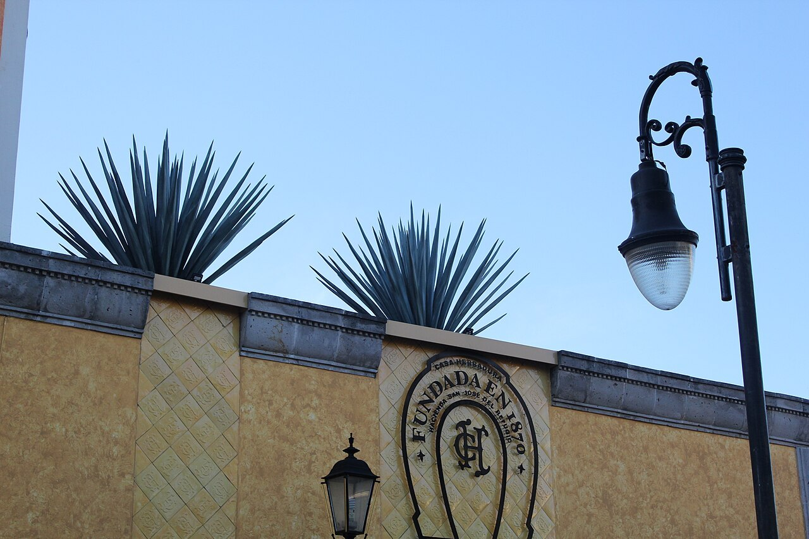
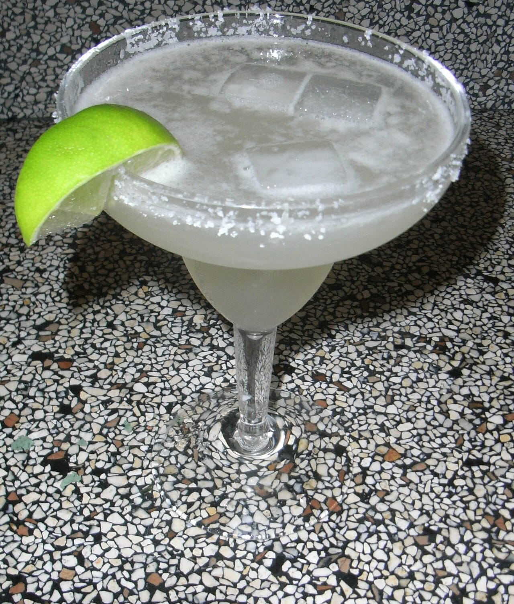

# 埃拉杜拉酒厂：阿马蒂坦的马蹄庄园

埃拉杜拉（Casa Herradura）在哈利斯科州阿马蒂坦（Amatitán）的圣何塞德尔雷富希奥庄园（Hacienda San José del Refugio），是龙舌兰酒低地产区里少数仍把葡萄园式庄园、生产车间与装瓶线放在同一片土地上的老字号。它常被压缩成“1870 年创立”，但真正值得看的是它如何在二十一世纪保留砖砌穹顶炉、露天野酵母发酵与自建美国白橡木桶，同时又用现代磨机替换了驴拉的塔霍纳。

图：埃拉杜拉酒厂：阿马蒂坦的马蹄庄园。摄影：Casa Herradura。署名：Lupita Sarai，CC BY-SA 4.0，来自 Wikimedia Commons（[来源](https://commons.wikimedia.org/w/index.php?curid=84673666)）。

## 从阿马蒂坦的火山低地开始

阿马蒂坦在哈利斯科州中部，位于瓜达拉哈拉与特基拉镇之间的公路线上，是官方叙事里的“龙舌兰酒摇篮”之一。酒厂地址写作圣何塞德尔雷富希奥旧庄园、多尼亚·加布里埃拉·佩尼亚·洛萨达街 405 号，邮编 45380。从瓜达拉哈拉开车约一小时，从特基拉镇约二十分钟；公共交通班次有限，最稳妥的方式是自驾或参加含接送的团队。导航可搜“Casa Herradura, Amatitán”，入口在庄园主路，停车按现场指引；不要只按邮编定位。

庄园周边是火山成因的低地，海拔不算高，昼夜温差比高原产区温和。酒厂说，这里的蓝色韦伯龙舌兰带有更明显的土质与草本气息；龙舌兰要长到六至八年才收割，jimador 用 coa 削去叶片，只留下甜度集中的 piña。

## 一座仍在运转的十九世纪庄园

酒厂把起点定在 1870 年，地点就是阿马蒂坦。传说蒸馏师奥雷利奥·洛佩斯·罗萨莱斯在田里看到一件反光的东西，以为是金子，走近才发现是一只马蹄铁，于是把它当作好运的征兆；“herradura”在西班牙语里就是马蹄铁，1928 年它正式成为品牌名。

埃拉杜拉经历了墨西哥革命、克里斯特罗战争与土地改革，产权也几度易手，但生产没有中断。它今天属于百富门集团，却仍以“庄园自产、自蒸馏、自装瓶”作为叙事核心。对访客而言，看到的不是一座纯展示用的博物馆，而是仍在出酒的老厂房：十九世纪的厚墙与高屋顶，接着现代化的不锈钢罐与灌装线。

## 砖砌穹顶炉、野酵母与铜壶

工艺上最容易被忽略的一点是：埃拉杜拉并没有完全停留在旧法。piña 仍被码进手工砌起的砖砌穹顶炉，慢蒸约 26 小时，让淀粉转成可发酵糖，并带出熟龙舌兰的焦糖与坚果气息；但磨碎环节早已改用现代设备，取代了历史上由驴拉动的塔霍纳石轮。酒厂并不掩饰这一点，反而把它表述为“该保留的保留，该效率化的效率化”。

发酵是另一处关键。开放式发酵槽里不接种商业酵母，而是依靠庄园周边十六种以上果树带来的野生酵母，发酵约三天。野生酵母的种群随季节与天气变化，批次差异因此比恒温接种更大，也更难复制。蒸馏用铜壶进行二次蒸馏，掐去甲醇含量高的酒头与杂醇多的酒尾，只取中段；随后一部分酒液进入烤过的美国白橡木桶。这套“蒸煮—发酵—蒸馏—陈年”的链条，正好对应[龙舌兰](ref:agave)、[蒸馏](ref:distillation)与[橡木陈年](ref:oak-ageing)三个基础条目。

## 产品线：从 Blanco 到 Selección Suprema

埃拉杜拉的产品线把陈年时间拉得很开：Blanco 不经桶，保留最直接的熟龙舌兰与胡椒；Silver 在桶中约 45 天，只取一点香草与圆润感；Reposado 陈年 11 个月，是它在上世纪带火的类别；Añejo 至少 25 个月，出现烤坚果、焦糖与旧木；Ultra 是把 Añejo 过滤成清澈的 cristalino，再加少量龙舌兰糖浆；Selección Suprema 在 1994 年推出，是业界最早的 Extra Añejo 之一；Legend 与 Aniversario 则把陈年推到更久，后者为纪念 150 年而陈年 100 个月。2001 年，特雷莎·拉拉·洛佩斯成为龙舌兰行业第一位女性生产负责人，这也是酒厂历史叙事里常被提到的一笔。

如果只喝一款，Blanco 最能说明它的底子：低地龙舌兰的草本、黑胡椒与矿物质感是否干净，二次蒸馏是否利落，一入口就清楚。若想理解陈年，可把 Reposado 与 Añejo 对读。用埃拉杜拉做[玛格丽特](ref:margarita)时，Reposado 的甜润会压住青柠的尖角，Blanco 则更适合干爽、盐边明显的版本。

## 与 NOM-006 和法定产区的关系

[龙舌兰酒](ref:tequila)受墨西哥官方标准 NOM-006-SCFI-2012 约束：只有用蓝色韦伯龙舌兰、在法定产区内完成规定工艺，才能叫 tequila；标“100% de agave”的酒必须全部糖分来自蓝色韦伯龙舌兰，未标明的“mixto”则至少要有 51% 的糖分来自它。陈年名称也有下限：Reposado 至少两个月，Añejo 至少十二个月，Extra Añejo 至少三十六个月。埃拉杜拉把自家陈年时间拉得远高于下限，这是品牌策略，不是法规要求。

法定产区并不只在哈利斯科一州，还包括瓜纳华托、米却肯、纳亚里特与塔毛利帕斯的部分市镇；阿马蒂坦属于哈利斯科核心带。酒厂与监管委员会的关系，体现在每一批酒的溯源、窖藏记录与瓶标审批上。对消费者来说，最实用的判断是看瓶身是否有 CRT（龙舌兰酒监管委员会）的认证标记与 NOM 编号。

## 导览、价格与预约

参观全部通过官网预约，现场不保证有散客名额。目前公布两类常规体验：“Casa Herradura 体验”约 2.5 小时，每人 950 墨西哥比索，走历史建筑、砖炉、发酵区与陈年区，并有一场引导式品鉴；“双桶仪式”约 3 小时，每人 2,200 墨西哥比索，重点讲二次入桶与只在该线路提供的在陈酒样。另有按需定制的私人体验，需发邮件询问。所有访客须年满 18 岁，入场可能查验证件。

价格、语言与场次会调整，出发前以官网为准。旺季、周末与墨西哥假期名额紧张，最好提前数日预订；如果只想买酒，可以只进商店，不必参团。

## 到访提示：把品鉴留在庄园里

**交通**：从瓜达拉哈拉自驾约一小时，从特基拉镇约二十分钟；庄园外有停车空间。参加团队游通常含接送。

**现场**：蒸煮与蒸馏区温度高、地面可能有水，穿防滑、耐脏的鞋；夏天带水与帽子。不要触摸设备、桶塞与管线，拍照前先问陪同人员。

**品鉴**：先喝 Blanco 建立基准，再喝 Reposado 与 Añejo；每杯少量，吐酒是专业做法。

**驾驶**：龙舌兰酒乡的公路不宽，品鉴后不要开车。指定不喝酒的司机，或把行程交给有资质的接送服务；墨西哥各州对酒后驾驶的执法标准不同，以当地法规为准。

把这站与同一条线路上的[福塔莱萨酒厂](ref:fortaleza)对读，能看到两种“传统”：一边是大庄园的规模化延续，一边是小酒厂的旧设备复燃。两处相距不远，适合安排成一天的龙舌兰谷行程。

把 Casa Herradura 放回龙舌兰谷的蒸馏传统，可对照[龙舌兰酒](ref:tequila)与[蒸馏](ref:distillation)。

## 相关图像

图：玛格丽特。图片：Akke Monasso，CC BY-SA 3.0，via Wikimedia Commons（[原图页面](https://commons.wikimedia.org/wiki/File:MargaritaReal.jpg)）。关联图像：埃拉杜拉酒厂：阿马蒂坦的马蹄庄园。
