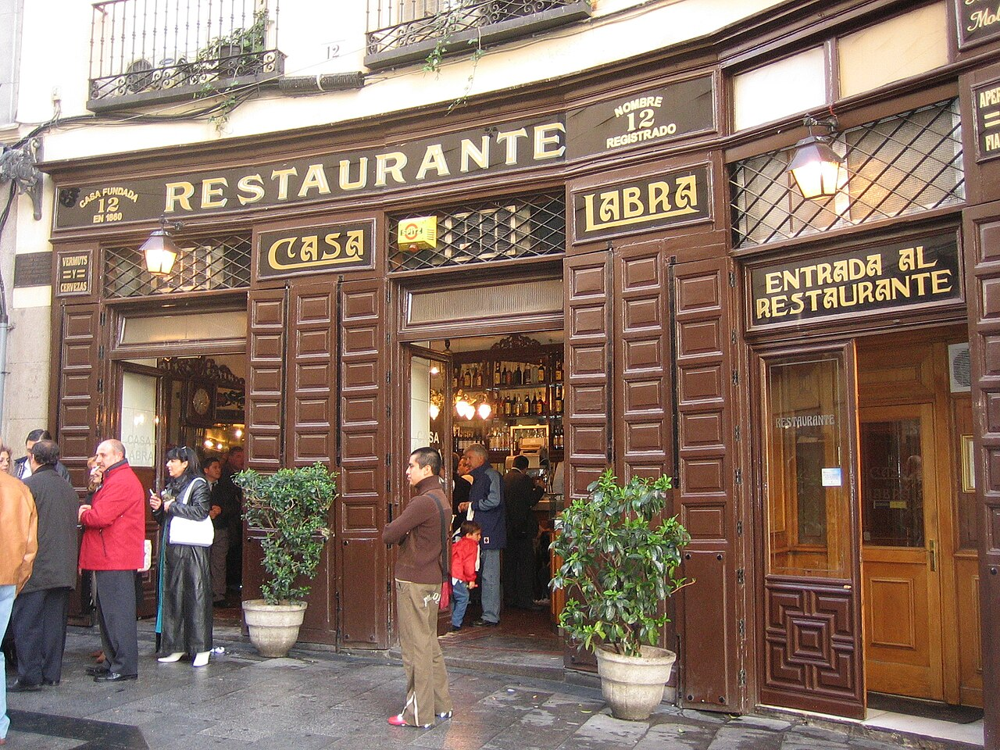

# 拉布拉之家

从太阳门（Puerta del Sol）往北拐进 Calle de Tetuán，走几十米就能看到一块老式玻璃招牌与弧形木立面，门口常有人站着吃炸鱼条。Casa Labra 不是那种有菜单、有服务员、有桌布的餐厅；它更像一间“站着吃”的老酒馆：锌皮吧台、大理石小桌、墙上挂着谚语与老照片，柜台上堆着刚炸好的 bacalao。它离太阳门只有一分钟，却保留着十九世纪马德里 taberna 的节奏。

图：Casa Labra 的弧形木立面与“Restaurante”招牌，Calle de Tetuán 12。图片：Midir，CC BY-SA 4.0，via Wikimedia Commons（[原图页面](https://commons.wikimedia.org/wiki/File:Casa_labra.jpg)）。

## 1860 年：拉布拉之家的关键起点
Casa Labra 于 1860 年开业，最初是 taberna/fonda——既卖酒，也给过路客人提供简单饭菜。它位于马德里老城的心脏，离太阳门、Plaza Mayor 与 Calle Mayor 都很近；十九世纪这一带是报社、咖啡馆、旅馆与政治俱乐部密集的街区。

1879 年 5 月 2 日，西班牙工人社会党（PSOE）在 Casa Labra 的一间后室秘密成立。参加者包括 Pablo Iglesias、Jaime Vera 等人；当时西班牙还没有合法的工人政党，聚会必须避开警察与保守派报纸。今天店方仍把这段历史写在官网与店内介绍里，Casa Labra 也因此成为马德里工人运动记忆的一部分。

1947 年，Molina 家族接手 Casa Labra；此后店面一直由家族经营，现在是第三代。2010 年，Casa Labra 庆祝开业 150 周年，马德里市与 restaurantes centenarios 计划把它列为“百年餐厅”之一。它没有被改造成博物馆或高级餐厅，仍然以炸鱼、炸丸子、牛尾与 callos 这些传统菜为主。

十九世纪的马德里 taberna 不只是喝酒的地方，也承担早饭、午饭、消息交换与临时住宿的功能；Casa Labra 的 fonda 身份正来自这种混合。今天的店面缩小了住宿与正餐部分，但“站着吃、快速喝”的动线仍在，柜台还是整间店最核心的位置。

## 空间与酒单

Casa Labra 的空间分两层：底层是站着吃的吧台区，锌皮台面被几代客人磨得发亮；上层有小桌与餐厅区。外立面是弧形木框与玻璃，招牌是旧式白底黑字；墙上有瓷砖、老照片、海报与西班牙谚语。它没有现代餐厅的开放式厨房，炸锅与柜台就在吧台后面，点单、付钱、取菜都在同一个动线上。

招牌是 bacalao：炸鳕鱼条（tiras de bacalao）、炸鳕鱼丸子（croquetas de bacalao）、炸鳕鱼块；此外有牛尾（rabo de toro）、callos、沙丁鱼、火腿与奶酪。酒以西班牙啤酒、葡萄酒、雪利酒与苦艾酒为主；站着吃鱼条时，一杯冰啤酒或白葡萄酒最顺口。

## 怎么喝

进门先看柜台：若吧台前有空位，靠近柜台点一份 tiras de bacalao 与一杯啤酒；鱼条要趁热吃，外皮脆、里面嫩，凉了会返油。若只想尝一口，点小份鱼条配一杯啤酒即可，不必凑成一整桌菜。想坐下来，问服务生楼上是否有桌；楼上可以点牛尾、callos 与更大的菜。下午与傍晚是高峰，门口会排队，但队伍走得快。

若想体验更接近日常的节奏，可以傍晚 18:30 开门时到，先点一杯啤酒与一份 croquetas，再视情况加 tiras de bacalao；这个时段客人多是附近下班的人，比中午的游客潮安静一些。

不要期待“1879 年 PSOE 成立室”的固定参观；那间后室不是日常开放展区。想了解历史，读店内墙面与官网，或把 Casa Labra 作为“马德里工人运动”步行路线的一站。

## 拉布拉之家的地址与营业安排
- 地址：Calle de Tetuán 12, 28013 Madrid。
- 营业：酒馆 11:30–15:30、18:30–22:30；周一上午休息；餐厅部分目前关闭（据 Tourism Madrid）。
- 交通：地铁 1、2、3 号线 Sol；近 Renfe Sol/Cercanías。
- 预订：酒馆不接受正餐预订，站着吃；楼上桌位视当天情况。
- 价格：鱼条与丸子按份计价，啤酒与葡萄酒便宜；是太阳门周边性价比很高的一站。
- 提示：门口与吧台很挤，背包客要把包背在身前；地面油滑时小心。太阳门周边停车困难，建议步行或地铁前来。

## 礼仪与常见误区

第一，不要把它当成“可以坐一下午”的咖啡馆；Casa Labra 的节奏是站着吃、吃完走，高峰时座位周转很快。第二，不要只点一份鱼条就占着吧台位；吧台是公共空间，吃完让位。第三，不要把 PSOE 成立说成“在餐厅大厅公开举行”；那是秘密聚会，店方与历史资料都强调“后室/秘密”。第四，不要用“1860 年”推断所有装修都是原物；木立面、锌皮台面与内部陈设经过多次修缮，但类型与用法延续。第五，不要在吧台前用闪光灯拍食物与客人；空间小，闪光会影响别人。

## 从拉布拉之家延伸到马杰斯蒂克咖啡馆
从 Casa Labra 出来，往南一分钟是太阳门与 Oso y el Madroño 雕像，往西是 Plaza Mayor 与 Calle Mayor，往东是 Paseo del Prado 与 Museo del Prado 方向。可以排成：太阳门 → Casa Labra 站着吃鱼条 → Plaza Mayor → Mercado de San Miguel → 马德里王宫 → Plaza de Oriente。若想看文学区，往东走到 Huertas 与 Calle de Lope de Vega，那里有 Cervantes 与 Quevedo 的旧居纪念。

相关条目：[马杰斯蒂克咖啡馆](ref:majestic)。

**关键事实。**

| 项目 | 内容 |
| --- | --- |
| 一句话定位 | 马德里太阳门旁 Calle de Tetuán 12 号的 Casa Labra，1860 年作为 taberna/fonda 开业；1879 年 5 月 2 日西班牙工人社会党在此秘密成立 |
| 地址 | Calle de Tetuán 12, 28013 Madrid, Spain |
| 城市/国家 | 马德里 / 西班牙 |
| 营业状态 | 已核验营业 |
| 官网 | casalabra.es |

**来源与边界。** 本页关于「拉布拉之家」的关键事实，主要由以下来源交叉核对：Casa Labra（Calle de Tetuán 12 地址、1860 年开业、1879 年 5 月 2 日 PSOE 成立、1947 年 Molina 家族与招牌菜；交叉核对 1860 年、1879 年、Molina 家族、bacalao 与营业时段）、Puerta del Sol（太阳门街区位置、锌皮吧台、大理石桌、弧形木立面与墙面谚语）、Restaurantes Centenarios de Madrid（交叉核对 1860 年开业、1947 年 Molina 家族接手与 2010 年 150 周年）。产品、地址或营业状态变化较快时，以 casalabra.es 的最新页面为准；价格、批次与状态会变，涉及这些字段时以页面所列来源的最新版本为准。正文为项目自写，来源只作核验，不复制原文。

**并读。** 把「拉布拉之家」与「四猫咖啡馆」、「马杰斯蒂克咖啡馆」、「丽兹海明威酒吧」放在一起读时，先确认它们是同一层级还是上下游关系：先确认地址与营业状态，再比较历史、空间与点单体验。本页负责给出场所的基本坐标，对照条目补上具体案例与差异；读完再回到本页，才能分清哪些差别属于场所本身，哪些只是产地、批次或品牌选择。

**适用边界。** 对「拉布拉之家」而言，营业时间、预约方式与菜单会变；到访前以官网、电话或现场公告为准。

## 参考资料
- 店方官网：<https://www.casalabra.es/>，用于核对 1860 年、1879 年 5 月 2 日、1947 年 Molina 家族与招牌菜。
- 英文页：<http://www.casalabra.es/en/>，用于交叉核对同一组事实。
- Puerta del Sol 街区条目：<https://www.puertadelsol.com/es/casa-labra/>，用于核对锌皮吧台、大理石桌、弧形木立面与墙面谚语。
- Restaurantes Centenarios 2015 年介绍 PDF：<https://www.restaurantescentenarios.es/wp-content/uploads/2015/11/images_pdfs_Presentacion_RCM_2015.pdf>，用于交叉核对 150 周年。
- 同批的 `place:els-quatre-gats`、`place:cafe-majestic` 可以对照南欧“历史咖啡馆/酒馆”的不同类型。
- 相关条目：[四猫咖啡馆](ref:gats)、[马杰斯蒂克咖啡馆](ref:majestic)、[巴黎丽兹 Hemingway 酒吧](ref:hemingway)、[花神咖啡馆（威尼斯）](ref:florian)、[和平咖啡馆](ref:paix)

对照阅读：[四猫咖啡馆](ref:gats)、[丽兹海明威酒吧](ref:hemingway)。
