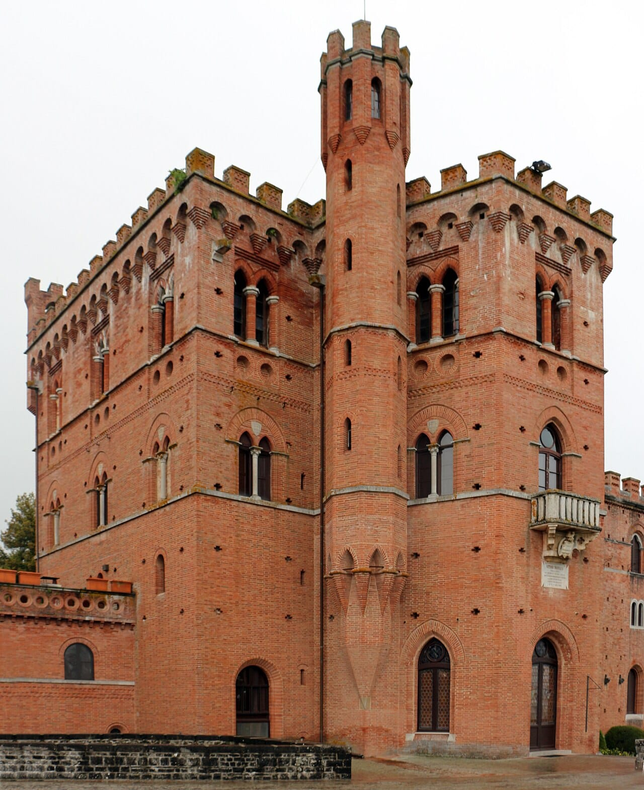

# 布罗利奥城堡

从 Gaiole in Chianti 往南，公路在山脊与橡树林之间爬升，布罗利奥城堡（Castello di Brolio）的塔楼会先于葡萄园出现。它看起来像一座典型的托斯卡纳城堡，但这里不只是拍照的背景：里卡索利家族在这里拥有土地、经营酒庄、参与佛罗伦萨与锡耶纳的战争，也在 19 世纪写下了现代基安蒂的配方。今天买票进入的是城堡、花园与家族收藏，山脚下的酒 shop 则负责品鉴与卖酒；两件事相关，但不是同一张门票。

图：布罗利奥城堡。图片：Sailko，CC BY 3.0，via Wikimedia Commons（[原图页面](https://commons.wikimedia.org/wiki/File:Castello_di_brolio,_edificio_padronale_11.JPG)）。

> **先给结论**
> **一句话：** 这页判断布罗利奥城堡值不值得专程去，以及到访前要核对什么。
>
> - **适合谁：** 正在计划去布罗利奥城堡、想知道值不值得专程安排半天到一天的人。
> - **不适合谁：** 只想要“必去榜单”、不准备核对预约、交通和开放时间的人。
> - **先看这两点：**
>   - 贝蒂诺·里卡索利（Bettino Ricasoli，1809–1880）是这座城堡最常被提起的人物。
>   - 布罗利奥的产品线可以按“城堡—村庄—珍藏—旗舰”来读。

## 一座还在讲政治史的城堡

城堡的第一批石头可以追溯到中世纪。官方介绍把里卡索利家族的取得归因于一次土地交换，相关记录早至 1141 年。此后几个世纪，布罗利奥多次被攻击与摧毁：15 世纪阿拉贡与西班牙军队的进攻、17 世纪的争端，以及第二次世界大战期间的空中轰炸与炮击，都在建筑上留下痕迹。今天看到的城堡是多次重建与改建的结果，中世纪防御工事、罗曼式与哥特复兴式加建、19 世纪托斯卡纳细节叠在一起，不是一座“原样保存”的中世纪城堡。

这种层叠感是参观的重点。城墙、塔楼、庭院与花园不是同一时代的东西；有些墙体明显更厚，有些窗户与装饰更晚。官方把城堡描述为“俯瞰里卡索利公司土地”的地标，庄园在经典基安蒂产区内面积最大，约 1200 公顷，其中约 240 公顷葡萄园、26 公顷橄榄园，全部位于 Gaiole in Chianti 市镇范围内。站在城堡露台往下看，葡萄园、橄榄林、橡树林与谷地连成一片，这个尺度比任何酒标都更能解释“庄园”意味着什么。

布罗利奥在历史上也不是一座安静的酒庄。它位于佛罗伦萨与锡耶纳之间，是双方争夺的前沿；有说法称“布罗利奥一咆哮，锡耶纳就发抖”，这类句子更像地方记忆，而不是精确史料。参观时可以把城堡当作“边界如何被防守、土地如何被经营”的样本，而不是把它简化成一座浪漫的中世纪废墟。

## 里卡索利家族与 1141 年的记录

里卡索利家族在 13 世纪以后分支众多，18 世纪末至 19 世纪初重新合流。官方把家族与葡萄酒的关系追溯到 1141 年，这一年有文字证据表明家族已经拥有布罗利奥城堡；此后他们长期保卫土地与封建权利，也是最早投入农业与葡萄园改良的家族之一。1584 年印制的家族树被认为是经典基安蒂地区最早的图像之一，17 世纪末的文件则记录了向阿姆斯特丹与英格兰的出口。

这些早期记录说明，布罗利奥不是 19 世纪才“发明”的酒庄。它的葡萄酒在 20 世纪初已经出口到中国、沙特阿拉伯、南非、危地马拉、哥斯达黎加与非洲的英属殖民地；今天常见的“意大利名庄”叙事，只是更长贸易史的一段。参观城堡时，家族收藏、地图、文件与肖像把这条时间线摊开，比单看酒标更容易理解“家族企业”如何在几百年里连续运转。

1993 年起，弗朗切斯科·里卡索利男爵（Francesco Ricasoli）接手经营。官方介绍称，他重新整理葡萄园、研究土壤类型、对布罗利奥的桑娇维塞进行克隆选择，并把葡萄园完整测绘。这些工作听起来技术化，却直接决定了今天酒款的风格：哪些地块适合早熟、哪些适合结构、哪些克隆在干旱年份更稳。城堡是门面，葡萄园研究才是酒庄的日常工作。

## 铁男爵与 1872 年的基安蒂配方

贝蒂诺·里卡索利（Bettino Ricasoli，1809–1880）是这座城堡最常被提起的人物。他被称为“铁男爵”，在意大利统一后两次出任首相，是加富尔之后的第二任首相；同时，他也是一位葡萄酒企业家。官方资料称，1872 年，贝蒂诺在写给教授 Studiati 的信中写下了基安蒂的配方，后来被称为经典基安蒂的基础。

这套配方的大意是：桑娇维塞提供香气与骨架，Canaiolo 带来柔和与圆润，Malvasia 等白葡萄则用于稀释前两者的强烈感。需要注意的是，这是 19 世纪的配方，不是今天的法规。经典基安蒂后来经历了多次调整，白葡萄逐渐退出，今天的规定要求桑娇维塞至少 80%，其余为法定红葡萄品种；2006 年起，经典基安蒂可以完全用红葡萄品种酿造。把 1872 年的配方当成“传统”，同时把今天的法规当成“现行规则”，两者不能混为一谈。

这段历史也解释了布罗利奥为什么在经典基安蒂叙事里位置特殊：它既是城堡，也是配方诞生的地方。参观时如果只记住“铁男爵”这个绰号，容易把历史人物浪漫化；更准确的说法是，他把地方经验写成了一套可复制、可讨论的混酿方案，而这套方案后来被产区制度不断修正。

## 看什么：城墙、花园与家族收藏

城堡参观通常包括城墙与塔楼、庭院、花园与里卡索利收藏。城墙段可以看防御工事的厚度与射击孔，也能看到不同年代的加建；花园是 19 世纪趣味，和城堡的军事功能形成对照；家族收藏则把文件、地图、肖像与器物放在一起，讲里卡索利家族如何从封建贵族变成现代酒庄经营者。部分空间可能因修复、婚礼或私人活动关闭，现场以指示为准。

山脚下的酒 shop 是另一处入口。官方介绍称，这里可以预约小型或大型团体的品鉴，由工作人员介绍经典基安蒂产区的代表酒款；酒 shop 也卖酒与当地产品。城堡门票与品鉴是两套安排：只想看建筑与花园，买城堡门票即可；想系统喝酒，需要预约品鉴或在酒 shop 询问当日杯卖。不要把“城堡参观”默认成“含品鉴的酒庄导览”。

酒庄的旗舰酒是 Castello di Brolio，属于经典基安蒂 Gran Selezione。官方产品页称，它只用酒庄自有葡萄，经过严格筛选，只在好年份生产，并在布罗利奥城堡的酒窖中陈年，风格强调集中度与单宁结构。名字里的“Castello di Brolio”既是城堡，也是酒款；在酒 shop 看到它时，不要把它和普通的 Brolio 村庄级混为一谈。

## 喝什么：从 Brolio 到 Gran Selezione

布罗利奥的产品线可以按“城堡—村庄—珍藏—旗舰”来读。Brolio 是经典基安蒂村庄级，适合日常饮用，果味与酸度更直接；Brolio Riserva 经过更长时间陈年，结构更完整，常见深色水果、香料与烟草气息；Castello di Brolio 是 Gran Selezione，代表酒庄对地块、克隆与年份的筛选，产量与年份供应都不稳定。另有一些单一园或特别酒款，名称与供应随年份变化，以酒 shop 与官网为准。

要理解这些酒的差别，需要回到产区规则。经典基安蒂村庄级最低陈年 12 个月；Riserva 最低 24 个月，其中至少 3 个月在瓶中，最低酒精度 12.5%；Gran Selezione 最低 30 个月，其中 3 个月在瓶中，桑娇维塞至少 90%，只能用酒庄自有葡萄，最低酒精度 13%。Riserva 不是“更好的葡萄园”，而是更长的陈年与更高的成熟度要求；Gran Selezione 才是靠近金字塔顶端的一档。

第一次喝，建议用 Brolio 村庄级与 Brolio Riserva 做对比，再视预算加一杯 Castello di Brolio。重点不是“哪杯更贵”，而是陈年如何改变单宁、酸度与香气：村庄级更明亮，Riserva 更圆润，Gran Selezione 更集中。若酒 shop 有杯卖，先问清年份与开瓶时间；陈年酒在杯里醒得快，开久了会散。

## 实用信息与礼仪

地址是 Località Brolio, 53013 Gaiole in Chianti (SI), Italy。酒庄办公与部分接待在 Loc. Madonna a Brolio，导航时不要只输入“Brolio”，官方联系页专门提醒这一点；城堡与酒 shop 在山脊不同位置，按现场标识走。2026 年的开放安排是：3 月 20 日至 10 月 8 日每日 10:00–19:00，售票处 18:00 关闭；10 月 9 日至 24 日每日 10:00–18:30；10 月 25 日至 12 月 20 日每日 10:00–17:00；2027 年 1 月 1 日至 3 月中旬关闭。日期与时间会调整，门票与品鉴价格以官方渠道为准。

从佛罗伦萨自驾约一小时，从锡耶纳约四十分钟，从 Gaiole in Chianti 镇中心约十分钟；山路弯多，停车按现场指引。公共交通班次不密，若不开车，建议预约出租车或参加含接送的行程。城堡建在山脊上，庭院与城墙段有坡道与台阶，行动不便的游客应在出发前询问可行路线；夏季遮阴少，带水与帽子。

礼仪上，第一，城堡是私人产业与仍在使用的庄园，不要翻越围栏、进入葡萄园或拍摄私人住宅区域；第二，酒 shop 品鉴要预约，团体需提前说明人数与语言；第三，品鉴后不要开车，经典基安蒂的山路不适合酒后驾驶，指定司机或包车更稳妥；第四，不要触摸展品、家具与文件，部分空间禁止闪光灯。页面核验日期 2026-11-08；开放时间、门票、品鉴与餐饮以官方渠道为准，本页不提供地图。

把布罗利奥放回[托斯卡纳](ref:tuscany)与[葡萄酒](ref:wine)的脉络，它最值得读的是“城堡如何变成酒庄、配方如何变成产区制度”；关于产地与工艺的关系，可以继续读[产地与工艺](ref:place-and-process)。

补充阅读：[意大利](ref:c-extra-1)、[安东尼世家经典基安蒂酒庄](ref:c-extra-2)。

相关条目：[托斯卡纳](ref:tuscany)、[葡萄酒](ref:wine)、[一杯酒，为什么有地方的味道？](ref:place-and-process)。

## 相关图像

图：Tuscany vineyard。摄影：cova69，CC BY 2.0，来自 Wikimedia Commons。。图片：cova69，CC BY 2.0，via Wikimedia Commons（[原图页面](https://commons.wikimedia.org/w/index.php?curid=1393578)）。关联图像：布罗利奥城堡。
