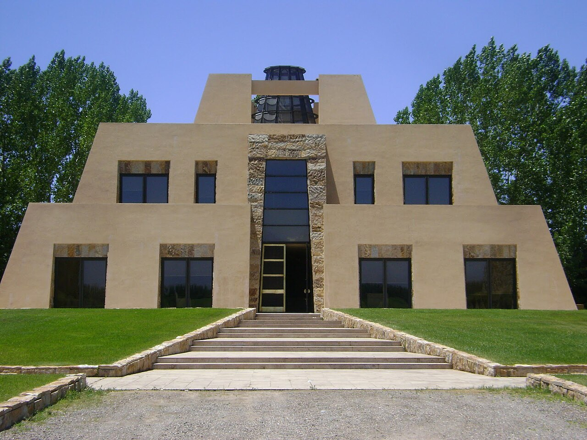

# 卡氏家族酒庄

卡氏家族酒庄在卢汉德库约的 Cobos 路，建筑以玛雅金字塔为标志，葡萄园则从谷地一直铺到安第斯山麓的高处。它 1902 年创立，真正让它进入国际视野的，是 20 世纪末对马尔贝克与高海拔风土的重新定义。到访这里，重点不只是“看金字塔”，而是理解一个家族如何把品种、海拔与酿造选择写成一套可复制的叙事。

图：卡氏家族酒庄。图片：ArgentinaWineTourism，CC BY-SA 3.0，via Wikimedia Commons（[原图页面](https://commons.wikimedia.org/wiki/File:ALTURA_Argentina_Wine_Tourism_-_Bodega_Catena_Zapata_-_panoramio.jpg)）。

## 1902 年：从意大利移民到门多萨

酒庄 1902 年由 Catena 家族创立。官方叙述把家族的意大利移民背景与门多萨的种植传统放在一起：从 Bonarda 到 Malbec，从本地消费到出口市场，家族经历了多次转型。Nicolás Catena Zapata 被官方称为把阿根廷葡萄酒推上世界地图的关键人物；他推动马尔贝克复兴，也把安第斯山麓的高海拔地块纳入系统性的风土研究。

这段历史的重点是“重新发现”，而不是“发明”。马尔贝克在门多萨早已存在，高海拔葡萄园也不是新开垦的荒地；改变的是对成熟度、酸度与地块差异的理解，以及把不同海拔的果实分开处理、分开陈年的能力。1902 年提供了家族连续性，1990 年代之后的转型提供了国际能见度，两者不能互相替代。这段家族史也为后来的高海拔试验提供了连续性，让酒庄可以把长期积累押在一次方向性的转变上。

## 金字塔与 Adrianna：高海拔的两种象征

金字塔是酒庄最容易被认出的建筑，但它不是酒庄的全部。真正支撑叙事的，是家族在 Uco Valley 的 Adrianna 葡萄园：官方描述它接近 5,000 英尺，约 1,500 米，被称为南美洲的 Grand Cru。高海拔带来更冷的夜晚、更强的紫外线与更长的成熟期，果皮更厚，酸度保留更好；这些条件让马尔贝克在保持成熟度的同时，仍能有清晰的骨架。

参观路线会把金字塔、发酵区、酒窖与品鉴室串起来。建筑提供视觉记忆，Adrianna 提供风土证据；如果只看建筑，容易把酒庄当成主题公园。留意讲解里提到的地块名称、海拔与年份，那些信息比拍照更能解释酒为什么不一样。关于门多萨产区的整体海拔结构，可读[门多萨](ref:mendoza)。

## 参观项目与酒单

官方参观由专业向导带小团进行，基础项目约 2 小时，包含酒庄参观与 5 款酒品鉴；另有调配体验、音乐感官体验与餐厅项目。酒单从 Catena 系列延伸到 Alta、Adrianna 与 Malbec Argentino，覆盖不同海拔与不同价格带。第一次到访建议选基础参观，先把 1902 年、Adrianna 与马尔贝克的关系串起来；已经熟悉卡氏的人，可以把重点放在不同地块的对照，尤其是高海拔与低海拔的酸度、单宁与香气差异。

品鉴时不要只问“哪款最好”。更有用的问题是：这款酒来自哪个地块、哪个海拔带、哪一年？同一品种在不同海拔上的表现，往往比品牌内部的排名更有信息量。关于[马尔贝克](ref:malbec)与[红葡萄酒](ref:red-wine)的基础背景，可先读相关条目；关于[橡木桶陈年](ref:oak-ageing)如何影响结构，也可以在品鉴中留意。

## 预约、价格与到达

参观需提前预约，官方通过预约系统放号。基础参观加品鉴的价格按 2026 年两个区间调整：7 月至 9 月为 184,000 阿根廷比索，10 月至 12 月为 194,000 阿根廷比索；调配体验与音乐感官体验另有价格，均以官网当日信息为准。价格会随汇率与季节变化，不要把本文的数字当成长期报价。

地址是 Cobos s/n, Luján de Cuyo (5509), Mendoza, Argentina；官方坐标是南纬 33°10′4.264″、西经 68°54′14.522″，本页换算为纬度 -33.167851、经度 -68.904034。从门多萨市区开车约 30–40 分钟，建议自驾或包车；酒庄内按指示停车，不要驶入葡萄园行间。预约确认后留出找路与报到时间，迟到可能影响入场。

## 门多萨产区的坐标意义

卢汉德库约被称为阿根廷马尔贝克的摇篮，葡萄园海拔约 900–1,100 米，砾石土壤排水良好，日照超过 300 天，昼夜温差大。卡氏家族酒庄把这一带的传统与 Uco Valley 的高海拔地块连接起来，形成一条从“经典产区”到“极端海拔”的对照线。卢汉德库约的砾石土壤与 Uco 的石质、石灰质土壤并不相同，前者排水快、成熟早，后者更冷、更晚熟；把这两类土壤放在同一张品鉴表上，才能看出卡氏产品线为什么既有宽厚的日常酒，也有紧致的高端酒。把两站放在同一条路线上，不是为了比较谁更高端，而是为了理解同一品种在不同海拔上的成熟与结构变化。

对旅行者来说，卡氏是一个“坐标点”：它告诉你门多萨不仅有干旱与灌溉，还有精确的地块选择与长期试验。读懂了这一点，再去 Maipú 或 Uco，就不会只用“海拔越高越好”来解释一切。

## 常见误区

第一，把金字塔当成酒庄的全部。建筑是入口，风土与地块才是内容。第二，以为所有卡氏酒都来自 Adrianna。酒庄的产品线覆盖多个地块与海拔，Adrianna 是其中最具象征性的一块。第三，把高海拔等同于高酒精度或高浓度。高海拔更常见的是紧致、酸度与花香，而不是单纯的“更大”。第四，忽略预约与价格区间。第五，把 1902 年当成“现代风格起点”；家族历史很长，现代转型发生在更晚的阶段。

对照阅读：[门多萨](ref:mendoza)、[红葡萄酒](ref:red-wine)。

相关条目：[马尔贝克](ref:malbec)。

**关键事实。**

| 项目 | 内容 |
| --- | --- |
| 一句话定位 | 门多萨卢汉德库约的家族酒庄，1902 年创立，以马尔贝克复兴与安第斯山麓高海拔风土著称；金字塔建筑与 Adrianna 葡萄园是参观核心，项目需预约，官方坐标为南纬 33°10′4.264″、西经 68°54′14.522″ |
| 地址 | Cobos s/n, Luján de Cuyo (5509), Mendoza, Argentina |
| 城市/国家 | 卢汉德库约 / 阿根廷 |
| 营业状态 | 已核验营业 |
| 官网 | catenazapata.com |

**来源与边界。** 本页关于「卡氏家族酒庄」的关键事实，主要由以下来源交叉核对：Bodega Catena Zapata（Cobos s/n, Luján de Cuyo (5509) 地址、官方经纬度、电话与预约入口；1902 年创立、马尔贝克复兴、Adrianna 葡萄园近 5,000 英尺与高海拔风土叙述）、Instituto Nacional de Promoción Turística (INPROTUR)（Luján de Cuyo 的海拔区间、砾石土壤与马尔贝克产区背景）、Wines of Argentina, based on the INV annual surface report（门多萨马尔贝克面积与占比，作为卡氏家族酒庄的产区背景）。产品、地址或营业状态变化较快时，以 catenazapata.com 的最新页面为准；价格、批次与状态会变，涉及这些字段时以页面所列来源的最新版本为准。正文为项目自写，来源只作核验，不复制原文。

## 参考资料

本页依据卡氏家族酒庄官方联系页、关于页与参观页，以及阿根廷国家旅游推广机构的门多萨资料与 Wines of Argentina 整理的 INV 数据核验，页面核验日期 2026-11-09。若要把这一站放进行程，可继续读[门多萨葡萄酒路线](ref:route)。开放时间、价格与预约规则以官方渠道为准。
