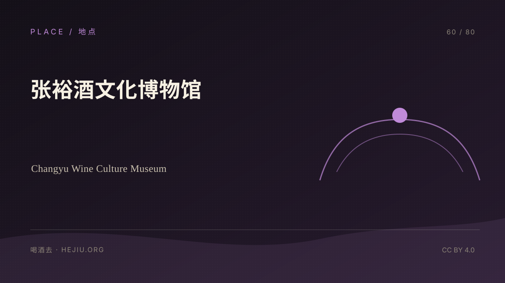
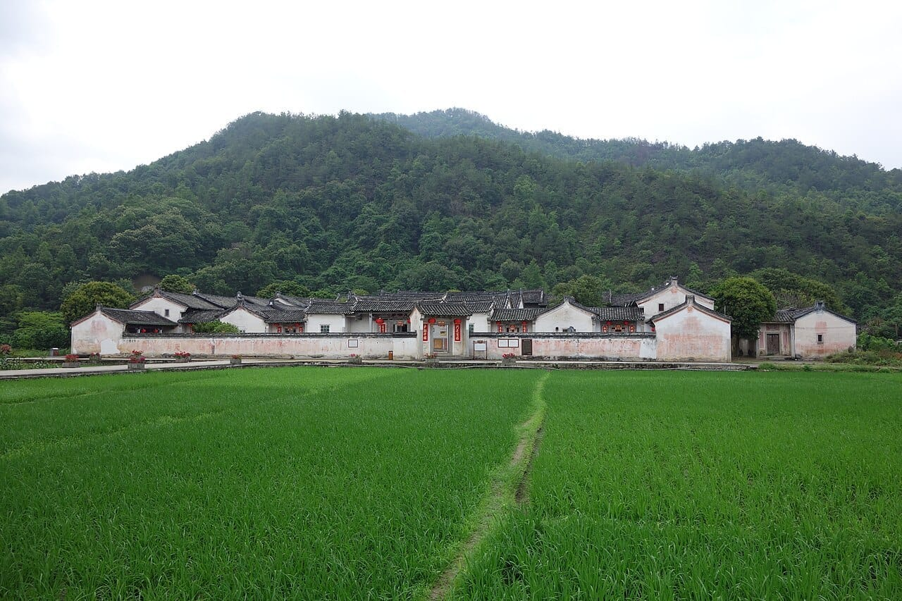

# 张裕酒文化博物馆

张裕酒文化博物馆在烟台市芝罘区大马路 56 号，建在张裕公司的老厂区里。张裕由张弼士于 1892 年创办，博物馆则在 1992 年、也就是张裕百年之际正式启用。馆方称它为中国首家葡萄酒专业博物馆，今天同时挂着国家一级博物馆、国家 4A 级旅游景区和首批国家工业旅游示范基地等身份。它不是一座酒庄，而是一座把企业史、工业遗产和葡萄酒消费放在同一条时间线上的博物馆。

> **到访信息**
> - 地址：山东省烟台市芝罘区大马路56号。
> - 开放与预约：以[官方页面](https://www.cymuseum.cn/)为准；开放时间、场次和预约规则会随季节调整。
> - 交通与费用：出发前以官方页面为准，本页不承诺固定票价。
> - 营业状态：已核实；来源最近核对：2026-11-08。

图：张裕酒文化博物馆栏目示意图。项目自产或类别插图，用于酒庄与酒类场馆语境，不是该对象的实拍。

> **先给结论**
> **一句话：** 这页判断张裕酒文化博物馆值不值得专程去，以及到访前要核对什么。
>
> - **适合谁：** 正在计划去张裕酒文化博物馆、想知道值不值得专程安排半天到一天的人。
> - **不适合谁：** 只想要“必去榜单”、不准备核对预约、交通和开放时间的人。
> - **先看这两点：**
>   - 最大的误区是把这里当成“张裕酒庄”。
>   - 1892 年，张弼士投资 300 万两白银，在烟台芝罘湾畔创办张裕酿酒公司，开启了中国工业化生产葡萄酒的先河。

## 1992 年：张裕酒文化博物馆的关键起点
1892 年，张弼士投资 300 万两白银，在烟台芝罘湾畔创办张裕酿酒公司，开启了中国工业化生产葡萄酒的先河。这个起点决定了博物馆的叙事重心：它首先讲一家企业如何把现代酿酒工业带入中国，然后才讲酒的风味与品鉴。馆方在介绍中既使用“中国首家葡萄酒专业博物馆”，也使用“中国第一座世界级葡萄酒博物馆”的说法，两者指的是“葡萄酒专题博物馆”这一定位，并不意味着它是中国最早建立的博物馆。

博物馆于 1992 年启用，2002 年和 2007 年经历两次扩建改造。馆方在张裕创立 130 周年时启动了以“智能互动＋数字化”为特征的 4.0 升级，展陈面积增加约 2000 平方米，达到近万平方米。它因此不是一座静态的老企业陈列室，而是不断用影像、互动和沉浸式品酒重写自身叙事的场馆。

一个容易被忽略的细节是门牌号：张裕酒文化博物馆在烟台大马路 56 号，青岛啤酒博物馆在青岛市北区登州路 56 号，张裕卡斯特酒庄在烟台开发区北京北路 56 号。馆方自己把这个巧合写进了导览词，但它只是巧合，不代表三个地点属于同一个参访体系。

## 为什么在烟台

张裕选择烟台，不是偶然。烟台是近代通商口岸，靠海、港口便利，气候温和，适合大规模种植酿酒葡萄和运输设备；张弼士又在这里拥有商业网络。把工厂建在芝罘湾畔，既能靠近港口，也能靠近当时的新式城市生活。博物馆今天所在的大马路，正处在烟台老城与海岸之间，这个位置本身就是工业遗产的一部分。

这也解释了博物馆的展陈为什么从“实业兴邦”讲起，而不是从葡萄品种讲起。欧洲酒庄参访通常以葡萄园、地块和年份为核心，张裕的起点却是“中国人自己办现代葡萄酒厂”。第一次来，如果只盯着酒瓶和酒标，会错过它真正想讲的东西：一个近代企业如何在通商口岸落地，并逐步建立起自己的品牌与消费市场。

## 展陈与展线

馆方把 4.0 展陈概括为六大板块：百年流霞、酒酝长卷、实业兴邦、“敢为人先”环幕影片、“平视世界”天地幕影片和“品味时光”沉浸品酒。整体以时间线为主脉络，配合张裕 130 多年的发展史。入口广场东侧有张弼士雕像，高 2.8 米，由中央美院雕塑系隋建国创作；馆方导览把它作为进入“大马路 56 号”故事的起点。

“百年酒窖”是整座馆最不可替代的展品。馆方介绍称，酒窖距海岸不到百米，低于海平面一米多，到 2026 年已有 132 年历史，被称为世界酒窖建筑史上的一个特例。它不是一个布景式的“地下酒窖”，而是仍在使用的老空间；走在里面能感到温度、湿度和层高都与地上展厅不同。酒窖里成排的橡木桶中，馆方把巨型橡木桶“亚洲桶王”列为镇馆之宝，这也是现场最常被拍照的点之一。参观时值得把时间留够，不要只在门口拍一张照片就离开。

官方导览列出的点位包括游客中心、张裕酒文化博物馆、庭院阳光房、葡萄长廊、时光陈酿雕塑广场、雕塑喷泉、早期金库、麒麟照壁、1892 红酒馆、木桶小溪和张裕门头。实际动线以入口地图为准，但大致可以理解为“主展馆看历史—下酒窖看空间—庭院与 1892 红酒馆看体验”的三段式。早期金库、麒麟照壁和门头属于企业史的物证，适合和展厅里的时间线对照着看。

展品层面，馆内以企业档案、历史图像、酒类实物和场景复原串起叙事，而不是靠零散的名酒陈列制造惊喜；“亚洲桶王”则把注意力拉回酒窖的物理尺度。若你期待的是一排排名酒或橡木桶阵列，可能会觉得它偏“企业纪念馆”；若你对近代工业、品牌史和城市消费感兴趣，它的信息密度会高得多。

## 怎么参观

建议预留两到三小时。先看主展馆的一层与二层，把 1892 年以来的时间线走一遍；再下百年酒窖，感受空间本身；最后回到庭院、葡萄长廊和 1892 红酒馆。若时间只有一小时，优先主展馆与酒窖，庭院可以快步带过。

看展时抓三条线：一是张弼士与“实业兴邦”的企业史；二是从引进葡萄苗、酿酒设备到品牌化的工艺线；三是葡萄酒如何从舶来品变成中国城市消费的一部分。三条线在“敢为人先”和“平视世界”两个影片板块里收束，适合作为参观的中段或结尾。

品鉴是否包含在门票里，取决于你买的票种。馆方有“品味时光”沉浸品酒和 1892 红酒馆等体验点，部分套票含品鉴，部分只含参观；购票页会写明。不要默认“博物馆门票一定含酒”，到现场再补买容易打乱预算。

适合同葡萄酒入门者、工业遗产爱好者和带孩子看企业史的家庭；不适合只想看葡萄园、拍庄园风景，或期待一顿正式酒庄午餐的人。这里没有成片葡萄园，重点在建筑、档案与展陈。园区内还有“张裕微醺号”复古列车、1892 艺术中心等体验点，部分需另付费或限时开放，安排前看官方公告。

## 张裕酒文化博物馆的地址与营业安排
地址：山东省烟台市芝罘区大马路 56 号（张裕老厂区）。开放时间：8:00–17:00，16:30 停止入园、停止售票，全年无休（官网与烟台文旅数字博物馆页，2026-11-08 复核）；节假日与临时闭馆以官方公告为准。

门票：成人票 80 元/人或 158 元/人（两种票种，后者含更多体验项目）；未成年人、70 周岁及以上老人、残疾人、现役与离退休及伤残军人凭证免费；60–69 周岁 55 元/人的说法见于部分渠道，现场需再确认。价格与优惠政策可能调整，购票前以官方智慧商城或现场公示为准。

预约：通过“张裕酒文化博物馆”官方微信公众号或官方智慧商城实名预约。游客中心电话 0535-6633860，博物馆前台电话 0535-6632892；团队、研学与讲解服务建议提前联系，临时到店不一定能约到讲解。中文讲解 180 元（10 人以内），金牌讲解与英文讲解 280 元（10 人以内）。

交通：博物馆在芝罘区老城，靠近烟台山、朝阳街与滨海广场；从烟台站打车约十分钟量级，具体时间看路况。公交可到“张裕博物馆”站或“烟台山医院”站，具体线路与下车站点以实时地图为准（未逐条核验）。馆内可免费停车，约 30 个车位；老城区街道较窄，旺季车位紧张，不建议把车开进最靠近馆门的路段。

本页不提供示意地图：烟台张裕酒文化博物馆的经纬度暂无公开可核验来源，frontmatter 留空；导航请用实时地图并到馆确认入口。

「张裕酒文化博物馆」的开放时间、价格与预约，以[官网](https://www.cymuseum.cn/)的公开页面为准；核验日期为 2026-11-08，临时调整以官网当日公告为准。

## 礼仪与常见误区

最大的误区是把这里当成“张裕酒庄”。张裕在烟台还有卡斯特酒庄、国际葡萄酒城等不同地点，博物馆只是大马路 56 号的老厂区；不要把“张裕”三个字等同于任意一处葡萄园。

第二个误区是把“国家一级博物馆”理解为“馆藏以文物为主”。它是一座企业博物馆，核心资产是企业档案、工业建筑与酒窖空间，展陈手法偏多媒体与场景，不是传统综合博物馆的书画青铜器路线。

第三个误区是忽略酒窖的体感。地下空间温度低于地面，夏天进去会觉得凉，带一件薄外套更稳妥；地面湿滑处不要快走。展厅内遵守拍摄提示，不触摸展品、不进入围栏区域。

品鉴时不要空腹，也不要开车。葡萄酒的酒精度通常低于白酒，但空腹连喝几款仍会影响判断；若含品鉴，先吃点东西，少量慢饮，离馆前留出足够时间。

还有一个常见误会是“免费人群一定能品鉴”。免门票通常只免除参观费用，品鉴与体验项目是否另收费要看票种；未成年人即便免票，也不应被默认允许饮酒。带孩子的家庭应把重点放在展陈与酒窖，而不是品鉴环节。

## 烟台市的周边街区
博物馆在芝罘区老城，适合和烟台山—朝阳街—滨海广场串成一条半日或一日路线。上午先看博物馆与酒窖，约两到三小时；中午到朝阳街一带吃饭；下午登烟台山看近代领事馆建筑群，再沿滨海广场走到海边。若还有时间，可以去所城里看老城街区。

反过来安排也可行：先逛朝阳街和烟台山，下午进馆，避开团队高峰。节假日与暑期团队较多，工作日上午通常更安静；具体人流仍取决于当天预约情况。

如果专门为葡萄酒而来，可以把这里与开发区的张裕卡斯特酒庄分开安排。两者不在同一区域，车程明显更长，一天内硬塞会变成赶路；只选一处的话，想了解中国葡萄酒工业史选博物馆，想看葡萄园与酒庄建筑选卡斯特。

## 同主题博物馆与延伸阅读
张裕博物馆是理解[葡萄酒](ref:wine)进入中国的一条入口，也把烟台放进了[中国](ref:china)近代工业与消费城市的脉络。它不同于欧洲酒庄的参访模式：这里首先是企业史与工业遗产的展示，其次才是品鉴与销售。

补充阅读：[烟台张裕葡萄酿酒股份有限公司](ref:c-extra-1)、[张裕葡萄酒](ref:c-extra-2)、[A Ginjinha](ref:c-extra-3)。

相关条目：[葡萄酒](ref:wine)、[中国](ref:china)、[烟台张裕葡萄酿酒股份有限公司](ref:c-extra-1)。

## 相关图像

图：Guang Lu Di in Dabu. Built in 1908, former residence of Cheong Fatt Tze who was the founder of Changyu Wine (19324457523)。图片：Yun Huang Yong from Harbord, Australia，CC BY 2.0，via Wikimedia Commons（[原图页面](https://commons.wikimedia.org/w/index.php?curid=140102273)）。关联图像：张裕酒文化博物馆。
