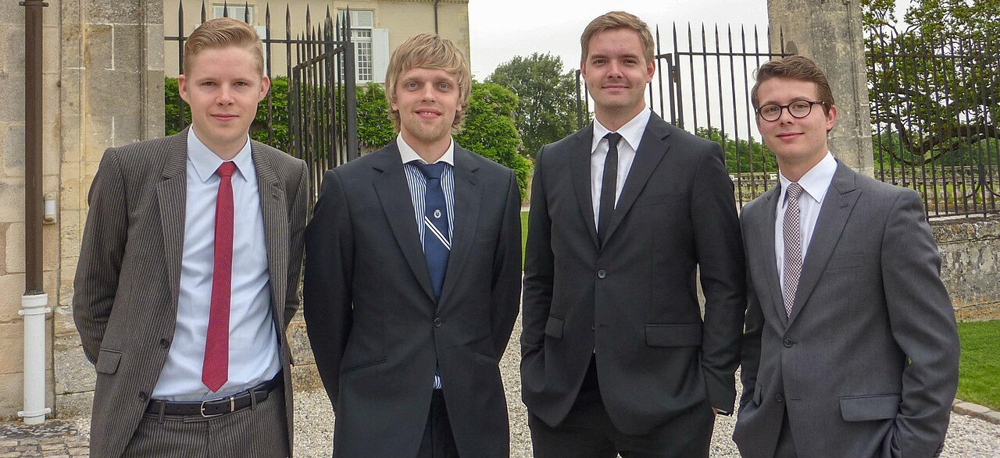

# 白马酒庄

从 Saint-Émilion 镇中心往西北，葡萄园在右手展开，地面从石灰岩坡地变成了黏土与砾石的缓坡。白马酒庄的主楼藏在一排树后面，白色石材、灰色屋顶、一个细尖的塔楼；门前有一片水塘，倒影里是树与天空。它没有圣埃美隆镇内那些“明信片角度”的密集感，反而像一座被葡萄园包围的乡间宅邸。真正让它在建筑史里被记住的，是主楼旁边那组白色混凝土的波浪形酒窖。

图：白马酒庄的老庄主楼。图片：Benjamin Zingg, Switzerland，CC BY-SA 2.5，via Wikimedia Commons（[原图页面](https://commons.wikimedia.org/wiki/File:Ch%C3%A2teau_Cheval-Blanc.jpg)）。

## 1832 年：白马酒庄的关键起点
白马的现代形态从 1832 年开始。那一年，Libourne 法院院长 Jean-Jacques Ducasse 买下庄园的核心地块；此后 20 年，他从邻居 Château Figeac 不断购地，形成约 39 公顷的庄园，边界到今天几乎没变。1852 年，酒第一次以 “Cheval Blanc” 之名出售；1860 年代，Ducasse 的女儿 Henriette 嫁给 Libourne 酒商 Jean Laussac-Fourcaud，丈夫在葡萄园里做了一次大胆的重植：一半 Merlot、一半 Cabernet Franc。1871 年完成，1911 年 Cabernet Franc 的比例已接近 50%。

1954 年，圣埃美隆第一次做分级，白马被评为 Premier Grand Cru Classé A；此后每十年重评，它都保持 A 级。2021 年 7 月，白马宣布退出 2022 年的圣埃美隆分级，理由是评估标准与酒庄的根本原则不再一致；同一时期，Ausone 也退出。今天介绍白马，不能再说它是“2022 年分级的一级 A”；它的历史荣誉仍在，但当前状态是“主动退出”。

1998 年，Baron Albert Frère 与 Bernard Arnault 买下白马；此后酒庄在葡萄园、酒窖与品牌上持续投资。2011 年，Christian de Portzamparc 设计的新酒窖落成；2021 年，酒庄又发布农业生态宣言，转向 agroforestry 与更少化学投入的种植。白马的“贵族感”不是靠城堡，而是靠 1832 年以来的地块连续性、Cabernet Franc 的比例与酒窖的精度。

## 建筑与空间

白马的主楼是 19 世纪的乡间宅邸，白色石材、灰色坡屋顶、一个尖塔；它不宏大，但比例安静。2011 年，Portzamparc 的酒窖在主楼旁完成：两片白色混凝土像波浪一样掀起，下面藏着 67 个混凝土发酵罐，分 14 种容量，从 12 到 113 百升。每个罐对应一个地块，罐身有两块铭牌：一块写罐号与容量，一块写地块号、品种与种植年份。这个设计把“地块—罐—酒”的关系做成可见的建筑语言。

酒窖的屋顶是草坡与野花，建筑与地形连在一起；内部用自然光，墙面是白混凝土，罐体像一排排雕塑。它是第一座获得 HQE 认证的酒窖，2013 年获得 Chicago Athenaeum 的 International Architecture Award。有人觉得它太现代，与圣埃美隆的中世纪小镇不协调；也有人认为它把“农业建筑”从装饰性的城堡里解放出来。无论喜欢与否，它都不是一座“拍照背景”，而是按地块发酵的工具。

白马的葡萄园 42 公顷、56 个地块、244,989 株葡萄；土壤是黏土、砾石与沙的拼图，位于 Saint-Émilion 与 Pomerol 交界的砾石台地。55% Cabernet Franc、40% Merlot、5% Cabernet Sauvignon，这个比例在右岸很少见；Cabernet Franc 带来花香、石墨、红果与细单宁，Merlot 带来李子、可可与圆润，Cabernet Sauvignon 提供骨架。

## 酒款与风味

白马的正牌是 Château Cheval Blanc，副牌是 Le Petit Cheval，另有 Petit Cheval Blanc 白葡萄酒。正牌通常带紫罗兰、红樱桃、黑加仑、石墨、雪松、松露与湿石头；年轻时单宁细、香气开放，比许多左岸一级庄更早可喝，但顶级年份仍能放 20–30 年。它不是“力量型”的酒，而是“细腻、花香、丝绒”的右岸风格。

白马与 Pomerol 的 [Pétrus](ref:petrus) 常被拿来对比：Pétrus 是 100% Merlot 的黏土力量，白马是 Cabernet Franc 主导的砾石花香；两家都在右岸，却像两种语言。与左岸的 [Margaux](ref:margaux)、[Latour](ref:latour) 相比，白马的单宁更细、果味更红、香气更早打开。

Le Petit Cheval 是更早喝的副牌，配烤鸡、牛肉、蘑菇都行；Petit Cheval Blanc 是白葡萄酒，产量少，带柑橘、白花与矿物。不要以为副牌就是“差一点的正牌”；它来自不同地块与 younger vines，风格更轻，但仍能看出白马的骨架。

## 怎么喝

正牌年轻时提前 1–2 小时开瓶，老酒开瓶后先试；温度 16–18°C，用波尔多杯或略宽的杯子。配餐选烤牛肉、羊排、鸽子、蘑菇、松露与硬奶酪；不要用重辣、重醋或甜酱。白马的香气以花香与红果为主，过度醒酒会把紫罗兰与红樱桃打散；老酒更要轻。

Le Petit Cheval 可以开瓶 30–60 分钟，配烤鸡、炖牛肉、香肠与奶酪。Petit Cheval Blanc 温度 10–12°C，配海鲜、白肉、山羊奶酪。若在餐厅点正牌，先确认年份与瓶况；白马的好年份与普通年份差距很大，不要只看酒庄名。

## 白马酒庄的地址与营业安排
- 地址：Château Cheval Blanc, 33330 Saint-Émilion, France。
- 坐标：44.9195, -0.1893。
- 电话：+33 5 57 55 55 55。
- 参观：仅限专业客人（酒商、零售、酒窖、侍酒师等）；普通游客不能直接预约常规参观。Saint-Émilion 旅游局可提供其他开放酒庄的名单。
- 交通：从 Saint-Émilion 镇中心开车约 10 分钟；从 Libourne 约 15 分钟；从 Bordeaux 约 50 分钟。最近火车站是 Saint-Émilion，出站后需打车。
- 停车：按预约进入；不要把车停在葡萄园行间或私宅门口。
- 无障碍：主楼与酒窖的部分区域有台阶，轮椅使用者需提前说明。
- 语言：预约时说明英语或法语；专业参观的语言依安排而定。

## 礼仪与常见误区

第一，白马已退出 2022 年圣埃美隆分级；不要再用“2022 年一级 A”介绍它。第二，不要把白马与 Pomerol 的 Pétrus 混为一谈；一个是 Cabernet Franc 主导的圣埃美隆，一个是 100% Merlot 的 Pomerol。第三，不要以为“白马”是酒的颜色或某个商标；它是地名/地块名，酒是红葡萄酒为主。第四，不要在没有预约的情况下进入酒庄；它不对散客开放常规参观。第五，不要在酒窖触摸混凝土罐与铭牌；那是生产设备，不是展品。

还有一层：白马的“退出分级”不是“降级”，而是对评估标准的不认同。理解这件事，需要读酒庄自己的声明，而不是只看“一级 A 取消”的标题。

## 从白马酒庄延伸到Pétrus
白马在 Saint-Émilion 西北，靠近 Pomerol 边界；往东是 Saint-Émilion 镇与它的石灰岩地下教堂，往北是 [Pétrus](ref:petrus)，往南是 [Yquem](ref:yquem) 与 Sauternes，往西是 [Margaux](ref:margaux)、[Latour](ref:latour)、[Haut-Brion](ref:hautbrion) 与 [Lafite](ref:lafite)。把白马放进 [波尔多左岸酒庄路线](ref:route) 并不顺路；它更适合与右岸的 Pomerol、Saint-Émilion 一起安排。

如果只有一天，白马 + Saint-Émilion 镇是合理组合；想同时看左岸，至少两天。右岸的葡萄园更小、道路更窄，预约之间要留足车程；不要把一天排成“五家酒庄”。

## 参考资料
- 官方历史：<https://www.chateau-cheval-blanc.com/en/history/>，用于核对 1832 年、Figeac 购地、1852 年、1860s 重植、1954 年一级 A 与 2021 年退出分级。
- 官方葡萄园：<https://www.chateau-cheval-blanc.com/en/the-vineyard/>，用于核对 42 公顷、56 地块、244,989 株、品种比例与土壤。
- 官方酒窖：<https://www.chateau-cheval-blanc.com/en/the-winery/>，用于核对 Portzamparc、2011 年、67 个罐、14 种容量、HQE 与 2013 年建筑奖。
- 官方联系：<https://www.chateau-cheval-blanc.com/en/contact/>，用于核对地址、电话与专业客人参观政策。
- 右岸对照：[Pétrus](ref:petrus)、[Yquem](ref:yquem)、[波尔多产区](ref:bordeaux)。
- 左岸对照：[Margaux](ref:margaux)、[Latour](ref:latour)、[Haut-Brion](ref:hautbrion)、[Lafite](ref:lafite)、[左岸酒庄路线](ref:route)。

对照阅读：[柏图斯酒庄](ref:petrus)、[拉图酒庄](ref:latour)。

## 相关图像

图：The CBS Wine team at the 2012 Left Bank Bordeaux Cup。图片：Netapp Inc，CC BY-SA 3.0，via Wikimedia Commons（[原图页面](https://commons.wikimedia.org/w/index.php?curid=21313721)）。关联图像：白马酒庄。
