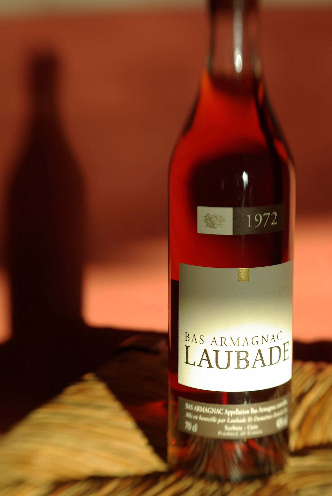

# 洛巴德酒庄

洛巴德（Château de Laubade）是下雅文邑（Bas-Armagnac）的一家单一庄园酒庄，位于热尔省索尔贝（Sorbets），1870 年建庄，80 公顷葡萄园围绕城堡连成一片，由 Lesgourgues 家族经营三代。它以下雅文邑的沙质土壤、单一庄园装瓶与年份雅文邑著称：生命之水按葡萄品种与年份分开陈年，每瓶标注装瓶日期与批次。这三点决定了它和以调配为主的大酒商是两种不同的参访对象。

图：洛巴德酒庄相关实景照片。图片：Adam Baker，CC BY 2.0，via Wikimedia Commons（[原图页面](https://commons.wikimedia.org/wiki/File:1972_Chateau_de_Laubade_Bas_Armagnac_Vintage.jpg)）。

## 1870 年：一座庄园与两个名人

城堡建于 1870 年，创始人是法国政治家 Joseph Noulens 与其妻、巴黎时装设计师 Jeanne Paquin。Noulens 曾任众议员、参议员并数度入阁，庄园在 19 世纪末是当地社交与农业的地标。此后酒庄经历起伏，直到 1974 年 Maurice Lesgourgues 买下庄园，恢复蒸馏并重启年份装瓶传统；今天由 Denis 与姐妹 Jeanne、兄弟 Arnaud 共同经营。

酒庄在 2015 年获得“活遗产企业”（Entreprise du Patrimoine Vivant）认证，2008 年起持有 ISO 9001，官方称已获约 250 个奖项，并在 2020 年被《La Revue des Vins de France》评为年度烈酒。奖项与认证说明它在本产区的位置，但真正决定风格的仍是葡萄、蒸馏与桶陈，而不是奖牌数量。

## 下雅文邑的沙质土

雅文邑分下雅文邑、泰纳雷兹与上雅文邑三个分区，洛巴德位于下雅文邑核心。这里的坡地覆盖“黄褐沙”（sables fauves）与砂质黏土（boulbènes），排水快、春季升温早，葡萄成熟相对均匀，蒸出的酒液更细腻、香气更清晰，也更适合长期陈年。酒庄 80 公顷葡萄园连成一块，围绕城堡与酒窖，采收与运输距离短，这是“单一庄园”在田间层面的含义。

种植上，酒庄用绿肥、行间机械除草与谷物轮作维持土壤生物多样性，养 600 只羊提供有机肥，并保留 15 公顷加斯科涅橡木与 10 公顷杨树。它还把抗病的巴科（Baco）作为重点品种，这在以白玉霓为主的干邑之外，是雅文邑的原料特色。把[雅文邑](ref:armagnac)产区分区与土壤放在一起读，就能理解为什么同一产区内的酒庄风格差异如此明显。

## 一台 1974 年的连续蒸馏器

洛巴德只用一台 1974 年定制的雅文邑式连续蒸馏器（alambic armagnacais），对六个本地品种分别蒸馏：巴科、白玉霓、白福儿、鸽笼白与 Plant de Graisse 等。葡萄压榨后不加硫，酒精发酵一结束就进蒸馏，以保留香气；蒸馏参数由酒窖主管按年份与品种制定，出酒酒精度靠品鉴定点。

这与干邑的二次壶式蒸馏是两条路线：连续蒸馏一次完成，酒液酒精度较低、风味物质保留更多，口感更厚。把[蒸馏](ref:distillation)的一般原理与[雅文邑](ref:armagnac)的工艺放在一起看，就能明白“只蒸馏一次”不等于粗糙，而是另一种取舍：更重的酒体需要更长的桶陈来打磨。

## 三千只酒桶与年份收藏

酒庄有九座陈年酒窖、约 3000 只 420 升的橡木桶，生命之水按品种与年份分开存放。制桶用的加斯科涅夏栎在庄园内选材与风干，再交给本地制桶师定制；陈年期间定期通风、在干湿不同的酒窖之间轮换、在新桶与旧桶之间转移。每瓶与每只酒樽都标注装瓶日期与批次，官方把这套做法称为可追溯性承诺。

年份雅文邑是洛巴德的招牌。官方“Celebration Vintages”系列涵盖陈年 15 至 50 年的年份酒，逐桶照料、必要时调配后在本庄装瓶。年份酒提供的是某一年份的可追溯风格，不是质量保证；不同年份的成熟度、酸度与蒸馏批次都会改变结果。把[橡木桶陈年](ref:oak-ageing)视为一个主动管理过程，而不是被动等待，才读得懂这些数字。

80 公顷连片是庄园规模，不代表所有年份雅文邑都同一风格；年份与装瓶日期仍要按瓶标核对。

## 参观与实用信息

地址是 Château de Laubade, 32110 Sorbets, France，位于热尔省下雅文邑乡间，邻近朗德省的拉巴蒂厄-达尔马尼亚克。酒庄提供两种参观：入门款“Premiers pas”品鉴 3 款经典雅文邑；深度款“L'essence de Laubade”走访酒窖与葡萄园，看园中的大型雕塑，最后品鉴 5 款雅文邑。参观需通过 Rue des Vignerons 平台或电话 +33 5 62 09 06 02 预约；办公室开放时间为周一至周五 8:30–12:00 与 13:30–16:00，周末与节假日不办公。

看点集中在三处：1870 年的城堡与老酒窖、连续蒸馏器与制桶作坊、以及葡萄园中的雕塑。酒庄位于乡间，公共交通不便，建议自驾，从蒙德马尔桑、波城或阿让方向驶入，具体路线以导航为准；坐标以官方渠道为准。酒窖温度低，带一件外套比穿短袖更实际；品鉴后可当场购买年份酒，但要先确认行李与入境限额。

单一庄园意味着葡萄来自连续地块，不等于所有酒款都是同一年份或同一等级；年份雅文邑与常规装瓶要分开看，瓶标上的年份才是判断依据。

## 单一庄园意味着什么

单一庄园（single estate）在这里不是营销形容词，而是可核对的生产链：葡萄来自本庄 80 公顷，蒸馏在本庄，陈年在本庄，装瓶也在本庄，年份与批次可追。与大型酒商把不同庄园、不同年份的酒液调配成统一风格相比，洛巴德更愿意让年份差异留在瓶里。

这也带来限制：某个年份歉收或风格不合预期时，没有别的庄园可以补位；产量也远小于干邑大品牌。若把[白兰地](ref:brandy)的整体分类、[法国](ref:france)的产地体系与雅文邑的年份传统放在一条线上，洛巴德正好是一个“小产区、单一庄园、年份导向”的样本。参观时不妨先问当年蒸馏与陈年的具体情况，再决定买哪一瓶。

相关条目：[白兰地](ref:brandy)、[蒸馏](ref:distillation)。

**关键事实。**

| 项目 | 内容 |
| --- | --- |
| 一句话定位 | 热尔省索尔贝的下雅文邑单一庄园，1870 年建庄、80 公顷葡萄园连成一片，以沙质土壤、1974 年定制的连续蒸馏器、约三千只酒桶与年份雅文邑装瓶著称 |
| 地址 | Château de Laubade, 32110 Sorbets, France |
| 城市/国家 | 索尔贝 / 法国 |
| 营业状态 | 已核验营业 |
| 官网 | chateaudelaubade.com |

**来源与边界。** 本页关于「洛巴德酒庄」的关键事实，主要由以下来源交叉核对：Château de Laubade（1870 年建庄、80 公顷单一地块、Lesgourgues 家族三代、1974 年定制的连续蒸馏器、约 3000 只 420 升酒桶与九座酒窖；1974 年重启年份装瓶传统、15 至 50 年年份系列与本庄装瓶的做法）、BNIA（下雅文邑分区、连续蒸馏与年份标示的产区规则）、INAO（雅文邑原产地命名的管理框架）。产品、地址或营业状态变化较快时，以 chateaudelaubade.com 的最新页面为准；价格、批次与状态会变，涉及这些字段时以页面所列来源的最新版本为准。正文为项目自写，来源只作核验，不复制原文。

## 相关图像

图：雅文邑。图片：Rama，CC BY-SA 2.0 fr，via Wikimedia Commons（[原图页面](https://commons.wikimedia.org/wiki/File:Armagnac-img_0465.jpg)）。关联图像：洛巴德酒庄。
