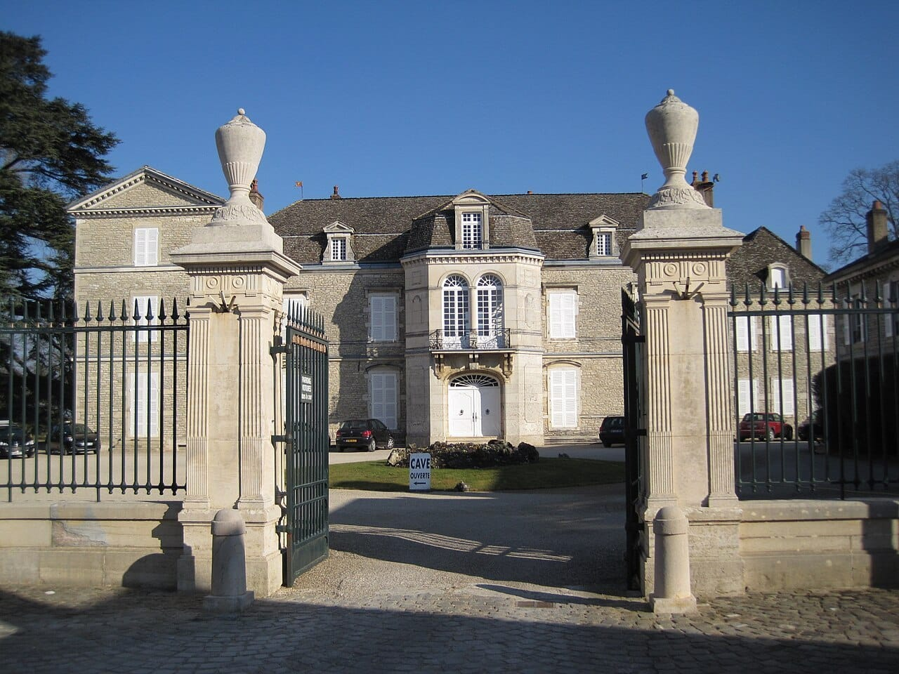

# 默尔索城堡

默尔索城堡（Château de Meursault）在勃艮第金丘的默尔索村，地址是 Rue Charles Giraud。它常被简称为“城堡”，但参访者真正进入的是一处仍在运营的葡萄酒庄园：葡萄园、酿造车间、地下酒窖与品鉴空间连在一起，城堡建筑只是入口和会客的门面。把这里当成一座供人参观的古堡，会错过它作为酒庄的核心；把它当成普通酒庄，又会忽略它保存下来的建筑与地下空间。

图：默尔索城堡。摄影：Château de Meursault 003。署名：Arnaud 25，CC BY-SA 3.0，来自 Wikimedia Commons（[来源](https://commons.wikimedia.org/w/index.php?curid=18551544)）。

> **先给结论**
> **一句话：** 这页判断默尔索城堡值不值得专程去，以及到访前要核对什么。
>
> - **适合谁：** 正在计划去默尔索城堡、想知道值不值得专程安排半天到一天的人。
> - **不适合谁：** 只想要“必去榜单”、不准备核对预约、交通和开放时间的人。
> - **先看这两点：**
>   - 参观分为预约制与免预约两类。
>   - 第一个误区是把“城堡”理解成一座可供自由参观的历史建筑。

## 1973 年：默尔索城堡的关键起点
酒庄官方把自身历史追溯到 11 世纪：卡佩王朝的勃艮第公爵罗贝尔一世把 Moulin Foulot 封地授予一名侍从，这片土地此后在勃艮第公国与法国王室之间的争夺中多次易主。1666 年，第戎议会律师 Pierre Blancheton 买下封地，成为默尔索领主，酒庄的葡萄园线索也从这一时期逐渐清晰。此后三个世纪，产业在家族之间继承、分割与转手，直到 1973 年 André Boisseaux 买下城堡并完成整修，Château de Meursault 才以今天的名字和规模成为勃艮第重要的酒庄之一。

2012 年底，Halley 家族收购酒庄，继续以“尊重风土、表达一级园与特级园”为经营方向。今天的葡萄园约 67 公顷，分布在默尔索及周边一百多块地块上，包含 6 个特级园、20 个一级园，以及 Aloxe-Corton、Beaune、Volnay、Pommard 等村的村庄级与地区级地块。自 2022 年份起，酒庄自有葡萄园全部转为有机种植。需要区分的是：11 世纪是封地与土地史的起点，1973 年是现代酒庄名称与参观体系的起点，二者不是同一个“创立年份”。

## 空间与酒单

现存的城堡主体是 18 世纪意大利风格建筑，2024 年完成整修，内部被改造成面向品鉴的厅室，露台正对 Clos du Château 的葡萄园。这片约 8 公顷的围合地块种霞多丽，是酒庄的旗舰白葡萄酒来源之一。城堡、温室、地块与公园合计约 10 公顷，园内有栗树道、果园、池塘和一棵据称有三百年树龄的雪松；这些景观属于酒庄的生态与参观叙事，不是独立的植物园。

地下酒窖是整处庄园最值得留时间的地方。官方介绍称，西多会风格酒窖从 12 世纪一直开凿、使用到 19 世纪，面积约 3500 平方米，分布在城堡与附属建筑之下；其中较大的酒窖和历史酿造车间在整修时采用生物基材料，并依靠园内 26 口地热井控温。新的酿造车间灵感来自丰特奈修道院，计划在 2026 年迎来第一次采收，专门处理一级园与特级园。参观时能看到的不是一条布景式的地下走廊，而是仍在为葡萄酒服务的老空间。

酒单以默尔索白葡萄酒为核心，同时覆盖金丘的红白两类。白葡萄酒常见 Meursault、Meursault Premier Cru Les Charmes-Dessus、Meursault Premier Cru Perrières、Puligny-Montrachet Premier Cru 等；红葡萄酒可见 Volnay Premier Cru Clos des Chênes、Pommard Premier Cru Clos des Epenots、Corton Grand Cru 等。对第一次接触勃艮第的人，最有效的比较是先喝一款村庄级默尔索，再喝一款一级园，最后用一款红葡萄酒确认酒庄在结构上的处理方式。它们都属于更广的[白葡萄酒](ref:white-wine)与[红葡萄酒](ref:red-wine)传统，但勃艮第的重点不是品种，而是地块之间的细微差别。

## 参观或点单方式

参观分为预约制与免预约两类。预约制包括城堡与酒窖导览加品鉴，由侍酒师讲解酒庄历史、酿造与地块，时长通常在 1 小时 15 分钟到 1 小时 30 分钟之间；团体 10 至 30 人需要单独邮件联系。免预约品鉴在城堡的厅室与露台进行，适合临时到访、只想喝一两杯的人，但可选酒款与座位受当天安排限制。官方页面会标注每场体验的语言，通常为法语或英语，预订前要看清。

第一次来，建议选“城堡与酒窖导览 + 品鉴”的组合，而不是只坐在露台点酒。原因很简单：默尔索城堡的价值有一半在地下，酒窖的空间、温度与建筑层次无法从酒单上读出来。若时间只够一场品鉴，优先选包含一级园的酒款，比单点村庄级更能理解酒庄的风格。不要把参观安排成“喝完还要开车”的行程；勃艮第乡间道路窄，品鉴后至少留出一段清醒时间。

## 默尔索城堡的地址与营业安排
地址：Rue Charles Giraud, 21190 Meursault, France（坐标 46.97440, 4.77350）。酒庄在博讷以南约 8 公里，靠近巴黎—里昂 TGV 线路，自驾从 A6、A31、A36 高速转入村内；城堡入口为步行通道，停车位在“栗树道”一侧。电话 +33 3 80 26 22 75，邮箱 tourisme@chateau-meursault.com。

交通：公共交通不如自驾方便。乘火车到博讷站（Gare de Beaune）后，需换出租车或当地公交约 15 分钟到默尔索；从第戎出发可乘 TER 到博讷再转。村内道路窄，酒庄本身没有大型停车场，旺季把车停在栗树道停车位后步行入内。

开放时间（2026 年）：5 月至 9 月每天 10:00–18:30；10 月至次年 4 月每天 10:00–12:00、14:00–18:00；11 月中旬至 3 月底为淡季，周日下午、周一与周二闭馆，周一与周二提前至 17:00 关门。最后入场在闭馆前留出足够参观时间。

预约与票价：参观与品鉴以预约为准，电话或官网/博讷旅游局预订页均可，每场最多 12 人，提供法语与英语场次。Grands Terroirs 套餐 59 欧元，含城堡与酒窖导览及 7 款酒（约 1 小时 15 分至 1 小时 30 分）；Prestige 105 欧元（8 款，私人厅）；Exclusive 175 欧元（含 Clos 葡萄园与 8 款一级园、特级园）；团体 10–30 人 49 欧元/人，时长 1 小时 30 分至 2 小时。免预约品鉴在城堡厅室与露台进行，酒款与座位视当天安排。博讷济贫院拍卖周末（11 月中旬）另有特别套餐，价格与场次不同。

庄园不接受宠物入内，穿舒适的鞋更合适，因为酒窖地面与村内道路都不适合细高跟。「默尔索城堡」的开放时间、价格与预约，以[官网](https://www.chateau-meursault.com/)的公开页面为准；核验日期为 2026-11-08，临时调整以官网当日公告为准。

## 礼仪与误区

第一个误区是把“城堡”理解成一座可供自由参观的历史建筑。默尔索城堡首先是一座酒庄，参观动线、开放区域与品鉴安排都由经营方决定；没有预约时，不要直接往酒窖方向走。第二个误区是把 11 世纪当成现代酒庄的创立年份。土地的记载、家族的继承、1973 年的整修与 2012 年的收购是几条不同的时间线，混在一起会得出错误印象。

第三个误区是只喝白葡萄酒。默尔索以白葡萄酒闻名，但酒庄在 Volnay、Pommard、Corton 也有红葡萄酒，参观时至少留一杯给红葡萄酒，才能理解它在金丘的完整布局。品鉴时不要一口吞下，勃艮第的酒杯通常不大，侍酒师给的量也克制；先看颜色、闻香气，再小口确认酸度与余味。若不想喝完，可以把酒吐进吐酒桶，这在酒庄是正常做法，不是失礼。

还有一个常见误会是“有机种植等于自然酒”。酒庄自 2022 年份起在自有葡萄园实行有机种植，但酿造与酒款风格仍遵循勃艮第的传统做法，不能据此推断所有酒款都是无添加或自然酒。拍照时避开正在工作的员工与其他客人，酒窖内不要触摸橡木桶和酒瓶，也不要用闪光灯直射酒标。

## 从默尔索城堡延伸到博讷主宫医院
默尔索在博讷与普里尼—蒙哈榭之间，适合与博讷老城串成一日行程：上午参观[博讷主宫医院](ref:hospices)，中午在博讷吃饭，下午到默尔索城堡看酒窖与葡萄园；若还有时间，沿 D974 继续向南到 Puligny-Montrachet 或 Chassagne-Montrachet。反过来安排也可以：先到默尔索，避开上午的团队，再回博讷看博物馆。两地车程约 15 分钟，具体时间看村内路况。

对想比较酒庄风格的旅行者，可以把默尔索城堡与博讷市内的[约瑟夫杜鲁安酒庄](ref:drouhin)放在同一天：前者以默尔索的白葡萄酒和城堡式参观为主，后者以博讷市中心的家族酒商历史与地下酒窖为主，体感差异明显。若只选一处，想看葡萄园与城堡建筑选默尔索，想在城市里看酒窖与酒商体系选杜鲁安。两地都属于[勃艮第](ref:burgundy)产区，但不要把它们当成同一种参观产品。

## 同产区酒庄与延伸阅读
- [勃艮第](ref:burgundy)：金丘、夜丘与夏布利的基本格局。
- [白葡萄酒](ref:white-wine)：霞多丽与勃艮第白酒的酸度、结构与陈年。
- [红葡萄酒](ref:red-wine)：黑皮诺在勃艮第的表达方式。
- [约瑟夫杜鲁安酒庄](ref:drouhin)：博讷市内的家族酒商与地下酒窖。
- [博讷主宫医院](ref:hospices)：理解博讷葡萄酒与慈善拍卖历史的入口。
