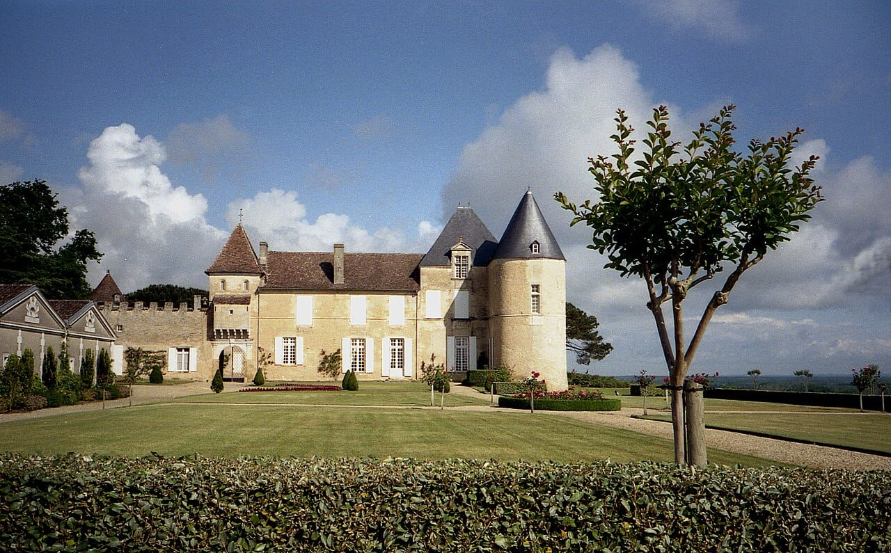
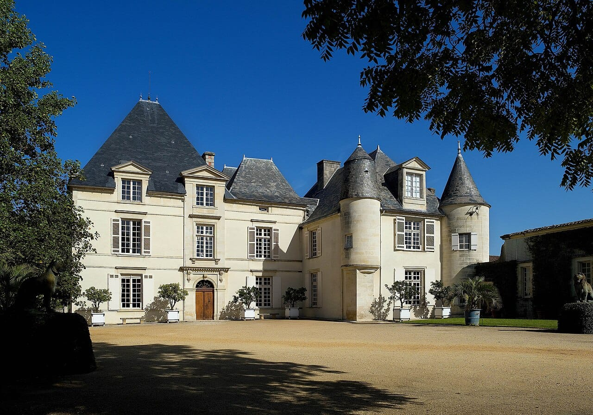

# 滴金酒庄

从 Bordeaux 往南，公路穿过 Graves 的松林与砾石地，进入 Sauternes 后，地势开始起伏。滴金在村外最高的山丘上，主楼是浅色石头、深灰屋顶、两座圆塔与一段城墙；门前是修剪过的草地与一条碎石路。站在坡上往下看，葡萄园一直铺到雾线；早晨的雾与下午的阳光，是这家酒庄最重要的工作条件之一。

图：滴金酒庄与葡萄园。图片：Benjamin Zingg, Switzerland，CC BY-SA 2.5，via Wikimedia Commons（[原图页面](https://commons.wikimedia.org/wiki/File:Ch%C3%A2teau_d%27Yquem.jpg)）。

## 1593 年：滴金酒庄的关键起点
滴金的历史从 1593 年开始。那一年，Jacques Sauvage 买下 Sauternes 的这块高地；此后家族通过婚姻与继承，把庄园传到 Lur-Saluces 家族。1785 年，Françoise Joséphine de Sauvage 嫁给 Louis-Amédée de Lur-Saluces，滴金成为 Lur-Saluces 家族的核心产业。1855 年，波尔多分级把滴金列为唯一的 Premier Cru Supérieur；它不是“一级庄之一”，而是甜酒里的单独一档。

20 世纪，滴金经历了战争、经济危机与家族分裂。1999 年，LVMH 买下滴金；2004 年，Pierre Lurton 接手管理。Lurton 同时管理 Cheval Blanc 与滴金，两家风格完全不同：一个是右岸的 Cabernet Franc/Merlot，一个是 Sauternes 的贵腐甜酒。滴金的团队在 2010 年代做了新的发酵室、酒窖与接待空间，但主楼与葡萄园保留原状。

滴金的“稀有”不是营销话术。官方与行业资料说，一棵葡萄藤一年的产量大约只能做一杯滴金；酒庄只在贵腐菌发展得好的年份做正牌，1910 年以来有十个年份没有装瓶。它不生产副牌甜酒；Ygrec（Y）是另一款干型白葡萄酒，用同一片葡萄园里未受贵腐影响的果实。

## 建筑与空间

滴金的主楼是 16–17 世纪的石头建筑，两座圆塔、深灰屋顶、城墙与庭院；它不是凡尔赛式的宫殿，而是一座建在山顶的农业宅邸。建筑最漂亮的地方不是立面，而是它与地形的关系：从葡萄园往上走，主楼像一座灯塔；从主楼往下看，葡萄园、村庄与远处的松林层层展开。

酒窖在地下，温度低、湿度高，橡木桶排成行；发酵室在不锈钢罐与橡木桶之间切换。滴金的葡萄园约 100 公顷，土壤是砾石、沙与黏土的混合，排水好；Sauternes 的微气候靠 Ciron 河与 Garonne 河的温差造雾，早晨的雾让 Botrytis cinerea 生长，下午的阳光又把葡萄晒干，糖分与风味被浓缩。

采收是滴金最费人力的环节。同一块地要分 5–10 次采摘，工人逐串挑选“被贵腐菌感染但还没有烂”的葡萄；有时一天只能收几筐。压榨要轻，发酵要慢，新桶比例与陈年时间依年份调整。参观时如果只看到“金色酒液”与“城堡”，会错过这些具体劳动。

## 酒款与风味

滴金的正牌是 Château d’Yquem，甜型；Ygrec（Y）是干型白葡萄酒，产量少。正牌以 Sémillon 为主（通常 75–80%），Sauvignon Blanc 为辅（20–25%）；贵腐菌带来蜂蜜、杏桃、橘子酱、姜、蜂蜡、藏红花与矿物，酸度把甜度托住，使它不腻。年轻滴金有柑橘、白花与香草；陈年后转成干果、无花果、焦糖、咖啡与皮革。

滴金的甜不是“加糖”，而是葡萄在树上自然浓缩：贵腐菌刺破果皮，水分蒸发，糖、酸与风味物质浓缩。它的酒精度通常只有 13–14%，因为发酵没有把全部糖分转成酒精；残糖高，但酸度也高，所以喝起来不觉得黏。好年份可以放 50 年以上；普通年份也能放 20–30 年。

Ygrec 是干型，带柑橘、白花、蜂蜡与矿物，适合配海鲜、白肉与亚洲菜；它不像正牌那样甜，但同样有 Sémillon 的厚度。不要把 Ygrec 当成“滴金的副牌”；它是另一款酒，原料与工艺不同。

## 怎么喝

滴金要冷，但不能太冷：8–10°C 最合适。温度太低，香气会闭；温度太高，甜度会显得腻。用小型郁金香杯或甜酒杯，不要用大波尔多杯；一次倒 60–80 ml，慢慢喝。配餐上，鹅肝、蓝纹奶酪、杏仁塔、水果塔、烤鸡与亚洲香料菜都行；不要配重辣、重醋或过甜的巧克力。

年轻滴金可以开瓶后醒 30 分钟；老酒不要醒太久，先倒一杯试香。瓶底有沉淀很正常；倒酒时留一点，不要摇瓶。若在餐厅点老滴金，先确认瓶况与年份；甜酒的老化速度与红葡萄酒不同，不是越老越好。

## 滴金酒庄的地址与营业安排
- 地址：Château d’Yquem, 33210 Sauternes, France。
- 坐标：44.5319, -0.3286。
- 电话：+33 5 57 98 07 07。
- 参观：仅限预约；2026 年 Initiation €100、Correspondances €200、Anthologie €350，每次最多 6 人；常规参观通常在工作日下午，具体以官网预订页为准。
- 交通：从 Bordeaux 开车约 45 分钟；从 Langon 火车站打车约 20 分钟；从 Sauternes 村中心步行约 10–15 分钟，但上坡路窄。
- 停车：按预约进入；不要把车停在葡萄园行间或村民门口。
- 无障碍：主楼与酒窖有台阶、地面不平，轮椅使用者需提前说明。
- 语言：预约时说明英语或法语；参观语言依安排而定。

## 礼仪与常见误区

第一，滴金不是“普通甜酒”。它是 1855 年唯一的 Premier Cru Supérieur，但这个头衔只说明历史分级，不代表每一瓶都合你口味。第二，不要用“液体黄金”概括它；贵腐菌、酸度与陈年是理解滴金的关键，不是颜色。第三，不要以为甜酒只能配甜点；鹅肝、蓝纹奶酪、亚洲香料菜都能配。第四，不要加冰或加苏打水；那会破坏酸度与香气。第五，不要在酒窖触摸酒桶与展品；生产区仍在工作。

还有一层：滴金的采收依赖同一块地反复挑选，工人要在葡萄园里走很多趟。参观时看到“100 公顷”与“一杯酒/株”，不妨想一想这背后的劳动与风险；贵腐菌不是每年都听话。

## 从滴金酒庄延伸到Haut-Brion
滴金在 Sauternes 山顶，往北是 Barsac、Graves 与 [Haut-Brion](ref:hautbrion)，往东是 [Cheval Blanc](ref:cheval) 与 [Pétrus](ref:petrus)，往西是 [Margaux](ref:margaux)、[Latour](ref:latour) 与 [Lafite](ref:lafite)。把滴金放进 [波尔多左岸酒庄路线](ref:route) 并不完全顺路；它更适合作为“甜酒半日”或“右岸—Sauternes”路线的一站。

如果只有半天，滴金 + Sauternes 村是合理组合；想同时看左岸，至少两天。Sauternes 的村庄小、道路窄，预约之间要留足车程；不要把一天排成“五家酒庄”。

**关键事实。**

| 项目 | 内容 |
| --- | --- |
| 一句话定位 | 法国索泰尔讷（Sauternes）山顶的甜酒庄园，1855 年分级中唯一的 Premier Cru Supérieur；葡萄园约 100 公顷，以 Sémillon 为主、Sauvignon Blanc 为辅，靠贵腐菌 Botrytis cinerea 浓缩糖分与风味 |
| 地址 | Château d’Yquem, 33210 Sauternes, France |
| 城市/国家 | 索泰尔讷 / 法国 |
| 营业状态 | 已核验营业 |
| 官网 | yquem.fr |

## 参考资料
- 滴金官网：<https://www.yquem.fr/en/>，用于核对地址、贵腐菌、微气候、四世纪历史与预约入口。
- La Gironde du Sud：<https://www.lagirondedusud.com/degustation/chateau-dyquem/>，用于核对 2026 年三档参观价格、6 人上限与预约信息。
- LVMH 品牌页：<https://www.lvmh.com/our-maisons/wines-spirits/chateau-dyquem>，用于核对 1453 年、Jacques Sauvage、1855 年一级与 1999 年收购。
- Cazebonne 档案：<https://cazebonne.fr/en/bordeaux-wine-estates/chateau-d-yquem>，用于交叉核对 1855 年唯一 Premier Cru Supérieur、约 100 公顷、每株一杯与十个未装瓶年份。
- 右岸与左岸对照：[Cheval Blanc](ref:cheval)、[Pétrus](ref:petrus)、[Margaux](ref:margaux)、[Latour](ref:latour)、[Haut-Brion](ref:hautbrion)、[Lafite](ref:lafite)。
- 路线与产区：[波尔多左岸酒庄路线](ref:route)、[波尔多产区](ref:bordeaux)。

## 相关图像

图：佩萨克城边的侯伯王酒庄外观。图片：BillBl，CC BY 2.0，via Wikimedia Commons（[原图页面](https://commons.wikimedia.org/wiki/File:Haut_Brion_exterior.jpg)）。关联图像：滴金酒庄。
