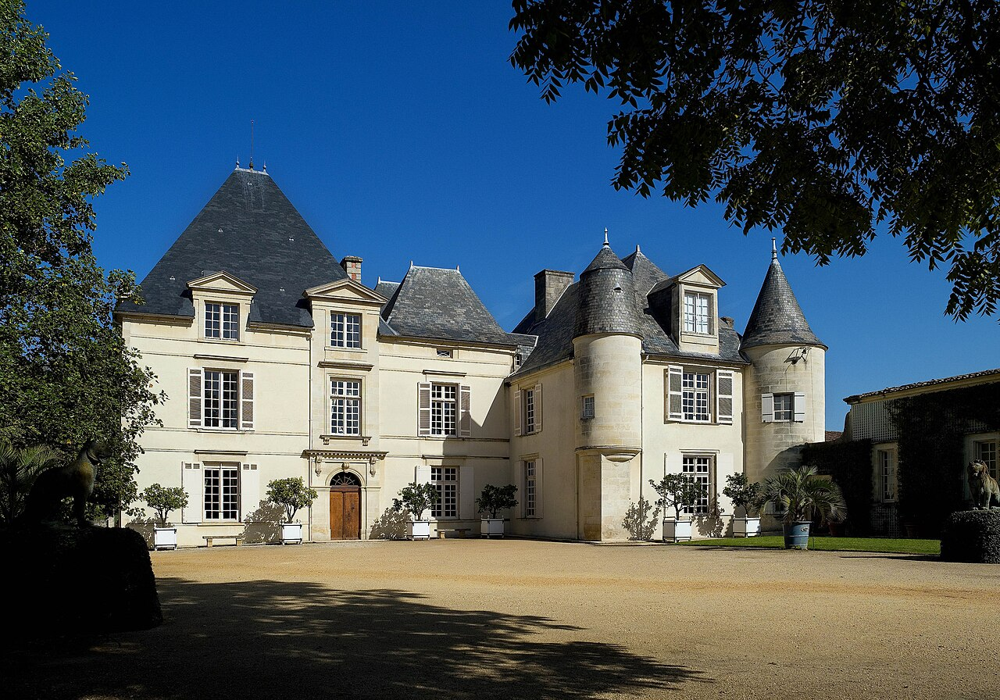

# 侯伯王酒庄

侯伯王不在梅多克的葡萄园里，它在 Bordeaux 市南郊的 Pessac。从市中心开车十几分钟，穿过住宅区、学院与办公楼，突然出现一片砾石坡地与一座 16 世纪的宅邸；墙外是街道，墙内是葡萄园。它是 1855 年一级庄里唯一不在梅多克的酒庄，也是最早被英国人、荷兰人与巴黎市场认识的波尔多酒之一。

图：佩萨克城边的侯伯王酒庄外观。图片：BillBl，CC BY 2.0，via Wikimedia Commons（[原图页面](https://commons.wikimedia.org/wiki/File:Haut_Brion_exterior.jpg)）。

## 1521 年：侯伯王酒庄的关键起点
侯伯王的葡萄园历史可以追到公元 1 世纪：官方说这里在罗马时期已有葡萄种植。1521 年，文献第一次用 “Haut-Brion” 这个名字指这片高地；1533 年，Pontac 家族买下地产，随后在 1549 年建成宅邸。Pontac 家族在 17 世纪把酒卖到伦敦，Samuel Pepys 在 1663 年的日记里提到 “Ho-Bryan”，这常被引用为侯伯王最早进入英国上流社会餐桌的证据。

1855 年，侯伯王与 Lafite、Latour、Margaux 一起列为一级庄；它是唯一来自格拉夫（Graves）产区的一级庄。1935 年，美国金融家 Clarence Dillon 买下酒庄；2008 年，他的曾孙 Prince Robert of Luxembourg 接手。今天，侯伯王由 Dillon 家族通过 Domaine Clarence Dillon 持有，旗下还包括 Château La Mission Haut-Brion、Château Quintus 与 Clarendelle。

侯伯王的建筑不是一座“城堡”，而是一组围绕葡萄园的宅邸、酒窖与附属建筑。主楼在 16 世纪成形，后来经过改建；它的立面不如玛歌那样对称宏伟，却有更老的石头、更窄的窗与更靠近城市的位置。站在门口，你能同时看到葡萄园与对面的住宅楼；这种“城市边缘的庄园”在波尔多是独一无二的。

## 建筑与空间

侯伯王的葡萄园约 50 公顷，位于 Pessac 的砾石高地上。土壤是深层砾石、黏土与沙的混合，排水好，葡萄根可以扎得很深；砾石在白天吸热、夜间释放，帮助葡萄成熟。葡萄园被城市包围，地块分散在道路与住宅之间；这不是“田园牧歌”，而是城市扩张后留下的历史地块。

酒窖是侯伯王参观的重点：地下酒窖、橡木桶、发酵室与品鉴室连在一起。与新建的大型酒窖相比，侯伯王的酒窖更老、更窄，桶与桶之间只留一人通道；墙上有旧砖与石灰痕迹，空气里是橡木、酒精与湿石头的味道。它不追求“未来感”，而是把 16 世纪的建筑与 20 世纪的温控设备放在同一个空间里。

侯伯王的白葡萄酒也来自 Pessac 的砾石地块，主要用 Sauvignon Blanc 与 Sémillon；白葡萄园的面积小，产量少。红葡萄酒以 Merlot、Cabernet Sauvignon 与 Cabernet Franc 为主，具体比例随年份变化；它与左岸以 Cabernet 为主的酒庄不同，Merlot 在侯伯王的风格里更早带来柔顺与香气。

## 酒款与风味

侯伯王的正牌是 Château Haut-Brion，副牌是 Le Clarence de Haut-Brion（2007 年从前名 Château Bahans Haut-Brion 改名），白葡萄酒是 Château Haut-Brion Blanc 与 La Clarté de Haut-Brion。正牌通常带黑加仑、李子、雪茄盒、烟熏、矿物与松露；年轻时单宁细而密，不是拉图那种厚重，也不是玛歌那种花香，而是“烟熏矿物+丝绒”的组合。

侯伯王的风格与它的土壤、城市位置和陈年环境有关。Pessac 的砾石比 Pauillac 的更细，黏土比例更高；Merlot 带来的李子与可可，Cabernet 带来的黑加仑与雪松，陈年后转成雪茄盒、皮革、湿石头与松露。它不需要 20 年才打开，好年份 8–15 年就能进入适饮；但顶级年份可以放得更久。

白葡萄酒是侯伯王的另一条线。Château Haut-Brion Blanc 用 Sauvignon Blanc 与 Sémillon，带柑橘、白花、蜂蜡、榛子与矿物；它不像 Yquem 那样甜，而是干型、浓郁、适合配海鲜与禽肉。产量少、价格高，遇到不要当成“随便喝的白酒”。

## 怎么喝

红正牌：年轻年份提前 1–2 小时开瓶，老酒开瓶后先试；温度 16–18°C，用波尔多杯。配餐选烤牛肉、羊排、蘑菇、松露、硬奶酪；不要用重辣或甜酱。副牌 Le Clarence 可以早喝，配烤鸡、炖牛肉与香肠都好。白葡萄酒温度 10–12°C，不要冰镇到 6°C 以下；配生蚝、煎鱼、白肉、山羊奶酪。

侯伯王的酒不需要“用力醒”。它的香气是慢慢出来的，过度摇杯会把烟熏与矿物打散；老酒尤其要轻。若在餐厅点老瓶，先看液面与瓶塞，确认没有漏液；不要让侍者把整瓶倒进醒酒器，先留一杯在瓶里对比。

## 侯伯王酒庄的地址与营业安排
- 地址：Château Haut-Brion, 135 avenue Jean Jaurès, 33600 Pessac, France。
- 坐标：44.8089, -0.6128。
- 电话：+33 5 56 00 29 30。
- 参观：需通过官网联系表预约；不设随到随入的售票参观，散客名额有限。
- 交通：从 Bordeaux 市中心开车约 15–20 分钟；从 Pessac 火车站步行约 15 分钟；公交与电车到附近，但最后一段走路不便。
- 停车：按预约进入；附近是住宅区，不要把车停在住户门口。
- 无障碍：酒窖地面不平、通道窄，轮椅使用者需提前说明。
- 语言：预约时说明英语或法语；参观与品鉴的语言依安排而定。

## 礼仪与常见误区

第一，侯伯王不是“梅多克一级庄”。它在格拉夫/佩萨克-雷奥良，1855 年分级时是唯一不在梅多克的入选者。第二，不要把“Haut-Brion”与“La Mission Haut-Brion”混为一谈；两家是邻居、同属 Dillon 家族，但历史、建筑与酒款不同。第三，不要以为侯伯王只有红葡萄酒；它的白葡萄酒同样重要，产量更少。第四，不要在城市边缘的葡萄园里随便走进地块；这里是私人土地，也是仍在生产的农田。第五，不要在酒窖里触摸酒桶与展品。

还有一层：侯伯王是“城市里的酒庄”，它的地价、交通与噪音都与乡村酒庄不同。参观时看到围墙外的住宅与道路，不妨想一想：这片葡萄园如何在城市扩张中保留下来，又是谁在维护它。

## 从侯伯王酒庄延伸到Margaux
侯伯王在 Pessac，往北是 Bordeaux 市中心，往西北是 [Margaux](ref:margaux)、[Latour](ref:latour)、[Lafite](ref:lafite) 与 [Mouton](ref:mouton)；往东过河是 [Cheval Blanc](ref:cheval) 与 [Pétrus](ref:petrus)；往南是 [Yquem](ref:yquem) 与 Sauternes。把侯伯王与左岸一级庄串起来，就是 [波尔多左岸酒庄路线](ref:route) 的一部分，但它离市区最近，适合放在第一天或最后一天。

如果只有一天，侯伯王 + Bordeaux 市中心的 Cité du Vin 是轻松组合；想走左岸，至少留两天。侯伯王的城市位置让它比乡村酒庄更容易到达，但也意味着参观时间更受预约与交通限制。

**关键事实。**

| 项目 | 内容 |
| --- | --- |
| 一句话定位 | 法国波尔多佩萨克-雷奥良（Pessac-Léognan）的格拉夫一级庄，1855 年分级中唯一不在梅多克的一级庄；葡萄园历史可追到公元 1 世纪，1521 年首次以“Haut-Brion”之名出现，1533 年 Pontac 家族购入 |
| 地址 | Château Haut-Brion, 135 avenue Jean Jaurès, 33600 Pessac, France |
| 城市/国家 | 佩萨克 / 法国 |
| 营业状态 | 已核验营业 |
| 官网 | haut-brion.com |

## 参考资料
- 官方历史：<https://www.haut-brion.com/en/history/>，用于核对公元 1 世纪、1521 年、1533 年 Pontac、1549 年宅邸、1855 年一级庄、1935 年 Dillon 与 2008 年 Prince Robert。
- 官方风土：<https://www.haut-brion.com/en/terroir/>，用于核对 Pessac 砾石土壤、葡萄园面积与品种。
- 法律声明：<https://www.haut-brion.com/en/legal-mentions/>，用于核对 135 avenue Jean Jaurès, 33600 Pessac 地址。
- Domaine Clarence Dillon：<https://www.domaineclarencedillon.com/en/>，用于核对 Dillon 家族所有权与 Prince Robert 的主持。
- 左岸对照：[Margaux](ref:margaux)、[Latour](ref:latour)、[Lafite](ref:lafite)、[Mouton](ref:mouton)、[左岸酒庄路线](ref:route)。
- 右岸与甜酒：[Cheval Blanc](ref:cheval)、[Pétrus](ref:petrus)、[Yquem](ref:yquem)、[波尔多产区](ref:bordeaux)。

对照阅读：[玛歌酒庄](ref:margaux)、[拉菲古堡](ref:lafite)。
