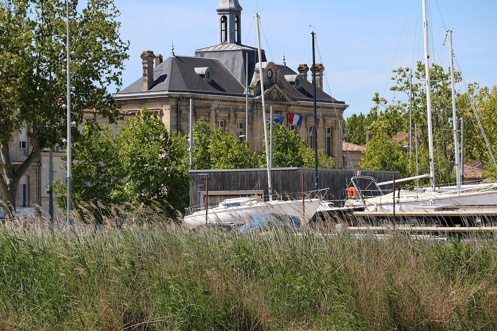

# 拉菲古堡

拉菲古堡在波尔多左岸的波亚克（Pauillac），是 1855 年梅多克分级的一级庄。官方把名字追溯到加斯科方言“La Hite”（小山脊）；17 世纪起，这一带的山脊被开垦为葡萄园。1868 年，詹姆斯·德·罗斯柴尔德男爵购入酒庄，此后一直由罗斯柴尔德家族经营。官方称它在拿破仑三世万国博览会的评比中获得“一级中的一级”（First of the First）。今天它是 Domaines Barons de Rothschild (Lafite) 的核心酒庄，不是独立品牌。

图：拉菲古堡。图片：PA，CC BY-SA 4.0，via Wikimedia Commons（[原图页面](https://commons.wikimedia.org/wiki/File:Ch%C3%A2teau_Lafite-Rothschild.jpg)）。

## 1855–1868：拉菲古堡的历史节点
拉菲的历史常被简化为“1855 年一级庄”与“1868 年罗斯柴尔德购入”，但这两件事之间隔了十三年，性质也不同。1855 年的分级是巴黎万国博览会的商业分类，把梅多克与格拉夫的酒庄按价格与声誉排成五级；拉菲被列为一级，官方用“一级中的一级”强调它在同级的特殊位置。1868 年的收购则是家族所有权的开始：詹姆斯·德·罗斯柴尔德买下酒庄后，罗斯柴尔德家族经历了根瘤蚜、战争、经济危机与多次重建，仍保持对拉菲的控制。

这两个时间点解释了拉菲的双重身份：它既是波尔多分级制度的象征，也是一家家族经营的农业企业。参观时如果只记得“名庄”两个字，会忽略葡萄园、排水、采收与桶陈这些具体工作；而这些工作才是 1855 年分级之后仍能维持声誉的原因。

## 空间与酒单

葡萄园 112 公顷，分三块：城堡周边坡地、西侧 Carruades 高原，以及圣埃斯泰夫（Saint-Estèphe）4.5 公顷地块。土壤是深层细砾石混风成沙，下层是排水良好的第三纪石灰岩。品种以赤霞珠为主，另有梅洛、品丽珠与味而多。正牌酒只用 10 年以上葡萄藤，发酵 15 天、控温 26 至 27°C，在新橡木桶中陈酿 15 个月；副牌 Carruades de Lafite 来自 Carruades 高原，梅洛比例更高，在法国橡木桶中约 16 个月。这里没有对游客开放的“酒单”，参观若恢复，重点是葡萄园、酒窖与桶边品鉴。

酒庄的“酒单”其实只有两款常被讨论：正牌 Château Lafite Rothschild 与副牌 Carruades de Lafite。正牌以赤霞珠为主，结构细、陈年潜力长；副牌梅洛比例更高，年轻时更容易接近。两者不是“好酒与次酒”的关系，而是不同地块与不同调配目标。官方还提到酒庄在 2023 年 12 月加入 B Corp，并正在转向有机种植；这些信息对理解今天的拉菲，比单纯记年份更有用。

## 参观或点单方式

拉菲不接待未预约访客。官网 2026 年 11 月 7 日的参观页面公告：古堡因整修暂停对访客开放至 2028 年 1 月，建议改访同产区的 Château Duhart-Milon，通过其预约表或 visites@duhartmilon.com 联系；联系页面则仍写“整修至 2026 年”，两处口径不一致，出发前必须再确认。正常时期的参观也只接受预约，通常包含葡萄园、酒窖与品鉴，具体时长、语言与价格由酒庄决定。不要把“路过拍照”当成参观，庄园内是私人产业。

想买酒的人要理解波尔多的销售结构：正牌酒主要通过期酒（en primeur）与酒商网络销售，酒庄门口不是零售店；副牌与部分年份可在酒商、餐厅或拍卖渠道找到。参观时若被问到购买，工作人员通常只能指引，不会现场卖给你一瓶正牌。把“参观”与“买酒”分开安排，会少很多误会。

## 拉菲古堡的地址与营业安排
地址：Château Lafite Rothschild, 33250 Pauillac, France（坐标 45.22500, -0.77306）。酒庄官方地址使用“Château Lafite Rothschild + 邮编”，没有街道门牌；导航到 Pauillac 后沿 D2 向北，认酒庄入口指示。电话 +33 5 56 73 18 18。

交通：波亚克在波尔多西北约 50 公里，自驾沿 D2“酒庄之路”北上；波亚克有火车站，从波尔多圣让站（Gare Saint-Jean）可乘 TER 区域列车到达，班次以 SNCF/TER 为准。车站到酒庄没有直达公共交通，需打车或步行较长距离；D2 沿线没有连续人行道，骑行要评估路况与车流。

营业状态与开放时间：官网英文参观页在 2026-11-08 明确写“因整修暂停对访客开放至 2028 年 1 月”（closed to visitors until January 2028）；中文与法文页面另有一处“整修至 2026 年”的旧表述，属口径不一致，以英文参观页与预约回复为准。因此本次核验把访客接待状态记为 `closed`。这不表示酒庄停产：葡萄园、酿造与销售照常进行。

门票与预约：整修期间不接待访客，也不售票。官网建议改访同产区的 Château Duhart-Milon，通过其官网预约表或 visites@duhartmilon.com 联系，参观须提前预约，名额视档期而定；可预约日期、语言与是否含品鉴由酒庄安排。恢复开放后的具体套餐与价格官网尚未公布，未核验，以恢复后的官方预约页为准。

周边道路窄，不要把车停在葡萄园入口或私人车道；葡萄园耕作期会有机械作业，路边停车不要挡住农用车辆。「拉菲古堡」的开放时间、价格与预约，以[官网](https://www.lafite.com/domaines/chateau-lafite-rothschild/)的公开页面为准；核验日期为 2026-11-08，临时调整以官网当日公告为准。

## 礼仪与误区

误区一是把拉菲当成 LVMH 旗下品牌。拉菲属于 Domaines Barons de Rothschild (Lafite)，与木桐（Mouton Rothschild）同属罗斯柴尔德家族但不同公司。误区二是把 1855 年分级当成今天的质量排名，它是历史分类，不是每年重评。误区三是以为副牌 Carruades 是“次等酒”，它来自不同地块与更高梅洛比例，风格与正牌不同。误区四是以为到门口就能买酒，正牌酒通过期酒与配额体系销售，酒庄门口不是零售店。

参观时不要踩葡萄园行间、不要触碰橡木桶与设备；品鉴时使用吐酒桶，开车的人不喝。着装以整洁、舒适为主，葡萄园地面不平，避免高跟鞋。拍照前问清哪些区域允许，私人宅邸与生产区不要擅自进入。遇到整修围挡时不要翻越，施工现场不是参观点。

## 波亚克的周边街区
波亚克是梅多克酒庄路线的核心：北有拉菲、木桐、拉图与杜哈米隆，南有圣朱利安（Saint-Julien）与玛歌（Margaux）。一天安排两座酒庄比较现实，三座会变成赶场；拉菲整修期间，可把杜哈米隆作为替代，再搭配一座圣朱利安酒庄。从波尔多出发可自驾走 D2，也可乘火车到波亚克后打车或租自行车。若只做“酒庄外观巡游”，D2 沿线已经能看到不少名庄大门，但内部参观必须预约。

如果时间只够一天，建议把波亚克与圣朱利安分开看：上午在波亚克看拉菲或杜哈米隆，下午南下圣朱利安看另一座酒庄，晚上回波尔多。玛歌在更南边，硬塞进同一天会让路上时间超过参观时间。整修期间不要把拉菲写成“必看”，先把替代酒庄预约好，再决定路线。

## 同产区酒庄与延伸阅读
拉菲是理解[波尔多左岸](ref:bordeaux)与[赤霞珠为主的红葡萄酒](ref:lafite)的样本；[1855 年分级](ref:grading)解释了“一级庄”从何而来，[波亚克](ref:pauillac)则把拉菲放回村庄与葡萄园的地图。

补充阅读：[红葡萄酒](ref:c-extra-1)。

对照阅读：[拉菲古堡红葡萄酒](ref:lafite)、[葡萄酒分级体系：地理标志、国家等级与酒庄分级](ref:grading)。

相关条目：[波尔多](ref:bordeaux)。

## 相关图像

图：波亚克产区。图片：Anthony Baratier，CC BY-SA 4.0，via Wikimedia Commons（[原图页面](https://commons.wikimedia.org/wiki/File:La_mairie_de_Pauillac_vue_depuis_le_port_de_plaisance.jpg)）。关联图像：拉菲古堡。
