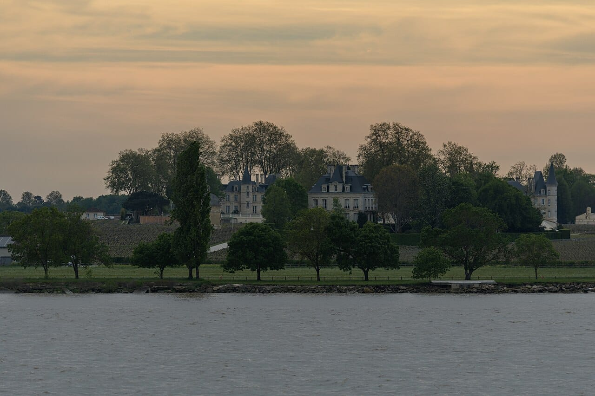

# 拉图酒庄

从 Pauillac 沿 D2 往南，葡萄园在左手展开，右手是吉伦特河口的水面。拉图的塔楼不在路边最显眼的位置，车要拐进一条窄道，穿过树林与草地，才看到那座圆顶塔楼与 19 世纪的宅邸。它离河口只有约 300 米，水面像一面巨大的镜子，调节着温度，也把船只与海风带到这里。拉图的力量感，从这片靠近水边的砾石高地开始。

图：从葡萄园与河口方向看拉图酒庄。图片：Gilles Messian from Paris, France，CC BY 2.0，via Wikimedia Commons（[原图页面](https://commons.wikimedia.org/wiki/File:Vue_sur_Ch%C3%A2teau_Latour_en_fin_de_journ%C3%A9e,_Pauillac,_France_(48030411248).jpg)）。

## 1331 年：拉图酒庄的关键起点
拉图有确切文献的历史从 1331 年开始：Gaucelme de Castillon 获得领主 Pons 的许可，在 Saint-Maubert 教区建一座防御塔。1378 年，Jean Froissart 的《编年史》写到这座“Saint-Maubert 塔”在百年战争中被英军围攻三天后占领。它不是一开始就种满葡萄的庄园，而是一座守卫河口的堡垒；葡萄园是后来慢慢围绕塔楼长出来的。

17 世纪末，拉图通过婚姻与继承进入 Ségur 家族。Alexandre de Ségur 在 1716 年去世前买下 Lafite；他的儿子 Nicolas-Alexandre 被 Louis XV 称为“葡萄亲王”，把家族产业扩到 Mouton 与 Calon。18 世纪，拉图的价格已经远高于普通波尔多酒：1714 年一桶拉图是普通酒的 4–5 倍，1729 年是 13 倍，1767 年是 20 倍。1759 年葡萄园 38 公顷，1794 年 47 公顷；1855 年，拉图与 Lafite、Margaux、Haut-Brion 一起列为一级庄。

20 世纪，Ségur 家族的后代越来越多，股份逐渐外流。1963 年，英国 Pearson 集团成为多数股东，Harveys of Bristol 持有 25%；1989 年 Allied Lyons 买下 Pearson 的股份，持股 93%；1993 年，François Pinault 通过 Artémis 买下 Allied Lyons 的股份。1998 年，Frédéric Engerer 被任命为经理；1999–2003 年，酒窖、发酵室与储存区全面整修；2012 年，酒庄决定不再以期酒（en primeur）方式销售，改为在酒庄认为适饮时再上市。

## 建筑与空间

拉图的视觉核心是那座圆顶塔楼与 19 世纪的宅邸，但真正的“建筑”是葡萄园与酒窖。Enclos 是环绕城堡的 47 公顷地块，葡萄园总面积为 96.5 公顷；Enclos 位于高出河口 12–16 米的砾石丘，北、南两侧有溪流，东侧是河口湿地。土壤表层是砾石，下面是黏土与泥灰岩，排水好，又能在干旱年份保住一点水。19 世纪，酒庄在 Enclos 下铺设排水系统，让采收前的水快速排走。

葡萄园种了约 90 万株葡萄，76% Cabernet Sauvignon、22% Merlot、2% Petit Verdot。老藤平均约 60 年，正牌主要来自 Enclos 的老藤；年轻的葡萄与 Enclos 外的地块进入 Forts de Latour 与 Pauillac 两款。2001 年，发酵室整修成 80 多个不同容量的不锈钢罐，可以按地块、品种与老藤分开发酵；2008 年，马匹回到葡萄园犁地；2015 年起，全部葡萄园按有机方式管理，2018 年获得 Ecocert 认证，部分地块还使用生物动力制剂。

拉图的建筑不追求“好看”。塔楼是历史，宅邸是身份，酒窖是工程；真正决定酒质的是 Enclos 的砾石、老藤的根系、分地块发酵与长时间陈年。参观时不要只看塔楼拍照，留意酒窖里新桶与旧桶的比例、罐的大小与排列，这些细节比立面更能说明酒庄的做法。

## 酒款与风味

拉图的正牌 Grand Vin 只来自 Enclos 的老藤，平均树龄约 60 年；官方说正牌中 Cabernet Sauvignon 通常超过 90%。它年轻时单宁厚、颜色深、黑加仑与雪松明显，常需要 10 年甚至更久才打开；好年份可以放几十年。Forts de Latour 是副牌，来自较年轻的葡萄与 Enclos 外地块，风格更早熟；第三款 Pauillac 更轻，适合较早饮用。

拉图的风格常被概括为“力量、结构、长寿”。与 Margaux 的花香优雅、Haut-Brion 的烟熏矿物相比，拉图更像一座石头建筑：单宁坚实、酒体集中、余味长，年轻时甚至有点“闭”。它不是不能早喝，而是早喝会浪费；如果你只有一瓶，先查年份的适饮窗口，不要用“越老越好”赌。

2012 年起，拉图不再卖期酒。这意味着你不太可能在酒庄还没装瓶时买到“期货”；酒庄会在自己认为合适的时候释放库存。对消费者来说，这减少了“买了还要等两年”的不确定性，也让市场价格更受酒庄节奏影响。

## 怎么喝

年轻拉图需要醒酒：提前 2–3 小时开瓶，或倒进醒酒器 1–2 小时；老酒则要更小心，开瓶后先试，避免过度氧化。服务温度 16–18°C，用大杯；配餐选烤牛肉、羊排、野味、硬奶酪与蘑菇，不要用重辣或甜酱。Forts de Latour 可以早 3–5 年喝，配烤鸡、牛肉与炖菜都行。

不要用“挂杯”判断酒质，也不要把瓶底的沉淀当成坏酒；老拉图有沉淀很正常，倒酒时留一点在瓶底。若在餐厅点老酒，先确认瓶况与退酒政策；长途运输与不当储存会让一瓶好年份变成醋。

## 拉图酒庄的地址与营业安排
- 地址：Château Latour, Saint-Lambert, 33250 Pauillac, France。
- 坐标：45.1765, -0.744925。
- 电话：+33 5 56 73 19 80。
- 办公时间：周一至周五 8:30–12:30、14:00–17:00，公共假日休息。
- 参观：主要面向专业人士（酒商、零售、侍酒师、媒体等），必须预约；不对散客开放常规售票参观。
- 交通：从 Pauillac 开车约 10 分钟；从 Bordeaux 约 1 小时；最近火车站是 Pauillac，出站后需打车。
- 停车：按预约进入，不要把车停在 Enclos 的葡萄行间。
- 无障碍：酒窖与葡萄园地面不平，行动不便者需提前说明。

## 礼仪与常见误区

第一，拉图不是“想进就进”的景点。官方明确说参观主要面向专业人士、必须预约；没有预约不要到门口碰运气。第二，不要把“一级庄”当成“每年都完美”；拉图也有相对普通的年份，买之前看年份。第三，不要以为拉图还在卖期酒；2012 年起已经停止。第四，不要在酒窖触摸酒桶与管线；生产区仍在工作。第五，不要穿薄底鞋进葡萄园；砾石与泥地会陷，雨后尤其滑。

还有一层：拉图的“长寿”来自结构，不是来自酒精度或橡木味。过度醒酒、过高温度与重口味配餐都会把结构压扁；喝老酒时，简单一点更好。

## 从拉图酒庄延伸到Lafite
拉图在 Pauillac 的南端，往北是 [Lafite](ref:lafite) 与 [Mouton](ref:mouton)，往南是 Saint-Julien 与 [Margaux](ref:margaux)，往西南过河到 Pessac 的 [Haut-Brion](ref:hautbrion)。把这几家串起来，就是 [波尔多左岸酒庄路线](ref:route) 的骨架；一天走三家已经很满，不要硬塞五家。

如果想过河换风格，可以去 [Cheval Blanc](ref:cheval) 与 [Pétrus](ref:petrus)，看右岸的 Cabernet Franc 与 Merlot；[波尔多产区](ref:bordeaux) 的左岸与右岸，土壤、品种与建筑完全不同。拉图适合放在“左岸力量”的一天，而不是“到处打卡”的一天。

## 参考资料
- 官方历史《Since 1331》：<http://www.chateau-latour.com/en/in-the-beginning/since-1331>，用于核对 1331 年建塔、1378 年围城、Ségur 家族、1855 年一级庄与 1963/1989/1993/1998/2012 年表。
- 官方风土《The land of Pauillac》：<http://www.chateau-latour.com/en/in-the-beginning/the-land-of-pauillac>，用于核对 300 米、47 公顷 Enclos、96.5 公顷、90 万株葡萄与品种比例。
- 官方代际《From generation to generation》：<http://www.chateau-latour.com/en/in-the-beginning/from-generation-to-generation>，用于核对 2001 年发酵室、2008 年马匹、2015 年有机与 2018 年认证。
- 官方联系：<http://www.chateau-latour.com/en/contact>，用于核对地址、电话、办公时间与专业人士预约政策。
- 左岸对照：[Margaux](ref:margaux)、[Lafite](ref:lafite)、[Mouton](ref:mouton)、[Haut-Brion](ref:hautbrion)、[左岸酒庄路线](ref:route)。
- 右岸对照：[Cheval Blanc](ref:cheval)、[Pétrus](ref:petrus)、[波尔多产区](ref:bordeaux)。

## 相关图像

图：拉菲古堡。图片：PA，CC BY-SA 4.0，via Wikimedia Commons（[原图页面](https://commons.wikimedia.org/wiki/File:Ch%C3%A2teau_Lafite-Rothschild.jpg)）。关联图像：拉图酒庄。
