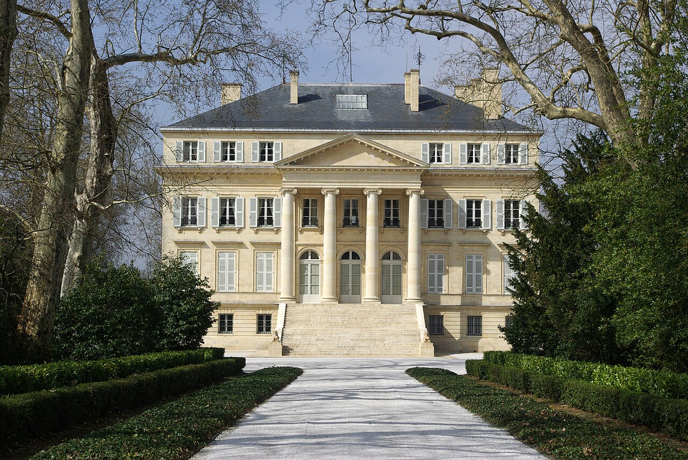

# 玛歌酒庄

从 Bordeaux 往北，D2 公路穿过葡萄园与村庄，进入 Margaux 地界后，路两边的房子变矮，葡萄园变宽。玛歌酒庄的主楼不在路边，要拐进一条林荫车道，经过草地、树丛与低矮的附属建筑，才看到那座新帕拉第奥式的立面：四根 Ionic 柱、三角山花、石阶，以及前面一大片浅色的砾石空地。它看起来像一座乡间宅邸，而不是酒厂；但在这座宅邸背后，是波尔多最贵的红葡萄酒之一。

图：玛歌酒庄主楼正面。图片：David Perez，CC BY 3.0，via Wikimedia Commons（[原图页面](https://commons.wikimedia.org/wiki/File:Chateau_Margaux_01_by-dpc.jpg)）。

## 1572 年：玛歌酒庄的关键起点
玛歌的葡萄园历史可以追到 12 世纪，当时这片地叫 La Mothe de Margaux，属于一个领主。1572 年，Lestonnac 家族把葡萄园与地产整合成今天的雏形；18 世纪，酒已经以 Margaux 之名出售。1810–1815 年，Louis Combes 为当时的业主 Marquis de La Colonilla 设计了这座新帕拉第奥式主楼，四根 Ionic 柱与三角山花成为酒庄最容易被认出的形象。1855 年，玛歌与 Lafite、Latour、Haut-Brion 一起被列为一级庄；Mouton 要到 1973 年才升入一级。

20 世纪，玛歌经历了战争、经济危机与所有权更替。1977 年，希腊裔法国商人 André Mentzelopoulos 买下酒庄，投入大量资金修复葡萄园、酒窖与建筑；1980 年他去世，27 岁的女儿 Corinne 接手。她后来买回 Agnelli 家族的股份，成为唯一股东，并在 2015 年请 Norman Foster 设计新的酒窖与生产设施。2023 年，Corinne 把日常管理交给儿子 Alexis Leven-Mentzelopoulos，女儿 Alexandra 担任控股公司监事会主席。

这段历史的关键不是“家族连续”，而是“在 1977 年之后重新把质量拉回一级庄”。1977 年前的玛歌并不差，但设备、排水与葡萄园管理已经落后；Mentzelopoulos 父女的投资让它在 1980 年代之后重新成为波尔多左岸的标杆。

## 建筑与空间

玛歌的主楼是法国新帕拉第奥主义的教科书：对称立面、中央门廊、四根 Ionic 柱、三角山花、石阶与两侧退后的翼楼。它不是中世纪城堡，也不是文艺复兴庄园，而是 1810 年代法国贵族对古希腊—罗马比例的想象。站在石阶前，你会看到柱子的阴影落在浅色石材上；这种“克制的气派”比任何金色装饰都更贵。

2015 年，Norman Foster 的新酒窖在主楼旁完成。新建筑没有复制古典立面，而是用玻璃、钢与木结构做出一个轻量的生产空间；屋顶与地形相接，内部放发酵罐、品鉴与接待区。它的争议在于“现代建筑是否该出现在历史庄园里”，但它至少没有把主楼遮住：从老建筑看向葡萄园，视线仍然完整。

玛歌的葡萄园约 265 公顷，其中约 87 公顷红葡萄、12 公顷白葡萄，其余是草地、树林、道路与建筑。土壤以深层砾石为主，排水好，葡萄根可以往下扎；靠近主楼的地块有永久草 cover，其他地块按土壤与品种调整。官方说酒庄正在转向有机种植，这不是一句“天然”口号，而是具体的 cover crop、堆肥与病害管理。

## 酒款与风味

玛歌的产品线不复杂：Grand Vin de Château Margaux 是正牌，Pavillon Rouge 是红副牌，Pavillon Blanc 是白葡萄酒。2009 年，酒庄又推出第三款红葡萄酒，用来承接更年轻的葡萄与更早饮用的场景；它不叫“副牌的副牌”，而是独立品牌。正牌通常以 Cabernet Sauvignon 为主，混少量 Merlot、Cabernet Franc 与 Petit Verdot；Pavillon Blanc 则是 100% Sauvignon Blanc，来自酒庄最老的白葡萄地块。

玛歌的风格常被概括为“优雅、花香、丝绒”。与 Latour 的力量、Haut-Brion 的烟熏矿物相比，玛歌更强调 perfumed 的花香、黑加仑、紫罗兰、雪松与细腻的单宁。它不是“入口就爆炸”的酒，往往要 10–20 年才进入适饮期；好年份可以放得更久。Pavillon Rouge 更早可喝，Pavillon Blanc 适合 5–10 年内喝，太老会失去白花与柑橘的轻盈。

不要把“玛歌”与“Margaux 产区”混为一谈。Margaux AOC 里有几十家酒庄，Château Margaux 只是其中一家；酒标上的 “Château Margaux” 与 “Margaux” 是不同层级的概念。也不要以为所有 Margaux 产区的酒都像玛歌酒庄；产区内从一级庄到小酒庄，风格与价格差得很远。

## 怎么喝

正牌玛歌不适合开瓶就喝。较年轻的年份，至少提前 1–2 小时开瓶或醒酒；老酒则要小心，开瓶后先试一口，避免过度醒酒把香气散掉。服务温度在 16–18°C，不要冰镇；用较大的波尔多杯，让酒液有空间接触空气。配餐上，红肉、烤羊排、蘑菇与松露是稳妥选择；不要用重辣、重醋或大量酱油的菜压住花香。

Pavillon Rouge 是更实用的日常选择：年轻年份开瓶 30–60 分钟即可，配烤鸡、牛肉、硬奶酪都行。Pavillon Blanc 要冷一些，8–10°C，配海鲜、白肉、山羊奶酪或简单的黄油煎鱼；不要加冰，也不要用重橡木味的杯子。

在酒庄参观时，品鉴通常只对专业人士开放，普通游客能看的是建筑、酒窖与葡萄园，不一定能喝到正牌。若想喝玛歌，最稳的是在 Bordeaux 的酒窖、餐厅或专业酒商处点一杯，而不是指望现场开一瓶。年份差异很大，买之前看酒评与适饮窗口，不要只看“一级庄”三个字。

## 玛歌酒庄的地址与营业安排
- 地址：Château Margaux, 33460 Margaux, France。
- 坐标：45.0423, -0.6747。
- 电话：+33 (0)5 57 88 83 83。
- 参观：仅限预约，周一至周五；周末、公共假日、8 月与采收期关闭。品鉴只对专业人士开放。
- 交通：从 Bordeaux 市中心开车约 40 分钟；从 Margaux 火车站步行约 20–25 分钟，但车道没有人行道，建议打车。
- 停车：访客停车场在主楼前，按预约进入；不要把车停在葡萄园行间或村民家门口。
- 无障碍：主楼石阶与部分酒窖地面不平，轮椅使用者需提前说明；新酒窖的接待区较平。
- 预约：写清姓名、人数、语言、到访目的与希望看的区域；不要临时 walk-in。

## 礼仪与常见误区

第一，玛歌不是“对所有人开放的景点”。它是私人酒庄，参观与品鉴有严格的职业/预约限制；没有预约不要推门。第二，不要把“一级庄”当成“最好喝”的同义词；1855 年分级是历史与价格的框架，不是每年每瓶的口味排名。第三，不要在酒窖里触摸酒桶、管线与展品；生产区仍在工作。第四，不要穿高跟鞋或薄底鞋进葡萄园；砾石与泥地会陷。第五，不要要求酒庄在现场卖正牌或开整瓶；库存与配额不在游客柜台。

还有一层：玛歌的建筑、葡萄园与酒价共同构成“品牌”，但酒庄的社会关系不只是庄主与客人。采摘工、酒窖工、 cooperage、运输与销售网络都在其中；参观时看到的一排排葡萄与干净石阶，是许多人劳动的结果。

## 从玛歌酒庄延伸到波尔多左岸酒庄路线
玛歌在 D2 公路旁，往北是 Saint-Julien、Pauillac，往南是 Cantenac 与 Arsac。把玛歌放进 [波尔多左岸酒庄路线](ref:route)，可以接着去 [Latour](ref:latour)、[Lafite](ref:lafite) 与 [Mouton](ref:mouton)；往南再走 [Haut-Brion](ref:hautbrion)。这四家一级庄分散在 Médoc 与 Pessac，一天走完不现实，至少安排两天。

如果只有半天，玛歌 + Margaux 村是较轻松的搭配；想看右岸的 Merlot 风格，可以过河去 [Cheval Blanc](ref:cheval) 或 [Pétrus](ref:petrus)；想喝甜酒，再往南到 [Yquem](ref:yquem)。[波尔多产区](ref:bordeaux) 很大，左岸与右岸的土壤、品种与建筑完全不同，不要用“波尔多”一个词概括。

## 参考资料
- 官方历史：<https://chateau-margaux.com/en/le-domaine/histoire>，用于核对 12 世纪起源、1572 年 Lestonnac、1810–1815 年主楼、1855 年一级庄、1977/1980/2015/2023 年表。
- 官方风土：<https://chateau-margaux.com/en/le-domaine/le-terroir>，用于核对 265 公顷、87 公顷红葡萄、12 公顷白葡萄、砾石土壤与有机转型。
- 官方参观与联系：<https://chateau-margaux.com/en/contact>，用于核对预约规则、关闭月份与地址电话。
- 官方首页：<https://www.chateau-margaux.com/en/>，用于核对 Grand Vin、Pavillon Rouge、Pavillon Blanc 的产品结构。
- 左岸对照：[Latour](ref:latour)、[Lafite](ref:lafite)、[Mouton](ref:mouton)、[Haut-Brion](ref:hautbrion)、[左岸酒庄路线](ref:route)。
- 右岸与甜酒：[Cheval Blanc](ref:cheval)、[Pétrus](ref:petrus)、[Yquem](ref:yquem)、[波尔多产区](ref:bordeaux)。
