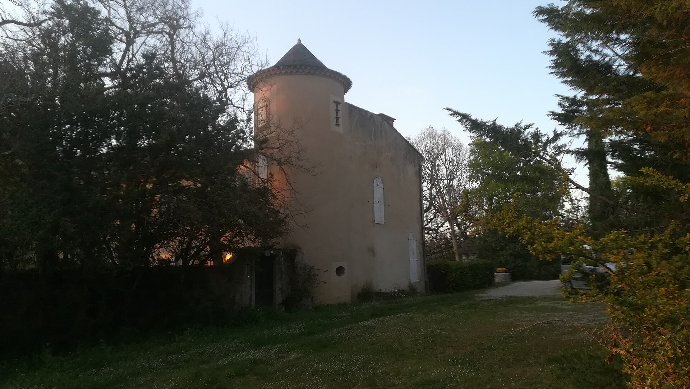

# 米拉沃酒庄

米拉沃酒庄（Château Miraval）在瓦尔省的科朗斯，是一处被松林、橄榄树与葡萄园包围的私人产业，也是普罗旺斯桃红在国际市场上最有辨识度的名字之一。它对外更像一个“酒标”而不是“景点”：官方问答明确写着庄园不对公众开放，酒款在佩兰家族的品鉴室与指定渠道出售。把它当作一个需要预约才能进入的酒窖，会直接走错方向；把它当作一瓶需要理解产地与工艺的酒，才符合它现在的运作方式。

图：米拉沃酒庄相关实景照片。图片：Hernandlucas，CC BY-SA 4.0，via Wikimedia Commons（[原图页面](https://commons.wikimedia.org/wiki/File:Ch%C3%A2teau_de_Miraval_3.jpg)）。

## 科朗斯山谷与一座私家庄园

科朗斯位于布里尼奥勒以北，是瓦尔省内陆的一个小村。米拉沃的葡萄园坐落在一条私人谷地里，官方描述强调干石梯田：坡面用石块垒成一层层窄台，既挡风、保土，也让排水更均匀。葡萄园平均海拔约 350 米，白天日照充足，夜里温度下降，这种日较差让果实保留酸度，同时累积香气。整个产业超过 600 公顷，但葡萄园只占其中一部分，其余是林地、橄榄与建筑。

这类地形决定了机械化程度。梯田窄、坡度陡，很多作业只能靠人工；采收时要把果实从坡上背下来，再集中运到压榨点。普罗旺斯的[产区](ref:provence)故事常从“光”讲起，但在米拉沃，光只是条件之一，石头、坡向与夜间凉意才是酒体结构的来源。

## 有机葡萄园与佩兰家族

官方问答写明，米拉沃的葡萄园多年按有机方式耕作并获有机认证。但酒款本身并不都标有机：自 2012 年份起，酒庄选择不为酒款申请有机标识，理由是要保留与邻近优质葡萄园混调的弹性，以及使用一种在欧洲尚未获有机批准的稳定工艺。这一点很关键：葡萄园的耕作方式与最终酒款的标签，是两件不同的事。

装瓶地点也不在庄园内。官方说明酒款在佩兰家族的酒厂装瓶，那里装有现代化的装瓶线，可以更精确地控制溶解氧，这对桃红尤其重要。换句话说，米拉沃的“庄园”负责果实与风土，佩兰家族负责酿造与装瓶的工业精度。理解这条分工，才不会把“酒庄”想象成一个从采摘到贴标都在同一栋房子里完成的地方。

## 为什么它不对公众开放

官方问答的回答很直接：庄园不对公众开放，但酒款可以在佩兰家族位于教皇新堡的品鉴室买到。这不是临时通知，而是当前的经营安排。私人产业、住宅与生产区混在一起，开放参观众多区域既不现实，也会影响庄园的日常运作。因此，任何声称可以“直接进庄园品鉴”的第三方行程，都值得先核实。

对旅行者来说，这意味着两件事。第一，不要把它写进“今天要参观的酒窖”清单；第二，若想喝到它，应该查佩兰家族的品鉴室、授权零售商或餐厅，而不是开车到科朗斯敲门。地址 Miraval, 83570 Correns, France 只适合作为地理参考与邮寄地址，不是访客入口；经纬度未从官方页取得，坐标以官方渠道为准。

## 桃红的风格与酒标细节

米拉沃的桃红属于 Côtes de Provence [法定产区](ref:appellation)，风格偏浅色、干型，香气以白花、柑橘、红醋栗与少量白桃为主，口感清爽但有中段浓度。它的葡萄来源并不全部出自庄园：官方承认为了保留混调弹性，会加入其他优质葡萄园的果实。这与“100% 庄园自产”的常见宣传不同，也是读酒标时容易忽略的一点。

酒标之外还有一个防伪细节：自 2014 年份起，桃红瓶身开始刻码，以降低仿冒风险。这个年份之后的产品，瓶身应有可识别的刻印。酒庄还生产两款白葡萄酒（Côtes de Provence 与 Côteaux Varois en Provence）和一款 Vin de France 红葡萄酒；产品结构说明它并不把自己锁死在单一桃红品类里，尽管桃红仍是市场认知的核心。

## 想喝到它，去哪里

最稳的渠道是佩兰家族的品鉴室。官方问答把教皇新堡的品鉴室作为购买入口，那里同时陈列佩兰家族的其他酒款，适合把米拉沃放进一个更大的南罗讷与普罗旺斯对照里。其次是授权零售商与餐厅；普罗旺斯当地的酒商、精品食材店与部分酒店也会进货，但库存随年份与批次变化。

如果行程以“参观酒庄”为主，建议把这一站替换成真正开放的酒窖，例如塔拉多的[奥托酒庄](ref:ott)。若坚持到科朗斯，可以只在外围看山谷与梯田景观，把品鉴安排在别处。不要在没有确认的情况下把车开进私人道路；法国乡村的私人产业边界很清楚，误入既失礼也可能有安全风险。

## 把它放进普罗旺斯路线

从莱博德普罗旺斯或艾克斯出发，科朗斯约一小时多车程；从塔拉多过来也约一小时。它适合作为“理解桃红市场”的一站，而不是“进入生产区”的一站。把米拉沃与奥托放在同一天，能对照两种普罗旺斯桃红路径：一个是三庄园、可参观、以酒窖体验接待访客；另一个是私家庄园、不开放、以品牌与渠道触达消费者。

对[桃红葡萄酒](ref:rose)的初学者来说，这种对照比多看一个发酵罐更有用：同一片产区，同样的浅色风格，背后的土地组织、所有权与销售方式完全不同。开放政策、品鉴渠道与地址以官方渠道为准，本页核验日期 2026-11-09。

对照阅读：[普罗旺斯](ref:provence)、[原产地命名（appellation）](ref:appellation)。

相关条目：[桃红葡萄酒](ref:rose)。

**关键事实。**

| 项目 | 内容 |
| --- | --- |
| 一句话定位 | 科朗斯山谷里的普罗旺斯桃红名庄，葡萄园按干石梯田排列，获有机认证；酒庄本身不对公众开放，酒款在佩兰家族的品鉴室与指定渠道出售 |
| 地址 | Miraval, 83570 Correns, France |
| 城市/国家 | 科朗斯 / 法国 |
| 营业状态 | 已核验营业 |
| 官网 | miraval.com |

**来源与边界。** 本页关于「米拉沃酒庄」的关键事实，主要由以下来源交叉核对：Château Miraval（葡萄园有机认证、酒款是否全部来自庄园、装瓶地点、酒标与瓶身刻码，以及“庄园不对公众开放”的官方说明；干石梯田、平均海拔约 350 米与葡萄园的日照和夜间凉意）、Famille Perrin（Miraval 由佩兰家族负责酿造与装瓶、酒款系列与品鉴渠道）、Conseil Interprofessionnel des Vins de Provence（Côtes de Provence 的 1977 年 AOP 地位、地理命名与石灰岩、结晶岩土壤分区）。产品、地址或营业状态变化较快时，以 miraval.com 的最新页面为准；价格、批次与状态会变，涉及这些字段时以页面所列来源的最新版本为准。正文为项目自写，来源只作核验，不复制原文。

## 参考资料

- [Miraval 官方问答](https://www.miraval.com/en/faq-2/)：有机认证、装瓶地点、瓶身刻码与不对公众开放的说明。
- [Miraval — A Land](https://www.miraval.com/en/a-land/)：干石梯田、平均海拔约 350 米与葡萄园地形。
- [Miraval — Famille Perrin](https://m.familleperrin.com/1777D1DDK6/fr)：佩兰家族的酿造、装瓶与品鉴渠道。
- [Côtes de Provence — Vins de Provence](https://www.vinsdeprovence.com/les-appellations/cotes-de-provence)：1977 年 AOP、地理命名与土壤分区。

补充阅读：[葡萄酒](ref:c-extra-1)。
