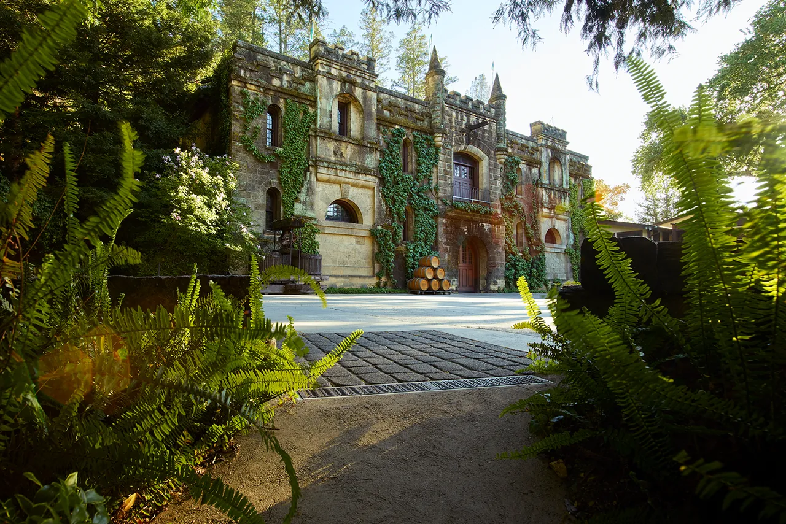

# 蒙特莱纳酒庄

卡利斯托加在纳帕谷北端，圣海伦娜山脚下，傍晚的雾气比谷底更早散去。Tubbs Lane 从镇中心向西，路尽头是一座灰石砌成的“城堡”，前面是草坪与池塘，后面是葡萄园。蒙特莱纳的入口不像酒庄，更像一座 19 世纪的乡间庄园：石墙、塔楼、拱门、修剪整齐的树。它的名气同样来自 1976 年巴黎审判，不过这次是白葡萄酒组：1973 年的霞多丽名列第一。与鹿跃的赤霞珠胜利并列，这两场结果让纳帕谷从“新兴产区”变成世界葡萄酒版图上的名字。

图：蒙特莱纳的石砌城堡主楼与庭院。图片：Unknown author Unknown author，CC0，via Wikimedia Commons（[原图页面](https://commons.wikimedia.org/wiki/File:Chateau_Montelena_Exterior.png)）。

## 1882 年：蒙特莱纳酒庄的关键起点
1882 年，靠绳索生意在淘金热中致富的 Alfred L. Tubbs 买下卡利斯托加北边 254 英亩土地，种下 100 多英亩葡萄，建成 A.L. Tubbs Winery。到 1896 年，酒庄已是纳帕谷第七大，年产约 60,000 箱。禁酒令开始后，酿酒停止，葡萄园改种李子与梨。1958 年，电气工程师 Yort Wing Frank 与妻子 Jeanie 买下产业，作为退休居所，并挖出 Jade Lake、建起中式园林。1968 年，Lee 与 Helen Paschich 买下产业，律师 James L. Barrett 与开发商 Ernest Hahn 加入；1972 年酒庄重启，Mike Grgich 担任酿酒师，酒庄正式命名为 Chateau Montelena。1976 年，1973 年霞多丽在巴黎审判白葡萄酒组中名列第一。2008 年，Michel Reybier 从 Barrett 家族手中买下酒庄；2013 年，酒庄列入美国国家史迹名录。

## 建筑与空间

主楼是 1882 年建成的石砌城堡，墙用当地火山岩与凝灰岩，塔楼、拱门与深色木窗构成典型的 19 世纪“château”趣味。它不是法国城堡的复制品，而是一位美国企业家在加州乡间建造的“欧洲想象”。主楼前是草坪与喷泉，侧面是中式园林与 Jade Lake：石桥、曲径、竹林与睡莲，和周围的橡树、棕榈并置，形成一种奇特的混搭。生产区在城堡后方，发酵罐、橡木桶与装瓶线不对外随意开放；品鉴室与庭院是访客能进入的部分。最值得看的是“建筑与水的组合”：在纳帕谷这样干燥的地方，Jade Lake 不只是景观，也是微气候的一部分，能调节近地面的温度与湿度。

## 酒单与味觉

核心酒款是 Estate Cabernet Sauvignon 与 Napa Valley Chardonnay。Estate Cabernet 通常以赤霞珠为主，少量品丽珠，来自卡利斯托加的庄园葡萄园；酒体饱满，单宁细密，黑樱桃、黑醋栗、雪松、烟草与矿物明显，20 个月法国橡木桶、约 28% 新桶，陈年潜力长。霞多丽是酒庄的另一张名片，发酵后在法国橡木桶中陈年约 10 个月，带黄桃、柠檬、榛子、奶油与烤面包气息，酸度保持得较好。酒庄也做 Sauvignon Blanc、Zinfandel 与 Riesling，产量不大；Riesling 在卡利斯托加的表现常被忽略，但它能说明酒庄并不只会做“重口味”的红酒。品鉴时把 Estate Cab 与霞多丽分开看：一个是结构，一个是质地，不要用同一套“浓郁度”标准评价。

## 怎么喝

Estate Cabernet 建议 16–18°C，年轻年份提前 1–2 小时，老年份 30–60 分钟；配烤牛排、羊排、炖牛肉、蘑菇与硬质奶酪。霞多丽建议 10–12°C，不要过冰；配龙虾、烤鸡、奶油意面、蟹肉与软质奶酪。Sauvignon Blanc 8–10°C，配牡蛎、沙拉与山羊奶酪。Riesling 8–10°C，配亚洲香料菜、猪肉与辛辣食物；它的酸度与残糖能平衡辣味。不要给霞多丽配重辣或大量醋的菜，酸度会冲突；也不要用高单宁赤霞珠配甜酱，苦味会被放大。

## 蒙特莱纳酒庄的地址与营业安排
地址是 1429 Tubbs Lane, Calistoga, CA 94515；电话 707.942.5105。酒庄以预约制品鉴为主，可能保留少量 walk-in 名额，旺季几乎必须提前订；具体场次与价格以官网为准。从 Napa 市区沿 CA-29 向北约 25–30 分钟到 Calistoga，再转 Tubbs Lane 向西；从 Santa Rosa 方向走 CA-128 约 45 分钟。停车场在入口内侧，品鉴室与庭院对轮椅基本友好，但老建筑部分有台阶。卡利斯托加夏季白天可达 35°C 以上，预约上午场更舒适；收成季节周边道路有农用车，留出时间。

## 礼仪与常见误区

第一，巴黎审判的白葡萄酒冠军是 1973 年蒙特莱纳霞多丽，不是“每一年都赢”；不要把它当成酒庄的永久头衔。第二，Jade Lake 与中式园林是私人产业的一部分，只有会员或特定体验才能进入野餐区；不要翻越围栏或下水。第三，城堡是历史建筑，不是影视布景；不要触摸石墙、攀爬塔楼或使用无人机。第四，不要把蒙特莱纳与“Bottle Shock”电影等同；电影做了戏剧化处理，真实历史以酒庄与档案馆为准。第五，品鉴不要赶场；卡利斯托加到鹿跃区至少 30 分钟，两个预约之间留足时间。第六，酒庄的 Riesling 与 Zinfandel 产量小，不要因为“主打赤霞珠”就忽略它们。

## 从蒙特莱纳酒庄延伸到纳帕谷
卡利斯托加周边有温泉、Old Faithful Geyser、Sharpsteen 博物馆与圣海伦娜山步道；向南是 [纳帕谷](ref:napa) 的 St. Helena 与 Rutherford。若只有半天，酒庄品鉴加镇中心午餐足够；一天可以加 Schramsberg 的起泡酒酒窖或 [美国](ref:usa) 葡萄酒图书馆。把 [霞多丽](ref:chardonnay) 与 [白葡萄酒](ref:white) 的背景放在一起读，会更容易理解 1976 年白葡萄酒组的争议；[橡木桶陈年](ref:oak) 则解释 Estate Cab 的结构。不要把蒙特莱纳与鹿跃安排在同一上午：两边都需要预约，而且卡利斯托加在北端，路线不顺。

**关键事实。**

| 项目 | 内容 |
| --- | --- |
| 一句话定位 | 纳帕谷卡利斯托加的历史酒庄，1882 年由 Alfred L. Tubbs 创建；1973 年霞多丽在 1976 年“巴黎审判”白葡萄酒组中名列第一 |
| 地址 | 1429 Tubbs Lane, Calistoga, CA 94515, United States |
| 城市/国家 | 卡利斯托加 / 美国 |
| 营业状态 | 已核验营业 |
| 官网 | montelena.com |

**来源与边界。** 本页关于「蒙特莱纳酒庄」的关键事实，主要由以下来源交叉核对：Chateau Montelena Winery（1882 年创立、Calistoga 与 Napa Valley、1429 Tubbs Lane、冲积/火山/沉积三类土壤与酒庄葡萄园地图；酒庄霞多丽的酿造、法国橡木桶陈年与风格描述）。产品、地址或营业状态变化较快时，以 montelena.com 的最新页面为准；价格、批次与状态会变，涉及这些字段时以页面所列来源的最新版本为准。正文为项目自写，来源只作核验，不复制原文。

**并读。** 把「蒙特莱纳酒庄」与「纳帕谷」、「美国」、「霞多丽」放在一起读时，先确认它们是同一层级还是上下游关系：先确认地址与营业状态，再比较历史、空间与点单体验。本页负责给出场所的基本坐标，对照条目补上具体案例与差异；读完再回到本页，才能分清哪些差别属于场所本身，哪些只是产地、批次或品牌选择。

**适用边界。** 对「蒙特莱纳酒庄」而言，营业时间、预约方式与菜单会变；到访前以官网、电话或现场公告为准。

## 参考资料
- 同类对照：[napa-valley](ref:napa)、[usa](ref:usa)、[chardonnay](ref:chardonnay)、[white-wine](ref:white)、[oak-ageing](ref:oak)。
- 背景阅读：[napa-valley](ref:napa)、[usa](ref:usa)。
关于蒙特莱纳酒庄，本页不绘制参观地图；开放时间、年份与价格以酒庄官网为准。

对照阅读：[纳帕谷](ref:napa)、[霞多丽](ref:chardonnay)。

## 相关图像

图：橡木桶陈酿的编辑插图：桶壁烘烤层、酒液与取样管；AI 辅助绘制，不是酒窖实拍。图片：Hejiu 编辑团队，使用豆包 Seedream 5.5 AI 辅助生成；项目自制，不是现场照片（[项目说明](https://hejiu.org/about/)）。关联图像：蒙特莱纳酒庄。
