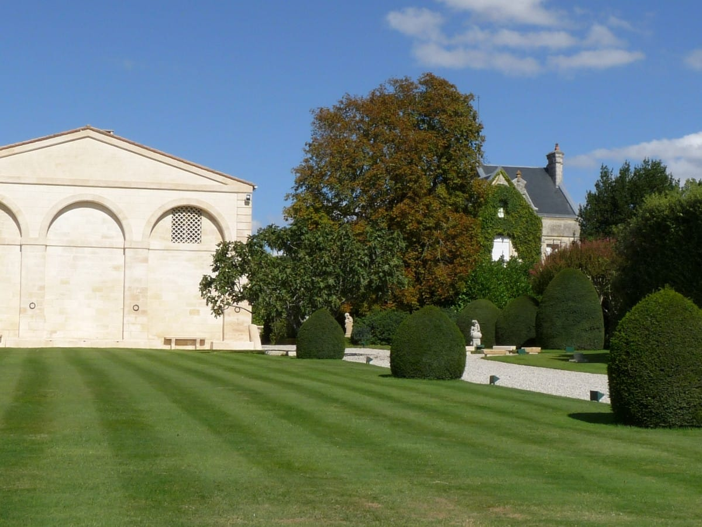

# 木桐酒庄

木桐酒庄在波尔多左岸的波亚克，梅多克产区的核心地带。它的名字、等级与酒标几乎构成了一部浓缩的波尔多近代史：1853 年由英国分支的罗思柴尔德家族买下，1855 年被评为二级庄，1973 年晋升一级庄；1945 年以后，每个年份的正牌酒都请一位艺术家设计酒标。今天它既是一座仍在生产的酒庄，也是一处需要提前很久预约的参访地，而不是可以临时买票进入的景点。

图：木桐酒庄。图片：Jack ma，CC BY-SA 3.0，via Wikimedia Commons（[原图页面](https://commons.wikimedia.org/wiki/File:Jardin_de_Ch%C3%A2teau_de_Mouton-Rothschild,_Pauillac._2012.jpg)）。

> **先给结论**
> **一句话：** 这页判断木桐酒庄值不值得专程去，以及到访前要核对什么。
>
> - **适合谁：** 正在计划去木桐酒庄、想知道值不值得专程安排半天到一天的人。
> - **不适合谁：** 只想要“必去榜单”、不准备核对预约、交通和开放时间的人。
> - **先看这两点：**
>   - 木桐只接受预约参观，官方明确要求至少提前两个月预订，且视名额而定；采收期参观会暂停。
>   - 第一个误区是把“1855 年二级庄”与“今天的一级庄”混为一谈。

## 1853 年：木桐酒庄的关键起点
1853 年，纳塔涅·德·罗思柴尔德男爵（Baron Nathaniel de Rothschild）在拍卖中买下当时的 Château Brane-Mouton，目的是让自己宴客时有酒可上。酒庄从此改姓罗思柴尔德，成为今天的 Château Mouton Rothschild。1855 年巴黎世博会配套的波尔多分级把木桐列为二级庄（Deuxième Cru），此后的一个多世纪里，酒庄的市场声誉常被拿来与一级庄比较，但等级始终差一档。

1922 年，二十岁的菲利普·德·罗思柴尔德男爵（Baron Philippe de Rothschild）接手酒庄。他是木桐现代性格的塑造者：推动酒庄自行装瓶，1924 年份开始以“mis en bouteille au château”标示，减少了对酒商的依赖；把酒庄从单纯的农业资产变成带有文化野心的品牌。1945 年，为庆祝同盟国胜利并标志自己重返酒庄，他请画家菲利普·朱利安（Philippe Jullian）设计酒标，瓶上出现代表胜利的“V”字。此后，木桐每年邀请一位当代艺术家为当年酒标创作原作，这一制度延续至今。

1962 年，菲利普男爵与第二任妻子保琳男爵夫人把酒庄的一部分改成葡萄酒艺术博物馆（Musée de l'Art du Vin），收藏与葡萄、葡萄酒有关的各时代器物。1973 年，经过长期游说，木桐由二级庄晋升一级庄，成为 1855 年分级中唯一被升格的一级庄；这次调整由时任农业部长雅克·希拉克签署法令。酒庄的座右铭也随之改为“Premier je suis, second je fus, Mouton ne change”，大意是“我今为第一，曾为第二，木桐不变”。

1988 年菲利普男爵去世后，女儿菲利平·德·罗思柴尔德男爵（Baroness Philippine de Rothschild）接手；她于 2014 年去世，如今酒庄由菲利普·塞雷·德·罗思柴尔德（Philippe Sereys de Rothschild）、卡米耶·塞雷·德·罗思柴尔德（Camille Sereys de Rothschild）与朱利安·德·博马舍·德·罗思柴尔德（Julien de Beaumarchais de Rothschild）共同经营。1979 年，木桐还与罗伯特·蒙大维（Robert Mondavi）在加州合资创立了作品一号（Opus One），这是波尔多资本进入新世界的一段重要插曲。

## 空间与酒单

木桐的葡萄园集中在波亚克镇北侧，面积约 90 公顷，以赤霞珠为主，辅以梅洛、品丽珠与小维多。左岸的砾石土壤排水性好，成熟期的热量反射有利于赤霞珠；酒庄的正牌酒通常结构紧实、单宁充沛，年轻时需要醒酒，陈年后会出现雪松、石墨与黑加仑的层次。它的风格并非每年一致：年份冷凉时更偏线性，成熟年份则更丰厚，这正是波尔多“年份”概念最直观的体现。

建筑上，酒庄最值得看的是三组空间。其一是大酒窖（Grand Chai），用于陈酿正牌酒；其二是 2013 年 6 月启用的新发酵车间，由舞台设计师理查德·佩杜齐（Richard Peduzzi）与建筑师贝尔纳·马齐埃（Bernard Mazières）合作设计，64 个不同容量的发酵罐对应不同地块，木结构、钢柱与悬挂照明让整个空间带有某种“百科全书”式的秩序感；其三是葡萄酒艺术博物馆与“酒标画作”（Paintings for the Labels）展区，后者把 1945 年以来艺术家为木桐创作的原作集中陈列，从毕加索、布拉克、达利到弗朗西斯·培根、杰夫·昆斯，构成一条可以按年份阅读的现当代艺术线。

酒款结构相对清楚。正牌 Château Mouton Rothschild 是酒庄的核心；副牌 Le Petit Mouton de Mouton Rothschild 从 1993 年份开始推出，风格更早熟；白葡萄酒 Aile d'Argent 自 1991 年份起生产。需要区分的是 Mouton Cadet：它由菲利普男爵在 1930 年创立，是面向更广阔市场的酒商品牌，并不是木桐酒庄的正牌或副牌。把 Mouton Cadet 当成“便宜的木桐”，是参观和购买时最常见的误会之一。

## 怎么参观

木桐只接受预约参观，官方明确要求至少提前两个月预订，且视名额而定；采收期参观会暂停。预约通过酒庄官方渠道进行，确认后按指定时间到达。常规完整参观通常包括发酵车间、酒窖、葡萄酒艺术博物馆与“酒标画作”展区，部分行程含品鉴；是否含品鉴、含哪些酒款，要在预约时确认，不能默认门票一定配一杯正牌酒。

参观时长通常在一到三小时之间，取决于行程类型。第一次来，建议把重点放在“空间—艺术—酒”三件事上：先看发酵车间理解木桐如何把地块分开处理，再看酒窖理解陈酿，最后在博物馆与酒标展区把品牌史串起来。若行程含品鉴，先喝副牌或白葡萄酒，再喝正牌，顺序反过来容易让前者显得单薄。

不适合把木桐当作“顺路拍照”的酒庄。它没有开放式的游客中心，不能临时进入葡萄园或酒窖；带小孩的家庭要提前说明，未成年人不会被提供酒精饮品。参观语言以法语和英语为主，其他语言需提前询问。采收期（通常九月至十月）不仅参观暂停，酒庄周边道路也常有农业车辆，安排行程时要留出余量。

## 木桐酒庄的地址与营业安排
地址：Château Mouton Rothschild, 33250 Pauillac, France（坐标 45.21530, -0.76860）。官方地址只写到镇与邮编，没有门牌号，导航时直接搜酒庄名称即可。电话 +33 (0)5 56 73 21 29。

交通：木桐位于波亚克镇北侧，从波尔多市区开车沿 D2 公路北上约一小时量级；也可从波尔多圣让站乘 TER 区域列车到波亚克，再打车或骑行前往，班次与接驳以 SNCF 和当地地图为准。

开放时间与预约：没有固定的公共开放时间，全部按预约安排，官方要求至少提前两个月预订且视名额而定；采收期（通常在 9 月至 10 月）参观暂停。名额在冬季与春季相对好约，夏季与采收前最紧张。预约通过官网联系页的预约入口或邮件进行，确认后按指定时段到达，迟到可能被缩短行程或拒绝入场。

门票与费用：官网不公布固定票价，费用随行程类型（是否含品鉴、品鉴酒款、时长与语言）变化，预约确认邮件会写明；本页不写具体金额，以免把会变的报价当成固定信息。可预约语言以法语与英语为主，其他语言需在预约时询问。是否含正牌品鉴不能默认，必须在预约时确认。

着装没有硬性规定，但酒窖温度低、地面为石板或碎石，穿舒适的平底鞋比穿高跟鞋实用。酒窖与发酵车间有台阶和狭窄通道，行动不便的参观者应在预约时说明，酒庄会视建筑条件安排。参观前不要喷浓香水，以免干扰自己和他人的闻香；也不要触碰橡木桶、酒瓶与展品。「木桐酒庄」的开放时间、价格与预约，以[官网](https://www.chateau-mouton-rothschild.com/)的公开页面为准；核验日期为 2026-11-08，临时调整以官网当日公告为准。

## 礼仪与误区

第一个误区是把“1855 年二级庄”与“今天的一级庄”混为一谈。木桐在 1855 年确实是二级庄，1973 年才晋升一级庄；它也是那次分级中唯一被升格的一级庄。第二，艺术家酒标不是另一款酒，而是同一款正牌酒在不同年份的包装；酒标原作在“酒标画作”展区展出，酒瓶上的图像是复制品。第三，Mouton Cadet 不是木桐正牌，它是一个独立的酒商品牌。

参观礼仪上，最重要的是准时。酒庄按预约时段组织讲解，迟到可能被拒绝进入或被缩短行程。品鉴时可以把酒吐到吐酒桶，尤其是要开车的人；不要因为“难得来一次”就杯杯喝干。酒窖里不要触摸桶壁与酒瓶，不要用闪光灯直射展品；讲解员允许拍照的区域再拍。不要擅自离开队伍进入葡萄园或生产区，酒庄是工作场所，不是公园。

还有一个容易被忽略的细节：木桐的参观名额有限，且优先安排提前很久预约的访客。把它安排在波尔多行程的最后一天、又指望现场加塞，通常会落空。若同行者中有人对艺术史的兴趣大于葡萄酒，木桐反而比许多只讲酿造的酒庄更适合，因为博物馆与酒标展区提供了另一条叙事线。

## 波亚克的周边街区
木桐在波亚克镇北侧，周边是梅多克最密集的名庄带。往南是拉图（Château Latour）与碧尚男爵、碧尚女爵，往北是拉菲（Château Lafite Rothschild）与圣埃斯泰夫；这些酒庄大多也需要预约，不能把一天排成“挨家敲门”。比较现实的安排是：上午参观木桐，午餐在波亚克镇，下午沿 D2 公路看一两座预约好的酒庄，傍晚回波尔多。

如果只有半天，建议只选木桐，把时间留给发酵车间、酒窖与博物馆；如果对分级制度感兴趣，可以在波尔多市区先看 1855 分级的资料，再到梅多克实地对照。波尔多市区的葡萄酒城（Cité du Vin）适合作为行程的第一站，它把世界葡萄酒的框架讲清楚，之后再到木桐看具体案例，信息会更容易落地。

不自驾的话，波尔多到波亚克的区域列车是最稳的公共交通方式，但波亚克镇内到各酒庄仍需要出租车或自行车；梅多克的出租车在旺季可能紧张，最好提前预约返程。把木桐与圣埃斯泰夫、玛歌串成一天也可以，但车程会增加，参观质量会下降。

## 同产区酒庄与延伸阅读
木桐是理解[波尔多](ref:bordeaux)分级与名庄体系的一个具体入口，也是[葡萄酒](ref:wine)如何把农业、资本与艺术绑在一起的案例。想进一步了解这个体系，可以读[葡萄酒分级](ref:grading)；想看这款酒本身的信息，可以读[木桐酒](ref:mouton-wine)。

补充阅读：[A Ginjinha](ref:c-extra-1)。

相关条目：[葡萄酒](ref:wine)、[木桐古堡](ref:mouton-wine)、[波尔多](ref:bordeaux)。
