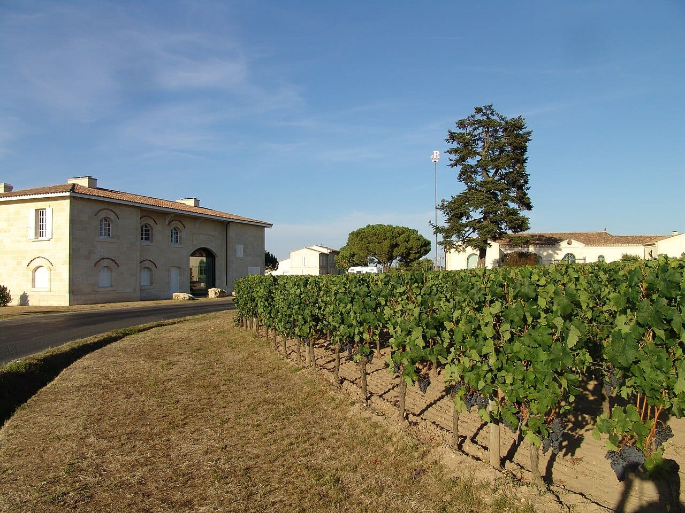

# 柏图斯酒庄

柏图斯没有一座可以拍照的城堡。它在 Pomerol 台地的边缘，地址是 3 route de Lussac；门口只有低矮的围墙、几栋农舍式的建筑、一个圆顶的小塔与一块写着 “PETRVS” 的牌子。葡萄园从墙外一直铺到地平线，深色的黏土在雨天会反光。它看起来像一座普通的农场，却是世界上最贵、最稀缺的 Merlot 之一。

图：柏图斯葡萄园与带徽记的农庄建筑。图片：Giogo，CC BY-SA 4.0，via Wikimedia Commons（[原图页面](https://commons.wikimedia.org/wiki/File:P%C3%A9trus_(ch%C3%A2teau)_02.jpg)）。

## 1855–2018：柏图斯酒庄的历史节点
柏图斯的名字来自 Saint Peter 的希腊语 “Petros”，不是某位庄主的姓氏，也不是一座“Château”。Pomerol 在 1855 年没有官方分级，所以柏图斯从来没有“一级庄”的头衔；它的地位来自市场、酒评与稀缺性，而不是一纸分类。它的葡萄园只有约 11.4 公顷，年产量约 30,000 瓶，只做一款正牌酒，没有副牌。

18 世纪，这片地属于 Arnaud 家族；19 世纪，酒已经在 Pomerol 有名。1925 年，Libourne 的 Loubat 酒店老板娘 Mme Edmond Loubat 开始买入股份，1945 年成为唯一业主；她把柏图斯推进巴黎的高级餐厅，让它在 1940–50 年代进入上流社会的酒单。1961 年 Loubat 去世，酒庄传给侄女与侄子；1943 年 Jean-Pierre Moueix 已成为独家分销商，1969 年买下多数股份，并从邻居 Château Gazin 购得 4.5 公顷，把葡萄园从约 7 公顷扩到 11 公顷多。

今天，柏图斯由 Jean-François Moueix 家族持有；2018 年，Alejandro Santo Domingo 买入 20% 股份。2008 年起，Olivier Berrouet 接替父亲 Jean-Claude Berrouet 负责酿酒；2014 年，新酒窖在葡萄园旁完成。柏图斯的“神话”不是一天建成的：Loubat 的市场眼光、Moueix 的酿酒与分销、Pomerol 的蓝黏土，三者叠加。

## 建筑与空间

柏图斯的建筑是“反城堡”的。没有 19 世纪的塔楼、没有对称立面、没有花园；只有一栋低矮的农舍、一个圆顶的发酵/办公建筑、仓库与围墙。2014 年的新酒窖也不追求地标感，它贴着葡萄园，用混凝土、金属与玻璃做出一个安静的工作空间。来访者如果期待“波尔多一级庄”的排场，会以为走错了地方；但这正是柏图斯的一部分：酒比建筑重要。

葡萄园位于 Pomerol 台地的最高处，海拔约 40 米；土壤是深蓝黏土（smectite），含铁量高，黏土厚 60–80 厘米，下面是很密的蓝黏土。周围台地是较年轻的砾石，柏图斯的 11.4 公顷几乎全部坐在蓝黏土上；这种黏土在干旱年份能保住水，在潮湿年份又排水缓慢，迫使葡萄根往下扎。平均树龄约 40 年，种植密度 6,000–7,000 株/公顷。自 2010 年收成后，最后 0.5 公顷 Cabernet Franc 被拔除，今天 100% Merlot。

## 酒款与风味

柏图斯只产一款酒：Petrus。没有副牌，没有白葡萄酒，也没有“入门款”。年轻时常带黑樱桃、蓝莓、李子、紫罗兰、松露、巧克力与湿黏土；单宁细而密，酒体厚，余味很长。与左岸的 Cabernet 主导酒相比，柏图斯的 Merlot 更早柔和，但顶级年份仍能放 30–50 年。

它的风格与蓝黏土直接相关：黏土保水，葡萄在干热的夏天不会过度缺水；黏土中的铁带来颜色与结构；Pomerol 的台地排水缓慢，果实成熟得较晚，酸度保留得较好。酿酒上，手工采摘、混凝土罐发酵、50% 新法国橡木桶、18–24 个月陈年；不做过度的压帽，追求丝绒般的单宁。近年来有光学分选、分地块发酵与更精确的温控，但“只做一款酒”的逻辑没变。

不要把柏图斯与 [Cheval Blanc](ref:cheval) 混为一谈。两家都在右岸，但 Cheval Blanc 是 Cabernet Franc 主导的砾石/黏土拼图，柏图斯是 100% Merlot 的蓝黏土；一个花香、石墨、红果，一个黑果、松露、巧克力。也不要拿它和左岸的 [Margaux](ref:margaux)、[Latour](ref:latour) 比“谁更好”；它们是不同的品种、土壤与风格。

## 怎么喝

柏图斯年轻时需要醒酒：提前 1–2 小时开瓶，或倒进醒酒器 1 小时；老酒开瓶后先试，避免过度氧化。温度 16–18°C，用大杯；配餐选烤牛肉、羊排、野味、松露、蘑菇与硬奶酪，不要用重辣、甜酱或大量醋。它的单宁细，不适合配过硬的生肉；脂肪与鲜味能托住酒体。

年份差异很大。1947、1961、1982、1989、1990、2000、2005、2009、2010、2016 都是常被提到的年份；普通年份也不便宜，但未必值得打开。若你只有一瓶，先查适饮窗口；柏图斯不是“越早喝越有面子”的酒，过早喝会只剩桶味与单宁。

## 柏图斯酒庄的地址与营业安排
- 地址：3 route de Lussac, 33500 Pomerol, France。
- 坐标：44.9309, -0.1934。
- 参观：不开放公众参观与品鉴；没有 cellar door、没有餐饮、没有住宿。私人/专业访问需通过长期客户、酒商或 Moueix 家族的关系安排。
- 交通：从 Libourne 开车约 10 分钟；从 Bordeaux 约 45 分钟；从 Saint-Émilion 约 15 分钟。最近火车站是 Libourne，出站后需打车。
- 停车：不要在门口停车或拍照阻碍道路；这是私人农庄，不是景点。
- 购买：通过波尔多酒商、拍卖行或专业零售；酒庄不直接向消费者卖酒。
- 无障碍：不适用；没有公众接待设施。

## 礼仪与常见误区

第一，柏图斯没有“一级庄”头衔。Pomerol 没有 1855 分级，不要把它写成“Premier Grand Cru Classé”。第二，它不是城堡，不要期待城堡参观；门口看看葡萄园可以，但不要推门进入。第三，不要以为“没有副牌”就是“只有一款酒所以便宜”；稀缺性正是价格的一部分。第四，不要从非授权渠道买“酒庄直供”；柏图斯不直接卖酒。第五，不要在私人地块里踩葡萄行或摘葡萄；这是农田，不是公园。

还有一层：柏图斯的价格与稀缺性让它成为投资品，但酒首先是农产品。参观时看到蓝黏土、老藤与简陋农舍，不妨把“神话”放一边，想一想一瓶酒如何从这片 11 公顷的地里长出来。

## 从柏图斯酒庄延伸到Cheval Blanc
柏图斯在 Pomerol 台地，往东是 [Cheval Blanc](ref:cheval) 与 Saint-Émilion，往南是 Libourne，往西是 [Margaux](ref:margaux)、[Latour](ref:latour)、[Haut-Brion](ref:hautbrion) 与 [Lafite](ref:lafite)，往东南是 [Yquem](ref:yquem)。把柏图斯放进 [波尔多左岸酒庄路线](ref:route) 并不顺路；它更适合与右岸的 Pomerol、Saint-Émilion 一起安排。

如果只有半天，Pomerol 台地 + Saint-Émilion 镇是合理组合；柏图斯门口看一眼葡萄园即可，不要把“不能参观”当成行程失败。想喝柏图斯，最稳的是在 Bordeaux 的专业酒窖、餐厅或拍卖会，而不是到酒庄碰运气。

**关键事实。**

| 项目 | 内容 |
| --- | --- |
| 一句话定位 | 法国波尔多波美侯（Pomerol）的柏图斯，11.4 公顷葡萄园位于产区最高的蓝黏土台地，自 2010 年起 100% Merlot，只产一款正牌酒、没有副牌，年产量约 30,000 瓶；它没有城堡式主楼，也不参加 1855 分级（Pomerol 没有官方分级） |
| 地址 | 3 route de Lussac, 33500 Pomerol, France |
| 城市/国家 | 波美侯 / 法国 |
| 营业状态 | 已核验营业 |
| 官网 | jeanpierremoueix.com |

## 参考资料
- Moueix 家族官网：<https://www.jeanpierremoueix.com/>，用于核对柏图斯与 Moueix 的关系及右岸酒商体系。
- 波尔多葡萄酒路线：<https://routeviticole.fr/domaines/petrus/>，用于核对地址、约 11.3 公顷、约 30,000 瓶、40 年树龄与“不开放参观”。
- Christie’s 柏图斯档案：<https://www.christies.com/en/artists/chateau-petrus>，用于核对 Arnaud 家族、Loubat、Moueix、1969 年购地与 11.4 公顷蓝黏土。
- Cazebonne 深度档案：<https://cazebonne.fr/en/bordeaux-wine-estates/petrus>，用于交叉核对无 cellar door、2018 年 20% 股份、2008 年 Berrouet 与 2014 年新酒窖。
- 右岸对照：[Cheval Blanc](ref:cheval)、[Yquem](ref:yquem)、[波尔多产区](ref:bordeaux)。
- 左岸对照：[Margaux](ref:margaux)、[Latour](ref:latour)、[Haut-Brion](ref:hautbrion)、[Lafite](ref:lafite)、[左岸酒庄路线](ref:route)。

## 相关图像

图：白马酒庄的老庄主楼。图片：Benjamin Zingg, Switzerland，CC BY-SA 2.5，via Wikimedia Commons（[原图页面](https://commons.wikimedia.org/wiki/File:Ch%C3%A2teau_Cheval-Blanc.jpg)）。关联图像：柏图斯酒庄。
