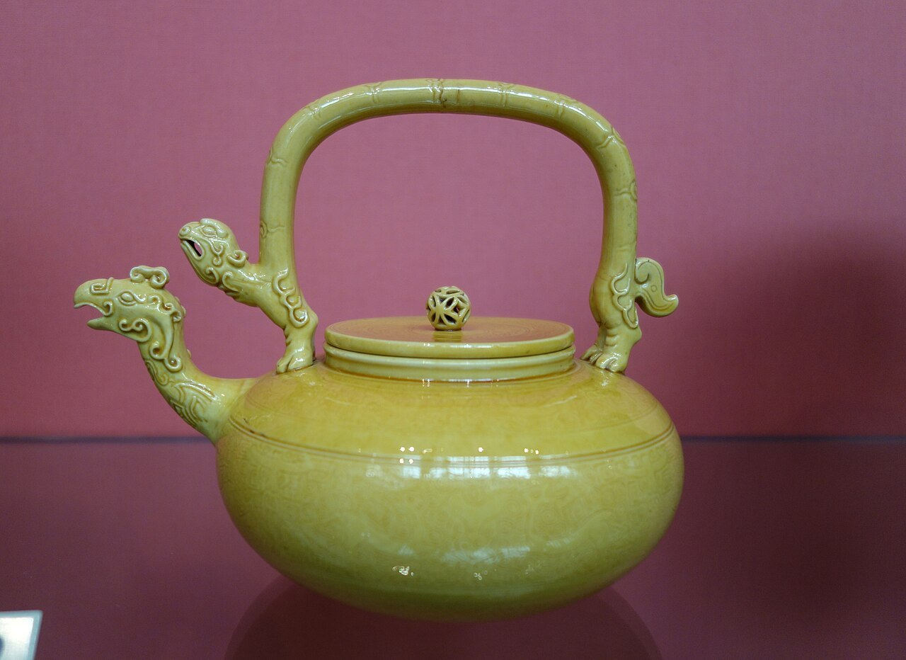

# 中国黄酒博物馆

中国黄酒博物馆在绍兴古城北部的光相桥畔，地址是越城区下大路 557 号。它由浙江古越龙山绍兴酒股份有限公司投资，2007 年正式开馆；占地约三万平方米，建筑面积约 1.6 万平方米，是国内以中国黄酒历史与文化为主题的专业性大型博物馆。它不是一座把酒瓶摆进玻璃柜的陈列室，而是把酒史、酒俗、酿造技艺、花雕工艺与地下酒窖放在同一条参观动线上的文化场馆。

> **到访信息**
> - 地址：浙江省绍兴市越城区下大路557号。
> - 开放与预约：以[官方页面](https://shaoxingwine.com.cn/home/nous/museum.html)为准；开放时间、场次和预约规则会随季节调整。
> - 交通与费用：出发前以官方页面为准，本页不承诺固定票价。
> - 营业状态：已核实；来源最近核对：2026-11-08。

图：中国黄酒博物馆。摄影：Wine pot with bird head spout, Jingdezhen, China, Kangxi period, Qing dynasty, 1680-1720, porcelain with yellow glaze - Victoria and Albert Museum - London, England - DSC04925。署名：Daderot，CC0，来自 Wikimedia Commons（[来源](https://commons.wikimedia.org/w/index.php?curid=152459715)）。

> **先给结论**
> **一句话：** 这页判断中国黄酒博物馆值不值得专程去，以及到访前要核对什么。
>
> - **适合谁：** 正在计划去中国黄酒博物馆、想知道值不值得专程安排半天到一天的人。
> - **不适合谁：** 只想要“必去榜单”、不准备核对预约、交通和开放时间的人。
> - **先看这两点：**
>   - 建议预留 1.5–2.5 小时。
>   - 第一个误区是把中国黄酒博物馆与“绍兴黄酒小镇”“中国黄酒城”混为一谈。

## 2007 年：中国黄酒博物馆的关键起点
2007 年，古越龙山投资 4.2 亿元、历时两年建成中国黄酒博物馆并对外开放。馆方称它是目前国内唯一展示中国黄酒历史与文化的专业性大型博物馆，同时挂着国家级社科普基地、省级爱国主义教育基地、省级绍兴黄酒非物质文化遗产传承基地等身份。这个定位决定了它的叙事方式：不是只讲某一个品牌，而是把黄酒放回江南的稻作、水网、节令与礼俗里。

绍兴是中国黄酒的核心产区，酿酒传统常被追溯到春秋时期的越国。当地流传“越王勾践箪醪劳师”的故事，把酒与战争、士气联系在一起；到了明清，绍兴酒已经通过运河与商路销往各地，成为黄酒中最有辨识度的品类之一。博物馆把这条长线压缩成“起源、人文、传承”三个关键词，并用实物、影像与场景复原，把中国黄酒的历史拉到九千年量级。这里的“九千年”指的是中国黄酒的整体脉络，不是绍兴这一地品牌的连续经营史，参观时要分清。

绍兴黄酒的工艺基础是糯米、麦曲与鉴湖水。传统流程包括浸米、蒸饭、摊饭、落缸、开耙、压榨、煎酒与陶坛陈酿，其中“开耙”是控制发酵温度与风味的关键工序，靠的是酒师傅的经验。绍兴黄酒酿制技艺已列入国家级非物质文化遗产名录；博物馆的二层酒技厅与花雕厅，正是把这类“看不见的手艺”转成可看的工具、工序与作品。运营方古越龙山是绍兴黄酒的代表企业，博物馆因此带有明显的企业馆色彩，但它同时承担公共文化教育的功能。

## 空间与展陈

博物馆主体为仿古建筑，围绕一个广场展开，参观区域大致分为序厅、酒史厅、酒俗厅、酒技厅、酒业厅、酒窖、手工酒作坊与花雕厅。一楼以酒史厅、领导关怀厅、酒俗厅、酒业厅、馆藏厅为核心，讲中国黄酒的历史、礼俗、产业与藏品；二楼以酒技厅、花雕厅为核心，讲酿造工序与花雕酒的装饰工艺；地下是酒窖，另外还有古越龙山手工酒坊与黄酒体验中心，构成五大功能板块。

展陈的线索可以从几件“看得见的东西”入手。入口附近的“品”字石雕把“品酒”与“品人”的意味放在一起；酒坛墙与红木榨展示传统酿酒与储酒的工具尺度；百年花雕与花雕工艺展区把彩绘酒坛从日用品变成工艺品；酒诰碑则把古代禁酒、酒礼的文本带进展厅。地下酒窖是整座馆最有体感的部分：温度低于地面，空气里有陶坛与酒香，成排酒坛的尺度比图片更有说服力。馆方还会安排酒道表演，具体场次以当天公告为准。

酒俗厅值得慢看。绍兴人的一生与酒绑得很紧：孩子出生埋“女儿红”，科举中第开“状元红”，婚礼有合卺酒，清明、端午、中秋、重阳各有对应的酒与食物。把这些习俗放在一起，会发现黄酒在江南不只是饮料，也是时间与关系的标记。花雕厅则解释了“花雕”不是一种葡萄或谷物品种，而是陈年绍兴酒与彩绘酒坛工艺结合后的称呼；坛上的戏文、花卉与吉祥图案，是另一套可以独立阅读的民间美术。

## 怎么参观

建议预留 1.5–2.5 小时。比较顺的动线是：序厅→酒史厅→酒俗厅→酒业厅→酒技厅→花雕厅→地下酒窖→手工酒作坊→黄酒体验中心。先看历史与礼俗，再看工艺，最后下酒窖与体验区，信息会从“故事”落到“器物”与“味道”。如果当天有酒道表演或花雕体验，先问清时间，再倒排参观顺序。

讲解服务与团队预约建议提前联系馆方；散客可以现场租借导览设备或按展板阅读。品鉴通常在黄酒体验中心进行，是否含在门票内、是否另收费，以现场与购票页面为准；不要默认“博物馆门票一定含酒”。未成年人不得饮酒，带孩子的家庭可以把重点放在酒俗、花雕与手工酒作坊，而不是品鉴。

手工酒作坊是理解“活态传承”的地方。这里会展示或演示浸米、蒸饭、摊饭、开耙等工序，部分节假日还有花雕彩绘、酒坛涂色等手作活动，是否开放、是否另收费以馆方公告为准。地下酒窖地面可能湿滑，温度偏低，夏天进去带一件薄外套；不要触摸酒坛与展品，拍照前看现场提示。

不适合把这里当成“酒庄”或“葡萄园”。博物馆在绍兴老城，周边是河道、老街与居民区，没有成片葡萄园，也没有酒庄午餐；它更适合对黄酒工艺、江南风俗、花雕美术与城市历史感兴趣的参观者。若只想喝酒、拍照打卡，可能会觉得展陈信息量偏大；若愿意读展板，它会比一杯酒给出更多背景。

## 中国黄酒博物馆的地址与营业安排
地址是浙江省绍兴市越城区下大路 557 号，位于光相桥畔。开放时间：9:00–17:00，全年无休（绍兴市文化广电旅游局 2026 年页面；百度百科记 8:30 开馆，两处略有差异，另有 16:30 后停止入馆的提示）；节假日、临时闭馆与活动安排仍以馆方公告为准。咨询电话 0575-85397288。

门票：成人票约 25 元，老人票约 15 元，2 大 1 小家庭票约 50 元（第三方平台 2026 年报价，部分票含 2 杯黄酒品鉴）；历史价格与联票种类有差异，具体以馆方售票窗口与官方渠道公示为准。购买绍兴古城联票或平台套票时，要确认是否包含本馆，以及是否含品鉴或手作项目。

预约与讲解：本页未查到统一的强制预约要求，团队、研学与讲解建议提前拨打 0575-85397288 咨询；手工作坊与花雕彩绘等活动是否开放、是否另收费以馆方公告为准。

交通：博物馆在绍兴老城北部，靠近下大路与光相桥。公交 5、39、51、108、168 路可到“小城北桥”站或“国际摩尔城”站，下车后步行前往；绍兴北站是高铁站，打车到老城约半小时量级，绍兴站更靠近老城。老城街巷较窄，自驾应停附近公共停车场，不要试图把车开到馆门口。

「中国黄酒博物馆」的开放时间、价格与预约，以[官网](https://shaoxingwine.com.cn/home/nous/museum.html)的公开页面为准；核验日期为 2026-11-08，临时调整以官网当日公告为准。

## 礼仪与误区

第一个误区是把中国黄酒博物馆与“绍兴黄酒小镇”“中国黄酒城”混为一谈。博物馆在下大路 557 号，黄酒小镇在越城区锡麟路 37 号一带，两者不是同一个地点；名字里都有“黄酒”，但运营主体、空间与参观内容不同。第二，黄酒不是“料酒”。饮用黄酒与烹饪用酒在标准、年份与风味上不是一回事，不能用超市料酒的价格来衡量一杯陈年花雕。

第三个误区是把黄酒都当成要加姜丝、话梅煮着喝。温饮是传统方式之一，尤其适合冬天与陈年酒；但好黄酒也可以常温纯饮，加料会遮住香气。第四个误区是把“花雕”“女儿红”“状元红”当成不同原料或品种。它们更多是陈年方式、包装工艺与人生礼俗的名称，底层都是绍兴黄酒。

参观时不要触摸酒坛、酒具与展品，地下酒窖不要快走；带小孩的家长要看住孩子，避免在酒坛墙附近奔跑。品鉴时小口慢饮，黄酒酒精度通常在 14%–20% 之间，后劲不小；不要空腹，不要酒后驾车。拍照避开其他游客正脸，商业拍摄与团队活动要提前向馆方申请。

## 绍兴市的周边街区
博物馆在绍兴老城北部，适合与鲁迅故里、沈园、仓桥直街、书圣故里串成一日路线。上午先看博物馆与地下酒窖，约两小时；中午到仓桥直街或鲁迅故里一带吃饭；下午看鲁迅故里（三味书屋、百草园）与沈园，傍晚沿仓桥直街或环城河散步。若对书法感兴趣，可以加书圣故里与八字桥。

黄酒爱好者可以把东浦黄酒小镇单独安排半天。东浦是绍兴黄酒的重要发源地之一，镇上有黄酒文化馆、手工作坊与酒坊街区，和博物馆的“馆内展陈”形成互补；但两地不在同一片区，打车或自驾更现实。安昌古镇、东湖、兰亭距离更远，适合另排一天。

交通上，绍兴老城适合步行与短途打车；公交班次与地铁接驳以实时地图为准。节假日鲁迅故里一带人流很大，博物馆相对安静，可以把顺序倒过来：先看博物馆，再去鲁迅故里。只停留半天的话，优先博物馆与仓桥直街，不要把东浦与兰亭硬塞进同一天。

## 同主题博物馆与延伸阅读
中国黄酒博物馆是理解[黄酒](ref:yellow-wine)的一条入口，也把[绍兴](ref:shaoxing)放进了[中国](ref:china)的稻作、礼俗与城市史里。想读黄酒的历史脉络，可以继续看[黄酒史](ref:yellow-history)。

补充阅读：[A Ginjinha](ref:c-extra-1)。

相关条目：[黄酒](ref:yellow-wine)、[绍兴市](ref:shaoxing)、[中国](ref:china)。
