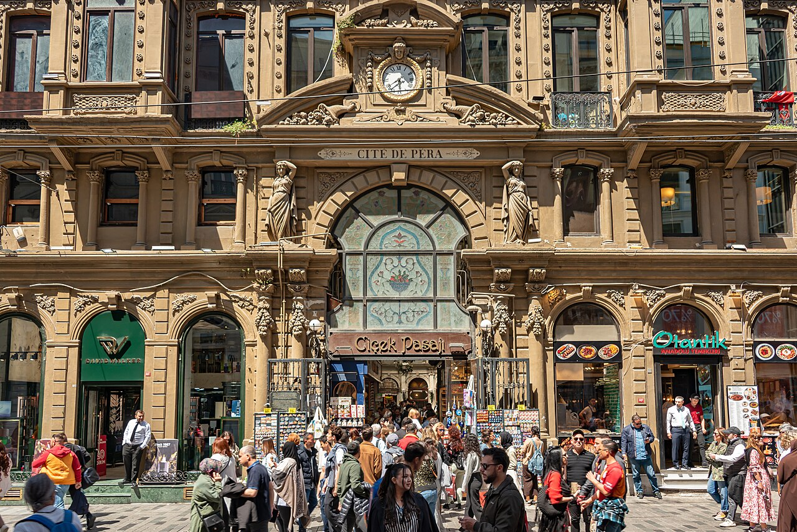

# Çiçek Pasajı

从 İstiklal 大街的人流里侧身拐进一道石拱门，声音会突然变厚：杯盘、瓶盖、土耳其语、英语、阿拉伯语与俄语混在一起，烤鱼与香料的味道从两侧店面涌出来。这里不是一间酒吧，而是一条叫 Çiçek Pasajı 的历史拱廊——“花廊”。它从 1876 年的商业公寓楼，变成 1978 年坍塌的废墟，再变成今天贝伊奥卢最密集的 meyhane 与餐馆群。

图：Çiçek Pasajı 的拱廊立面与入口，位于伊斯坦布尔贝伊奥卢的 İstiklal 大街。图片：Jorge Franganillo，CC BY 4.0，via Wikimedia Commons（[原图页面](https://commons.wikimedia.org/wiki/File:Istanbul_-_%C3%87i%C3%A7ek_Pasaj%C4%B1.jpg)）。

## 1876 年：Çiçek Pasajı的关键起点
先看它的前身。官方历史页说，拱廊所在的地块原是 Naum 剧院；1870 年佩拉大火把剧院烧毁。奥斯曼希腊银行家 Hristaki Zografos Efendi 买下地块，请建筑师 Kleanthis Zannos 设计一座带商铺与公寓的新建筑，1876 年完工。商铺部分叫 Hristaki Pasajı，公寓部分叫 Cité de Péra；早期有 24 家店铺与 18 套公寓，花店、皮草店、裁缝、烟草店、装订店与糕点店混在一起。

1908 年，建筑归大维齐尔 Küçük Sait Paşa，名字又多了一个：Sait Paşa Pasajı／Sait Paşa Geçidi。1917 年俄国革命后，一些流亡的俄国贵族女性——包括一位男爵夫人——在这里开花店谋生；到 1940 年代，花店越来越集中，“Çiçek Pasajı”（花廊）逐渐取代旧名。与此同时，餐馆、啤酒馆与 meyhane 也在这里聚集，这里成为贝伊奥卢的夜间会面点。

1978 年 5 月 10 日，年久失修的建筑部分坍塌，12 人死亡。Portreler 的长文写得很具体：坍塌前，上层公寓空置、承重墙被挖、漏水腐蚀石材；坍塌后，拱廊以木板围挡，废墟状态持续到 1988 年。1988 年，贝伊奥卢市政府与“保护与美化 Çiçek Pasajı 协会”推动修复，拱廊以餐馆与啤酒馆的形态重开。2005 年 12 月又有一次立面与照明整修，2022 年再次修缮。今天看到的石拱、店面与招牌，是多次修复后的层积，不是 1876 年的原样。

## 建筑与空间

Çiçek Pasajı 是一条连接 İstiklal 大街与 Sahne 街、并通向 Balık Pazarı 的拱廊。入口是一道石拱，里面是一条窄长的通道，两侧是连续店面，上层是公寓窗。它没有大型中庭，也没有玻璃穹顶；它的空间感来自“窄”和“深”——你从大街的宽阔人流被吸进一条两侧都是餐桌的走廊，灯光、油烟与人声在石墙之间反弹。

今天的店面大多是 meyhane、鱼肉餐馆、啤酒馆与小吃店。桌布、藤椅、铜锅、挂灯、墙上老照片与啤酒广告挤在一起；有些店把鱼与蔬菜摆在门口，有些店把整面墙做成酒架。白天，拱廊相对安静，能看清石墙与门楣；晚上七点以后，餐桌一直摆到通道边缘，侍者端着盘子在人群中穿行。它不适合安静约会，适合一群人吃饭、喝酒、聊天。

## 酒单与味觉

这里的关键词是 meyhane 文化，而不是“酒吧单”。meyhane 是奥斯曼以来伊斯坦布尔的酒馆传统：一桌人点许多小碟 meze，配 rakı、葡萄酒或啤酒，慢慢吃、慢慢喝。rakı 是茴香风味的葡萄蒸馏酒，通常加水变白（“狮子奶”），加冰，配海鲜、羊奶酪、西瓜、炸茄子、鹰嘴豆泥、填米葡萄叶、章鱼、炸小鱼与烤鱼。啤酒以土耳其品牌为主，也有进口；葡萄酒单通常不长。

点单方式不是“每人一份主菜”，而是“先点一桌 meze，再点鱼或肉”。常见节奏是：冷 meze 先上（酸奶茄子、甜菜、豆泥、橄榄油蔬菜），再上热 meze（炸鱿鱼、炸芝士、填馅），最后是烤鱼或烤肉。rakı 要慢慢加水，不要一口闷；一杯 rakı 通常配一杯水与一碟 meze。甜点可以留到最后，果仁蜜饼与奶酪甜点都常见。

## 怎么吃

最合适的时段是晚上七点到十点，或者中午十二点到两点。晚上气氛最完整，但人也最多；中午适合想看建筑与拍照的人。周末与节假日，拱廊会非常挤，带小孩或推婴儿车不太方便。建议先绕一圈看菜单与价格，再选一家坐下；门口拉客的店员会用多国语言招呼，价格与份量要先问清楚。

点菜时可以先说“bir meze tabağı”（一份 meze 拼盘）或指着一盘盘小碟选；鱼按重量计价，点之前确认单价与总价。rakı 通常按杯或按瓶卖，问清楚品牌与份量。不要把所有菜都点成“主菜”，meyhane 的乐趣在多样与小份。结账时核对账单，尤其是鱼与酒；土耳其餐馆有时会另收面包、水或座位费。

## Çiçek Pasajı的地址与营业安排
- 地址：Hüseyinağa Mah. İstiklal Cad. Saitpaşa Geçidi No:176, 34435 Beyoğlu/İstanbul。
- 坐标：41.033944, 28.977917。
- 交通：地铁到 Tünel 或 Şişhane，步行到 İstiklal；从 Galatasaray 高中方向走过来约 5 分钟。
- 营业：拱廊本身全天可通行；各餐厅与酒吧营业时间不同，通常中午到深夜，周末更晚。具体以店门口公告为准。
- 预订：热门店晚餐建议预订；小桌可以现场等位。团体要提前电话确认。
- 支付：现金与信用卡都常见；部分小店只收现金，进门先看标识。
- 无障碍：石拱门有门槛，通道窄且常被餐桌占据，轮椅通行困难。
- 周边：Balık Pazarı、Galatasaray、Tünel、加拉塔塔都在步行范围；夜间人多，注意随身物品。

## 礼仪与常见误区

第一，不要把 Çiçek Pasajı 当成“一间店”。它是一条拱廊，里面有多家 meyhane 与餐馆；你选的不是“Çiçek Pasajı 的菜单”，而是某一家店的菜单。第二，不要把它当成“花市”。今天仍有花店记忆，但主体是餐饮；想看花，去 Balık Pazarı 周围的小摊。第三，不要只点一瓶啤酒站着喝；meyhane 的节奏是坐下来、点 meze、慢慢聊。第四，不要不问价格就点鱼；按重量计价的鱼很容易超出预算。第五，不要对拉客者粗鲁；一句“teşekkürler”（谢谢）就够，不想进店就继续走。第六，不要用闪光灯拍侍者与食客；通道很窄，闪光会打扰整桌人。

## 从Çiçek Pasajı延伸到Café Central
从拱廊出来，往北是 Galatasaray 高中与 İstiklal 的繁华段，往南是 Tünel 与加拉塔塔，往西是 Balık Pazarı。可以把这一站放进“贝伊奥卢历史餐饮”半日线：下午从 Galatasaray 出发，逛 İstiklal 的旧使馆与咖啡馆，傍晚进 Çiçek Pasajı 吃 meze 与鱼，饭后走到加拉塔塔看夜景。跨城对照可以看维也纳的 [Café Central](ref:central)、[Café Sacher](ref:sacher)，布达佩斯的 [New York Café](ref:newyork)，里斯本的 [A Brasileira](ref:brasileira) 与 [A Ginjinha](ref:ginjinha)：它们同样把“历史空间”做成日常餐饮，但各自的历史层积与旅游化程度不同。

伊斯坦布尔不适合自驾进贝伊奥卢；地铁加步行最稳。晚上回程建议打车或用网约车，但 İstiklal 大街周末封车，走到主路再叫车更快。

## 参考资料
- 官方首页：<https://tarihicicekpasaji.com/>，用于核对地址、拱廊现状与餐饮业态。
- 官方历史页：<https://tarihicicekpasaji.com/tarihce/>，用于核对 Naum 剧院、1870 年大火、Hristaki Zografos、Kleanthis Zannos、1876 年建成、1908 年 Sait Paşa、1917 年俄国花店与 1940 年代名称。
- Portreler 长文：<https://www.portreler.com.tr/peranin-solmayan-hafizasi-cicek-pasaji/>，用于核对 1978 年 5 月 10 日坍塌、12 人死亡、1978–1988 年废墟与 1988 年修复。
- Wow Cappadocia 指南：<https://wowcappadocia.com/cicek-pasaji-istanbul.html>，用于交叉核对 24 家店铺、18 套公寓、1908 年归属、花店集中与 1978/1988/2005 年修复。
- 跨城条目：[Café Central](ref:central)、[Café Sacher](ref:sacher)、[New York Café](ref:newyork)、[A Brasileira](ref:brasileira)、[A Ginjinha](ref:ginjinha)。
