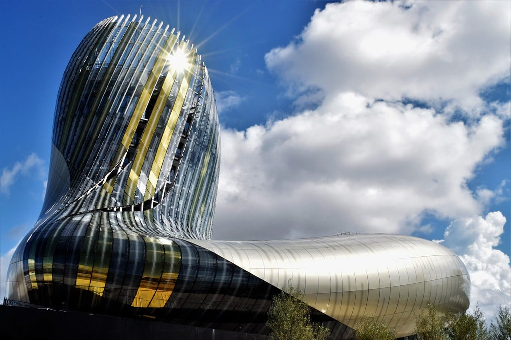

# 波尔多葡萄酒城

波尔多葡萄酒城（La Cité du Vin）在加龙河左岸的巴卡朗码头 134 号，属于 Bassins à Flot 旧港区改造的一部分。它不是一座酒庄，也不是产区协会的陈列室，而是一座以“葡萄酒文明”为主题的城市文化设施。2016 年开馆，建筑由巴黎 XTU 建筑事务所的 Anouk Legendre 与 Nicolas Desmazieres 设计；官方把外形解释为葡萄藤、杯中旋转的酒液与加龙河涡流的结合，立面使用丝网印刷玻璃与穿孔铝板，随光线变化。这个定位决定了参观重点：展览把葡萄酒放在地理、历史、工艺、消费与艺术里，而不是把波尔多名庄排成一面墙。

> **到访信息**
> - 地址：134 Quai de Bacalan, 33300 Bordeaux, France。
> - 开放与预约：以[官方页面](https://www.laciteduvin.com/)为准；开放时间、场次和预约规则会随季节调整。
> - 交通与费用：出发前以官方页面为准，本页不承诺固定票价。
> - 营业状态：已核实；来源最近核对：2026-11-08。

图：从地面仰拍的波尔多葡萄酒城，玻璃与金属板包覆的塔体在阳光下反光。图片：olilynch，CC0 1.0，via [原图页面](https://www.flickr.com/photo.gne?id=37500642606)。

> **决策清单**
> 买之前、去之前，按这三步过一遍。
>
> - **参观方式：** 建议先在一层拿地图，按兴趣选线，不必按顺序走完 18 个模块。
> - **2016 年：波尔多葡萄酒城的关键起点：** 葡萄酒城的出现，与波尔多在 21 世纪初对城市形象的重新定位有关。
> - **空间与展陈：** 常设展约 3000 平方米，分六大主题、18 个模块，从古代到当代，覆盖五大洲。

## 2016 年：波尔多葡萄酒城的关键起点
葡萄酒城的出现，与波尔多在 21 世纪初对城市形象的重新定位有关。巴卡朗码头一带过去是港口与仓储区，城市改造后成为文化、餐饮与住宅混合的新片区；葡萄酒城被放在这里，既面向游客，也面向本地居民。它由波尔多市政府推动，官方定位是“葡萄酒文化中心”，而不是某个产区的推广机构。2016 年落成后，它迅速成为波尔多最容易被识别的当代建筑之一，也让“葡萄酒”从酒庄和酒商的话题，变成一座城市可以日常使用公共文化空间。

理解这一点，能解释馆内为什么没有按“名庄排行榜”布展。展览的第一层问题是“人如何种植、酿造、交易和饮用葡萄酒”，第二层才是“波尔多在其中处于什么位置”。对第一次接触葡萄酒的游客，这种框架比直接走进一座酒庄更容易建立坐标；对已经熟悉产区的人，它提供的则是跨产区比较的视角。

## 空间与展陈

常设展约 3000 平方米，分六大主题、18 个模块，从古代到当代，覆盖五大洲。六个主题分别是“世界葡萄园”“技艺”“历史长河”“生活艺术”“葡萄酒周游世界”和“波尔多”。展项以影像、气味、触觉与互动装置为主，官方给出的平均参观时间为 2 至 3 小时，内容全部看完可达 6 小时。展线不是强制的单行道，观众可以按兴趣跳着看；如果某一段人多，先去看其他主题再回来，是更实际的做法。

8 层是 Belvédère 观景楼。门票含一杯由侍酒师挑选的葡萄酒或葡萄汁，可以俯瞰波尔多与加龙河；这里也是整座馆最容易被记住的空间，但它不是“无限畅饮”的酒吧，而是一段参观的收尾。馆内还有临时展、品鉴工作坊、餐厅 Le 7、Latitude20 小酒馆与商店。建筑有两个入口，一个朝城市、一个朝河，动线本身被设计成“流动”，从暗处走到亮处，再回到城市。

## 参观方式

建议先在一层拿地图，按兴趣选线，不必按顺序走完 18 个模块。第一次来可以先把“世界葡萄园”“技艺”“历史长河”走一遍，再上 8 层；如果对波尔多本地感兴趣，把“波尔多”两个模块留到最后。品鉴工作坊与常设展分开售票，部分时段有英语或法语场，报名时看清语言与时长。对带孩子的人来说，“Junior”主题路线比全程硬走更合适；对只想拍照的人，建筑外观与观景楼已经足够，但会错过馆藏的信息密度。

2026 年 11 月官网列出的成人常设展票为 23 欧元，优惠票 18.40 欧元，6 至 17 岁 9 欧元，6 岁以下免费，含观景楼一杯酒饮。价格与场次会调整，购票前以官网为准。若想把品鉴工作坊一起安排，最好预留半天，不要把两场体验压在同一小时里。

## 波尔多葡萄酒城的地址与营业安排
地址：134 Quai de Bacalan, 33300 Bordeaux, France（坐标 44.86250, -0.55030）。

交通：最近的车站是波尔多电车 B 线“La Cité du Vin”站，步行约 2 分钟；也可乘公交到 Bacalan 一带后步行。从波尔多圣让火车站（Gare Saint-Jean）乘电车 C 线转 B 线约 30 分钟；从市中心沿加龙河步行约 30–40 分钟，骑行更快。馆址在 Bassins à Flot 新区，自驾可用 Quai de Bacalan 的 Hangar 19 收费停车场。

开放时间（2026–2027 年官网排期）：2026 年 4 月 3 日至 10 月 31 日每天 10:00–19:00；11 月 1 日至 2027 年 1 月 3 日平日与周日 10:00–18:00、周六与学校假期 10:00–19:00，12 月 24 日 16:00 闭馆，12 月 25 日全天闭馆；2027 年 1 月 3 日至 4 月 2 日每天 10:00–18:00，其中 1 月 25–31 日为闭馆周，3 月周六延长至 19:00。最后入场时间以官网当日公告为准。

门票与预约：常设展 + Belvédère 观景楼一杯酒饮的成人票 23 欧元，优惠票 18.40 欧元，6–17 岁 9 欧元（优惠 7.20 欧元），6 岁以下免费，家庭套票（2 成人 + 2 名 6–17 岁儿童）56 欧元。可在线购票走免排队通道；品鉴工作坊、Via Sensoria 与餐厅另计，工作坊按场次和语言单独预约。旺季与周末建议提前一两天订票。

馆内无障碍设施齐全，婴儿车可进入；大件行李需寄存。「波尔多葡萄酒城」的开放时间、价格与预约，以[官网](https://www.laciteduvin.com/)的公开页面为准；核验日期为 2026-11-08，临时调整以官网当日公告为准。

## 礼仪与误区

最常见的误区是把这里当成“波尔多酒庄参观”的替代品。馆内没有葡萄园，也不以某一家名庄为核心；它讲的是世界葡萄酒文化，波尔多只是其中一条线。第二个误区是以为门票含无限品鉴：门票只含观景楼一杯，工作坊与额外杯数另计。第三，展项大量使用触摸屏、气味装置与声音，带孩子的家庭要看好孩子，不要拍打展具；品鉴区不要大声喧哗，也不要把酒杯带到展区。法国法定饮酒年龄为 18 岁，未成年人只能取葡萄汁。最后，别把观景楼当成拍照打卡点就离开，那里的一杯酒是理解“葡萄酒如何被讲述”的一部分，慢慢喝完比拍完就走更值得。

## 波尔多的周边街区
葡萄酒城在 Bassins à Flot，适合和加龙河岸、Chaban-Delmas 桥、Les Halles de Bacalan 食物市场串成半日路线。上午看展，中午在市场吃饭，下午沿河走到 Chartrons 旧酒商街区，或乘电车 B 线进老城。若要看葡萄园，梅多克与圣埃美隆都需要另安排半天到一天，不能从馆内直接步行到达。把这里当作“先建立框架”的第一站，再去产区，会比反过来更有收获；如果时间只够一处，想了解世界葡萄酒的多样性就选这里，想感受酒庄建筑与葡萄园就去产区。

## 同主题博物馆与延伸阅读
葡萄酒城把[葡萄酒](ref:wine)放回世界地图，也把[波尔多](ref:bordeaux)放进更大的[世界葡萄酒史](ref:world-wine)里。它与张裕酒文化博物馆形成对照：一座以城市文化设施讲全球葡萄酒，一座以企业史讲中国工业化。

补充阅读：[张裕酒文化博物馆](ref:c-extra-1)、[A Ginjinha](ref:c-extra-2)。

相关条目：[葡萄酒](ref:wine)、[波尔多](ref:bordeaux)、[世界酒史纲：从发酵饮料到全球产业](ref:world-wine)。

## 相关图像

