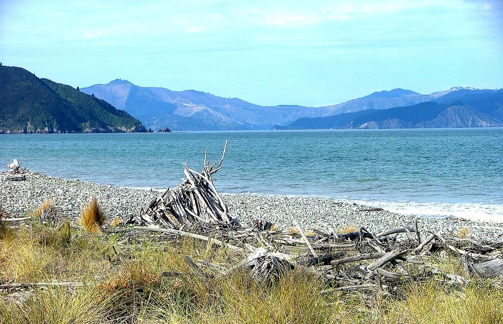

# 云雾之湾酒庄

云雾之湾在布伦海姆的 Jacksons Road，葡萄园铺在 Wairau Valley 的砾石河床上，背后是 Richmond Ranges 的山脊。它不是一个把“老历史”挂在门口的酒庄：1985 年才酿出第一个年份，在马尔堡的现代葡萄酒史里算中生代；但它把长相思的香气、酸度与海风叙事结合得足够清楚，成了许多人认识新西兰白葡萄酒的第一站。

图：云雾之湾酒庄。图片：Crackerbuzz at English Wikipedia，CC BY-SA 3.0，via Wikimedia Commons（[原图页面](https://commons.wikimedia.org/wiki/File:Rarangi_Beach.jpg)）。

## 1985 年：一个年份如何定义酒庄

1985 年是云雾之湾的第一个年份，也是它对外叙述的起点。这个时间放在马尔堡的产业史里并不算早：1973 年 Montana 在 Wairau Valley 种下首批大规模葡萄苗，1979 年马尔堡第一个长相思上市，1985 年云雾之湾才装瓶自己的第一瓶酒。晚进入并没有让它失去位置，反而让它可以直接采用已经验证过的品种与地块，把资源集中在风格与出口市场上。

官方叙述强调“从第一天起就把质量放在第一位”，这句话听起来像品牌口号，但结合时间线看，它更像一种策略选择：不追求产品线最宽，而是把长相思做成可识别的基准，再逐步扩展到霞多丽、黑皮诺与起泡酒。2010 年起，酒庄在 Central Otago 建立另一个据点，把马尔堡的海洋性风格与南岛南端的冷凉风格分开处理。这条时间线也解释了它为什么把长相思放在产品线的中心，而不是先做一条更宽的红酒线。

## Wairau 河谷的葡萄园位置

[马尔堡](ref:marlborough)的 Wairau Valley 以古老河床砾石为主，排水快、升温早，葡萄容易达到成熟度，同时保留酸度。谷地内部有不同朝向与降雨：沿海地块受海风调节，内陆更干、更早熟；Southern Valleys 的土壤更重、黏土更多，向南更凉；Awatere Valley 更靠南、更干、风更大。云雾之湾所在的布伦海姆一带属于 Wairau 的核心，酒庄的葡萄来源并不只限于门市周围，但参观时看到的风景、道路与山脊，确实决定了它对外呈现的第一印象。

把“Wairau”当成一个精确的地块名并不准确。它是一片包含多种中气候的河谷；同一酒庄的不同酒款，可能来自相距不远但土壤与成熟节奏完全不同的地块。门市周围的葡萄园更多是参观者的空间参照，真正进入酒款的果实来自酒庄自有与签约的多个地块；不要因为门口看到的藤蔓就推断整瓶酒的来源。

## 酒单怎么读：核心系列与 Te Koko

核心系列是理解酒庄最直接的入口：长相思是基准，通常带青柠、百香果、青草与矿物气息，酸度高、香气外放；霞多丽从清爽型到更有质感的风格都有；黑皮诺提供红樱桃、李子与香料的中等酒体。再往上是 Te Koko 与 Te Wāhi，前者是另一种长相思表达，后者更强调地块与酿造选择；Pelorus 则是起泡酒线。不同年份的成熟度会改变香气比例，不要用一瓶酒给整个品牌下定论。

如果你只打算喝一杯，先点核心长相思，建立参照；如果想把“同一品种的不同表达”喝清楚，选含 Te Koko 的品鉴，比较发酵与陈年带来的质地差异。具体酒款是否供应、是否在品鉴单里，以门市当天信息为准；本页不把酒单写成固定清单。

## 门市与 Saku：到访怎么安排

门市每周七天 10:00–17:00 开放，圣诞节与耶稣受难日关闭；官方建议预约，周末与夏季尤其如此。Saku 餐厅午餐每天 11:00–15:00，周四与周五加开 16:00–20:00 的晚餐；餐厅与品鉴是两套预约，想同时安排要分别确认。门市周围是葡萄园与山脊，适合在品鉴前后留出一段步行时间，但不要走进未开放的种植区。

到访节奏可以这样排：上午先做品鉴，建立对长相思与霞多丽的参照；中午在 Saku 吃饭；下午再回到门市买酒或补一杯。反过来也行，但午餐后味觉会变钝，品鉴的细节容易丢失。带孩子的家庭要提前问清餐厅与品鉴的年龄规定；新西兰法定饮酒年龄为 18 岁，含酒项目会查证件。

## 预约、开放与到达

地址是 230 Jacksons Road, Blenheim, New Zealand。从布伦海姆机场或市区出发都很近，自驾最方便；没有可靠的公共交通直达门市，回程叫车也不稳定。停车按现场指引，不要停在葡萄园行间或作业通道。坐标以官方渠道为准，导航直接输入地址即可。

预约通过官网的预订入口完成，选择日期、时段与人数；取消规则随项目变化。旺季是南半球夏季与节假日前后，门市与餐厅都容易满；春季与秋季人少，但海风更冷，带一件防风外套。开放时间、餐厅时段与预约规则会调整，出发前再看一次官方页面。

## 常见误区

第一，把云雾之湾当成“最古老的马尔堡酒庄”。它 1985 年才首酿，真正的现代种植起点在 1973 年，首个长相思在 1979 年。第二，把门市当成生产车间参观。这里的重点是品鉴、餐饮与葡萄园风景，不是完整生产线。第三，以为 Te Koko 是另一个品种。它仍是长相思，只是酿造与陈年路径不同。第四，把马尔堡长相思当成一种味道；Wairau、Southern Valleys 与 Awatere 的差异、年份与酒庄选择，都会改变结果。第五，忽略预约；临时到访可能只能买到酒，排不进品鉴。

对照阅读：[马尔堡](ref:marlborough)、[白葡萄酒](ref:white-wine)。

相关条目：[长相思](ref:sauvignon)。

**关键事实。**

| 项目 | 内容 |
| --- | --- |
| 一句话定位 | 新西兰马尔堡布伦海姆 Jacksons Road 的长相思酒庄，1985 年酿出首个年份；门市每周七天 10:00–17:00 开放，设 Saku 餐厅与预约制品鉴，是理解 Wairau Valley 风格与马尔堡出口叙事的入口 |
| 地址 | 230 Jacksons Road, Blenheim, New Zealand |
| 城市/国家 | 布伦海姆 / 新西兰 |
| 营业状态 | 已核验营业 |
| 官网 | cloudybay.co.nz |

**来源与边界。** 本页关于「云雾之湾酒庄」的关键事实，主要由以下来源交叉核对：Cloudy Bay（230 Jacksons Road 地址、每周七天 10:00–17:00 的门市时间、预约建议、Saku 餐厅时段与闭馆日）、New Zealand Winegrowers（1985 年首个年份、2010 年起在 Central Otago 的布局、230 Jacksons Rd 地址与品鉴室描述；Wairau Valley 的砾石土壤、海风调节与长相思风格描述）、Pernod Ricard USA（1973 年首批葡萄苗与 1979 年马尔堡首个长相思，作为云雾之湾 1985 年首酿前的行业背景）。产品、地址或营业状态变化较快时，以 cloudybay.co.nz 的最新页面为准；价格、批次与状态会变，涉及这些字段时以页面所列来源的最新版本为准。正文为项目自写，来源只作核验，不复制原文。

## 参考资料

本页依据云雾之湾官方到访页、新西兰葡萄种植者协会的云湾档案与马尔堡产区页，以及 Brancott 官方品牌页核验，页面核验日期 2026-11-09。若要把这一站放进行程，可继续读[马尔堡葡萄酒路线](ref:route)；关于品种背景，见[长相思](ref:sauvignon)与[白葡萄酒](ref:white-wine)。开放时间、预约与酒款以官方渠道为准。

补充阅读：[A Ginjinha](ref:c-extra-1)。
