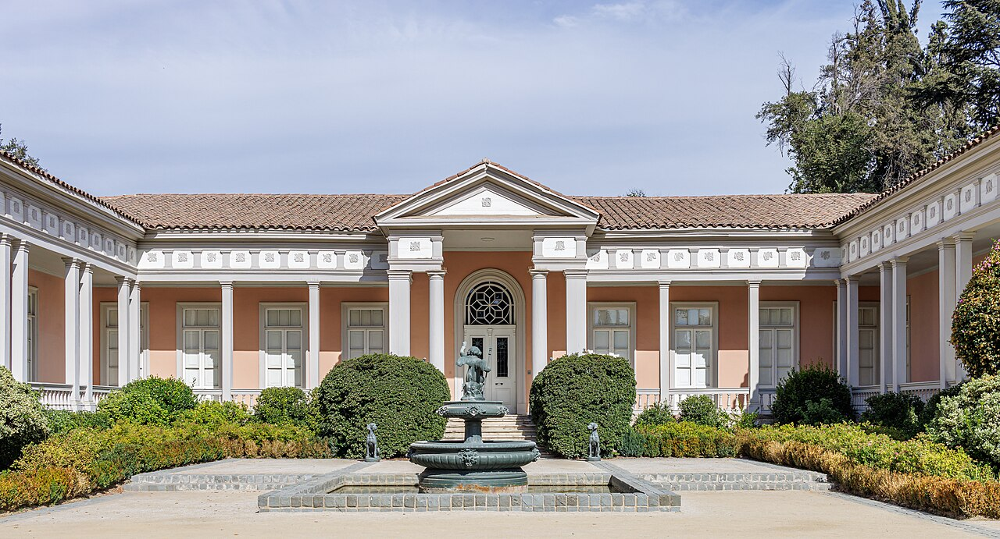
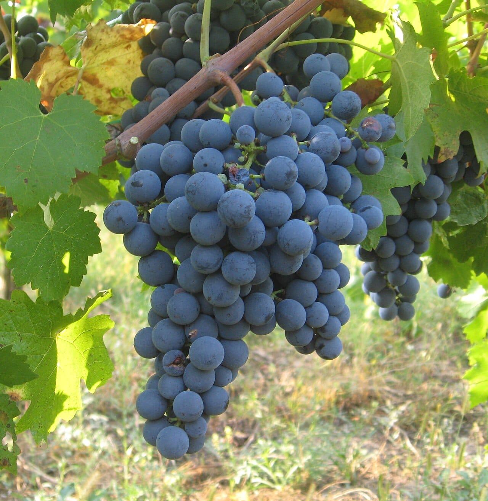

# 干露酒庄

从圣地亚哥向南，车行约 45 分钟进入皮尔克，路边的杨树、灌溉渠与葡萄园逐渐取代城市。干露酒庄的院子在迈坡谷的冲积平原上，入口并不张扬，但一进去就能看到 1883 年的旧酒库、Casa Don Melchor 与后来加建的 Centro del Vino。它不是一个“家族小庄”，而是智利葡萄酒工业化、出口化与品牌化的缩影；理解它，最好把“品牌”与“土地”分开看：一边是 Casillero del Diablo 这样的全球商品，一边是 Don Melchor 这样来自 Puente Alto 特定地块的旗舰酒。酒庄的参观路线也把品鉴室与生产区分开，避免把工业流程当成主题公园。

图：皮尔克园区 Casa Patronal 的正面与入口花园。图片：Rjcastillo，CC BY-SA 4.0，via Wikimedia Commons（[原图页面](https://commons.wikimedia.org/wiki/File:Frente_Casa_Patronal_Concha_y_Toro.jpg)）。

## 1883 年：干露酒庄的关键起点
1883 年，律师、政治家与商人 Melchor Concha y Toro 在皮尔克买下土地，从波尔多引入葡萄藤，并修建地下酒窖。1933 年，酒庄首次向荷兰出口，同年股票在圣地亚哥交易所上市；这在当时的智利葡萄酒业是少见的资本化动作。1966 年，Casillero del Diablo 品牌开始成形，传说酒窖里住着魔鬼，工人不敢偷酒；这个故事后来成为智利出口量最大的品牌之一。1987 年，Don Melchor 首个年份发布，被称为智利第一款“图标酒”，来自 Puente Alto 的赤霞珠老藤。1994 年，酒庄成为第一家在纽约证券交易所上市的酒庄；2023 年庆祝 140 周年，2024 年 Don Melchor 2021 被 Wine Spectator 评为年度第一。

## 建筑与空间

皮尔克的空间分成三层。最老的是 19 世纪的地下酒窖与 Casa Don Melchor，砖拱、石墙、低矮的入口，至今仍用于陈年与接待；中间是 1883 酒库与生产区，发酵罐、装瓶线与物流在这里；最新的是 Centro del Vino，2023 年 140 周年时开放，面积超过 12,000 平方米，分成六个主题区，外面是 22 公顷的百年公园。公园里有高大的桉树、棕榈、池塘与欧洲式的轴线，和智利中央谷地的干燥气候形成对照。参观动线从葡萄园与历史建筑开始，再进入“魔鬼酒窖”，最后到品鉴与餐厅；这不是一座把历史封存起来的博物馆，而是把生产、品牌与旅游叠在同一块地上的复合空间。

## 酒单与味觉

酒单可以按三条线理解。第一条是日常出口线：Casillero del Diablo 的赤霞珠、佳美娜、霞多丽与长相思，果味直接、价格亲民，是智利葡萄酒进入全球超市与餐厅的入口。第二条是产区线：Marques de Casa Concha 强调单个谷地的典型性，赤霞珠来自 Puente Alto，佳美娜来自 Peumo，霞多丽来自 Limarí；第三条是旗舰线：Don Melchor 来自 Puente Alto 的砾石与冲积土，以赤霞珠为主，少量品丽珠、梅洛与味而多，新桶比例高，但目标是结构、长度与陈年能力，而不是单纯的桶味。干露也做起泡酒与甜酒，但最值得对照的是“品牌酒”与“旗舰酒”之间的差距：同一个公司，不同的葡萄来源、产量与陈年标准。

## 怎么喝

Casillero del Diablo 这类日常红葡萄酒建议 15–17°C，开瓶即饮，不需要长时间醒酒；配烤肉、披萨、汉堡与中式红烧肉都合适。Marques de Casa Concha 可以提前 30–60 分钟开瓶，配牛排、羊排与硬质奶酪；Don Melchor 建议 16–18°C，年轻年份提前 1–2 小时，老年份 30–60 分钟，配熟成牛肉、野味与松露。白葡萄酒 10–12°C，起泡酒 6–8°C。若在餐厅点酒，先看酒精度与残糖，再看产区；智利酒成熟度高，配重酱汁比配清蒸海鲜更稳。

## 干露酒庄的地址与营业安排
地址是 Av. Virginia Subercaseaux 210, Pirque。Centro del Vino 每日 10:00–18:00 开放，最后一场导览 16:30；建议至少提前 48 小时预订，电话 +56 2 2476 5000，邮箱 visitas@conchaytoro.cl。从圣地亚哥市中心自驾约 45–55 分钟，经 Acceso Sur 与 Av. Concha y Toro 进入皮尔克；也可乘地铁 4 号线到 Plaza de Puente Alto，再换出租车。园内有免费停车，主路线对轮椅友好，但部分历史区域有台阶。18 岁以下可入园但不能进入品鉴室；宠物不得入内。

## 礼仪与常见误区

第一，不要把干露等同于“一个酒庄”；它是一个拥有多个谷地、多个品牌与多家子公司的集团，参观前先确认自己订的是 Centro del Vino 还是生产区。第二，Casillero del Diablo 是品牌故事，不是酒窖里的“魔鬼”；不要向工作人员追问传说细节或要求进入封闭酒窖。第三，Don Melchor 不是“每个年份都一样”的旗舰；它的风格随年份、地块与配比变化，购买时看年份与来源。第四，品鉴不要开车；智利酒精度偏高，午后尤其容易低估。第五，园区是生产空间，不要进入发酵间、装瓶线或葡萄行间；拍照遵守现场标识。第六，不要用“智利酒都便宜”来判断干露；它的高端线价格与旧世界名庄有重叠。

## 从干露酒庄延伸到迈坡谷
皮尔克周边可以接迈坡谷的其他酒庄、Puente Alto 的葡萄园与圣地亚哥老城。若只有半天，Centro del Vino 的导览加品鉴足够；一天可以加 [迈坡谷](ref:maipo) 的乡间公路与 [智利](ref:chile) 葡萄酒博物馆。把 [赤霞珠](ref:cabernet) 与 [佳美娜](ref:carmenere) 做对照，是理解智利红葡萄酒最快的办法；前者提供骨架，后者提供草本与浆果。不要把干露与阿根廷门多萨放在同一天：两边都要过安第斯，车程太长。若继续阅读，可看 [红葡萄酒](ref:red) 与 [橡木桶陈年](ref:oak)。

**关键事实。**

| 项目 | 内容 |
| --- | --- |
| 一句话定位 | 智利迈坡谷皮尔克的历史酒庄，1883 年由 Melchor Concha y Toro 创立，是智利葡萄酒走向世界最具代表性的名字之一；以 Casillero del Diablo、Marques de Casa Concha 与 Don Melchor 为核心酒款 |
| 地址 | Av. Virginia Subercaseaux 210, Pirque, Región Metropolitana, Chile |
| 城市/国家 | 皮尔克 / 智利 |
| 营业状态 | 已核验营业 |
| 官网 | conchaytoro.com |

**来源与边界。** 本页关于「干露酒庄」的关键事实，主要由以下来源交叉核对：Concha y Toro、Centro del Vino Concha y Toro（Av. Virginia Subercaseaux 210、每日 10:00–18:00、最后导览 16:30、电话、48 小时预订建议与无障碍信息）、Viña Concha y Toro。产品、地址或营业状态变化较快时，以 conchaytoro.com 的最新页面为准；价格、批次与状态会变，涉及这些字段时以页面所列来源的最新版本为准。正文为项目自写，来源只作核验，不复制原文。

**并读。** 把「干露酒庄」与「迈坡」、「智利」、「赤霞珠」放在一起读时，先确认它们是同一层级还是上下游关系：先确认地址与营业状态，再比较历史、空间与点单体验。本页负责给出场所的基本坐标，对照条目补上具体案例与差异；读完再回到本页，才能分清哪些差别属于场所本身，哪些只是产地、批次或品牌选择。

**适用边界。** 对「干露酒庄」而言，营业时间、预约方式与菜单会变；到访前以官网、电话或现场公告为准。

**更新提示。** 「干露酒庄」最近核对于 2026-11-21；地址、营业时间、门票与预约会变，出行前以官网当日公告为准。

## 参考资料
- 同类对照：[maipo](ref:maipo)、[chile](ref:chile)、[cabernet-sauvignon](ref:cabernet)、[carmenere](ref:carmenere)、[red-wine](ref:red)、[oak-ageing](ref:oak)。
- 背景阅读：[maipo](ref:maipo)、[chile](ref:chile)。
关于干露酒庄，本页不绘制参观地图；开放时间、年份与价格以酒庄官网为准。

## 相关图像

图：佳美娜。图片：Lebowskyclone，CC BY-SA 3.0，via Wikimedia Commons（[原图页面](https://commons.wikimedia.org/wiki/File:CarmenereW.jpg)）。关联图像：干露酒庄。
