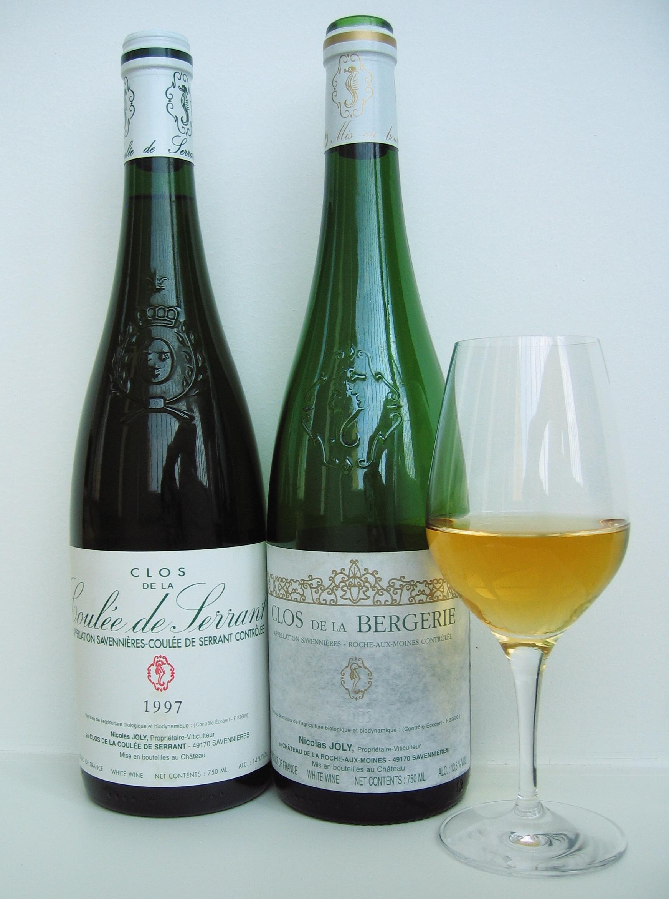

# 塞朗河畔坡地酒庄

塞朗河畔坡地（La Coulée de Serrant）在法国卢瓦尔萨韦尼耶尔（Savennières），地址是 Château de la Roche aux Moines。它只有 7 公顷，却是一个独立的 AOC——Coulée de Serrant，由乔利（Joly）家族独占。葡萄园位于俯视卢瓦尔河的陡坡上，由西多会修士于 1130 年种植；今天由 Nicolas Joly 家族经营，是法国生物动力法最具标志性的地点之一。

图：塞朗河畔坡地酒庄相关实景照片。图片：Tomas er，CC BY-SA 3.0，via Wikimedia Commons（[原图页面](https://commons.wikimedia.org/wiki/File:Coul%C3%A9e_de_Serrant_and_Clos_de_la_Bergerie.jpg)）。

## 萨韦尼耶尔：卢瓦尔河北岸的坡地

萨韦尼耶尔在昂热（Angers）西南、卢瓦尔河北岸，坡地朝南或东南，土壤以片岩、砂岩与少量火山岩为主。这里的白诗南以干型为主，酸度高、矿物感强，年轻时紧，陈年后出现蜂蜜、坚果与湿石。与武弗雷相比，萨韦尼耶尔更“窄”：甜型不是主流，酒庄更强调坡地与陈年。

塞朗河畔坡地就在这片坡地上，位置比村中心更靠近河。坡陡、土层薄，机械难以进入；从坡脚抬头能看到葡萄行沿着等高线排开。这里的景观不是背景，而是酒风格的来源：排水、日照与根系深度都由坡度决定。

## 1130 年：西多会修士种下的葡萄园

官方叙述把葡萄园的起点定在 1130 年，由西多会修士种植。旧修道院至今仍在，距离几百米处曾是 Château de la Roche aux Moines，后在宗教战争中被拆毁。这个起点让塞朗河畔坡地成为卢瓦尔最古老的葡萄园之一，也让“修道院—葡萄园—酒”的叙事有实物可对应。

历史不是用来装点酒标的。西多会修士选择这片坡地，是因为它朝南、靠近河、排水好；这些条件今天仍然有效。参观时若只记住“古老”，会忽略更重要的一点：这是一片被自然条件选中的坡地，而不是被历史偶然记住的地块。

还要分清“修道院”与“城堡”：旧修道院仍在，Château de la Roche aux Moines 则是后来建造、又在宗教战争中被拆毁的建筑。酒庄的接待与办公设在 Château 名下，但葡萄园与修道院遗址是两处不同的点；问路时说“Château de la Roche aux Moines”比说“修道院”更准确。

## 7 公顷的独占 AOC

Coulée de Serrant 是一个只包含 7 公顷的 AOC，全部属于乔利家族。法国很少有如此小的独立产区，这也意味着酒标上的“Coulée de Serrant”不是酒庄名，而是法定产地名；同一庄园的另外两款酒则分别属于 Savennières-Roche aux Moines 与 Savennières。

独占 AOC 的好处是边界清楚：酒庄不能用别处葡萄来扩充产量，也不能随意扩大面积；坏处是产量极小，年份差异被放大。对消费者来说，买到一瓶 Coulée de Serrant 就是买到这 7 公顷某一年份的全部表达，而不是某个品牌组合的一部分。

## 乔利家族与 1984 年起的生物动力法

乔利家族接手后，Nicolas Joly 在 1980 年代把注意力转向生物动力法；官方页面写明，自 1984 年起整个庄园按生物动力法耕作。这比许多法国酒庄都早，也让这里成为生物动力法在卢瓦尔的“样板间”。Nicolas Joly 的著作与演讲影响很大，但酒庄本身仍以葡萄园与酒窖为核心。

生物动力法在这里不是“不加硫”或“自然酒”的同义词，而是一套耕作与观察体系：制剂、堆肥、物候与星象都被纳入决策。访客可以怀疑其解释，但很难否认它对葡萄园生态的影响；看土壤、植被与葡萄状态，比争论理论更实际。

## 三款酒：Coulée、Clos de la Bergerie、Les Vieux Clos

酒庄生产三款白诗南，分别对应三个法定标签。Coulée de Serrant 来自最陡、最靠近河的地块，酒最紧、最矿物，陈年潜力最长；Clos de la Bergerie 属于 Savennières-Roche aux Moines，风格更圆、更早开；Les Vieux Clos 属于 Savennières，来自坡上较年轻或不同土壤的地块，价格更可接近。

三款酒的差别不只是地块，也是法定边界。把它们并排喝，能看出“同一庄园、不同 AOC”的层叠关系：最里面是 7 公顷的独占产区，外面是 Roche aux Moines，再外面是 Savennières。买酒时先确认标签，再谈年份与价格，才不会把三款混为一谈。

也不要假设三款只是“强弱排序”。Coulée 更紧、更需要时间，Clos de la Bergerie 更圆、更早开，Les Vieux Clos 更直接；它们对应不同餐桌与不同耐心。若只买一瓶，先问自己准备现在喝还是放几年，答案会指向不同的酒。

## 陡坡上的马耕与手工

官方页面提到，因为坡地陡峭，葡萄园部分作业只能靠人工与马匹完成。陡坡让机械无法稳定作业，也让采摘、修剪与搬运的成本更高；这正是 7 公顷能维持低产量与高价格的原因之一。葡萄藤多为 35 至 80 年，老藤与陡坡叠加，产量自然被压低。

这种耕作方式也影响酒的风格：根系深、产量低、成熟慢，酒更集中，酸度更清晰。参观时若能看到坡上的马或手工工具，不要只看“浪漫”；那是成本，也是酒庄选择不扩产的理由。

## 到访与品鉴

地址是 Château de la Roche aux Moines, 49170 Savennières, France；官方页面写明酒庄在周一至周六 09:00–12:00、14:00–17:30 开放品鉴，无需预约，并建议通过邮箱 info@coulee-de-serrant.com 联系。电话线路偶尔会调整，出发前最好再查一次官网或发邮件确认。

从昂热开车约二十分钟，坡下道路窄，停车空间有限；村内步行更合适。品鉴时先问清三款酒是否都能试、是否收费、能否带儿童；开车的人应吐酒。若想买酒，注意运输与储存温度，白诗南对热与光都敏感。

相关条目：[白诗南](ref:chenin)。

酒庄的独占 AOC 意味着这块坡地只能由这一家申报，不是整个萨韦尼耶尔只有一款酒；三款酒的园块与法规身份要分开看。

## 另见

- [卢瓦尔产区](ref:loire)：萨韦尼耶尔、武弗雷与白诗南的分布。
- [白诗南](ref:chenin)：干型、陈年与生物动力法。
- [白葡萄酒](ref:white-wine)与[橡木桶陈年](ref:oak-ageing)：理解陈年容器与风格。

开放时间、预约与交通以官方渠道为准，页面核验日期 2026-11-09。

补充阅读：[葡萄酒](ref:c-extra-1)。

对照阅读：[卢瓦尔河谷](ref:loire)、[白葡萄酒](ref:white-wine)。

**关键事实。**

| 项目 | 内容 |
| --- | --- |
| 一句话定位 | 法国卢瓦尔萨韦尼耶尔的一座 7 公顷独占 AOC 酒庄，葡萄园由西多会修士于 1130 年种植，现由乔利家族经营并自 1984 年起全面采用生物动力法；出产 Coulée de Serrant、Clos de la Bergerie 与 Les Vieux Clos 三款白诗南 |
| 地址 | Château de la Roche aux Moines, 49170 Savennières, France |
| 城市/国家 | 萨韦尼耶尔 / 法国 |
| 营业状态 | 已核验营业 |
| 官网 | coulee-de-serrant.com |

**来源与边界。** 本页关于「塞朗河畔坡地酒庄」的关键事实，主要由以下来源交叉核对：SAS Famille Joly（Château de la Roche aux Moines 地址、7 公顷独占 AOC、1130 年种植、三款酒与 1984 年起的生物动力法；西多会起源、乔利家族接手与产区历史叙述）、InterLoire（萨韦尼耶尔与白诗南的法定风格说明）、INAO（AOC 法定边界与标签规则的一般框架）。产品、地址或营业状态变化较快时，以 coulee-de-serrant.com 的最新页面为准；价格、批次与状态会变，涉及这些字段时以页面所列来源的最新版本为准。正文为项目自写，来源只作核验，不复制原文。
