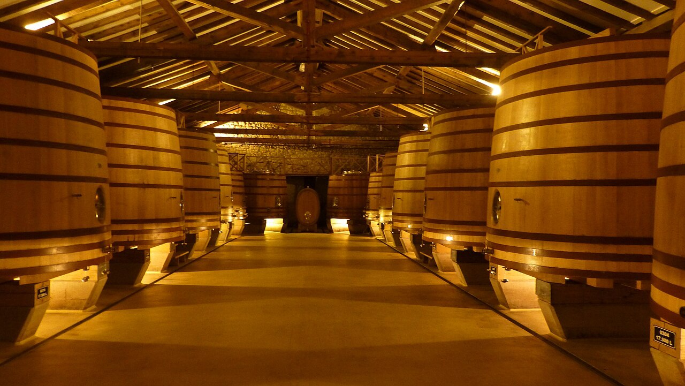

# CVNE 酒庄

从阿罗火车站出来，沿着 Barrio de la Estación 走几分钟，会先看到一片被石墙与铁门围住的老厂区，门口写着 CVNE。它的全名是 Compañía Vinícola del Norte de España（西班牙北方酿酒公司），当地人更常把它读成“Cune”。1879 年，Real de Asúa 兄弟从外地来到阿罗，在这片靠近铁路的地方建厂；一个多世纪过去，酒庄仍由创始家族的后代经营，厂区也仍在原址运转。它不是一座被改造成博物馆的空壳，而是“老建筑里继续酿酒”的样本。

图：CVNE 酒庄。摄影：CVNE bodega Imperial 2。署名：Txo，CC BY-SA 4.0，来自 Wikimedia Commons（[来源](https://commons.wikimedia.org/w/index.php?curid=83638963)）。

## 定位与历史

1879 年，Eusebio 与 Raimundo Real de Asúa 兄弟在阿罗火车站区创立 CVNE。酒庄官方把这段起点讲得很具体：兄弟俩原本是因健康原因来到阿罗，后来决定留下来做酒。这个细节说明，里奥哈现代酒业的兴起并不只靠本地农户，也靠外来资本、铁路与法国市场的需求。19 世纪下半叶，法国葡萄园接连遭受白粉病与根瘤蚜打击，酒商跨过比利牛斯山来里奥哈买酒；阿罗的火车站让桶装酒可以快速运往法国与大西洋港口，酒厂因此聚在铁路旁。

CVNE 是这一带最早的一批酒庄之一，与洛佩兹雷迪亚（1877）和里奥哈阿尔塔（1890）共同构成车站区的“老三家”。酒庄名称后来简化为 CVNE，品牌“Cune”则来自发音的简化。今天集团旗下包括 Cune、Viña Real、Imperial 等品牌，覆盖里奥哈的不同子产区与风格；酒庄仍强调“同一个家族、五代人”的连续性。把这些名字分开看，才不会把 Cune 当成酒庄名、把 CVNE 当成某一个酒款。

厂区的空间也值得读。入口内的 Aldea del Vino（葡萄酒村）是一个被石砌建筑与陶瓷瓦屋顶围合的院落，发酵、陈酿、装瓶与办公围绕它展开。酒庄最老的厂房常被称作 Nave Eiffel，导览与当地资料会把它与埃菲尔工作室联系在一起；这一归属带有历史叙事的成分，具体年代与设计者以酒庄官方说明为准。可以确定的是，这批 19 世纪末的工业建筑仍在厂区中占位置，它们不是布景，而是生产空间的一部分。

## 空间与参观

参观通常从 Aldea del Vino 开始，经过老厂房、发酵区、桶陈酒窖与瓶陈空间，最后到品鉴室。老厂房的木梁、砖墙与铁构件保留得比较完整，走在里面能感到 19 世纪工业建筑的尺度：高、窄、光线从侧窗进来，桶架一排排延伸到深处。酒窖温度低、湿度大，地面可能湿滑，穿防滑平底鞋，带一件薄外套；拍照前看标识，部分区域不允许使用闪光灯或三脚架。

桶陈是这一站的重点。CVNE 的传统以美国橡木桶为主，Crianza、Reserva 与 Gran Reserva 按法定最短陈年时间分级，但酒庄的实际陈年往往更长。美国橡木带来香草、椰子、莳萝与甜香料，长时间陈年让这些味道与果味、酸度融合，变成干果、皮革与烟草。参观时留意桶的尺寸、烘烤程度与排列方式，以及酒窖墙上的年份标记；这些细节比“传统工艺”四个字更能解释酒的风格。

酒庄的参观以预约为准，通常安排在工作日，采收期会减少或暂停接待。不同套餐的时长、是否含品鉴、品鉴酒款与语言不同，预约时要逐项确认；团体与业内人士的安排可能另有一套流程。不要把它当成“到门口买票”的酒庄，也不要指望在品鉴室随到随喝。若同行者不喝酒，可以只参加历史与酒窖部分，或把时间留给阿罗老城。

## 酒款与品鉴

Cune 是酒庄最广为人知的品牌，产品从 Crianza、Reserva 到 Gran Reserva，风格偏经典里奥哈：红果、香草、皮革与烟草，结构中等，适合配烤羊、火腿与炖菜。Imperial 是另一条线，Reserva 与 Gran Reserva 更注重陈年与复杂度，常被视为酒庄的旗舰；Viña Real 来自里奥哈阿拉维萨，风格通常更清新、果味更前；Monopole 则是经典的白葡萄酒，以 Viura 为主，经橡木桶发酵与陈年，带坚果、蜂蜜与柑橘的气息。具体酒款与年份供应会变化，买之前看背标。

第一次来，最有效的对比是 Cune Reserva 与 Imperial Reserva：同一产区、相近品种，差别在葡萄来源、桶陈时间与酒体结构；如果还能喝到 Gran Reserva，注意它在瓶中的陈年带来的干果与皮革。白葡萄酒不要冰到失去香气，Monopole 的温度可以比一般干白高一些。品鉴时先闻后喝，少量慢饮；喝不完可以吐掉，尤其是还要开车或赶火车的人。

酒庄门市有售酒，但开放时间不固定，部分时段只对预约访客开放；买之前确认携带与托运规定。高年份与限量酒款价格跨度大，不要为了“ collectors ”而忽略自己是否真的喜欢这种风格。若想把三家酒庄横向比较，建议在同一天只喝少量、多吐酒，把注意力放在“桶型、陈年长度、葡萄来源”三个变量上，而不是记住一长串酒名。

## 实用信息

地址是 Calle Barrio de la Estación 2, 26200 Haro, La Rioja, Spain，就在阿罗火车站区入口。火车到 Haro 站后步行约三到五分钟；从洛格罗尼奥乘火车或巴士约四十分钟到一小时，从毕尔巴鄂乘火车约两小时，班次不多，出发前查当日时刻。自驾从洛格罗尼奥约 45 公里、从维多利亚约 50 公里、从毕尔巴鄂约 120 公里；镇内酒庄集中，停车位有限，建议把车停在镇外或酒店。

参观须提前预约，可通过官网的参观入口或电话、邮件联系；确认日期、时间、语言、人数、是否含品鉴与费用。采收期会关闭或减少接待，周日与节假日通常不安排。参观时长一般在一到两小时之间，视套餐而定；酒窖温度低、湿度大，穿防滑鞋并带薄外套。行动不便的访客要提前说明，历史建筑的门槛与楼梯不一定适合轮椅。

开放时间、票价与酒款会调整，页面核验日期 2026-11-08，出发前以酒庄回复与官网当日信息为准。若把这里作为哈罗车站区路线的第三站，建议预约下午早段，给午餐与前两家酒庄留出时间；不要把三场品鉴排得太密，味觉疲劳会让第三家变成“喝不出区别”。

## 礼仪与周边

酒庄是生产场所，不是酒吧。按预约时间到达，不要迟到；迟到可能被缩短行程或拒绝进入。不要触摸酒桶、管道、老照片与展品，不要进入未开放的地窖分支；拍照前看陪同人员的提示。品鉴时不要喷浓香水，不要大声喧哗；吐酒是正常做法，不需要勉强喝完。

就「CVNE 酒庄」而言，开车的人全程不喝。里奥哈的酒庄之间距离不远，但乡村道路弯多，酒后驾驶风险高；最稳妥的是火车加步行、包车或指定司机。若乘火车，注意回程班次不多，不要把最后一场品鉴安排在发车前半小时。

周边就是火车站区的其他酒庄：洛佩兹雷迪亚、里奥哈阿尔塔、Muga、Gómez Cruzado 都在步行范围内，但每家都要预约。阿罗老城的和平广场周边有酒吧与小餐馆，适合午餐；六月二十九日的 Haro 葡萄酒节会让全镇非常拥挤，想安静参观要避开。往东可到布里奥内斯的 Vivanco 葡萄酒博物馆，往北可到拉瓜迪亚与里奥哈阿拉维萨。想理解酒窖如何影响风味，可以读[酒窖与储存](ref:cellar)；想建立里奥哈的整体框架，则从[里奥哈](ref:rioja)与[葡萄酒](ref:wine)开始。

补充阅读：[A Ginjinha](ref:c-extra-1)、[À la Mort Subite](ref:c-extra-2)。

相关条目：[葡萄酒](ref:wine)、[里奥哈](ref:rioja)、[酒窖与储存：温度、湿度、光照与时间](ref:cellar)。

**关键事实。**

| 项目 | 内容 |
| --- | --- |
| 一句话定位 | 西班牙里奥哈阿罗火车站区的历史酒庄，1879 年由 Real de Asúa 兄弟创立，全名 Compañía Vinícola del Norte de España；以 Cune、Viña Real 与 Imperial 等品牌、美国橡木桶陈年与老厂区建筑闻名，至今由创始家族经营 |
| 地址 | Calle Barrio de la Estación 2, 26200 Haro, La Rioja, Spain |
| 城市/国家 | 阿罗 / 西班牙 |
| 营业状态 | 已核验营业 |
| 官网 | cvne.com |
