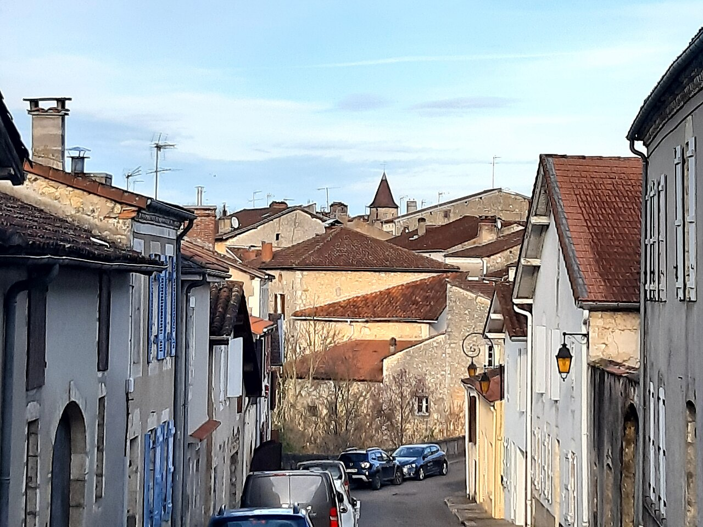

# 达罗兹雅文邑

Roquefort 是 Landes 省东部的一个小镇，主路两旁是矮房、面包店、药房与几家卖鹅肝和雅文邑的店。达罗兹的接待处与酒窖就在 277 Avenue de l’Armagnac，门口没有城堡式的排场，只有一个家族酒商的仓库、品鉴室与堆到天花板的酒瓶。它更像一个“把整个 Bas-Armagnac 收进酒窖”的地方，而不是一座供人拍照的庄园。

图：Roquefort 镇中心街景；达罗兹的酒窖与接待处位于镇上的 277 Avenue de l’Armagnac。图片：Jibi44，CC BY-SA 4.0，via Wikimedia Commons（[原图页面](https://commons.wikimedia.org/wiki/File:Roquefort_(Landes)_vue_rue.jpg)）。

## 1974 年：达罗兹雅文邑的关键起点
达罗兹的故事从一家餐厅开始。Jean Darroze 在 Villeneuve-de-Marsan 经营餐厅，儿子 Francis 在 1960 年代末开始替客人寻找雅文邑。他很快意识到，雅文邑可以像葡萄酒一样，按庄园、按年份、按批次来做，而不必把所有酒混成一个大品牌。1974 年，官方把这一年写作 Maison Darroze 的创立年；1982 年，Francis 在 Saint-Aubin 开出第一间酒窖；1985 年买下 Roquefort 的旧酒窖；1994 年，儿子 Marc 加入；2002 年，Roquefort 的接待与参观空间完成；2011 年，Labastide-d’Armagnac 的酒窖启用。

这段年表说明达罗兹不是“古堡酒庄”，而是一个从餐厅与选酒起家的家族企业。它没有自己的大葡萄园，而是与 Bas-Armagnac 约 30 个庄园合作，其中约 15 个由达罗兹自己蒸馏。每年，Francis 与 Marc 会到这些庄园试酒，决定哪些批次进入 Collection Unique，哪些进入调配系列。酒在 Roquefort 与 Labastide-d’Armagnac 的陈年酒窖里继续变化，装瓶时不再加水、不加焦糖，也不做跨庄园的混调。

官方 50 周年资料写，达罗兹目前约有 20 年的库存，出口到 50 多个市场，并与约 30 个庄园合作、在其中约 15 个庄园蒸馏。数字不是“越大越好”的证明，但它说明这家公司的核心资产不是一座城堡，而是酒窖里那些标着年份、庄园与蒸馏日期的酒桶。

## 建筑与空间

Roquefort 的酒窖是实用建筑：石墙、混凝土、金属门、成排的橡木桶与玻璃瓶。参观从一间小展厅开始，墙上挂着家族照片、旧酒标与产区地图；然后进入酒窖，空气里是酒精、橡木与陈年酒液的甜香；最后到品鉴室，桌上摆着一排不同年份的酒杯。这里没有精心设计的“沉浸式剧场”，也没有把酒窖做成网红打卡点；它的空间感来自数量与时间——同一面墙里可能同时躺着 1960 年代与 2010 年代的酒。

Labastide-d’Armagnac 的酒窖更像“第二个仓库”：它位于小镇边缘，承担部分陈年与装瓶功能，也接待预约团体。两处都不是大型游客中心，参观需要提前联系；如果你期待的是城堡、花园与拍照点，这里会让你失望。如果你要看的是“一个家族如何把不同庄园的酒分开保存”，这里比任何酒庄都直接。

## 酒款与风味

达罗兹最重要的一条产品线是 Collection Unique：单一庄园、单一年份、不调配、不加水、不加焦糖。酒标上通常会写庄园名、收获年份、蒸馏年份、装瓶日期与酒精度；同一庄园的 1985 年与 1995 年，可能像两种完全不同的酒。Bas-Armagnac 的“棕红沙土”给了酒液较轻的骨架与明显的干果、香料、皮革与烟草；长时间在橡木桶中陈年，又会带来香草、椰子、橙皮与雪松。

另一条线是 Grands Assemblages：把不同庄园、不同年份的酒调配成稳定的 12 年、20 年、30 年、50 年风格。它适合刚开始喝雅文邑的人，也适合酒吧与餐厅按杯售卖。Blanche d’Armagnac 是透明、未长时间陈年的雅文邑，达罗兹近年用蛋形陶罐做实验，让酒液在不锈钢与陶土之间取得不同的质地；它更适合加汤力水、柠檬或直接冰镇。

不要把“年份雅文邑”理解成葡萄酒的“采摘年份”。雅文邑的年份通常指收获与蒸馏的年份，装瓶可以晚很多年；一瓶标 1974 的酒，可能在 2024 年才装瓶。也不同把“没有焦糖”当成“颜色一定浅”：长期橡木桶陈年会自然加深颜色，达罗兹只是不额外加色。

## 怎么喝

达罗兹的常规参观分三段：先看一段家族与雅文邑历史的幻灯，再走进酒窖看桶，最后在品鉴室试一组酒。官方与 Gers 旅游局的介绍都强调其年份与庄园收藏的广度；你不需要一次试完，告诉接待人员你平时喝什么，让他们从年轻到老、从轻到重安排即可。

品鉴顺序建议从 Blanche 或年轻 Bas-Armagnac 开始，再进入 10 年、20 年，最后到老酒。年轻酒更锋利，带梨、葡萄、白花与一点酒精感；老酒更圆，干果、可可、皮革、雪茄盒与香料层层展开。雅文邑通常用郁金香杯或小闻香杯，不要用宽口 Rocks 杯；手掌温度会让香气打开，但不要加冰把酒冻住。加一两滴水可以，尤其对高度数老酒；不要用苏打水稀释一杯本来就很贵的年份酒。

如果只想买一瓶带回家，先想清楚用途：调鸡尾酒选 Blanche 或年轻 VSOP；纯饮与送礼选 12 年以上的 Grands Assemblages；想收藏再考虑 Collection Unique 的特定庄园与年份。达罗兹的年份酒数量多、价差大，买之前让店员给你看酒标上的庄园、年份、装瓶日与酒精度，不要只看“Darroze”四个字。

## 达罗兹雅文邑的地址与营业安排
- 地址：277 avenue de l’Armagnac, 40120 Roquefort, Landes, France。
- 坐标：44.0336, -0.4347。
- 电话：+33 5 58 45 51 22。
- 开放：工作日约 8:00–12:00、13:30–17:00；周末与节假日通常需预约，具体以官网或电话确认为准。
- 参观：展厅—酒窖—品鉴三段，约 1–1.5 小时；建议提前预约，说明语言（法语/英语）与人数。
- 交通：从 Mont-de-Marsan 开车约 25 分钟；从 Bordeaux 约 1 小时 40 分钟；从 Agen 约 1 小时。镇上停车位有限，不要把车停在店铺门口。
- 购买：现场可买酒，也可以安排运输；年份酒库存变动快，出发前先问是否有目标年份。
- 无障碍：酒窖地面不平、有门槛与低温，轮椅与行动不便者需提前说明。

## 礼仪与常见误区

第一，雅文邑不是干邑。两者都是法国葡萄蒸馏酒，但产区、蒸馏方式、陈年与法规不同；不要把达罗兹当成“干邑品牌”。第二，不要把所有雅文邑都当成甜酒。它是烈酒，甜感来自陈年与甘油，不是加糖。第三，不要用“颜色越深越老”判断；桶的烘烤、木材与储存条件都会影响颜色。第四，不要要求酒庄把年份酒调成“更顺口”再卖；达罗兹的卖点就是不做这种统一化。第五，进酒窖不要触摸桶塞与酒瓶，也不要大声敲桶；酒窖仍在工作。

还有一点：达罗兹的很多酒来自合作庄园，酒标上的“Château”或“Domaine”不是达罗兹的资产，而是那一批酒的来源。尊重这一层关系，才能看懂它的价格与风味差异。

## 从达罗兹雅文邑延伸到雅文邑路线
Roquefort 在 Landes 的东端，往西是 Mont-de-Marsan，往东是 Nérac 与 Lot-et-Garonne，往南是 Gers 的 Eauze 与 Montréal-du-Gers。把达罗兹放进 [雅文邑路线](ref:armagnacroute)，可以接着去 [洛巴德酒庄](ref:laubade) 与 [奥尼奥阿庄园](ref:ognoas)：前者是单一庄园与连续蒸馏器的样本，后者是朗德省所有的公共庄园。三处合起来，能看清“酒商选酒”“单一庄园”“公共庄园”三种完全不同的模式。

如果从 Bordeaux 过来，可以把达罗兹与 [干邑路线](ref:cognacroute) 分开安排：雅文邑在法国西南内陆，干邑更靠北，两个产区不适合硬塞进一天。想对比两大法国葡萄烈酒，可以先在达罗兹喝 Bas-Armagnac，再去 [Hennessy](ref:hennessy) 与 [Rémy Martin](ref:remy) 看干邑的调配与陈年体系。

## 参考资料
- 官方历史：<https://darroze-armagnacs.com/en/notre-histoire/>，用于核对家族起源、1974 年创立、Roquefort/Labastide 酒窖与单一庄园理念。
- 官方 50 周年年表：<https://darroze-armagnacs.com/en/carafe-unique-assemblage/>，用于核对 1974–2011 年关键节点。
- 官方 50 周年新闻：<https://darroze-armagnacs.com/en/actualites/armagnacs-darroze-celebrates-its-50th-anniversary/>，用于核对 30 个合作庄园、15 个自蒸馏庄园、20 年库存与 50 个市场。
- 官方首页：<https://darroze-armagnacs.com/en/>，用于核对 Collection Unique、Blanche 陶罐实验与参观邀请。
- 雅文邑行业局：<https://www.armagnac.fr/>，用于核对 Bas-Armagnac、连续蒸馏与年份雅文邑的 AOC 规则。
- 产区对照：[雅文邑路线](ref:armagnacroute)、[洛巴德酒庄](ref:laubade)、[奥尼奥阿庄园](ref:ognoas)、[雅文邑产区](ref:armagnacregion)。
- 干邑对照：[干邑路线](ref:cognacroute)、[Hennessy](ref:hennessy)、[Rémy Martin](ref:remy)。

对照阅读：[洛巴德酒庄](ref:laubade)、[雅文邑路线：下雅文邑的单一庄园](ref:armagnacroute)。
