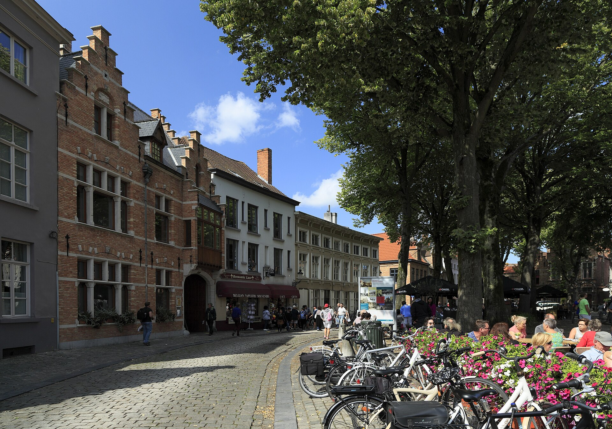

# 半月酒厂

图：半月酒厂相关实景照片。图片：Falk2，CC BY-SA 4.0，via Wikimedia Commons（[原图页面](https://commons.wikimedia.org/wiki/File:J33_542_Walplein,_%C2%BBDe_halve_Maan%C2%AB.jpg)）。

## 布鲁日市中心的一家“还在酿酒”的酒厂

半月酒厂在布鲁日老城的 Walplein 26，邮编 8000，紧邻贝居安会院与圣母教堂，从布鲁日火车站步行约十五分钟。它的特殊之处不是“有一座啤酒博物馆”，而是酒厂仍在城市中心、仍在原址酿造：麦汁、发酵罐、装瓶线与游客的参观路线共享同一栋建筑，走出门就是石板广场与餐馆。这在比利时的老城里已经不多见。

Walplein 是一个安静的小广场，夏天坐满喝酒的人，冬天显得空。酒厂的门面不大，进门是售票与商店，再往里是餐厅与参观入口。把它安排在布鲁日步行动线里很顺：先看广场与贝居安会院，再进酒厂参观，最后沿运河走到市集广场。它和布鲁塞尔南边的[康帝隆酒厂](ref:cantillon-brewery)构成一组很好的对照：一个做自然发酵的兰比克，一个做上发酵的比利时艾尔，两座城市相距不到一小时火车。

## 六代人，两个品牌

现在这块地点的酿酒活动超过五百年，但家族故事从 1856 年开始：Leon Maes（也称 Henri 一世）成为“De Halve Maan”酒厂的主人，按自己的配方酿酒，早期产品是一种浑浊、带酸味的啤酒。1867 年，Henri 二世与兄弟 Achère 接手，从英国带回当时较新的酿造技术；两兄弟早逝后，遗孀继续经营，没有把酒厂卖掉。

1919 年，第三代 Henri 三世掌舵，投资新设备，开始生产下面发酵啤酒；20 世纪 30 年代，他做出博克与一款淡色拉格，后者大受欢迎。1981 年，第五代 Véronique Maes 加入父亲 Henri 四世的经营，是当时最早的女酿酒师之一；同年推出 Straffe Hendrik，名字意为“强壮的 Hendrik”，致敬家族里一连串同名先辈。2005 年，第六代 Xavier Vanneste 推出 Brugse Zot，这款上发酵啤酒让酒厂的未来重新稳定下来。

## 参观动线：220 级台阶与屋顶

导览分两种。经典导览约 45 分钟，最多 25 人，含一杯啤酒，成人 16 欧元，六岁以下免费、7 至 15 岁 8.50 欧元，提供荷兰语、法语与英语场次；XL 导览约 90 分钟，含三杯啤酒，26 欧元，只在周末，语言为荷兰语与英语。团队与私人导览需要另行预约。全程有 220 级台阶，部分很陡，官方提醒穿合适的鞋；不适合行动不便者。

路线从糖化间开始，经过几代人的旧设备，最后上屋顶，能看到布鲁日老城的 360 度全景。2024 年 4 月，导览做了更新，加入围绕地下管道与装瓶厂的影像与虚拟体验；终点是品鉴，且只有在这里能喝到未过滤的 Brugse Zot 与 Straffe Hendrik。酒厂每年接待超过十万名参观者，周末与假期场次容易满，建议提前在线订票。

## 酒单：Brugse Zot 与 Straffe Hendrik

Brugse Zot Blond 是主力，用四种麦芽与两种香型酒花，酒体金黄、果香与麦芽甜平衡；Brugse Zot Dubbel 颜色深，焦糖与深色水果更明显；Straffe Hendrik Tripel 更干、更烈，收尾带苦；Straffe Hendrik Quadrupel 酒体厚，适合慢喝；Straffe Hendrik Heritage 在橡木桶中陈年，属于限量款。Blanche de Bruges 是小麦白啤，Brugse Bok 是季节性博克，Rosé de Bruges 带果味，Sportzot 则是 2018 年推出的无酒精特色啤酒，酒厂称它是比利时第一家做无酒精特色啤酒的酒厂。

这些酒都属于[啤酒](ref:beer)里的上发酵家族：酵母在较高温度下工作，产生酯香，再经低温熟成。与德国酒厂不同，比利时允许使用糖与糖浆提高酒精度、调节酒体，所以 Tripel 与 Quadrupel 的“烈”不只是靠麦芽。风格名词本身没有统一法律定义，同一家厂的 Tripel 与另一家可能差很远；点单时看酒精度与描述，比看名称可靠。

## 3.3 公里管道：把卡车换成重力

2016 年，酒厂建成一条 3.3 公里的地下输酒管道，把市中心的酿造车间与城外的装瓶厂连起来。管道部分靠众筹完成，动机很实际：老城街道狭窄，运酒卡车既扰民又伤路面；把酒从地下送出去，既减少交通，也保住了“在市中心酿酒”这件事。今天每一升酒仍在原址酿造，管道只负责输送。

这条管道也是导览里最容易记住的部分，因为它把“传统”与“工程”放在同一个故事里。对城市来说，它是旅游叙事；对酒厂来说，它是产能与区位的妥协。参观时看到的老建筑、铜锅与新管道并置，正是布鲁日这类城市的常态：遗产保护与产业运营必须同时成立。

## 比利时风格与法规边界

比利时没有德国的《纯净法》，啤酒可以用糖、香料与水果；这给了酿造者更大的空间，也让“风格”更依赖约定俗成。Tripel、Dubbel、Quadrupel 不是法律等级，Blanche 也不等于固定配方；真正受严格保护的是 Trappist 标识，只有特定修道院的产品能用。半月酒厂是家族企业，不是修道院酒厂，所以它的酒属于修道院风格的商业演绎，而不是 Trappist。

出口与本地销售的比例、酒精度与配方会调整，标签上的数字以当次购买为准。想系统比较比利时上发酵与兰比克的差别，可以把这家与康帝隆各安排半天：前者看规模化的城市酒厂如何运作，后者看自然发酵如何依赖时间。两者的共同点是都把[发酵](ref:fermentation)当作风味来源，而不是透明化处理的中间步骤；这也是[比利时](ref:belgium)啤酒在世界范围内最难被简化的原因。

## 实用信息

**地址**：Walplein 26, 8000 Brugge, Belgium。**交通**：布鲁日火车站步行约 15 分钟；老城内建议步行，石板路不适合拉杆箱；酒厂没有停车场，自驾需用城边公共停车场。**开放时间**：导览按场次售票，经典导览每日多场，XL 导览仅周末；餐厅与酒馆有独立营业时间。**票价**：经典导览 16 欧元，XL 导览 26 欧元，均含酒；儿童与团体价格见官网。

**提示**：全程 220 级台阶，穿防滑鞋；酒窖与楼梯较窄，旺季拥挤；参观前不要空腹喝酒，品鉴杯量虽小，三杯加起来也不少；未满法定饮酒年龄者不饮酒。布鲁日老城住宿贵，住火车站附近步行进城也方便。本页不列坐标，坐标以官方渠道为准。

补充阅读：[A Ginjinha](ref:c-extra-1)。

对照阅读：[啤酒](ref:beer)、[康帝隆酒厂](ref:cantillon-brewery)。

相关条目：[比利时](ref:belgium)。

**关键事实。**

| 项目 | 内容 |
| --- | --- |
| 一句话定位 | 布鲁日市中心的家族酒厂，1856 年由 Maes 家族接手，六代经营至今；参观可上屋顶俯瞰老城，地下 3.3 公里输酒管道与 Brugse Zot、Straffe Hendrik 是核心看点 |
| 地址 | Walplein 26, 8000 Brugge, Belgium |
| 城市/国家 | 布鲁日 / 比利时 |
| 营业状态 | 已核验营业 |
| 官网 | halvemaan.be |
