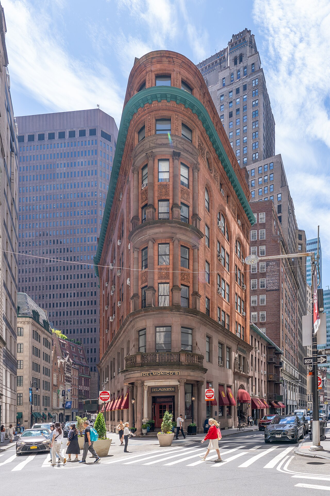

# 德尔莫尼科餐厅

在曼哈顿金融区，Beaver、South William 与 William 三条街交出一个很尖的三角口，德尔莫尼科（Delmonico's）的弧形门廊就卡在这个角上。白天，附近是提着公文包过街的银行与交易所人群；晚上，街区安静得较快，餐厅的暖光从柱廊后面透出来。它今天的样子不是 1837 年那栋楼，而是 1890–91 年重建的八层建筑；但“美国高级餐厅”的这个故事，确实是从这个地址长出来的。

图：德尔莫尼科餐厅 56 Beaver Street 的弧形转角门廊；现楼由 James Brown Lord 设计，建于 1890–91 年，不是 1837 年原建筑。图片：Ajay Suresh，CC BY 4.0，via Wikimedia Commons（[原图页面](https://commons.wikimedia.org/wiki/File:Delmonico%27s_-_56_Beaver_Street_(55312935822).jpg)）。

## 1837 年：德尔莫尼科餐厅的关键起点
Delmonico 兄弟 1827 年先在 William Street 开糕点铺，1837 年在 Beaver 与 William 的三角地块开出餐厅，通常被称作美国第一家高级餐厅。它最早提供私人宴席房、独立菜单与大型酒窖，把“吃饭”变成可以被安排、被展示的社交活动。1862 年 Charles Ranhofer 出任主厨，后来以 Eggs Benedict、Baked Alaska、Lobster Newburg、Chicken à la Keene 等菜肴闻名；这些菜的原型与归属在烹饪史上有不少争议，但 Delmonico's 确实是它们进入美国菜单的重要节点。1890–91 年，餐厅拆掉旧楼，请 James Brown Lord 设计现存的八层 Renaissance Revival 大楼；1923 年，原家族经营在禁酒令与经营压力下结束，1926 年 Oscar Tucci 在 56 Beaver Street 重开。纽约市地标保护委员会 1996 年将这栋楼定为地标，称它是唯一存留的、与 Delmonico's 直接关联的建筑。

把 1837 与 1891 分开看，是理解这栋楼的关键。1837 年的餐厅在 Beaver/William 三角地块的一栋四层建筑里；1890 年 Delmonico 家族为扩张，请 James Brown Lord 设计八层新楼，1891 年启用。新楼既是餐厅，也是办公与公寓混合的商业建筑，转角弧形立面与 Pompeian 柱头是它的识别点。1923 年原家族结束经营，1926 年 Oscar Tucci 接手，把 56 Beaver 重新做成 Delmonico's；此后又经历多次转手、关闭与重开。1996 年纽约市地标保护委员会指定这栋楼为地标，理由不是“美国第一家餐厅”的口号，而是它作为 Delmonico's 唯一存留建筑、以及 James Brown Lord 早期商业建筑代表作的双重价值。

## 空间与酒单

现楼最醒目的是转角处的弧形石柱门廊，入口上方有“DELMONICO'S”字样，柱头与阳台保留着 19 世纪末的商业建筑语言。室内分成多个餐厅与私宴房，木饰、镜面与旧画作营造出“金融区老餐厅”的正式感；楼下仍有酒窖，但今天的功能更偏储酒与活动，不是 19 世纪那种对公众炫耀的私人酒窖。菜单的核心是 Delmonico Steak：官方称它是 1850 年在 Delmonico 厨房定型的肋眼切法，今天按“原始规格”供应；此外有 Lobster Newburg、羊排、porterhouse 与经典美式配菜。酒吧提供经典鸡尾酒与葡萄酒，适合在正餐前来一杯。

Delmonico 牛排与 Lobster Newberg 仍是菜单上的历史菜式，具体做法随厨房团队调整，但命名与摆盘仍沿用旧餐厅的谱系。

## 怎么喝

来这里最好把“吃饭”当作主事件：提前订位，点一份 Delmonico Steak 或 Lobster Newburg，再配一道清爽的沙拉或蔬菜，避免整桌都是重油菜。想喝一杯，可以先在酒吧点一杯经典鸡尾酒或一杯勃艮第白，再进餐厅；不要只点一杯酒占正餐桌。午餐时段附近上班族多，气氛偏商务；晚餐更正式，适合纪念日或带外地朋友。若只想看建筑，门廊与转角外观在街上就能看到，不必为了“打卡”订一整桌。

## 德尔莫尼科餐厅的地址与营业安排
地址是 56 Beaver Street, New York, NY 10004。最近的地铁是 Bowling Green（4/5）与 Broad Street（J/Z），Wall Street（2/3）也在步行范围；从 Fulton Center 走过来约几分钟。餐厅位于金融区，工作日午餐与晚餐建议订位，周末相对好订但仍应先查官网。着装为 business casual 到 formal，男士不必强制西装，但短裤、背心与运动鞋不合适。菜单价格偏高，酒单尤其如此；点单前先确认时价与配菜是否另计。

## 礼仪与常见误区

第一，“1837 年”是餐厅创业年，不是现建筑年代；今天看到的大楼是 1890–91 年建成，1996 年才被定为地标。第二，“美国第一家高级餐厅”是 Delmonico's 官方与常见历史叙事的说法，学界对“第一”的界定有讨论，写作时应保留“通常被称为”的限定。第三，Eggs Benedict、Baked Alaska 等菜的故事版本很多，不能把“某位客人在某天即兴要求”的轶事当成档案事实。第四，Delmonico Steak 是特定切法与历史名称，不等同于任何一块肋眼；不要把它写成“纽约最好的牛排”这种无法核验的排名。第五，这里是营业中的餐厅，不是免费博物馆，拍建筑可以，但不要进入私宴区或把酒窖当景点。

## 从德尔莫尼科餐厅延伸到纽约历史酒馆路线
从餐厅出来，往东是 Stone Street 历史街区，往北是纽约证券交易所与 Federal Hall，往南可到 Battery Park 与渡轮码头。把它放进[纽约历史酒馆路线](ref:ny-route)时，适合作为金融区的“正餐站点”；若想比较纽约两种历史餐饮空间，可以读[基恩斯牛排馆](ref:keens)。禁酒令如何改变高端餐厅的经营，见[禁酒令](ref:prohibition)；酒馆与餐厅的空间差异，见[酒馆史](ref:taverns)；关于“在餐厅里消费时间”的写法，见[一杯酒里的时间](ref:time-in-cup)。

**关键事实。**

| 项目 | 内容 |
| --- | --- |
| 一句话定位 | 纽约金融区 56 Beaver Street 的传奇餐厅，1837 年开出美国早期高级餐厅，1890–91 年建现楼，以 Delmonico Steak 与多道经典菜肴闻名 |
| 地址 | 56 Beaver Street, New York, NY 10004, USA |
| 城市/国家 | 纽约 / 美国 |
| 营业状态 | 已核验营业 |
| 官网 | theoriginaldelmonicos.com |

**来源与边界。** 本页关于「德尔莫尼科餐厅」的关键事实，主要由以下来源交叉核对：Delmonico's（1827 年糕点铺、1837 年餐厅、1923 年停业与 1926 年 Oscar Tucci 重开；1837 年 Beaver/William 三角地块、私宴房、酒窖、Ranhofer 与经典菜肴叙事）、New York City Landmarks Preservation Commission（1890–91 年、James Brown Lord、唯一存留的 Delmonico's 关联建筑与 1996 年地标指定）、Landmarks（交叉核对 1835 年火灾后购地、1890 年重建、Renaissance Revival 风格与 Ranhofer 的菜肴；以 LPC 文件为主）。产品、地址或营业状态变化较快时，以 theoriginaldelmonicos.com 的最新页面为准；价格、批次与状态会变，涉及这些字段时以页面所列来源的最新版本为准。正文为项目自写，来源只作核验，不复制原文。

## 参考资料
- [纽约历史酒馆路线](ref:ny-route)
- [酒馆史：从酒肆、客栈到酒吧](ref:taverns)
- [禁酒令：禁令改变供给，不消灭需求](ref:prohibition)
- [基恩斯牛排馆](ref:keens)
- [一杯酒里的时间](ref:time-in-cup)

本页于 2026-11-21 核对 Delmonico’s 官方页面。餐厅位于金融区，工作日午餐与晚餐建议订位，菜单价格与时价菜会调整，订位前查官网。1837 年是创业年、现建筑为 1890–91 年，1996 年列为地标；“美国第一家高级餐厅”与 Eggs Benedict 等菜的故事已在正文保留限定，不作为档案事实。本页图片是德尔莫尼科餐厅的弧形转角门廊，不是菜品或内景；图注已标摄影者与许可，文字许可见文末 rights 字段。

对照阅读：[纽约历史酒馆路线：东村到格拉梅西](ref:ny-route)、[禁酒令：禁令改变供给，不消灭需求](ref:prohibition)。
