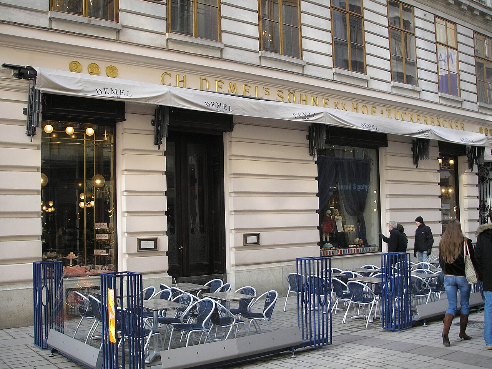
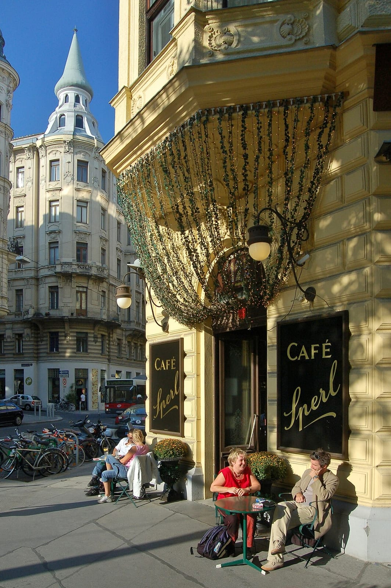

# Demel

Kohlmarkt 是维也纳最贵的一条步行街，橱窗里是珠宝、手表与瓷器；14 号的 Demel 却把整条街的注意力拉回糖、奶油与咖啡。门口的木制橱窗像一座小型舞台，蛋糕、糖果与季节装饰一层层堆到玻璃前；推门进去，洛可可式的白金色装饰、镜面、吊灯与深色木柜台把街道的明亮挡在外面。这里不是“顺路喝一杯”的咖啡馆，而是维也纳皇家糖果店传统的现场版本。

图：Kohlmarkt 14 号的 Demel 店面与橱窗。图片：No machine-readable author provided. Gryffindor assumed (based on copyright claims).，Public domain，via Wikimedia Commons（[原图页面](https://commons.wikimedia.org/wiki/File:Caf%C3%A9_Demel,_Vienna.jpg)）。

## 1786 年：Demel的关键起点
Demel 的官方历史从 1786 年开始：Ludwig Dehne 在 Michaelerplatz 开了一间糖果店（confiserie），位置就在今天 Hofburg 皇宫的入口附近。1857 年，Christoph Demel 接手生意，并把店迁到 Kohlmarkt 18；1888 年，因城市改造，店面再次搬到今天的 Kohlmarkt 14。新店的室内由 Portois & Fix 设计，风格是洛可可复兴：白色与金色的木饰、镜面、曲线、吊灯与层层陈列柜。这套室内一直被视为 Demel 的“舞台布景”，也是它和普通甜品店拉开距离的地方。

20 世纪的历史并不平顺。1911 年，Maria Demel 接手；1918 年，Anna Demel 在奥匈帝国解体后坚持保留“K. u. K.”（皇家与王室）称号，这在共和国时代是一种大胆的品牌坚持。1952 年，Anna 获得“Councillor of Commerce”称号；1956 年，Klara Demel 与 Baron Federico Berzeviczy-Pallavicini 接手；1972 年，店面卖给一家瑞士公司，后来经历 Udo Proksch 时代的丑闻与转手；1992 年再次易主；2002 年由 DO & CO 接手。今天的 Demel 是“皇家糖果店”品牌与现代餐饮集团的结合，历史叙事仍然是它最重要的资产。

## 建筑与空间

Kohlmarkt 14 的店面分为前场与后场。前场是售卖柜台与橱窗，蛋糕、巧克力、糖果与礼盒在玻璃后面排成剧场式的阵列；后场是咖啡馆座位，靠墙的镜面、白色木饰、红色/绿色丝绒长椅与大理石小桌，空间比街头看起来更深。二楼/夹层有时用于更多座位与私人活动，但日常开放区域以一层为主。灯光偏暖，白天也像傍晚，目的是让蛋糕与糖霜看起来更有光泽。

Demel 的空间不适合“安静地工作”。它更像一个不断有人进出的甜品剧场：游客在橱窗前拍照，本地人买礼盒，服务员端着咖啡与蛋糕穿过窄通道。想坐下來，通常要先在门口排队，由服务员领位；不想排队，可以直接在售卖柜台买蛋糕与糖果带走。橱窗陈列是品牌的一部分，不要用手敲玻璃或把手机伸进展示区；那些蛋糕与糖艺不是道具，而是当天要卖的商品。

## 酒单与味觉

Demel 的招牌包括 Sachertorte、Kaiserschmarrn、紫罗兰冰淇淋（Sisi 的传说）、巧克力、杏仁糖与各类维也纳甜点。它的 Sachertorte 与 Hotel Sacher 的“Original Sacher-Torte”是两套不同的品牌叙事：Demel 版本通常也被称为“Demel’s Sachertorte”，口感与夹层比例和 Original 不同。点单时如果只说“Sachertorte”，服务员会给你 Demel 的版本；想要 Hotel Sacher 的 Original，得去 Café Sacher。两者都值得试，但不要在同一个月里争论“谁才是正宗”——这场争论已经持续了上百年。

咖啡方面，Demel 提供 Wiener Melange、Einspänner、黑咖啡、热巧克力与茶。甜度高的蛋糕适合无糖咖啡或微酸的果茶；Kaiserschmarrn 适合配李子酱（Zwetschgenröster）或苹果酱。紫罗兰冰淇淋是季节性与传说性兼具的选择，颜色偏淡紫，花香明显；如果不喜欢花香，可以点香草或巧克力。酒单不长，但有起泡酒、甜型葡萄酒与少量鸡尾酒，适合把下午茶延长到傍晚。

## 怎么喝

最合适的时间是上午十点开门后到中午，或下午三点后的非正餐时段。上午排队较短，橱窗刚补货，咖啡座也更容易找到；下午是游客高峰，门口经常排到街上。因为不接受预订，策略只能是“早到”或“改天”。如果只想买蛋糕与糖果，直接走售卖柜台，不必等咖啡座；如果想坐下吃 Kaiserschmarrn，最好预留四十分钟以上。

点单时可以先在橱窗前看好，再入座告诉服务员名字；Demel 的甜点名称很多是德语，提前把想要的截图或写下来会更顺利。Sachertorte 可以两人分一块，Kaiserschmarrn 分量较大，适合两人。咖啡可以续杯热水，但不要指望免费续咖啡。结账时服务费通常已包含，仍可按服务留零钱。

## Demel的地址与营业安排
- 地址：Kohlmarkt 14, 1010 Wien。
- 营业：每日 10:00–19:00（WienTourismus；官方 Contact 页未列时间，节日与特殊日期可能调整）。
- 交通：地铁 U3 Stephansplatz 步行 3 分钟；U1/U2/U4 Karlsplatz 步行 10 分钟；从 Hofburg 的 Michaelertor 出来即到。
- 预订：不接受预订，现场排队；团队建议分开到店或在非高峰时段。
- 价格：蛋糕、咖啡与礼盒属中高端；Kaiserschmarrn 与下午茶套餐更高。
- 无障碍：主入口有门槛，店内通道窄；轮椅建议提前联系门店确认可用动线。
- 购物：蛋糕与巧克力可以打包，但含奶油/鲜奶油的甜点在常温下不耐放，长途旅行建议买密封礼盒。

## 礼仪与常见误区

第一，不要把 Demel 的 Sachertorte 与 Hotel Sacher 的 Original Sacher-Torte 混为一谈；两者是不同品牌、不同配方叙事。第二，不要以为“K. u. K. Hofzuckerbäckerei”只是装饰头衔；它指的是皇家与王室宫廷糖果供应商的历史身份。第三，不要叫服务员“Fräulein”；Demel 的传统称呼是第三人称复数“Haben schon gewählt?”，用“Sie”更稳妥。第四，不要在橱窗前长期占位拍照；Kohlmarkt 的通道很窄，后面的人要过。第五，不要期待“安静的老咖啡馆”；Demel 是高频零售 + 咖啡座，嘈杂是它的一部分。第六，不要把 1786 年当成今天这栋店面的开业年；1786 年是品牌起点，1888 年才是 Kohlmarkt 14 现址的迁入年。

Demel 不接受预订，排队与堂食节奏是体验的一部分；把 Sachertorte 的原版之争当成口味排名，会错过两家店各自的配方差异。

## 从Demel延伸到Café Central
从 Demel 出门，往西是 Michaelerplatz 与 Hofburg 的 Michaelertor，往东是 Stephansplatz 与维也纳老城，往南步行五分钟是 Café Sacher 与歌剧院。可以把这一站排成“Hofburg 皇宫 → Demel 橱窗与咖啡 → Kohlmarkt → Stephansdom → Café Sacher 下午茶”。若想把维也纳咖啡馆做成一条路线，可以先到 [Café Central](ref:central) 看穹顶与文学客群，再到 [Café Hawelka](ref:hawelka) 感受战后小馆，最后到 [Café Sperl](ref:sperl) 看 Otto Wagner 式室内；Demel 则是“皇家糖果店 + 零售橱窗”的类型。若只想比较 Sachertorte，把 [Café Sacher](ref:sacher) 与 Demel 排在同一天，各自点一块，配无糖鲜奶油或咖啡，差异会比传说更清楚。完整的夜晚路线可以参照 [维也纳咖啡馆之夜路线](ref:vienna-route)。

## 参考资料
- Demel 官方历史页：<https://www.demel.com/en/pages/demels-history>，用于核对 1786/1857/1888/1918/1952/1972/1992/2002 的时间线。
- Demel 官方 Our Story 页：<https://www.demel.com/en/pages/our-story>，用于核对皇家糖果店定位与甜点叙述。
- Demel 官方 Contact 页：<https://www.demel.com/en/pages/contact>，用于核对地址与“不接受预订”。
- WienTourismus 的 Demel 页面：<https://www.wien.info/de/essen-trinken/cafes/demel-344266>，用于核对营业时间、全女性服务与 Demelinerinnen 传统。
- 同城的 `place:cafe-sacher` 是 Sachertorte 的另一套叙事；`place:cafe-central`、`place:cafe-hawelka`、`place:cafe-sperl` 代表不同类型的维也纳咖啡馆。
- 相关条目：[Café Sacher](ref:sacher)、[Café Central](ref:central)、[Café Hawelka](ref:hawelka)、[Café Sperl](ref:sperl)、[维也纳咖啡馆之夜路线](ref:vienna-route)

## 相关图像

图：斯佩尔咖啡馆。图片：Bahnfrend，CC BY-SA 3.0，via Wikimedia Commons（[原图页面](https://commons.wikimedia.org/wiki/File:Caf%C3%A9_Sperl,_front,_2006.JPG)）。关联图像：Demel。
