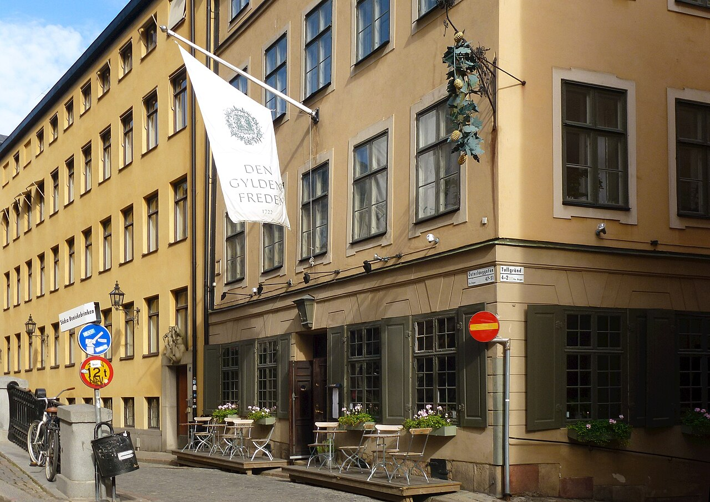

# 金色和平餐厅

斯德哥尔摩老城（Gamla Stan）的东长街（Österlånggatan）是一条窄长的石板街，两侧是 17–18 世纪的房子。51 号门口挂着“Den Gyldene Freden 1722”的招牌，中文常译“金色和平”。它不是一家把历史做成布景的餐厅，而是一间仍在营业的瑞典老馆子：木梁、石灰墙、旧吊灯、厚菜单，以及楼上那个与瑞典学院有关的房间。

图：斯德哥尔摩老城的金色和平餐厅。图片：Holger.Ellgaard，CC BY-SA 3.0，via Wikimedia Commons（[原图页面](https://commons.wikimedia.org/wiki/File:Den_Gyldene_Freden_2013a.jpg)）。

## 1722 年：金色和平餐厅的关键起点
餐厅官方历史把起点放得很早：1485 年，酒商西蒙·弗兰塞尔（Simon Fränsell）租下今天餐厅所在的地块，开了一家葡萄酒馆，卖当时的甜酒与德国啤酒；1719 年，酒商彼得·赫尔贝里（Petter Hellberg）买下东长街与索尔格伦德（Solgränd）转角的旧石屋；1722 年，按传统，金色和平在这一地址开业。官方同时承认，学者对“1722 年开业”与店名来源都有争议：店名可能指 1570 年的《斯德丁和约》，也可能指 1721 年的《尼斯塔德和约》，也可能只是“金色”与“和平”两个好词碰在一起。把 1722 当“传统说法”而不是“档案定论”，是更稳妥的写法。

餐厅经历过几次险些消失的时刻。1891 年，金色和平停业，房屋租给寡妇约翰娜·卡罗琳娜·埃里克松，用来推动禁酒运动；1895 年，秩序恢复，酒馆重新开业。1919 年，画家安德斯·左恩（Anders Zorn）在一盘肉丸之间得知餐厅即将永久关闭，决定自己买下它。他请建筑师托尔斯滕·斯图贝利乌斯（Torsten Stubelius）重新设计餐具、刀叉与室内，1920 年去世前还去看过外立面的颜色；餐厅在 1922 年 12 月 11 日重新开业，左恩没能看到。后来，左恩把餐厅遗赠给瑞典学院（Svenska Akademien），学院至今仍是业主；捐赠条件包括不得出售房产、房屋保持原状、继续作为餐饮场所经营。

这段历史解释了“金色和平”为什么既是餐厅，也是文化机构。瑞典学院成员每周四在楼上的贝尔曼厅（Bellmanvåningen）用餐，豌豆汤是常见菜；诺贝尔文学奖的评选是学院的工作，但“奖在这里评出”的说法不准确——学院在这里吃饭，不等于评奖会议就在餐桌上举行。餐厅里还有埃弗特·陶贝（Evert Taube）的雕像与纪念位，陶贝是瑞典 20 世纪最重要的民谣诗人之一，也是这里的常客。

1985 年除夕，餐厅突然停业，员工放下手中一切、关灯锁门；此后经过四年、3000 万瑞典克朗的整修，于 1989 年前后重新开业。2019 年，现任经营者在丁香花开时接手。今天的金色和平，是多次停业、重建、整修与家族/机构接手之后的版本，不是 1722 年原封不动的空间。

## 空间与菜单

空间分几层：地面层的“风暴厅”（Stormen）与“旧城拱顶”（Valvet）是主要餐厅，楼下有拱顶地窖，适合团体与私人晚餐；楼上是贝尔曼厅与左恩厅，属于瑞典学院的活动空间，普通顾客通常不能随意进入。地面层的木地板、石灰墙、旧镜子与吊灯保留了老餐厅的质感；地窖更低、更暗，冬天有烛光，适合吃肉与喝啤酒。它不是“极简北欧设计”的样板，而是“老房子 + 瑞典传统”的组合。

菜单是瑞典家常菜（husmanskost）的当代表达：肉丸配土豆泥、越橘酱与腌黄瓜；豌豆汤（ärtsoppa）配芥末；烤三文鱼或腌鲱鱼；驯鹿肉、野味、烤猪肉、卷心菜卷；夏季有小龙虾、芦笋与草莓，秋季有野蘑菇、苹果与鹅，圣诞节有圣诞自助餐。具体菜单按季节与周次变化，官网有“季节菜单”与“日历”，不要拿旧攻略点菜。

酒水以瑞典与欧洲酒为主。瑞典人喝啤酒通常点本地淡啤或国际品牌；葡萄酒单有旧世界与新世界；烈酒有瑞典伏特加、 aquavit（葛缕子/茴香风味烈酒）与苦味酒。想配肉丸，点一杯淡啤或中等酒体红葡萄酒；想配鲱鱼，点一杯干型白葡萄酒或淡啤；想试瑞典传统，饭前点一小杯 aquavit，配歌唱传统（ snapsvisa）——但不要在不熟悉的桌上强行领唱。

## 第一次去怎么点

午餐与晚餐都营业，但菜单不同：中午有较短的午市菜单，晚上有完整菜单与季节菜。第一次去，点一份主菜加一份甜点就够；想尝瑞典味，点肉丸或豌豆汤；想吃鱼，点腌鲱鱼或烤三文鱼；想吃肉，点驯鹿肉或烤猪肉。两个人可以一荤一素、一重一轻：肉丸配土豆泥分量足，适合分享；腌鲱鱼味道重，配土豆与酸奶油；驯鹿肉瘦、野味明显，配越橘酱与土豆。

预订规则：8 人以下可通过官网在线预订，地面层“风暴厅”最多 6 人，地窖“旧城拱顶”最多 8 人；8 人以上发邮件给餐厅。没有严格 dress code，但晚餐与周末客人会穿得正式一些；不要穿运动短裤与拖鞋进晚餐。带小孩可以，餐厅有家庭客人，但地窖空间不适合婴儿车。

费用结构：午餐主菜约 200–300 瑞典克朗，晚餐主菜约 300–450 瑞典克朗，甜点约 100–150 瑞典克朗；具体以菜单为准。瑞典餐厅通常按菜单价加小费，5%–10% 是常见范围；刷卡普遍可用。午市套餐可能更划算，问侍者“dagens”即可。

## 金色和平餐厅的地址与营业安排
**地址**：Österlånggatan 51, 111 31 Stockholm, Sweden。位于老城东长街，靠近索尔格伦德与铁广场（Järntorget）；从王宫步行约 5 分钟，从大教堂步行约 3 分钟。

**交通**：地铁绿线/红线到 Gamla Stan 站，步行 5–8 分钟；公交车到 Slussen 或 Riddarholmen 后步行。老城全是石板路与窄巷，出租车不能停在门口；最近的下车点在东长街两端或 Skeppsbron。穿高跟鞋与薄底鞋要小心。

**营业时间**：周一至周四 12:00–23:00，周五、周六 12:00–01:00；周日通常休息，但 2026 年圣诞季与部分周日会开放，具体看官网日历。`operating_status` 记为 `verified`，表示官网在 2026-11-20 仍显示营业；这不等于每天一定开门。

**预订**：8 人以下在线预订，8 人以上邮件 info@gyldenefreden.se；电话 +46 8-24 97 60。没有最低消费，但大团体可能需要套餐或押金，预订时问清。地窖与贝尔曼厅的可用性取决于学院活动，普通顾客不要假设一定能订到。

**价格**：斯德哥尔摩老城中高档，晚餐人均约 500–800 瑞典克朗（含酒水可能更高）；午市较便宜。小费 5%–10%，刷卡可用。圣诞自助餐与新年晚餐需提前预订，价格另计。

页面核验日期 2026-11-20；营业时间、价格与菜单以官方渠道为准。

## 礼仪与常见误区

第一，不要把“1722”当成毫无争议的档案事实；官方自己都说学者有争议，店名可能指 1570 年或 1721 年的和约。第二，不要把“瑞典学院拥有”当成“诺贝尔文学奖在这里评选”；学院成员在这里吃饭，评奖是另一套程序。第三，不要以为楼上贝尔曼厅可以随便参观；那是学院活动空间，普通顾客只能在地面层与地窖用餐。

常见误区还有三个。其一，以为餐厅从 1722 年连续营业至今；1891 年停业、1895 年重开，1985 年又停业四年，历史有多次中断。其二，以为左恩只是“赞助人”；他买下餐厅、请建筑师重做室内、遗赠学院，是实际经营者与设计者。其三，以为菜单全年不变；豌豆汤、小龙虾、圣诞自助都有季节，点菜前看官网日历。

不适合来这里的情况：只想吃一顿快速午餐、不想预订的人；对瑞典家常菜不感兴趣、只想自拍的人；带大型旅行团、要求“快速参观”的人。它适合“坐下来吃一顿瑞典传统菜”的场景，也适合对北欧文学与老城历史感兴趣的人。

## 斯德哥尔摩的周边街区
餐厅在东长街，往北是王宫与大教堂，往南是铁广场与 Slussen，往西是德国教堂与老城广场。把餐厅放在“王宫—大教堂—东长街—铁广场”这条线上：上午看王宫与大教堂，中午在金色和平吃午餐，下午逛老城小店，晚上去 Skeppsbron 看水景。走路约 30 分钟，不需要交通工具。

若想把“老餐厅”作为主题，可以再去马德里的博廷或柏林的最初审；三家都是“城市最老”叙事，但空间、菜系与经营模式不同。斯德哥尔摩老城还有其它老咖啡馆与酒吧，不要把所有“历史感”都押在一家店上。

老城窄巷在夏季与圣诞季非常拥挤，拍照要避让；餐厅门口常有游客驻足，不要堵住门。若遇到学院活动或私人包场，地面层可能封闭，改订另一天或另一时段。

## 同城酒馆与延伸阅读
- [酒吧与城市](ref:pub-and-city)：老餐厅如何用空间、菜单与营业时间组织城市生活。
- [博廷餐厅](ref:botin)：马德里 1725 年的老餐厅，与斯德哥尔摩这家“1722”形成对照。
- [最后一审餐厅](ref:instanz)：柏林 1621 年餐饮传统的老餐厅，另一种“城市最老”的叙事。
- [中央咖啡馆](ref:cafe-central)：维也纳的文学咖啡馆，说明“老店”不只有一种形态。
- [哈维尔卡咖啡馆](ref:hawelka)：维也纳的家族咖啡馆，另一种“作家与艺术家”传统。

相关条目：[认识一座城，从一间酒馆开始](ref:pub-and-city)、[博廷餐厅](ref:botin)、[最后一审餐厅](ref:instanz)。
