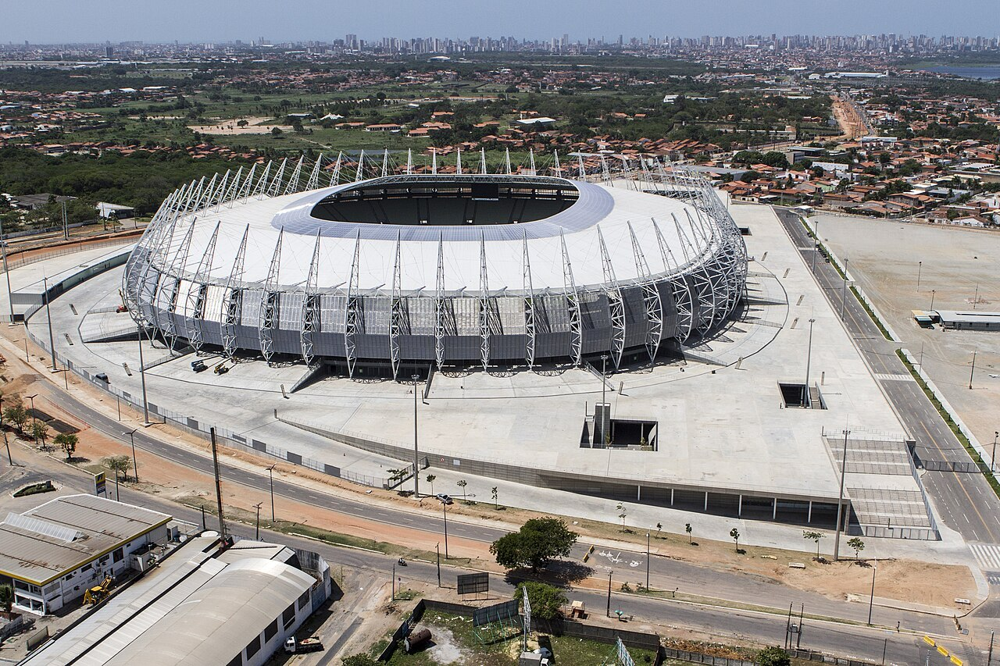

# 福塔莱萨酒厂：把 1873 年的作坊重新点火

福塔莱萨（Destilería La Fortaleza）在哈利斯科州特基拉镇（Tequila）的塔巴斯科街 153 号，坐在镇子高处，能俯看旧日竞争对手的厂房。它常被称作“时间胶囊”：砖砌炉、塔霍纳石磨、木制发酵槽与两只原装铜壶都还在用，产量却小得必须预约才能进门。理解这座酒厂的关键，不是“老”，而是“停过、修过、又开起来”——它把家族史、旧设备与[龙舌兰酒](ref:tequila)的商品化放在同一条时间线上。

图：福塔莱萨酒厂：把 1873 年的作坊重新点火。摄影：Fortaleza Arena。署名：Fábio Lima/Portal da Copa/Março de 2013，CC BY 3.0，来自 Wikimedia Commons（[来源](https://commons.wikimedia.org/w/index.php?curid=25894204)）。

## 特基拉镇高处的一座旧厂

特基拉镇在哈利斯科州西部，距瓜达拉哈拉约六十公里，开车一小时出头。酒厂地址是 Centro 区的塔巴斯科街 153 号，邮编 46400，夹在 Atizcua、Galeana 与 Héroes de Nacozari 几条街之间。镇中心不大，步行十几分钟；自驾的人要把车停在镇外再步行进入。导航可搜“Destilería Fortaleza, Calle Tabasco 153, Tequila”，镇内步行更稳，车停镇外停车场。

厂区不是一座新建的游客中心，而是建在斜坡上的老宅与车间：发酵区、蒸馏间与地下酒窖顺地势分布。高处的位置原本有炫耀意味——老厂主买下这块地，就是为了让自家烟囱高过对手。今天站在平台上看出去，特基拉谷地的龙舌兰田与镇上的屋顶连成一片。

## 从 La Perseverancia 到 La Fortaleza

家族叙事从塞诺维奥·绍萨（Don Cenobio Sauza）开始。1873 年，他在特基拉镇创办第一座酒厂 La Perseverancia，并把“mezcal de tequila”出口到美国，后来干脆把名字缩短成 tequila；他也是较早主张只用蓝色韦伯龙舌兰、并用蒸汽代替土坑蒸煮的人之一。1909 年他去世后，儿子埃拉迪奥接手；1946 年埃拉迪奥去世，孙子弗朗西斯科·哈维尔接管，并在 1973 年牵头提交龙舌兰酒原产地命名申请，墨西哥在 1996 年获得国际承认。

弗朗西斯科·哈维尔在镇上最高处买地，建起带小砖炉、塔霍纳坑、几只木发酵槽和两只小铜壶的酒厂，取名 La Fortaleza。这套设备一直用到 1968 年，因为“效率太低”而停火，改为展示旧法生产的博物馆。1976 年家族把公司卖掉，但保留了这块地与老厂。1999 年，孙子吉列尔莫开始修复；2005 年，福塔莱萨作为品牌重新上市。今天它仍由家族经营，老设备不是道具，而是实际生产的一部分。

## 砖炉、塔霍纳与两只铜壶

工艺链条几乎照着十九世纪的样子走：采收的蓝色韦伯龙舌兰先在砖砌炉里蒸煮，再放进塔霍纳坑，用石轮把烤软的 piña 压成纤维与汁液；随后进入木制发酵槽，依靠环境酵母自然发酵；最后用那两只老铜壶做二次蒸馏。酒厂强调，水源来自庄园的天然泉水，不加水稀释到常规酒精度，也不添加糖浆或增味剂。

这套做法与“效率”是对着干的。塔霍纳的吞吐量远低于辊式磨机，木槽发酵受气温影响，铜壶的批次也难完全一致；代价是产量小、成本高，回报则是更厚的龙舌兰纤维感、更慢的发酵香气与更明显的矿物收尾。参观时值得注意的细节，是塔霍纳坑边缘的磨损、铜壶的修补痕迹，以及木槽内壁的酵母层——这些比任何展板都更能说明[发酵](ref:fermentation)与[壶式蒸馏](ref:potstill)在这里意味着什么。

## 酒款：Reposado 的质地与 Añejo 的边界

福塔莱萨的产品线不长：Blanco 不经桶，保留烤龙舌兰、黑胡椒与柑橘皮；Reposado 在桶中约数月，口感更圆，但仍有清晰的龙舌兰骨架；Añejo 陈年更久，出现香草、焦糖与烤坚果。它偶尔推出原桶强度或季节调和版本，数量很少，价格也高。与一些大厂相比，它的风格不靠甜味取悦人，而是把龙舌兰的草本与矿物质放在前面。

若把福塔莱萨与[埃拉杜拉](ref:herradura)对读，差异很清楚：后者用现代磨机换效率，前者坚持塔霍纳；后者产量大、参观流程标准化，前者更像走进一座仍在运转的家族作坊。两支 Blanco 并排喝，能直接感到[龙舌兰](ref:agave)处理方式的不同：一个更干净利落，一个更粗粝、更有纤维感。这种差异也说明，所谓“传统”不是一种味道，而是一组选择。

## NOM-006 与“1873 年工艺”的位置

在 NOM-006-SCFI-2012 的框架里，福塔莱萨属于“100% 蓝色韦伯龙舌兰”的龙舌兰酒：全部糖分来自蓝色韦伯，在法定产区内完成蒸煮、发酵、蒸馏与陈年；瓶身须有 NOM 编号与监管委员会认证。它的陈年名称也受规则约束：Reposado 至少两个月，Añejo 至少十二个月，Extra Añejo 至少三十六个月。福塔莱萨并不靠超长陈年取胜，卖点是工艺路径与批次个性。

“1873 年工艺”这个说法需要拆开看：1873 年是家族第一座酒厂的起点，不是今天这栋厂房的建成年代；今天的设备是后来重建、修复并继续使用的。它真正继承的是方法——砖炉、塔霍纳、木槽与铜壶——而不是某一台从未换过的机器。把这点讲清楚，才能理解它为何既被当作“活历史”，又是一家二十一世纪的小型出口酒厂。

## 两条导览与预约

参观只能通过官网预订。常规线路有两条：“Vive Abuelo”约 90 分钟，起价 750 墨西哥比索，走塔霍纳、发酵与蒸馏区，最后在地下酒窖品鉴；“Vive Bisabuelo”约 150 分钟，起价 950 墨西哥比索，增加一段上坡步行到观景点，俯瞰特基拉谷地与龙舌兰田，再回到酒窖做更完整的品鉴。两条线路都讲工艺，区别在时长、步行量与酒款数量。

价格、语言与场次会调整，出发前以官网为准。周末与假期名额紧，最好提前几天订。只想买酒的人可以去店里，不必参团。镇中心还有其他酒厂与博物馆，可安排半天。

## 到访提示与饮酒边界

**交通**：从瓜达拉哈拉自驾约一小时，从特基拉镇中心步行约十五分钟；镇内坡道多，穿好走的鞋。参加含接送的团队游可以省去停车麻烦。

**现场**：蒸煮区热、地面可能有水，塔霍纳坑边缘不要跨越；铜壶与木槽属于生产设备，不要触摸。拍照前先问陪同人员，闪光灯通常不受欢迎。

**品鉴**：先喝 Blanco，再喝 Reposado 与 Añejo；每杯少量，吐酒是正常做法。地下酒窖温度低，夏天带一件薄外套。

**驾驶**：特基拉镇与周边公路适合自驾，但品鉴后不要开车。指定不喝酒的司机，或使用有资质的接送服务；墨西哥各州对酒后驾驶的执法标准不同，以当地法规为准。

把这站放进更大的语境，可以接着读[场所与工艺](ref:place-process)条目，理解“酒厂作为生产现场”与“酒厂作为叙事空间”的区别；再沿龙舌兰谷线路走访大厂与小厂，比较规模、设备与风味。

把 Fortaleza 放回龙舌兰谷的小厂传统，可对照[龙舌兰酒](ref:tequila)与[龙舌兰（龙舌兰属）](ref:agave)。
