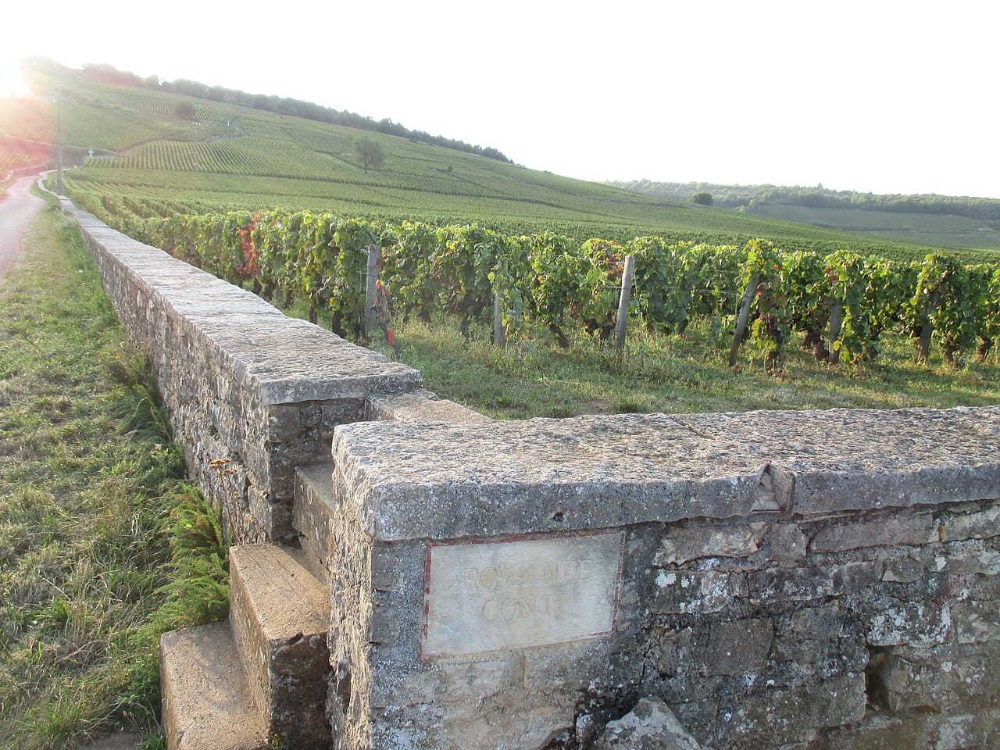

# 罗曼尼康帝酒庄

从沃恩-罗曼尼村中心往北，D974 公路两侧的葡萄园被低矮石墙切成一块一块。Romanée-Conti 只有 1.81 公顷，坡地朝东偏南，站在路边几乎看不出它与邻居的差别。它的名气与面积完全不成比例，而酒庄本身没有游客中心、没有 cellar door，只有一扇常闭的铁门。理解罗曼尼康帝，最好先把“神话”放一边，从土地、家族与极低产量开始。

图：沃恩-罗曼尼的 Romanée-Conti 葡萄园石墙与坡地。图片：Arnaud 25，CC BY-SA 4.0，via Wikimedia Commons（[原图页面](https://commons.wikimedia.org/wiki/File:Domaine_de_la_Roman%C3%A9e-Conti_02.JPG)）。

## 1869 年：罗曼尼康帝酒庄的关键起点
这片坡地最早属于圣维旺修道院。13 世纪起，僧侣在这里开垦葡萄园，地块当时叫 Cros des Cloux。1760 年，路易-弗朗索瓦·德·波旁，孔蒂亲王买下这块地，把自己的名字加了进去，Romanée-Conti 由此得名。法国大革命期间产业被没收，1794 年拍卖；1869 年，Jacques-Marie Duvault-Blochet 在 79 岁时买回这块地，并把 La Tâche、Richebourg、Grands-Échézeaux 与 Échézeaux 逐步收拢。

1942 年 7 月 31 日，酒庄成立民事公司（Société Civile），Henri Leroy 买下 Jacques Chambon 的股份，Gaudin de Villaine 家族保留另一半。1974 年，Aubert de Villaine 与 Lalou Bize-Leroy 共同管理；1991 年 Lalou 退出，Charles Roch 接任，1992 年 Charles 去世后由 Henry-Frédéric Roch 接替。2019 年，Perrine Fenal 被任命为共同管理人；2021 年，Bertrand de Villaine 接替叔父 Aubert。今天酒庄仍由 de Villaine 与 Leroy/Roch 两家族各持一半，这种“两个家族、一个酒庄”的结构，是理解 DRC 决策方式的起点。

酒庄从 1985 年起按有机方式耕作，1990 年代开始生物动力试验，2007 年全面转换，2017 年获得 Biodyvin 认证。它拥有 8 个历史特级园；2018 年又接手 Bonneau du Martray 的 Corton-Charlemagne 地块，2019 年首次采收，因此今天常说“9 个特级园”。葡萄园合计约 28.6 公顷，全部为特级园，其中 Romanée-Conti 1.81 公顷、La Tâche 6.06 公顷。

## 建筑与空间

DRC 没有一座为游客设计的“旗舰建筑”。它的空间由 14 世纪的旧压榨房、18 世纪的宅邸、地下酒窖和葡萄园边的小屋组成。2014 年 12 月，行政与管理办公室迁入圣维旺僧侣旧压榨房（ancien vendangeoir des moines de Saint-Vivant），这是一次低调的回归：把日常事务放回葡萄园历史的起点，而不是新建一座访客中心。

真正决定酒的“建筑”在坡地上。Romanée-Conti 位于坡面中段，表土薄，底层是石灰岩与泥灰岩；La Tâche 紧邻其上，土壤更厚一点，排水与保水的比例不同。酒庄用马匹耕作，避免重型机械压实土壤；采收时按地块、甚至按行分收，小批量进入发酵。发酵使用开口木槽，浸渍时间与整串比例按年份调整；正牌在全新橡木桶中陈年，比例高，但目的不是把酒做成“桶味”，而是给纤细的 Pinot Noir 一个缓慢呼吸的空间。

酒窖里没有夸张的展陈。桶列、温度、湿度与品尝记录构成主要景观。参观者如果被允许进入（通常只限专业访问），最值得留意的是不同园块的分桶标记：DRC 的风格不是一种“统一的味道”，而是把每个 climat 的差异保留下来，再在装瓶时拼成完整的一年。

## 酒单与味觉

DRC 的酒单可以按三组理解。核心是两块独占园：Romanée-Conti 与 La Tâche。前者约 1.81 公顷，年产量通常 5,000–6,000 瓶，香气以玫瑰、紫罗兰、红樱桃、香料与湿石为主，入口极细，单宁像丝线，余味很长；后者 6.06 公顷，年产量约 20,000 瓶，结构更宽，力量更外放，常被当作理解 DRC 风格的入口。

第二组是 Richebourg、Romanée-Saint-Vivant、Grands-Échézeaux 与 Échézeaux。Richebourg 约 3.51 公顷，酒体最饱满，适合长期陈年；Romanée-Saint-Vivant 约 5.29 公顷，香气更飘，单宁更细；Grands-Échézeaux 约 3.53 公顷，介于力量与细腻之间；Échézeaux 约 4.67 公顷，地块分散，风格变化最大。第三组是白葡萄酒：Montrachet 约 0.68 公顷，Corton 约 2.28 公顷，以及 2019 年起加入的 Corton-Charlemagne 约 2.9 公顷。白葡萄酒产量更少，Montrachet 常带白花、榛子、矿物与蜂蜡，陈年后会出现蜂蜜与干果。

不要用“贵不贵”来判断这些酒。DRC 的产量太小，价格由配额、拍卖与二级市场共同决定；同一款酒在不同年份的差异，往往比不同园块之间的差异更大。品鉴时先看颜色与香气，再小口让酒液覆盖口腔；Romanée-Conti 不适合大口吞，La Tâche 可以稍快一点，Richebourg 则需要更多时间。

## 怎么喝

红葡萄酒建议 15–16°C，不要低于 14°C，也不要高到 18°C。年轻的 DRC 可以提前 1–2 小时开瓶，但不一定需要激烈醒酒；老酒更脆弱，提前 30 分钟开瓶、必要时只做一次短暂换瓶即可。酒杯用口径较宽的勃艮第杯，杯肚要给香气留空间；倒酒量不超过杯肚最宽处。

配餐不要压过酒。烤乳鸽、鸭胸、蘑菇、松露、Comté 或成熟软质奶酪都比浓酱汁合适；避免黑椒汁、烧烤酱与重辣。白葡萄酒配龙虾、白肉、奶油蘑菇与陈年 Comté，温度 12–14°C。若同时开红白，先白后红、先轻后重；Romanée-Conti 放在最后，不要用它给整桌菜“压轴”。

## 罗曼尼康帝酒庄的地址与营业安排
地址是 1 Place de l'Église, 21700 Vosne-Romanée。酒庄不对公众开放，没有门票、没有品鉴室、没有酒庄商店；不要按门铃要求参观。葡萄园可以从村内公共道路与 D974 旁远观，但不要跨过石墙、进入行间或采摘葡萄。最近的铁路站是 Dijon 与 Beaune，From Paris 乘 TGV 到 Dijon 约 1 小时 40 分，再自驾 30 分钟；从 Beaune 自驾约 25 分钟。

村里停车位少，建议把车停在村口公共停车区，步行进入。周边没有大型餐厅，午餐可去 Vosne 村内的小馆，或回 Beaune。若只为一睹葡萄园，半天足够；若想把 Côte de Nuits 的特级园串起来，至少留一整天，并把驾驶与品鉴分开。

## 礼仪与常见误区

第一，DRC 不是旅游景点。没有预约不要进入酒庄，不要向工作人员索要参观、签名或合影；专业访问应通过正式渠道提前联系。第二，配额不是“排队买酒”。DRC 的酒主要通过长期配额、拍卖与专业渠道流通，酒庄不设零售窗口。第三，不要用“最好的 Pinot Noir”这类绝对判断替代品鉴；DRC 的风格是低产、整串、长陈年与地块差异，不是单靠名气。

第四，注意假酒与“故事”。Romanée-Conti 是被仿冒最多的酒之一，购买时要看酒标、瓶号、来源与流转记录；不要相信“酒庄直出”的口头承诺。第五，葡萄园是农田，不是公园：不要飞无人机、不要踩踏行间、不要在石墙边野餐。第六，年份差异很重要；同一款酒在冷凉年份与炎热年份的表现可以完全不同，不要用一瓶酒给整个酒庄下结论。

## 从罗曼尼康帝酒庄延伸到勃艮第特级园路线
把 DRC 放进[勃艮第特级园路线](ref:route)，最顺的安排是 Vosne-Romanée—Flagey-Échézeaux—Vougeot—Chambolle-Musigny，一路看不同坡面与石墙。向南到[博讷](ref:hospices)，可以看主医院与旧城区；向北到[Château de Meursault](ref:meursault)，则能看到另一类酒庄建筑与更开放的参观体系。若想对比“酒庄 vs négociant”，可以把[Louis Jadot](ref:jadot) 放在同一天的另一半。

只安排半天的话，建议在 Vosne 看 Romanée-Conti 与 La Tâche 两块坡地，然后去 Vougeot 城堡外观，最后回 Beaune 吃饭。不要把 DRC 与波尔多或香槟的名庄放在同一条“打卡”线上：它的价值在安静的葡萄园，不在接待设施。

## 参考资料
- 同产区对照：[Louis Jadot](ref:jadot)、[Château de Meursault](ref:meursault)、[Hospices de Beaune](ref:hospices)、[勃艮第特级园路线](ref:route)。
- 背景阅读：[勃艮第产区](ref:burgundy)。
- 若对“土地如何进入酒”的方法论感兴趣，可继续看项目中的产地与工艺条目；本页不提供地图，也不鼓励未经许可的庄内拍摄。

## 相关图像

图：Burgundy vineyards near Beaune, France。图片：Mark Gorzynski，CC BY-SA 4.0，via Wikimedia Commons（[原图页面](https://commons.wikimedia.org/w/index.php?curid=65061583)）。关联图像：罗曼尼康帝酒庄。
