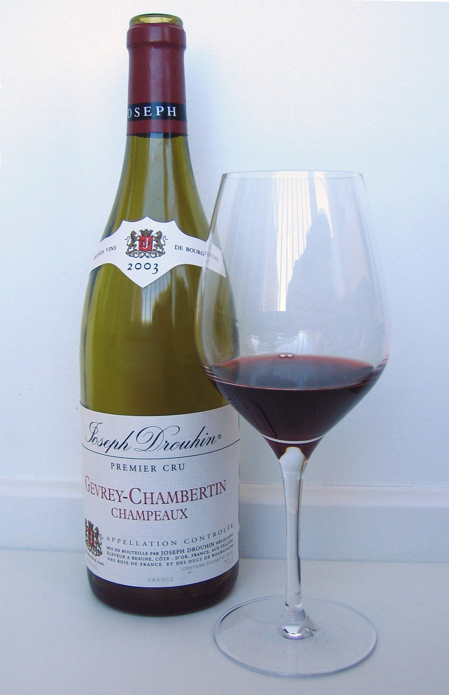

# 约瑟夫杜鲁安酒庄

约瑟夫杜鲁安酒庄（Maison Joseph Drouhin）在博讷老城的 7 Rue d'Enfer，是一处把家族住宅、酒商办公室、地下酒窖与品鉴空间叠在一起的建筑。它 1880 年由约瑟夫·杜鲁安创立，今天仍由杜鲁安家族经营，第四代成员 Philippe、Véronique、Laurent 与 Frédéric 参与管理。与郊外的城堡式酒庄不同，这里的参访从一条城市街道开始，往下走进酒窖，再回到博讷的石板路与市集，节奏更接近“城市酒商”而不是“乡村庄园”。

图：约瑟夫杜鲁安酒庄。图片：Tomas er，CC BY-SA 3.0，via Wikimedia Commons（[原图页面](https://commons.wikimedia.org/wiki/File:Drouhin_Gevrey-Chambertin_in_glass.jpg)）。

## 1880 年：约瑟夫杜鲁安酒庄的关键起点
1880 年，约瑟夫·杜鲁安在博讷创立酒商行。当时的勃艮第已经有一套成熟的 négociant 体系：酒商从种植者手中买酒，负责熟成、调配与销售。杜鲁安很快把这套角色与“自己拥有葡萄园”结合起来，逐步从单纯买酒卖酒，变成同时经营酒商、生产商与地主身份的酒庄。今天官方称其葡萄园约 100 公顷，分布在勃艮第多个著名 climats，覆盖从夏布利到马贡内的范围。

20 世纪的关键人物是莫里斯·杜鲁安（Maurice Drouhin）与罗贝尔·杜鲁安（Robert Drouhin）。1920 年代，莫里斯买下 Beaune Premier Cru Clos des Mouches 的 41 块地块，这些地块来自 8 位不同的所有者，红白葡萄各占一半，后来成为酒庄最具代表性的园之一。1960 年代，罗贝尔在夏布利葡萄园大面积荒废时进入该产区，重新种植并推动复兴；他也是较早把勃艮第酒庄带到美国俄勒冈州的人之一，Domaine Drouhin Oregon 今天仍在运营。家族史与产区史在这里是交织的，不是一条单线。

## 空间与酒单

7 Rue d'Enfer 的建筑群没有大型城堡的气派，它的价值在地下。官方介绍称，酒窖墙体可以追溯到十五个世纪前的罗马 castrum 基础，部分空间保留了中世纪教堂与教士会的痕迹；酒庄收购的建筑中还包括 Maison du Diénat，历史学家推测它曾是教士会长的住所。更戏剧性的是，酒庄部分酒窖上方曾是勃艮第议会所在地，从“大胆腓力”到“大胆查理”都曾在此主持事务；其中一间酒窖还曾作为法国国王的酒窖使用。参观时听到的这些地层关系，比任何酒标都更能解释博讷为何是勃艮第酒商体系的中心。

酒单覆盖勃艮第的主要白与红两类。白葡萄酒包括 Chablis、Meursault、Puligny-Montrachet、Beaune Clos des Mouches 白等；红葡萄酒包括 Beaune Premier Cru Clos des Mouches、Gevrey-Chambertin、Chambolle-Musigny、Vosne-Romanée 等。它们属于更广的[白葡萄酒](ref:white-wine)与[红葡萄酒](ref:red-wine)传统，但杜鲁安的重点是“酒商的选择与调配”：同一款酒可能来自多个地块，风格要在年份差异中保持稳定。第一次喝，建议从 Clos des Mouches 的红白各一杯开始，再对比一款夜丘与一款夏布利，这样能听出酒庄在不同产区的处理方式。

## 参观或点单方式

酒庄提供每日酒窖导览与品鉴，需通过官方页面选择场次并预约；导览通常从 7 Rue d'Enfer 的历史建筑进入地下酒窖，讲解博讷的罗马基础、中世纪教士会、议会旧址与酒庄家族史，最后回到品鉴。另有“Events & Unique Experiences”类活动，内容与价格随季节变化，适合已经来过一次的访客。品鉴语言通常为法语或英语，预约时看清场次说明；团队与特殊需求建议直接联系酒庄。

如果只想买酒、不想参加导览，可以去 1 Place du Général Leclerc 的 Oenothèque Joseph Drouhin。门市周一至周六 9:30 至 18:00 营业，圣诞节到新年期间闭店；这里更像一间葡萄酒专卖店，可以按产区、年份与预算挑酒，也能请店员推荐。第一次来，建议把“导览”和“门市”分开：导览解决理解，门市解决购买。不要把门市当成品鉴室长时间占座，也不要默认门市能提供与酒窖导览相同的酒款。

## 约瑟夫杜鲁安酒庄的地址与营业安排
地址：总部 Maison Joseph Drouhin，7 Rue d'Enfer, 21200 Beaune, France（电话 +33 3 80 24 68 88）；零售门市 Oenothèque Joseph Drouhin，1 Place du Général Leclerc, 21200 Beaune（电话 +33 3 80 24 84 05）。本站坐标 47.02380, 4.83583 取自酒庄官方门市页公布的 GPS，对应门市与接待位置；总部位于同一片老城街区，两处步行数分钟即可到达。

交通：乘火车到博讷站（Gare de Beaune）后步行进入老城，约 10 分钟到门市一带；自驾把车停在老城外围停车场（如 Louis Véry 等公共停车场），不要试图把车开进 Rue d'Enfer 这类窄街。博讷老城适合步行，酒庄、主宫医院、圣母联合教堂与市集都在同一片街区。

开放时间：门市全年周一至周六 9:30–18:00（官方页面 2026-11-08 复核），圣诞与新年周闭店；周日及法定节假日安排以官方页面为准。酒窖导览按预约场次进行，不设固定散客时段，旺季与周末建议提前几天预订。

预约与门票：酒窖导览、品鉴与主题活动均须预约，可通过 visite@drouhin.com、oenotheque@drouhin.com 或电话 +33 3 80 24 84 05 联系；场次通常提供法语或英语讲解。官方页面未公布统一导览票价，具体套餐与金额以预约确认页为准（未核验），本文不复制具体金额。酒窖温度低于地面，夏天也建议带一件薄外套；地面不平，穿舒适的鞋。若当天还要开车，品鉴时使用吐酒桶，不要因为“只喝一点”而冒险。

「约瑟夫杜鲁安酒庄」的开放时间、价格与预约，以[官网](https://www.drouhin.com/)的公开页面为准；核验日期为 2026-11-08，临时调整以官网当日公告为准。

## 礼仪与误区

第一个误区是把“Maison Joseph Drouhin”当成只种自己葡萄的单一酒庄。它同时是 négociant、生产商与地主，酒款可能来自自有园、长期合作农户或购买的酒液；这不是缺点，而是勃艮第酒商体系的常态。第二个误区是把门市当成酒窖入口。7 Rue d'Enfer 是总部与历史酒窖，1 Place du Général Leclerc 是零售门市，预约导览与买酒是两件事。

第三个误区是把地下酒窖想象成一座装修华丽的地下宫殿。它的价值在墙体、拱顶与地层，而不是灯光与布景；部分空间狭窄、光线暗，拍照时不要开闪光灯，也不要越过围栏。品鉴时不要喷香水或古龙水，浓烈气味会干扰别人判断；先闻后喝，少量慢饮，不想喝完就吐酒。带孩子的家庭要提前确认场次是否适合儿童，酒窖不是游乐空间。

还有一个常见误会是“家族经营等于封闭”。杜鲁安家族确实控制酒庄，但业务覆盖多个产区与国际市场，Oenothèque 也面向普通消费者；不要因为它是“家族酒庄”就以为只能通过餐厅或拍卖买到。若想比较“城市酒商”与“乡村城堡”的差别，可以在同一天下午去默尔索，体感会比读介绍更直接。

酒庄的罗马地基与中世纪遗迹属于建筑史，不是葡萄酒等级；参观酒窖与品鉴是两件事，预约时要看清包含内容，别把建筑故事当成酒款背书。

## 从约瑟夫杜鲁安酒庄延伸到博讷主宫医院
酒庄在博讷老城，步行可到[博讷主宫医院](ref:hospices)、圣母联合教堂、Place de la Halle 与 Marché aux Vins。建议上午先看主宫医院，中午在市场附近吃饭，下午参加杜鲁安的酒窖导览，傍晚在门市买酒；若还有时间，开车约 15 分钟到默尔索的[默尔索城堡](ref:meursault)，比较城市酒商与城堡酒庄的参观方式。

对只安排一天的旅行者，杜鲁安适合作为“博讷城市线”的核心，而不是整天泡在酒窖里。博讷老城不大，但地下酒窖与博物馆都需要站立与步行，连续安排两个容易疲劳；中间留一顿午饭与一段街上散步，体感会好很多。若专门为勃艮第红葡萄酒而来，可以把杜鲁安与夜丘的酒庄分开安排，不要在一天内从博讷赶到热夫雷—香贝丹再返回，路上时间会压缩品鉴。

## 同产区酒庄与延伸阅读
- [勃艮第](ref:burgundy)：博讷、金丘与夏布利的地理与酒商体系。
- [红葡萄酒](ref:red-wine)：黑皮诺在勃艮第的结构与陈年。
- [白葡萄酒](ref:white-wine)：霞多丽与勃艮第白酒的酸度与质地。
- [博讷主宫医院](ref:hospices)：博讷城市史与葡萄酒拍卖的入口。
- [默尔索城堡](ref:meursault)：默尔索的白葡萄酒与城堡式参观。
