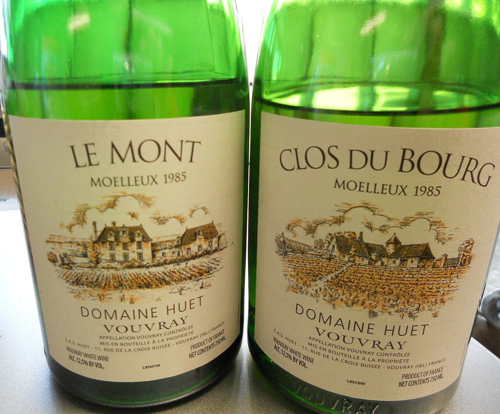

# 休埃酒庄

休埃酒庄（Domaine Huet）在法国卢瓦尔河谷的武弗雷（Vouvray），地址是 11 rue de la Croix Buisée。它以白诗南（Chenin Blanc）闻名，三十公顷葡萄园分成三块核心地：Haut-Lieu、Le Mont 与 Clos du Bourg。休埃不是一座以游客动线为核心的酒庄，酒窖、办公与接待混在同一处；因此到访前先确认能否接待，比直接按地址找过去更稳妥。

图：休埃酒庄。图片：jamesonf，CC BY 2.0，via Wikimedia Commons（[原图页面](https://commons.wikimedia.org/wiki/File:Vouvray_AOC_moelleux_Domaine_Huet_1985.jpg)）。

## 武弗雷：卢瓦尔河北岸的白诗南小镇

武弗雷在卢瓦尔河中段北岸，小镇依着坡地与凝灰岩（tuffeau）洞穴展开。这里的白诗南可以做成干型、半干、甜型与起泡，是卢瓦尔最“全能”的白葡萄酒产区之一。坡地上的黏土、石灰岩与燧石给酒不同的质地；凝灰岩洞穴则提供了恒温恒湿的酒窖，许多酒庄至今仍在洞中陈年。

对访客来说，武弗雷的尺度很小：村内步行即可，酒庄之间相距不远；但公共交通班次有限，从图尔（Tours）过来通常自驾或打车。把武弗雷放在一天里，上午看酒庄、下午沿河走一段，比试图一天跑完整个卢瓦尔更现实。坐标以官方渠道为准。

## 1928 年以来的休埃家族

酒庄由 Victor Huet 与儿子 Gaston Huet 于 1928 年创立。Gaston Huet 在战后推动了武弗雷的法定产区建设，也让休埃成为当地最有代表性的酒庄之一；今天酒庄由 Hwang 家族持有，Stefan Hwang 是法律声明中列出的法定代表。家族与所有权的变化没有改变核心：白诗南与三块地。

理解这段历史，能解释酒庄的“老派”气质：酒标不追逐潮流，酒窖仍用旧桶与洞穴，陈年型白诗南占很大比重。它既不是自然酒先锋，也不是大集团品牌，而是一座把传统与生物动力法叠在一起的家族产业。

## 三块地：Haut-Lieu、Le Mont、Clos du Bourg

Haut-Lieu 是酒庄的历史地块，1928 年购入时只有五公顷，如今约十五公顷，土壤为深厚的棕色黏土，酒偏果味、清新，适合较早饮用。Clos du Bourg 于 1953 年购入，约六公顷，位于武弗雷教堂上方，围着九世纪旧石墙，土层薄，黏土与石灰岩之下是凝灰岩，酒更密、更适合陈年。

Le Mont 于 1957 年加入，坡向朝南，燧石与绿黏土给酒更锋利的矿物感与酸度，酒窖就在坡下。三块地是休埃的骨架：同一品种、同一村庄，却给出三种质地。参观时若只能喝一组，优先选三块地的干型同年份对比，差异最清楚。

## 白诗南的干、半干、甜与起泡

白诗南的高酸让它能覆盖整个甜度谱系。武弗雷的干型（sec）清爽、带柑橘与湿石；半干（demi-sec）更圆，常配餐；甜型（moelleux 与 liquoreux）依赖贵腐或过熟果，蜂蜜、杏干与蜂蜡明显；起泡（pétillant 与 mousseux）则用传统法或罐法，酸度支撑气泡。休埃的酒单几乎覆盖全部类型，这也是它适合“教学式品鉴”的原因。

读标时不要只看“Vouvray”：同一酒庄的 Vouvray 可能是干型，也可能是半干。看背标残糖，或直接问酒庄；白诗南的酸度会把甜感压低，入口常比糖度数字更“干”。想理解[白诗南](ref:chenin)的多面性，最好把干型、甜型与[起泡酒](ref:sparkling)各点一款，再比较酸度与酒体。

同一块地的酒在不同年份也会换性格，所以“地块”与“年份”要一起看；只记地块名，容易把某个好年份的印象当成永恒风格。先确定自己想喝干型还是甜型，再选地块，顺序会更清楚。

## 1988 年转向生物动力法

酒庄从 1988 年起转向生物动力法，是法国最早采用这一体系的酒庄之一。官方叙述强调“让葡萄在自然环境中找到平衡”，具体做法包括更细的物候观察、更少的化学投入与按地块调整的耕作。三块地各有土壤与坡度，管理不能一刀切。

生物动力法在休埃不是标签，而是决策框架：它影响耕作、采收判断与酒窖节奏。访客不必把它神秘化，也不必把它当成“更好喝”的保证；看葡萄园里的植被与土壤，再喝三块地的酒，比讨论认证更有意义。

## 酒单与年份

休埃的核心是白诗南的静止酒与起泡酒，按地块与甜度分线。Haut-Lieu 的干型果味更开，Le Mont 更矿物、更紧，Clos du Bourg 更密、更适合长期陈年；甜型则看年份与贵腐条件。酒庄也会做少量红葡萄酒与桃红，但比例很低。

年份差异在卢瓦尔很明显：冷凉年份酸度高、酒体轻，熟年份果味更足、甜型更容易出现。买酒时先确认年份与甜度，再看地块；老年份的白诗南可能出现蜂蜜、坚果与湿石，也可能因储存不当而氧化。不要只看酒庄名就下单。

还需要留意瓶型与封口：休埃的老年份常以不同瓶型与软木塞出现，运输与储存条件比酒庄名更能决定一瓶酒的状态。若在餐厅点老年份，先看液面高度与颜色，再闻是否有氧化味；这些判断比年份表更实际。

## 到访与预约确认

地址是 11 rue de la Croix Buisée, 37210 Vouvray, France；官方页面以酒庄介绍与销售为主，没有列出固定参观时段，法律声明只提供地址、电话与邮箱。因此本页把营业状态标为 unknown：酒庄在运营，但能否参观、何时品鉴，必须提前邮件或电话确认。

若获接待，品鉴时先问清是否收费、是否含三块地的对比、能否带儿童；开车的人应吐酒。从图尔到武弗雷约二十分钟车程，村内停车位有限；把车停在村外，步行进入酒庄更从容。回程避开晚高峰，卢瓦尔河沿岸的乡道在傍晚视线不佳。

相关条目：[卢瓦尔河谷](ref:loire)、[白葡萄酒](ref:white-wine)。

## 另见

- [卢瓦尔产区](ref:loire)：武弗雷、萨韦尼耶尔与白诗南的分布。
- [白诗南](ref:chenin)：高酸、甜度谱系与陈年潜力。
- [白葡萄酒](ref:white-wine)与[起泡酒](ref:sparkling)：两类成品的读标与配餐。

开放时间、预约与交通以官方渠道为准，页面核验日期 2026-11-09。

**关键事实。**

| 项目 | 内容 |
| --- | --- |
| 一句话定位 | 法国卢瓦尔武弗雷的一座家族酒庄，1928 年由 Victor Huet 与 Gaston Huet 创立，以 30 公顷白诗南、Haut-Lieu、Le Mont 与 Clos du Bourg 三块地及 1988 年起的生物动力法闻名；参观与品鉴需先确认 |
| 地址 | 11 rue de la Croix Buisée, 37210 Vouvray, France |
| 城市/国家 | 武弗雷 / 法国 |
| 营业状态 | 待核验 |
| 官网 | domainehuet.com |

**来源与边界。** 本页关于「休埃酒庄」的关键事实，主要由以下来源交叉核对：Domaine Huet（1928 年创立、30 公顷、三块葡萄园与生物动力法表述）、Domaine Huet / L'Echansonne Huet Distribution（11 rue de la Croix Buisée, 37210 Vouvray 地址与法定代表；页面未列出固定参观时段，故营业状态标为 unknown）、InterLoire（武弗雷法定风格、白诗南与卢瓦尔产区说明）等 4 条来源。产品、地址或营业状态变化较快时，以 domainehuet.com 的最新页面为准；价格、批次与状态会变，涉及这些字段时以页面所列来源的最新版本为准。正文为项目自写，来源只作核验，不复制原文。

## 相关图像

图：白诗南。图片：Benjamin Smith，CC BY-SA 4.0，via Wikimedia Commons（[原图页面](https://commons.wikimedia.org/wiki/File:Rochecorbon_-_Vignoble_-_02.jpg)）。关联图像：休埃酒庄。
