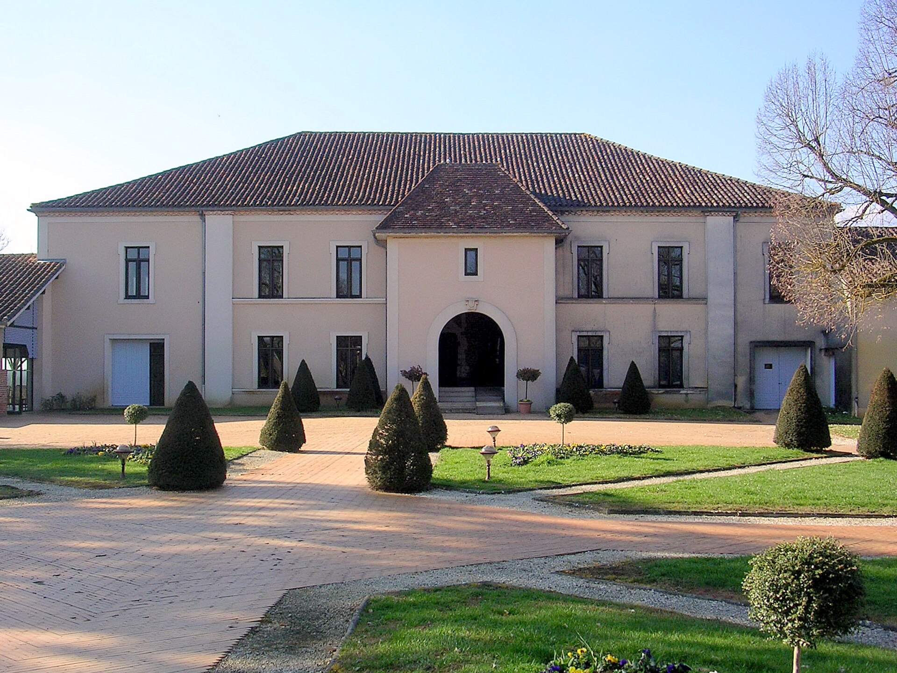

# 奥尼奥阿庄园

奥尼奥阿（Domaine d'Ognoas）是朗德省阿尔泰兹达尔马尼亚克的一座省立庄园，位于下雅文邑西缘，领地可追溯到 11 世纪末或 12 世纪初。它不是家族酒庄，而是 1905 年政教分离后由朗德省接手的公共产业：约 650 公顷土地、一台连续蒸馏器、成排酒窖与一间全年营业的商店，共同构成产区内少见的“公共庄园”样本。

图：奥尼奥阿庄园相关实景照片。图片：Jibi44，CC BY-SA 3.0，via Wikimedia Commons（[原图页面](https://commons.wikimedia.org/wiki/File:Arthez_domaine_Ognoas.jpg)）。

## 朗德省的一座公共庄园

奥尼奥阿的入口是一条乡间路，两侧是松林、玉米地与葡萄园。它与私人酒庄最大的区别在所有权：庄园归朗德省所有，由省议会负责经营，定位是向公众展示朗德风土与雅文邑工艺。因此这里既有农业生产，也有旅游接待；既卖酒，也承担讲解与地方记忆的功能。

这种身份带来两个直接结果。第一，参观门槛较低：酒窖开放时间长，品鉴免费，商店全年营业，适合把这里当作进入雅文邑产区的第一站。第二，风格不靠某一款旗舰酒讲故事，而靠整套生产链：葡萄从哪来、用什么蒸馏器、在哪种桶里陈年、年份如何存放。对访客来说，这反而比品牌叙事更容易看懂。

## 从中世纪领地到 1905 年

庄园的历史比酒更早。领地最初属于马尔桑子爵领；1240 年，子爵夫人 Matha de Mastas 与 Gaston VII Moncade 联姻，奥尼奥阿随贝阿恩家族一直到 1607 年。1274 年的文献里，Arnaud Bosquet 是唯一能以“奥尼奥阿领主”自称的人。1770 年 Etienne Lormand 买下领地，1775 年其子又购入 Tampouy，把庄园扩大到今天的轮廓。

1847 年，最后一位 Lormand 没有继承人，把庄园遗赠给教会，由艾尔-叙尔-阿杜尔主教区管理。1905 年，法国通过政教分离法，教区财产转交省府，奥尼奥阿由此成为朗德省的产业。此后它一直作为农业庄园运作，主楼与附属建筑经过整体修复，才逐渐变成今天可以对公众开放的参观点。领主、教会、省府三层身份叠在同一座酒窖上，这是它与其他单一庄园最不同的地方。

## 沙土、巴科与连续蒸馏

奥尼奥阿位于[下雅文邑](ref:armagnac)西侧，土壤以黄褐沙与砂质黏土为主，混有铁质，排水快、春季升温早。这样的土壤让葡萄成熟均匀，蒸出的酒液偏细、果香清晰，适合长期陈年。雅文邑的葡萄品种比干邑更宽，巴科（Baco）在这里尤其重要：它抗病、适应沙土，能给酒液圆润感与熟果香；白玉霓提供酸度与骨架，白福儿带来花香，鸽笼白补充香气。

蒸馏用雅文邑式连续蒸馏器。雅文邑约 95% 的酒液走这条路线，设备是纯铜的，1818 年由奥什的炉具匠 Sieur Tuillière 在路易十八治下定型，此后被本地蒸馏师不断改造。酒液从冷却器底部持续进料，蒸气在塔板间上升并与酒液接触，最后经蛇形管冷凝；出酒酒精度在 52%–72% 之间，传统上多为 52%–60%。蒸馏必须在采收次年的 3 月 31 日前完成。与干邑的二次壶式蒸馏相比，一次连续蒸馏保留更多风味物质，酒体更厚，也更依赖桶陈来打磨。

## 酒窖里的时间与 Floc de Gascogne

蒸馏后的酒液进入 400 升的“pièce”橡木桶，多取加斯科涅或利穆赞橡木。新桶用于萃取单宁与香气，萃取到合适程度就换到旧桶，避免木味过重；酒窖的温湿度决定蒸发速度，酒精度每年约降 0.5 度，这就是“天使的分享”。当酒窖主管判断酒液到达顶点，部分酒液会转入玻璃坛（bonbonne）停止变化，留在“paradis”里作为老酒储备。把[橡木桶陈年](ref:oak-ageing)理解成一个持续判断的过程，而不是简单的“放得越久越好”，才读得懂这里的年份。

庄园的另一条产品线是 Floc de Gascogne：用新鲜葡萄汁与雅文邑调和而成的加斯科涅开胃酒，既有果汁的甜，也有烈酒的骨架。它和年份雅文邑共用同一套葡萄与酒窖，却面向完全不同的饮用场景。参观时可以对照着喝：一边是陈年带来的坚果、皮革与香料，一边是年轻、直接、带果香的调和酒。这种对照比单独记年份更容易建立味觉坐标。

## 参观：蒸馏器、酒窖与免费品鉴

地址是 1043 Route d'Ognoas, 40190 Arthez-d'Armagnac, France。酒窖全年开放，周一至周五 9:00–12:00 与 14:00–17:30；周六下午需预约；5 月 2 日至 9 月 30 日的周末与节假日 14:00–17:30 也开放。团体最多 50 人，提供英语与西班牙语讲解，有无障碍设施，品鉴免费，商店可以当场买酒。电话 +33 5 58 45 44 23，庄园官网也列出联系方式。

看点分三层：建筑与领地，让人看到庄园如何从中世纪领主宅邸变成省属产业；蒸馏车间，让人看到连续蒸馏器的铜制塔板与蛇形管；酒窖，让人看到年份、品种与桶型如何分开存放。冬季蒸馏季来，能看到设备运转；其他季节来，重点放在酒窖与品鉴。参观时间、场次与团体安排会调整，出发前以官方渠道为准。

## 奥尼奥阿在雅文邑地图上的位置

奥尼奥阿在朗德省东北部，靠近拉巴斯蒂德达尔马尼亚克、诺加罗与欧兹，离热尔省的索尔贝也不远。它适合与洛巴德组成一条两站路线：先在索尔贝看家族庄园的年份装瓶，再向西北到奥尼奥阿看公共庄园的完整生产链。两站之间是松林、玉米地与小镇，公共交通基本不可用，必须自驾。

把视野再放宽：雅文邑是[法国](ref:france)原产地命名体系中的葡萄[白兰地](ref:brandy)，下雅文邑的沙土、巴科与连续[蒸馏](ref:distillation)构成它的底层逻辑。奥尼奥阿不是最古老的酒庄，也不是最昂贵的品牌，但它把“一座庄园如何被制度保存下来”讲得最清楚。若只在本区停一处，且想用最低成本理解雅文邑，这里比许多需要提前数周预约的私人酒庄更合适。页面核验日期 2026-11-09。

对照阅读：[雅文邑](ref:armagnac)、[蒸馏](ref:distillation)。

相关条目：[白兰地](ref:brandy)。

**关键事实。**

| 项目 | 内容 |
| --- | --- |
| 一句话定位 | 朗德省阿尔泰兹达尔马尼亚克的下雅文邑庄园，领地可追溯到 11 世纪末，1905 年后归朗德省所有；约 650 公顷土地、一台连续蒸馏器、成排酒窖与免费品鉴，让它成为产区内少见的公共庄园样本 |
| 地址 | 1043 Route d'Ognoas, 40190 Arthez-d'Armagnac, France |
| 城市/国家 | 阿尔泰兹达尔马尼亚克 / 法国 |
| 营业状态 | 已核验营业 |
| 官网 | domaine-ognoas.com |
