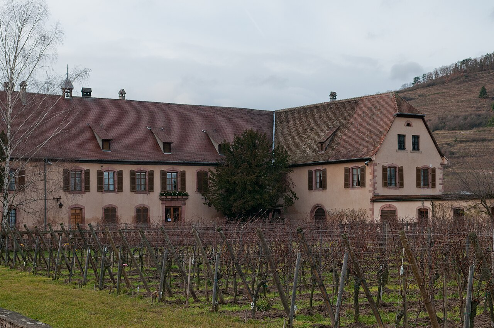

# 魏恩巴赫酒庄

魏恩巴赫酒庄（Domaine Weinbach）在法国阿尔萨斯的凯泽斯堡（Kaysersberg），门牌是 25 Route du Vin。酒庄建在施洛斯山（Schlossberg）脚下，1612 年由嘉布遣会修士建立，后来由法勒（Faller）家族接手。它的名字来自穿过庄园的一条小溪——“酒溪”。今天它既是家族住宅，也是仍在运转的酒窖与品鉴空间，属于那种“走进院子就能看见葡萄园”的酒庄。

图：魏恩巴赫酒庄。摄影：Domaine Weinbach (6710808155)。署名：Michal Osmenda from Brussels, Belgium，CC BY-SA 2.0，来自 Wikimedia Commons（[来源](https://commons.wikimedia.org/w/index.php?curid=24415979)）。

## 凯泽斯堡山谷与 1612 年的修道院

凯泽斯堡位于阿尔萨斯葡萄酒之路的核心段，山谷狭窄，坡地朝东与东南，光照充足而降雨偏少。1612 年，嘉布遣会修士在这里建起修道院，种植葡萄并酿造用于弥撒与待客的酒；修道院建筑、围墙与部分地块一直保留到今天。法国大革命后，产业转入私人手中，法勒家族在二十世纪把它重新做成一座完整的酒庄。

这段历史对理解酒庄很重要：它不是“后来建的酒厂”，而是先有修道院与葡萄园，再有家族与品牌。参观时看到的旧墙、拱门与院落，不是布景，而是酒庄仍在使用的基础设施。把它们与酒标上的 Clos des Capucins 连起来看，才知道名字从哪来。

## 法勒家族与 Clos des Capucins

法勒家族接手后，Théo Faller 扩大了葡萄园，把重心放在老藤与地块选择上；今天酒庄由 Eddy Leiber-Faller 代表。核心地块 Clos des Capucins 围绕修道院，名字直译就是“嘉布遣会园”，是酒庄最古老的一圈葡萄园。它的土壤与坡向并不单一，因此酒庄会用不同 cuvée 来表达其中的差异。

Clos des Capucins 的 cuvée 包括 Cuvée Théo、Cuvée Sainte Catherine 等，既有雷司令，也有灰皮诺与其他品种。它们不是“修道院纪念酒”，而是用同一片园子的不同部分做出的风格选择。喝这些酒时，可以把它们与施洛斯山特级园对照：一个是院墙内的复合地块，一个是法定边界内的单一特级园。

## 施洛斯山特级园

施洛斯山是阿尔萨斯最早被承认的特级园之一，也是凯泽斯堡最显眼的一片坡地。它的土壤以花岗岩为主，局部混有片麻岩与砂岩，排水好、升温快，适合雷司令；坡向与海拔让葡萄在秋季保持酸度，同时获得足够的成熟度。魏恩巴赫在施洛斯山拥有地块，酒标上会同时写“Alsace Grand Cru Schlossberg”与品种。

特级园的规则要求写清园名与品种，且只允许规定品种；这让酒标比普通 Alsace 更长，也更具体。同一特级园内，坡上与坡脚的酒可以不同；魏恩巴赫的施洛斯山雷司令通常更矿物、更紧，陈年后出现蜂蜡与湿石感。把它与 Clos des Capucins 的雷司令并排喝，能看出“法定特级园”与“历史围园”两种逻辑。

## 贵族品种的酒单

酒庄的品种覆盖阿尔萨斯的主要贵族品种：雷司令、灰皮诺、琼瑶浆与麝香，也有白皮诺与西万尼。雷司令负责酸度与矿物骨架，是酒庄最核心的白葡萄酒；[灰皮诺](ref:pinot-gris) 给梨、蜂蜜与烟熏感，酒体更宽；琼瑶浆给荔枝与玫瑰，麝香给葡萄本身的花香。不同品种在同一片坡地上表现不同，这也是阿尔萨斯酒单迷人之处。

酒庄也做不标特级园的 cuvée，让价格更可接近。不要把“没有 Grand Cru”当成次一等：它可能来自年轻藤、特定地块或特定年份的混酿，风格更早饮。若想建立参照，先喝一款入门雷司令，再喝 Clos des Capucins，最后喝施洛斯山特级园，三层结构就清楚了。

## 迟摘与贵腐精选

阿尔萨斯的 Vendanges Tardives（VT）与 Sélection de Grains Nobles（SGN）是两类迟采标签，前者要求糖度达到下限，后者要求逐粒挑选贵腐或过熟果。两者都必须使用贵族品种，且不能加糖。魏恩巴赫在这些标签上有长期经验，酒体浓郁但保持酸度，不是简单的“甜”。

VT 与 SGN 的差别不只在糖度：VT 的关键是迟采带来的熟果与蜂蜜，SGN 的关键是贵腐菌带来的浓度与复杂度，产量极低。喝的时候先看颜色与香气，再看口中的酸度是否把甜度托住；如果只按“甜不甜”判断，会错过这两类酒真正的结构。

还需要注意年份：阿尔萨斯的秋季并不总是干燥，贵腐需要特定的湿度与昼夜温差。不是每个年份都能做 SGN，酒庄也不会为了产品线强行生产；遇到某个年份没有 SGN，是气候的结果，不是酒庄的失误。买酒时问一句“这一年贵腐条件如何”，比问“哪款最贵”更有用。

## 预约参观与品鉴

酒庄在 25 Route du Vin, 68240 Kaysersberg，官方页面写明“sur rendez-vous”，即必须预约：周一至周五 9:30–11:30、13:30–17:30，周六 9:30–11:30、13:30–17:00，周日闭馆。参观与品鉴的具体内容、时长与费用随季节调整，应以邮件回复为准；不要按门口看到的时段直接进入。

从凯泽斯堡村中心到酒庄步行可达，开车则应停在村外停车场，再走进酒之路。品鉴时问清是否收费、是否含特级园、能否带儿童；开车的人应吐酒。若时间有限，优先看 Clos des Capucins 与施洛斯山两组酒，比把整张酒单都试一遍更有效。

如果同行者对阿尔萨斯不熟，可以先要一张品种与地块对照表，再按雷司令、灰皮诺、琼瑶浆的顺序试；这样不会把“品种香”误当成“地块香”。离开前问清哪些酒适合现在喝、哪些需要放，能避免把一瓶好酒在错误的年份打开。

相关条目：[雷司令](ref:riesling)。

## 另见

- [阿尔萨斯产区](ref:alsace)：孚日雨影、特级园与贵族品种。
- [雷司令](ref:riesling)与[灰皮诺](ref:pinot-gris)：两类核心品种的风格差异。
- [白葡萄酒](ref:white-wine)：阿尔萨斯白酒的读标与配餐。

开放时间、预约与交通以官方渠道为准，本文不填经纬度，坐标以官方渠道为准；页面核验日期 2026-11-09。

对照阅读：[阿尔萨斯](ref:alsace)、[灰皮诺](ref:pinot-gris)。

**关键事实。**

| 项目 | 内容 |
| --- | --- |
| 一句话定位 | 法国阿尔萨斯凯泽斯堡的一座家族酒庄，1612 年由嘉布遣会修士建立，位于施洛斯山特级园脚下，以 Clos des Capucins 地块、生物动力法与雷司令、灰皮诺等贵族品种闻名；参观须预约 |
| 地址 | 25 Route du Vin, 68240 Kaysersberg, France |
| 城市/国家 | 凯泽斯堡 / 法国 |
| 营业状态 | 已核验营业 |
| 官网 | domaineweinbach.com |

**来源与边界。** 本页关于「魏恩巴赫酒庄」的关键事实，主要由以下来源交叉核对：Domaine Weinbach（预约制接待、周一至周六时段与周日闭馆；25 Route du Vin, 68240 Kaysersberg 地址、电话与酒庄主体）、Conseil Interprofessionnel des Vins d'Alsace（阿尔萨斯特级园、贵族品种与迟摘标签的官方说明）、Agence Touristique du Haut-Rhin / Bas-Rhin（凯泽斯堡与施洛斯山在葡萄酒之路上的位置）。产品、地址或营业状态变化较快时，以 domaineweinbach.com 的最新页面为准；价格、批次与状态会变，涉及这些字段时以页面所列来源的最新版本为准。正文为项目自写，来源只作核验，不复制原文。
