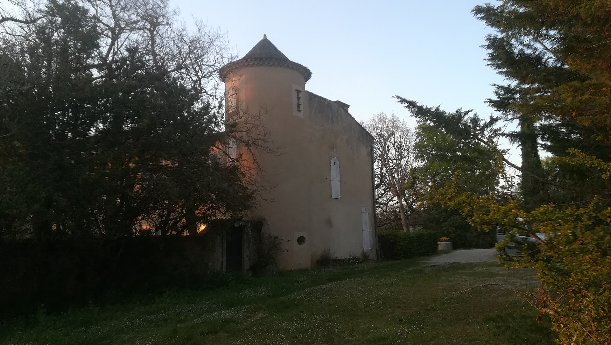

# 奥托酒庄

奥托酒庄（Domaines Ott*）是普罗旺斯桃红最容易被认出的名字之一。它不是一个单一庄园，而是一个由三处产业组成的家族品牌：塔拉多的 Château de Selle、拉隆德莱莫尔的 Clos Mireille，以及勒卡斯特莱的 Château Romassan。三处都产桃红，也产少量白与红，但对外接待主要集中在各自的酒窖与品鉴室，其中 Château de Selle 是最常被安排的一站。需要先分清“品牌”“庄园”与“可参观地点”，否则很容易把地图上的一个点当成整家企业。

图：奥托酒庄所在的普罗旺斯风貌配图。图片：Robert Brink，CC BY-SA 3.0，via Wikimedia Commons（[原图页面](https://commons.wikimedia.org/wiki/File:Lavender_field_and_Mont_Ventoux.jpg)）。这张照片用于说明产区环境与访问语境，不标定奥托酒庄的门店、酒庄或活动现场。

## 一个名字，三个庄园

官方叙述把品牌的起点放在约 130 年前，由 Marcel Ott 创立；真正进入普罗旺斯葡萄园的关键年份是 1912 年，那一年的收购让 Château de Selle 成为家族第一处普罗旺斯产业。此后 Clos Mireille 与 Château Romassan 陆续加入，形成今天“三种风土、一种光”的结构。三处分别落在瓦尔省的不同地带，酒款风格并不复制，而是各自对应土壤、坡向与海风。

对访客来说，这个结构有一个实际后果：预约、开放时间与联系电话都按庄园分开。Château de Selle 的电话是 +33 (0)4 94 47 57 57，Clos Mireille 与 Château Romassan 各有另一组号码。不要拿一个庄园的开放时间去套另一个庄园，也不要把“Domaines Ott*”当作一个可以随时走进去的单一酒厂。

## 石灰岩、片岩与米斯特拉尔

普罗旺斯的[产区](ref:provence)形象常被简化成“阳光与薰衣草”，真正决定酒体的是风和石头。米斯特拉尔风从罗讷河谷一路吹向地中海，干燥、稳定、有时猛烈，它让葡萄园少受霉菌压力，也让成熟度更集中；代价是风大的年份要更注意防护与整形。CIVP 的资料把 Côtes de Provence 的底土分成两大系统：北与西以石灰岩为主，南与东则出现结晶岩与片岩。Château de Selle 所在的塔拉多属于前者，葡萄园里混杂石膏、砂岩与红黏土，排水快，根系要往深处找水。

这种土并不“肥沃”，产量也不高，却让桃红保有清晰的酸度与矿物感。CIVP 将整个 Côtes de Provence 划成八个生产盆地，并承认五个补充地理命名：Cru Sainte-Victoire、Fréjus、La Londe、Pierrefeu 以及 2019 年新增的 Notre-Dame des Anges。它们不是营销标签，而是写在[法定产区](ref:appellation)规则里的地理细分。

## 桃红怎样保持浅色

[桃红葡萄酒](ref:rose)的颜色来自葡萄皮接触，而不是靠调配。普罗旺斯的主流做法是直接压榨：果实采收后尽快压榨，让汁液与皮只接触极短时间，随后低温发酵。这样得到的颜色偏浅，带灰粉、洋葱皮或浅鲑鱼色调，香气以柑橘、白花、红醋栗和少量核果为主，口感干而清爽。它与“短浸渍”并不矛盾：浸渍时间越短，颜色越淡，单宁也越少。

这套工艺对采收时机很敏感。过早，酸度尖锐、香气不足；过晚，酒精度上升，颜色也变深。CIVP 的统计显示，Côtes de Provence 约有 51% 的葡萄园已获有机或 HVE 认证，说明“轻提取”不只是风格选择，也与减少投入、保持果实干净有关。想理解杯中为什么是这种浅色，先看压榨与温度，再看土壤。

## 到塔拉多酒窖参观

Château de Selle 的地址是 5093 Route de Flayosc, 83460 Taradeau, France。行政上它在塔拉多，不在莱博德普罗旺斯；从莱博德普罗旺斯出发，开车约一小时。酒庄的品鉴室与酒窖在周一至周五开放：9:30–12:00 与 13:00–16:30；Clos Mireille 与 Château Romassan 的时段不同，分别是 9:00–12:00 与 14:00–17:00。

预约导览约 45 分钟，官方写明仅接受预订，且以当日名额为准。酒窖是当代建筑，采用重力输送与按地块分开的小罐发酵，参观时能看到不锈钢罐、橡木大桶与陶质球形容器并存。这类细节比“酒庄历史”更能解释酒的风味：不同材质与容积改变温度与氧气接触，桃红与红葡萄酒因此走不同的路径。

## 酒单与年份

奥托的核心是桃红，但产品线并不只有一款。Château de Selle 的桃红以柑橘、白花、矿物感为主，适合作为整条路线的基准；Clos Mireille 靠海，酒体通常更圆，咸感更明显；Château Romassan 位于勒卡斯特莱附近，结构更紧。红葡萄酒则展示同一片土地的另一面，单宁与香料感更突出。

压榨后的汁液要尽快降温并澄清，低温发酵通常控制在 12–16°C：温度过高会损失白花与柑橘香气，过低则容易发酵停滞。酒庄要在香气、酸度与口感之间找平衡，这也是同一产区不同酒庄风格差异的技术来源。年份差异在普罗旺斯尤其明显。炎热干燥的年份糖分上升快，采收提前；多雨年份则要更仔细地筛选果实。不要把“浅色”当成“没有味道”：真正好的普罗旺斯桃红在浅色背后仍有浓度与长度。若在酒窖品鉴，先横向比较三处庄园的桃红，再挑一款红酒作对照，比单喝一款更容易建立坐标。

## 从莱博德普罗旺斯出发

从莱博德普罗旺斯到塔拉多，最顺的走法是先走 A8 或 D554 向南，再转入 D54 一带的乡村道路；沿途葡萄园与松林交替，导航直接输入地址即可。酒庄的经纬度暂未从官方页面取得，坐标以官方渠道为准；停车与集合点以预约确认邮件为准。

这一站适合安排在工作日上午，因为酒窖与品鉴室周末通常不开放。若要继续往东到科朗斯看[米拉沃酒庄](ref:mirav)，两地之间约一小时车程，可以把两站压在同一天。参观时不要触摸桶架与管道，试饮后不要驾车；普罗旺斯的乡村道路窄且弯多，指定司机或包车比“只喝一点”更稳妥。开放时间、预约方式与价格以官方渠道为准，本页核验日期 2026-11-09。

对照阅读：[普罗旺斯](ref:provence)、[原产地命名（appellation）](ref:appellation)。

相关条目：[桃红葡萄酒](ref:rose)。

**关键事实。**

| 项目 | 内容 |
| --- | --- |
| 一句话定位 | 普罗旺斯桃红的老牌名号，旗下有 Château de Selle、Clos Mireille 与 Château Romassan 三个庄园；可参观的是塔拉多的 Château de Selle，工作日上午开放酒窖与品鉴，导览约 45 分钟且须预约 |
| 地址 | 5093 Route de Flayosc, 83460 Taradeau, France |
| 城市/国家 | 莱博德普罗旺斯 / 法国 |
| 营业状态 | 已核验营业 |
| 官网 | domaines-ott.com |

## 参考资料

- [Domaines Ott 参观页](https://www.domaines-ott.com/en/visit-us-in-provence)：三处庄园的地址、开放时段与预约电话。
- [Château de Selle 庄园页](https://www.domaines-ott.com/en/domaine-chateau-de-selle)：1912 年收购、93 公顷、土壤与酒窖工艺。
- [Côtes de Provence 产区页](https://www.vinsdeprovence.com/les-appellations/cotes-de-provence)：1977 年 AOP、面积、市镇与地理命名。
- [Vins de Provence 官网](https://www.vinsdeprovence.com/)：普罗旺斯三个产区与葡萄酒旅游入口。

补充阅读：[葡萄酒](ref:c-extra-1)。

## 相关图像

图：米拉沃酒庄相关实景照片。图片：Hernandlucas，CC BY-SA 4.0，via Wikimedia Commons（[原图页面](https://commons.wikimedia.org/wiki/File:Ch%C3%A2teau_de_Miraval_3.jpg)）。关联图像：奥托酒庄。
