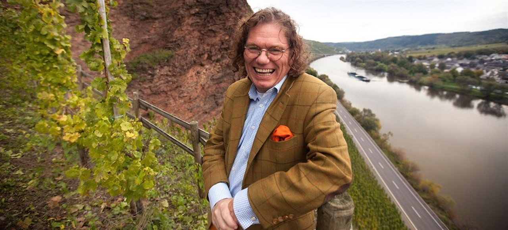
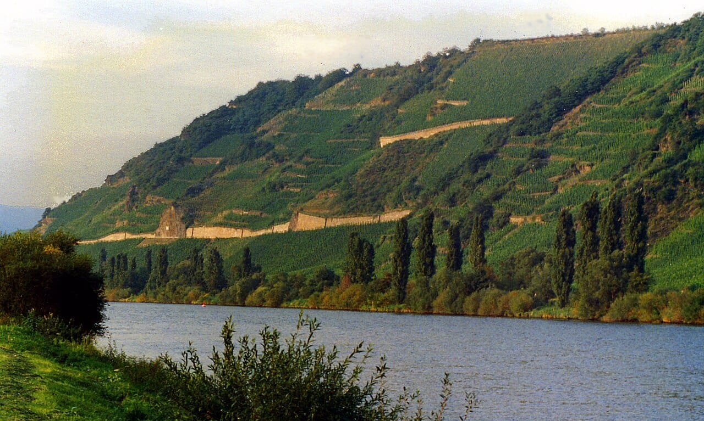

# 卢森博士酒庄

卢森博士酒庄（Weingut Dr. Loosen）在摩泽尔中段的贝恩卡斯特-库斯，具体位置是圣约翰内斯霍夫（St. Johannishof）。它不是一个对游客全天开放的主题公园，而是一座仍在运转的家族酒庄：酒窖、住宅与坡地葡萄园连在一起，门口没有大型游客中心。把它当成“来喝一组板岩雷司令的地方”，比当成“景点”更准确；地址与联系方式可在官方页面核对，坐标以官方渠道为准。

图：卢森博士酒庄。图片：Weingut Dr Loosen，CC BY-SA 4.0，via Wikimedia Commons（[原图页面](https://commons.wikimedia.org/wiki/File:Ernst_Loosen.jpg)）。

## 圣约翰内斯霍夫：贝恩卡斯特坡脚的一座老庄园

圣约翰内斯霍夫的名字来自附近的 Bernkasteler Johannisbrünnchen 泉眼，酒庄的旧称也与此有关。庄园位于贝恩卡斯特-库斯镇内，背后就是中摩泽尔的陡坡；从镇中心步行可达，但坡上的葡萄园并不适合随意进入。对访客来说，这里最大的优势是“集中”：接待、品鉴与酒窖在同一个院落，不需要在村里来回找门牌。

酒庄的官方联系页只列出 St. Johannishof, 54470 Bernkastel/Mosel、电话与邮箱，没有固定参观时段；区域旅游资料则提示参观需预约。因此本页把营业状态标为 unknown：酒庄当然在运营，但“何时可以进入、如何参观”没有在官方页面确认，出发前必须邮件询问，不能按固定开放时间安排行程。

## 两百年家族与 1988 年后的转向

酒庄在同一家族手里超过两百年，与摩泽尔的 Prüm 家族也有亲缘联系。1988 年，Ernst F. Loosen 接手管理，随后把酒庄从“稳定的大厂”转向更强调地块与老藤的方向；1993 年，酒庄成为 VDP 成员。官方叙述把这一段写成“回归摩泽尔传统”，核心不是复古，而是把未嫁接老藤与历史名园重新放到酒标中心。

这一步的背景是 20 世纪的德国葡萄酒市场：产量与甜度一度比地块更重要。卢森博士的选择相反——降低产量、区分地块、把干型与甜型分开表达。今天看它的酒单，入门款仍然易饮，但真正撑起声誉的是 GG 与 RÉSERVE；前者强调地块，后者强调长期陈年。理解这段历史，才知道它的“传统”是经过选择的传统。

## 三块板岩：蓝、红、灰

酒庄用板岩颜色做入门系列，这在摩泽尔很常见，但卢森博士把它做成了清晰的对照。蓝板岩（Blauschiefer）通常给更紧的酸度、矿物与青柠感；红板岩（Rotschiefer）偏香料、红果与更宽的质地；灰板岩（Grauschiefer）则更圆、更柔和，常以 feinherb 呈现。三款酒不是“等级”，而是三种口感方向。

板岩的影响不只在颜色。风化程度、土层厚度与坡向都会改变保水与升温速度；同一片坡上，深根老藤比年轻藤更能稳定产量。参观时若有机会走到坡脚，注意脚下的碎石与坡度，再回到品鉴室对比三款酒，会比只看酒标更容易记住差别。

还有一点值得注意：三色板岩并不是三块固定地块的“官方分级”，而是酒庄为了让消费者建立口感坐标而做的组合。不同年份的配比与来源可能变化，喝到的那瓶未必与上一年的“蓝板岩”完全一样。把它当作风格入口，而不是法定产区名，就不会误读。

## 从入门款到 Großes Gewächs

酒单大致分三层：入门款（包括三色板岩）、村庄与名园级，以及 Großes Gewächs（GG）。GG 来自 Erdener Treppchen、Bernkasteler Lay 等历史名园，要求更严的产量与采收标准，风格以干型为主；RÉSERVE 则是另一条线，用更长时间的陈年换取更干、更少甜感的质地，官方叙述提到 48 个月的等待。

价格与年份会随市场变化，酒庄官网的在线商店会列出当前批次。若只想建立参照，建议先买三色板岩各一瓶，再选一款 GG；把“地块差异”与“等级差异”分开喝，才不会把价格当成唯一线索。陈年后的 GG 常出现蜂蜜与湿石感，年轻时则更柑橘、更锋利。

也要留意 GG 的适饮窗口：它并不是“越老越好”，而是酸度、果味与矿物在几年内重新平衡。若只有一瓶，先确认年份与酒评，再决定现在喝还是继续放；开瓶后如果香气封闭，可以隔一段时间再试，不必急着下结论。

## 残糖分级与“干型”的读法

卢森博士的酒单同时使用两套语言：一套是传统的 Prädikat 分级（Kabinett、Spätlese、Auslese 等），按采收糖度；另一套是干型标注（trocken、feinherb）。同一款酒可能既有 Prädikat 名，又标干型，这不是矛盾，而是“原料成熟度”与“成品残糖”两件事。

读标的顺序可以是：先看品种与地块，再看 Prädikat，最后看干型标注。Kabinett trocken 与 Kabinett feinherb 的差别在残糖，不在采摘难度；Auslese trocken 在德国并不常见，遇到时要确认是否真的发酵到干。对新手而言，最容易被“Kabinett”误导成“一定甜”，其实它只是最轻的一档。

## 预约、到访与购买

地址是 St. Johannishof, 54470 Bernkastel-Kues, Germany；官方页面给出电话 +49 (0) 6531-3426 与 info@drloosen.de。由于官网没有列出固定参观时段，建议提前写明人数、日期、想喝的酒款与是否开车，再等酒庄回复。不要把“到门口再问”当成计划，尤其在采收期与周末。

如果只为买酒，官网商店比到访更省事；如果为品鉴，确认是否收费、是否含酒窖、能否带儿童。开车的人应吐酒，贝恩卡斯特到维尔廷根一带的乡道窄且多弯。购买时注意运输与关税，含糖型与干型混装也要考虑温度。

相关条目：[雷司令](ref:riesling)。

未嫁接老藤与三色板岩是酒庄的风土叙事，不等于每款酒都来自同一块园；购买前要按酒标上的园名与等级核对，别把酒庄故事当成酒款说明。

## 另见

- [摩泽尔产区](ref:mosel)：中摩泽尔的地块、板岩与河湾。
- [雷司令](ref:riesling)：高酸、品种香与陈年潜力。
- [白葡萄酒](ref:white-wine)与[橡木桶陈年](ref:oak-ageing)：理解发酵容器与陈年对风格的影响。

开放时间、预约与价格以官方渠道为准，页面核验日期 2026-11-09。

补充阅读：[葡萄酒](ref:c-extra-1)。

对照阅读：[摩泽尔](ref:mosel)、[白葡萄酒](ref:white-wine)。

**关键事实。**

| 项目 | 内容 |
| --- | --- |
| 一句话定位 | 德国摩泽尔贝恩卡斯特-库斯圣约翰内斯霍夫的一座家族酒庄，以未嫁接老藤、蓝红灰三色板岩与 Großes Gewächs 雷司令为核心；参观与品鉴需先通过官方渠道预约确认 |
| 地址 | St. Johannishof, 54470 Bernkastel-Kues, Germany |
| 城市/国家 | 贝恩卡斯特-库斯 / 德国 |
| 营业状态 | 待核验 |
| 官网 | drloosen.de |

**来源与边界。** 本页关于「卢森博士酒庄」的关键事实，主要由以下来源交叉核对：Weingut Dr. Loosen（St. Johannishof, 54470 Bernkastel/Mosel 地址、电话与邮箱；页面未列出固定参观时段，故营业状态标为 unknown）、Verband Deutscher Prädikatsweingüter（VDP 成员身份与圣约翰内斯霍夫地址）、Mosel Tourismus（酒庄位于贝恩卡斯特-库斯、参观需预约的区域旅游信息）等 4 条来源。产品、地址或营业状态变化较快时，以 drloosen.de 的最新页面为准；价格、批次与状态会变，涉及这些字段时以页面所列来源的最新版本为准。正文为项目自写，来源只作核验，不复制原文。

## 相关图像

图：Mosel vineyard in Tittenheim。图片：Phillip Capper，CC BY 2.0，via Wikimedia Commons（[原图页面](https://commons.wikimedia.org/w/index.php?curid=4168277)）。关联图像：卢森博士酒庄。
