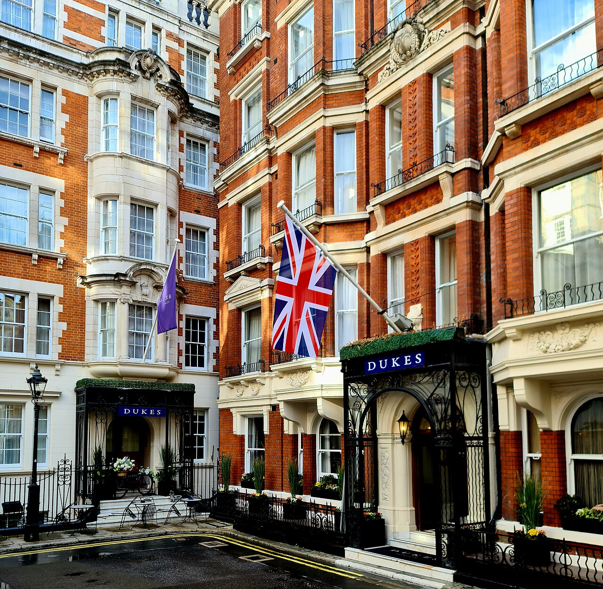

# 杜克斯酒吧

杜克斯酒吧在圣詹姆斯广场 35 号的杜克斯酒店（Dukes Hotel）内，是伦敦少数把“只做一件事”做成招牌的酒店酒吧。它空间不大，服务围绕一张手推车展开：冷冻的酒杯、冷冻的酒，以及一片柠檬皮。第一次来的人常以为这里卖的是“邦德同款”，实际上店里更在意的是温度、稀释与节奏。

图：杜克斯酒吧。图片：Ricardalovesmonuments，CC BY-SA 4.0，via Wikimedia Commons（[原图页面](https://commons.wikimedia.org/wiki/File:Hotel_Dukes_London.jpg)）。

## 1908 年：杜克斯酒吧的关键起点
杜克斯酒店位于 St James's Place，门牌 35 St James's Place, London SW1A 1NY。官方页面把酒吧的历史写作“自 1908 年起坐落于圣詹姆斯”，因此本页把开业年记为 1908；不过酒吧的空间与经营形态在随后一个多世纪里经过多次调整，今天看到的是一间小型、老派、以桌边服务为核心的酒店酒吧，而不是 1908 年原样保留的房间。

伊恩·弗莱明在 1950 年代常到圣詹姆斯一带，杜克斯酒吧与“shaken, not stirred”这句邦德台词的关联，是店方与媒体反复讲述的传说。官方措辞也把它放在“legend has it”的层面：这能解释酒吧为什么出名，但不能当作弗莱明在此写下那句台词的证据。酒吧的长期主理人是 Alessandro，官方页面以“Alessandro 和他的团队”延续这一传统；具体人员与班次会变，出发前不必把某位调酒师当作必见项目。

## 空间与酒单

酒吧在酒店内，房间小，座位以扶手椅和沙发为主，地毯、深蓝色扶手椅与墙上的肖像画构成一种接近私人俱乐部的气氛。它没有舞池，也没有大声播放的音乐；服务生把材料放在小推车上推到桌边，在你面前完成最后的混合与倒杯。这个空间适合两个人说话，不适合十几个人庆祝。

酒单以 Dukes Martini 为核心。做法是把金酒或伏特加连瓶放在冷冻室，杯子也预先冷冻，倒酒时不加冰、不加水，因此没有常规摇酒带来的稀释；最后以柠檬皮表达香气。官方页面明确说“每一杯都用冷冻酒杯、更冷的酒，而且著名地不加冰”。《The Infatuation》则形容一杯里约有五份金酒，酒劲很足。除马天尼外，店里也做经典鸡尾酒，具体酒单以现场为准；不要期待一部长长的创意特调菜单。

## 怎么喝/点什么

第一次来，点一杯 Dukes Martini 就够了。先选金酒或伏特加，再告诉服务生你想要柠檬皮还是橄榄；如果你对苦艾酒敏感，可以直接说“very dry”或“just a rinse”。酒是冷冻的，入口会比常温马天尼更紧、更烈，慢慢喝，不要急着追加第二杯。

想比较风味，可以两个人各点一杯不同的基酒，分别要金酒与伏特加，再交换喝一口；这比一次点四杯更容易分辨差别。店里也做经典鸡尾酒，若不想喝马天尼，可以问当天能做什么，但不要把这里当成实验性调酒吧。酒吧不接受预订，全部现场入座；下午三点开门，傍晚前通常比晚上更容易找到位置。独自前来的客人可以要一本杂志，这是这家店照顾 solo 客人的小习惯。

## 杜克斯酒吧的地址与营业安排
地址是 35 St James's Place, London SW1A 1NY, United Kingdom，位于圣詹姆斯，介于 Green Park 与 Piccadilly 之间。最近的地铁站是 Green Park（Jubilee、Piccadilly、Victoria 线），步行约 5–7 分钟；从 Piccadilly Circus 步行约 8–10 分钟；也可从 Charing Cross 站步行约 12 分钟。

营业时间在官网两个页面上存在出入：酒吧专页写周一至周六 15:00–22:00、最后点单 22:00、22:30 关门；“Dukes Bar”介绍页则写周一至周六 15:00–23:00、关门前 45 分钟最后点单。两处都未列出周日营业时段，且酒吧曾于 2026 年 7 月 29 日至 8 月 16 日短暂停业，因此具体时段必须以官方渠道当日公告为准。酒吧只接受 walk-in，繁忙时段可能需要在门口等位。着装要求是 smart casual：运动装、短裤与 T 恤不允许，短袖有领衬衫（polo 衫）是例外；客人须年满 18 岁，除辅助犬外不允许带宠物。

酒店整体因分阶段翻新暂时关闭，但酒吧照常营业；翻新期间酒店入口暂不支持轮椅通行，行动不便的客人应先联系酒店确认安排。价格属于伦敦高端酒店酒吧一档，《The Infatuation》标为最高价位级别；具体酒价以菜单为准。酒吧营业状态与翻新期间的入口安排以 Dukes Bar 官方页面当日公告为准；页面核验于 2026-11-08。

## 礼仪与常见误区

最常见的误区是把“shaken, not stirred”当成店里的实际做法。杜克斯的马天尼不加冰、不稀释，服务生把冷冻的酒直接倒进冷冻杯里，与其说是“摇”，不如说是“倒”；邦德台词是文化传说，不是操作说明。第二个误区是把这里当成可以大声聚会的酒吧：房间小，客人多半在低声说话，十几个人进门会立刻改变整间房的音量。

第三个误区是穿得像白天逛街。smart casual 在这里是实际执行的门槛，短裤、运动装与人字拖可能被拒绝。第四，不要点一长串酒：马天尼的酒精度高，一杯已经足够，第二杯要慢；店里也不以“快速出杯”为目标。第五，不要把手推车服务当成拍照背景，服务生在你桌边操作时，保持距离、不要伸手碰杯子。最后，结账时确认服务费；英国酒店酒吧常在账单里加服务费，额外小费不是必须。

## 伦敦的周边街区
从酒吧出来，沿 St James's Place 走到 St James's Palace 与 Spencer House 一带，再往南进入 Green Park，可以走到 Buckingham Palace；往北穿过 Piccadilly 就是 Jermyn Street 与 Fortnum & Mason。若想把两家酒店酒吧放在同一次行程里，可以步行约十五分钟到梅费尔的康诺特酒吧，或再走一段到萨沃伊美式酒吧；三家店都在伦敦中心，但节奏完全不同：杜克斯最小、最安静，康诺特更设计化，萨沃伊更强调历史。圣詹姆斯一带的俱乐部建筑多，晚上街道安静，喝完不妨绕街区走一圈再叫车。

## 同城酒吧与延伸阅读
杜克斯酒吧适合与康诺特酒吧对照：前者把仪式压缩到一杯马天尼，后者把仪式扩展成整晚的空间体验。若对“酒店酒吧如何变成城市地标”感兴趣，可以再读萨沃伊美式酒吧。三间店都提醒人：在伦敦，酒店酒吧的价格买的不是酒量，而是时间、座位与服务。

## 同城酒吧与延伸阅读
- [伦敦经典酒吧步行路线](ref:london-classic-bar-walk)
- [萨沃伊美式酒吧](ref:american-bar-savoy)
- [干马天尼](ref:dry-martini)

补充阅读：[A Ginjinha](ref:c-extra-1)、[À la Mort Subite](ref:c-extra-2)。

相关条目：[伦敦经典酒吧步行路线](ref:london-classic-bar-walk)、[萨沃伊美式酒吧](ref:american-bar-savoy)、[干马天尼](ref:dry-martini)。
